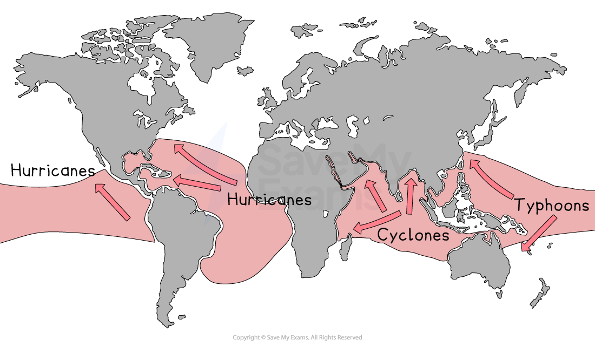

# Tropical Storms

## Specification link

This page covers sections 2.3.4 and 2.3.5 of the [CIE IGCSE Geography specification](https://www.cambridgeinternational.org/Images/718150-2027-2029-syllabus.pdf).

- **2.3.4 **- The distribution and impacts of tropical storms: cyclones, hurricanes, and typhoons.
- **2.3.5** - An evaluation of the strategies and techniques used to manage the impacts of tropical storms: preparation, planning, protection, and prediction.

## Tropical storm distribution

> **Spec point** — `spcpt_K2Cf8Snr6fpS3jrs` · The distribution and impacts of tropical storms: cyclones, hurricanes, and typhoons

## Tropical storm distribution

- Tropical storms are rotating, intense low-pressure systems (below 950mb)
- They are known as:

  - **Typhoons **in the South China Sea and west Pacific Ocean
  - **Hurricanes **in the Gulf of Mexico, Caribbean Sea and west coast of Mexico
  - **Cyclones **in the Bay of Bengal, Indian Ocean and northern Australia

*Distribution of tropical storms*

- Tropical storms need specific conditions to form

  - Ocean temperatures must be in excess of **27°C** and to a **depth **of **50-60 metres**
  - Between 5° and 30° north and south of the equator, but not on the Equator, as there is no *Coriolis effect*
- Tropical storms begin when tropical oceans are at their warmest, which is usually late summer (Nov-April in the southern hemisphere and June-Nov in the northern hemisphere)

  - The **Pacific Ocean** sees the **largest number** of tropical storms, followed by the Indian Ocean, and lastly, the Atlantic
  - Tropical storms in the **western Pacific** are the **strongest **

### Characteristics of tropical storms affect impacts

- Characteristics include:

  - **lasting 7-14 days**
  - **large diameter**
  - **heavy rainfall**
  - **high wind speeds (over 119 km/h)**
  - **high waves and storm surges**
- Tropical storms can **vary** in **diameter **(100 and 1000 km)** **but generally ranges from 200 to 500 km (124 to 311 miles)
- The winds of the storm are not constant across its diameter

  - The outer edges of the storm have lighter wind speeds, smaller and more scattered clouds, less intense rain, and temperatures begin to increase
  - The **strongest and most destructive winds** are found within the **eyewall,** with spiralling storm clouds, torrential rainfall and low temperatures
- Tropical storms are rated on the five-point ***Saffir-Simpson scale*** based on wind speeds
- Tropical storms are considered **major **when they reach **category 3** and have wind speeds between 111 and 129 miles (178 and 208 kilometres) per hour
- A category 5 storm can deliver wind speeds of more than 157 miles (252 km) an hour

### Impacts of tropical storms

- The  *primary* impacts of tropical storms

  - **High winds** up to 250 km/h uprooting trees, damaging infrastructure and buildings, causing injury and loss of life
  - **Intense rainfall **leading to flash flooding, damaging property and injuring people from fast-flowing water
  - **Storm surges** from large areas of low pressure allow the sea level to rise, which, combined with high winds, forces a large mass of water towards land. This erodes beaches, damage sea defences and contaminates farmland and freshwater
  - **Coastal flooding** caused by intense rainfall and storm surges can affect large areas of low-lying land, including farmland and the tourist industry
  - **Landslides **are triggered because soil becomes saturated due to intense rainfall and in areas with steep slopes, where the soil can no longer hold its position, sliding down the slope
- The *secondary * impacts of tropical storms include

  - People are made homeless, causing distress, poverty, ill health or death due to a lack of shelter. The cost of rebuilding can be expensive and some people may not have insurance
  - Blocked or destroyed roads prevent rescue and emergency vehicles, and aid from getting through
  - Life support systems, hospitals, shops and homes left without power supplies when electricity lines are damaged/destroyed
  - There are risks of fires and explosions as gas lines are broken
  - Clean water supplies are contaminated as sewage overflows, bringing the increased risk of waterborne diseases and death
  - Economic impact to business owners and potential unemployment as businesses are destroyed
  - Storm surge can drown people or cause injuries from the rushing water. Crops, livestock and habitats are destroyed, leading to a shortage of food and potentially famine
  
    - For instance, Cyclone Idai destroyed almost 715,000 hectares of crops in March 2019, resulting in food shortages in Mozambique
    - The cyclone killed over 1,000 people and affected over 15 million in Mozambique, Malawi, and Zimbabwe
    - It was the second-deadliest tropical cyclone ever seen in the southern hemisphere

> **Exam Hint**
> The storm's impact increases with the number of settlements and businesses, affecting more people and properties.

## Planning, preparation, protection, and prediction of tropical storms

> **Spec point** — `spcpt_Zg7H3g5XDKthf7k7` · An evaluation of the strategies and techniques used to manage the impacts of tropical storms: preparation, planning, protection, prediction.

## Planning, preparation, protection, and prediction of tropical storms

- The level of preparation depends on accurate forecasting and then communications but also level of development
- High-income countries (HICs) are able to spend money on preparation and high-tech systems of prediction and notification
- Middle-income countries (MICs) and low-income countries (LICs) may find it difficult to buy satellites and monitoring systems or communicate the information to people likely to be affected
- The **4 P's** are used to manage tropical storms: **planning, preparation, protection, and prediction **(for the future)
- These aim to:

  - Save lives
  - Protect personal property and infrastructure
- **Planning** provides long-term strategies to mitigate the impacts of tropical storms

  - Examples include building homes and businesses away from high-risk areas, such as the coast
  - Implement building standards to ensure structures can withstand hurricane-force winds and storm surges
  
    - Areas of poverty lead to poor construction of housing, which is more easily damaged: regardless of level of development
- **Preparation** involves taking measures to minimise risks and ensure readiness before a tropical storm strikes

  - Examples include developing emergency response plans
  - Stockpiling supplies and advising people to maintain a survival kit
  - Educating residents about evacuation routes and safety procedures
  - Reinforcing buildings and securing loose objects that could become projectiles in high winds are also sensible preparations
  
    - People who know how to react are more likely to survive, as they will evacuate safely
    - Survival kits can help those who are trapped to survive whilst waiting for help
- **Protection **involves creating structures that help lessen the effects of tropical storms on both people and property

  - This includes things like building seawalls, levees, and storm surge barriers that can prevent flooding
  - Mangroves are nature's own defence system and can play a crucial role in reducing the impacts of storm surges and coastal erosion when planted
  
    - Buildings are less likely to be destroyed, so less people will die from collapsing buildings and falling debris
    - Buildings will not be flooded This reduces the risk of flooding from overflowing rivers, or from storm surges
- **Prediction **is understanding where the storm is headed and how strong it’s going to be

  - Early warning systems alert those who are at risk
  - Meteorological agencies combine satellite imagery and weather models with historical data to predict how tropical storms will develop and move
  
    - This allows time for evacuation, which will reduce the number of deaths and injuries
    - It also means people can protect their homes and businesses from strong winds and flooding
