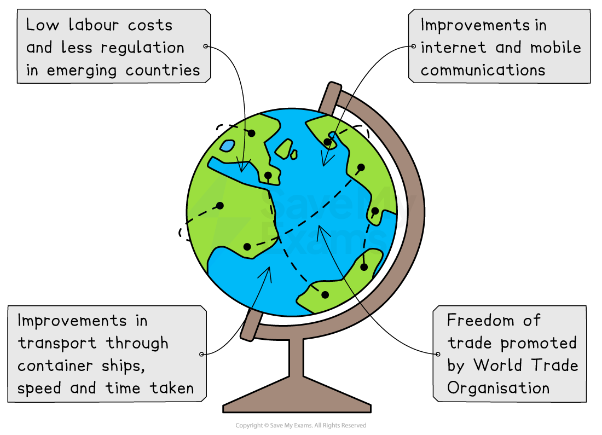
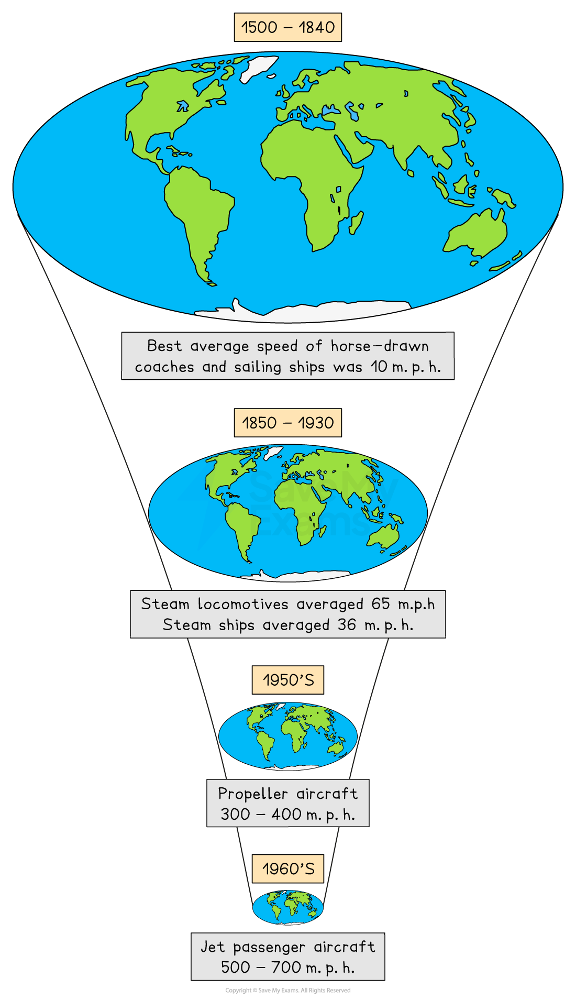

# Globalisation

## Specification link

This page covers section 9.2.1, 9.2.2 and 9.2.3 of the [CIE IGCSE specification](https://www.cambridgeinternational.org/Images/718150-2027-2029-syllabus.pdf) .

- **9.2.1  **- What is meant by globalisation?
- **9.2.2** - The key features of globalisation.
- **9.2.3 **- The impacts of globalisation on trade, transport, culture, communications and technology.

## Definition of globalisation

> **Spec point** — `spcpt_4wQprJwzByrKFZdy` · What is meant by globalisation.

## Definition of globalisation

- **Globalisation** is where the world has become more **interconnected **through the **processes **of economics, culture, politics, trade and tourism
- Globalisation is nothing new; trade between people, businesses and countries has always existed
- Whereas trade would have taken weeks, months or even years in the past, modern transport and communications have made trading and interaction almost **instantaneous**

*The reasons for globalisation *

**Flows** to places and populations are the result of **four **significant developments:

- Appearance of large **transnational corporations **(***TNCs***)
- Growth of regional economics and ***trading blocs***
- Development of modern transport networks
- Advances in ***IT*** and communications, particularly the ***WWW*** and the ***internet***

## Key features of globalisation

> **Spec point** — `spcpt_XWQp22D578mSQBhp` · The key features of globalisation

## Key features of globalisation

- Globalisation reduces the effect of political borders of countries

  - It makes them more ***interdependent***
- **Global cities** have developed, which are the focus of the world economy
- The improvements and developments in communication and transport have made globalisation what it is today—a** shrinking world**
- Overall, connections around the globe are:

  - **Faster – **faster** **speeds for talking, travel, money exchange, etc.
  - **Deeper – **connecting** **lives with faraway places
  - **Longer – **connecting links between places are further apart

*A key feature of globalisation is a shrinking world*

## Impacts of globalisation

> **Spec point** — `spcpt_44dcFj78ZgFcNZX6` · The impacts of globalisation on trade, transport, culture, communications, and technology.

## Impacts of globalisation

- Globalisation has a wide variety of impacts, both positive and negative

### Communications

- Mobile phones and the internet have transformed global communication
- As of 2024, more than** 60%** of the world's population has **access to the internet**
- Instant communication lets businesses work on different continents
- Rapid communication allows businesses to hire skilled workers from around the world, which leads to more business innovation
- **Faster communication** has also made it easier for people to get news from around the world
- This makes it easier to respond to disasters and brings attention to global problems like climate change

### Culture

- Today's world features international institutions with hundreds of member nations, such as the Olympic Games
- More people speak English as a second language
- Globalisation makes it easier for people from different cultures to share arts, sports, languages, and other things
- Businesses operate in different regions, taking into account the cultures of their consumers and employees
- People from different cultures can share their thoughts and improve global understanding when they interact with each other
- However, some people see globalisation as a threat to local cultures because Western practices often replace traditional ones, which can **damage cultural diversity**

### Trade

- Globalisation has opened up **new markets**, which has helped trade and business grow
- In the 1800s, advances in technology made **transportation cheaper**, which led to more foreign trade
- The end of the World War II in 1945 saw global trade rebound
- To help keep up the benefits of a connected world economy, the** International Monetary Fund (IMF) **and the **World Bank** were set up to encourage economic growth and cooperation
- Today, more than half of the world's total economic output comes from goods that are exported and imported across foreign borders

### Transport

- By making **global travel faster **and **cheaper**, trains, steamships, and jet planes allowed more people to experience different cultures and countries in the 19th and 20th centuries
- The '*shrinking world'* connects markets on a scale never seen before, boosting trade
- The expanding number of global goods requires complex logistical infrastructure
- Modern international trade requires a complicated ***supply chain***
- Every nation's roads and trains must connect to the global airport and shipyard network
- As economies grow, more goods and services are created and sold, and transport networks need more energy, increasing carbon emissions
- Shipping and *haulage* emit 60% of world emissions
- Businesses must invest more in ethical supply chains and sustainable transportation to meet legal requirements and environmentally conscientious customers

### Technology

- **Technological innovations** like steamships and the internet have fuelled globalisation, which in turn drives more technological advancement
- Our growing reliance on global connectivity makes communication essential for economic activity
- Infrastructure like **satellites **and **fibre optic cables **have further improved communication
- These technological advances can enhance growth and improve quality of life worldwide

  - For instance, governments, private companies, and multilateral organisations collaborated to produce effective vaccines for COVID-19
  - However, manufacturing processes and the use of fossil fuels for energy contribute to air and water pollution, impacting human health and ecosystems
- GPS and weather monitoring are made possible by the increasing number of satellites in low earth orbit.
- **E-waste** contains toxic materials that can leach into the soil and water because technology becomes quickly outdated and electronic devices are improperly discarded
- Satellite construction and launch have a large carbon footprint, and low-earth-orbit satellites pollute the night sky and harm wildlife

> **Worked Example**
> Suggest two reasons for the pattern shown in Figure 8a.  **[4 marks]**
> 
> 
> 
> **Answer**
> 
> The map shows that many parts of Africa experience slow internet speeds. **[1]**  This may be because many of these areas are still not very developed. **[1]**
> 
> Countries with high incomes, like the USA and Sweden, have good internet connections because they can afford to invest in infrastructure.  **[1]**  These countries depend on the internet for their businesses.  **[1]**
> 
> ### Marking guidance
> 
> - Ideas must be based on something from the map.
> - The command word '**suggest**' needs two reasons for the pattern shown on the map.
> 
> #### Mark allocation
> 
> - Each idea earns** 1 mark** for identifying a pattern on the map.
> - You earn the **second mark** by providing an explanation.
> 
> #### Alternative content
> 
> - The answer provided earlier is just one example of how to respond to this question. You could also include the following information in your answer:
> 
>   - Corruption in government causes a shortage of funding for infrastructure projects.
>   - The country or region is wealthy and has a strong R&D base.
>   - Conflict zones have slow speeds.
>   - The government lacks stability.
