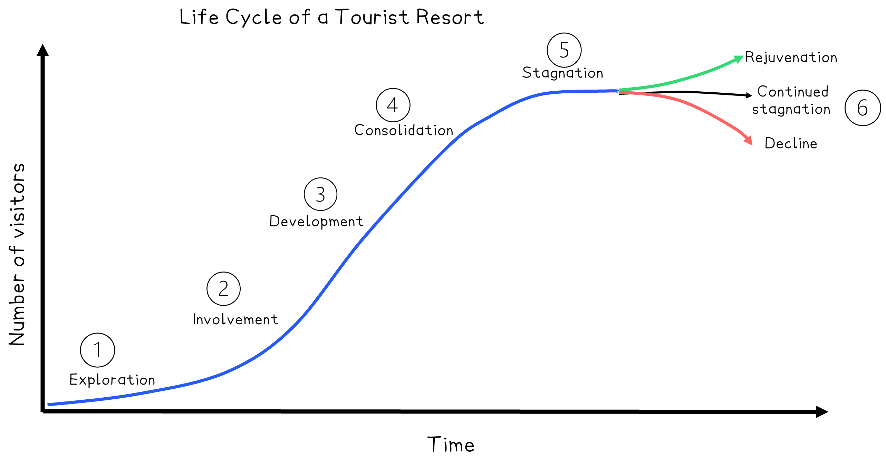

# Growth of tourism as an industry

## Specification link

This page covers sections 9.3.1 and 9.3.2 of the [CIE IGCSE specification](https://www.cambridgeinternational.org/Images/718150-2027-2029-syllabus.pdf).

- **9.3.1 **- The factors that have led to the growth of tourism as an industry.
- **9.3.2** - The Butler model and its strengths and limitations.

## Factors leading to the growth of tourism

> **Spec point** — `spcpt_nHdf4JQG8896Dz2B` · The factors that have led to the growth of tourism as an industry

## Factors leading to the growth of tourism

- **Tourism **is one aspect of **globalisation**

  - It is defined as time spent away from the home environment for leisure, business or professional reasons
- Over the last 50 years, ***mass tourism*** has expanded into a major global industry
- In 2024, the global tourism industry contributed *\$10.9 trillion* to the global economy, accounting for **10% of global GDP**
- International visitor spending in 2024 was **\$1.9 trillion**
- The tourism sector accounts for **357 million jobs** worldwide
- Europe remains the region with the greatest number of tourist arrivals, with France being the top destination
- Approximately, 53% of inbound tourism is for leisure (holiday); the second reason is for visiting friends and relatives
- The main reasons for the increase in tourism are as follows:

### Improvements in transport

- The development of **low-cost airlines**, such as **easyJet** and **Ryanair**, has led to cheaper and faster air travel
- Expansion of **high-speed rail networks** (e.g. TGV in France, Shinkansen in Japan)
- Larger **cruise ships** make international travel more accessible.
- There has been an improvement in road networks and an increase in the ownership of private cars

### Economic factors

- Increased **disposable incomes**: typically, both couples work, which boosts the amount of money coming into the home, especially in emerging economies (China, Brazil)
- Better **pay and leave benefits** in many countries: most workers now work less than 40 hours a week and have paid annual leave
- Globalisation has **expanded middle-class populations**, creating new tourist markets

### Technological developments

- **Online booking platforms** such as **Booking.com** and **Airbnb** have experienced significant growth
- **Instant access to information** via smartphones and the internet
- Technology lets tourists share their experiences** **and influence others (**social media effect**)

### Social and cultural change

- More people are becoming aware of and interested in **different cultures and environments**
- People now **value experiences** more than material goods
- **Specialist tourism** is growing, including eco-tourism, adventure tourism, and medical tourism

### Political factors

- There are **more open borders **and **fewer visa restrictions** in many regions
- **Political stability** in many regions has created new travel destinations
- **International agreements** make travel easier, like the Schengen Area in Europe

### Marketing and media

- National tourist boards launch **global marketing campaigns**
- Popular culture, like films and television, often highlight specific locations, such as New Zealand in 'The Lord of the Rings'

### Demographic factors

- The population is ageing and has the means and leisure to travel, a trend known as 'grey tourism'
- Young travellers taking gap years and backpacking
- There is an increasing trend of family mobility and multi-generational travel

### Environmental factors

- More people are showing interest in natural landscapes and wildlife tourism
- Awareness of sustainable travel options
- Physical landscapes such as:

  - Tropical islands with beaches, warm waters, coral reefs, palm trees, etc.
  - Mountains for hiking, walking and climbing
  - Coastal bays, headlands and cliffs, etc.

## What is the Butler model?

> **Spec point** — `spcpt_6nbN5jR2zW79H4WB` · The Butler model and its strengths and limitations.

## What is the Butler model?

- Richard W. Butler proposed the Butler Model in 1980 to describe the life cycle of tourist resorts
- It shows us how tourism changes over time and how destinations can handle their growth

*The Butler Model showing the life cycle of a tourist resort*

### Stages of the model

#### 1. Exploration

- Small numbers of **adventurous tourists** discover a location
- There are limited tourist facilities, and the impact is minimal

#### 2. Involvement

- Local people offer basic services like homestays and guiding
- Interest is growing through word of mouth

#### 3. Development

- Larger companies invest in the area
- Significant **tourism infrastructure** develops (hotels, transport)
- The number of** tourists increases** rapidly

#### 4. Consolidation

- Tourism becomes the **dominant economic***** *****activity**
- The destination **gains** a **strong reputation**; however, negative impacts such as pollution and congestion begin to emerge

#### 5. Stagnation

- Visitor numbers peak
- The environment and *l*ocal culture may suffer
- The resort loses appeal due to overcrowding and loss of authenticity

#### 6. Rejuvenation, continued stagnation or decline

- **Rejuvenation:** The destination reinvents itself by promoting **eco-tourism and heritage tourism**, attracting new markets
- **Continued stagnation: **The destination **invests** the **minimum amount** in infrastructure and services and fails to adapt to changing preferences
- **Decline:** Tourists go elsewhere, businesses close and the area deteriorates

## Strengths and limitations of the Butler model

> **Spec point** — `spcpt_jsRHnqrd27DcjbT8` · The Butler model and its strengths and limitations.

## Strengths and limitations of the Butler model

### Strengths of the Butler Model

- The Butler Model offers a clear visual representation of how tourism evolves.
- The Butler Model helps with planning and management by encouraging proactive rejuvenation.
- The Butler Model is flexible, as it can be applied to a wide range of destinations

### Limitations of the Butler Model

- This **model is simple** — real-world development rarely follows clear stages
- It does not consider **global shocks** like pandemics and terrorism that can suddenly change trends
- All destinations eventually **decline or rejuvenate**, but some **remain stagnant** or **stay stable **for long periods
- **External factors **such as climate change, political change, and economic crises are not well represented

### Using the Butler Model to promote sustainable tourism

- This approach allows planners to spot stagnation and put sustainable strategies in place early

  - Control the number of visitors (the *carrying capacity*)
  - Develop sustainable transport and lodging options
  - Help local communities so that tourism benefits everyone
  - Protect natural and cultural heritage
- Recognises the need for constant innovation to prevent stagnation and decline

### Is the model still relevant today?

- **Yes, **but there are some conditions
- New forms of tourism, such as **digital nomadism** and **remote eco-tourism**, make tourist life cycles more complex
- The model offers valuable insights for long-term planning, particularly in cities facing overtourism, such as Venice and Barcelona
- In the digital age, tourist destinations can quickly rise and fall, with stages compressing or repeating unpredictably
- **Sustainability** is now more important than when the model was first introduced
