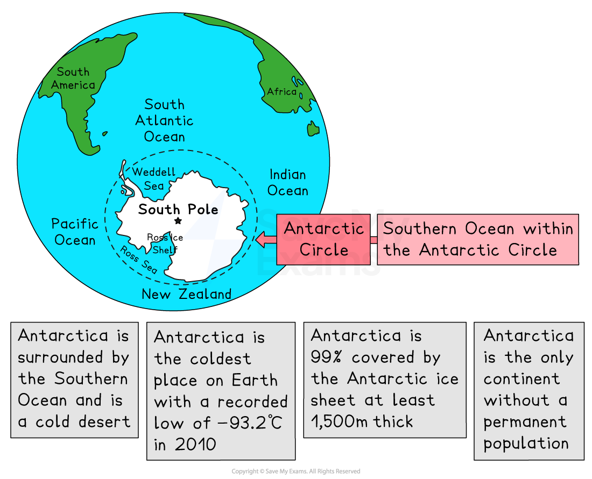
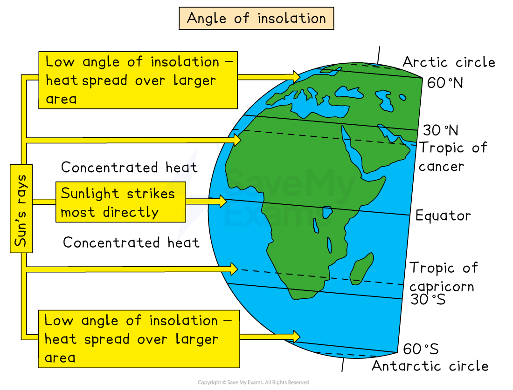
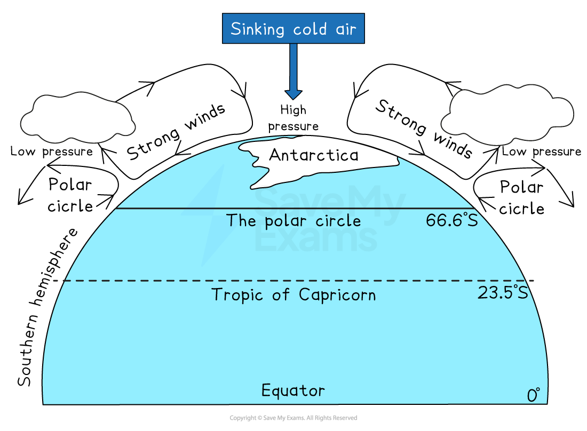
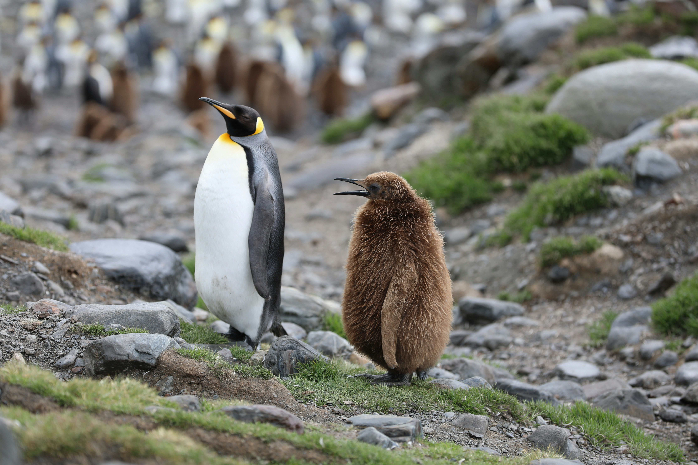
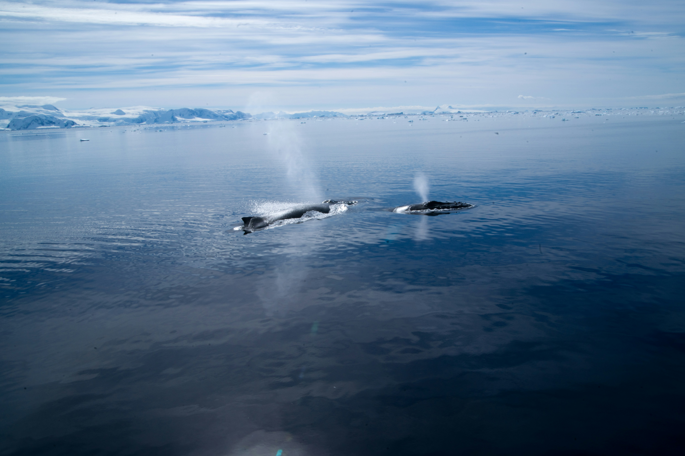

# Characteristics of the Antarctic Ecosystem

## Specification link

This page covers section 3.1.1, 3.1.2 ,3.1.3  and 3.1.4 of the [CIE IGCSE specification](https://www.cambridgeinternational.org/Images/718150-2027-2029-syllabus.pdf) .

- **3.1.1 **- The location of the Antarctic ecosystem.
- **3.1.2 **- The characteristics of the Antarctic climate: high pressure, the influence of latitude, angle of the sun, temperature, and precipitation.
- **3.1.3** - The features of the Antarctic ecosystem
- **3.1.4 **- The interrelationships between abiotic and biotic factors in the Antarctic ecosystem and how flora and fauna adapt to survive.

## Location of the Antarctic

> **Spec point** — `spcpt_Md4h37yZkHmCkW78` · The location of the Antarctic ecosystem.

## Location of the Antarctic

- **Antarctica** is located at the **South** **Pole** from 66.5° to 90° south of the Equator
- **Antarctica** is a vast and **remote continent surrounded** by the **Southern Ocean **within the **Antarctic Circle**
- It is considered the world's last wilderness, as it is mostly untouched by human activity because of its **harsh** **climate** and **extreme** **environmental** conditions

*Location of Antarctica and key facts*

## Characteristics of the Antarctic climate

> **Spec point** — `spcpt_5mj2fVYXdt8DwCgm` · The characteristics of the Antarctic climate: high pressure, the influence of latitude, angle of the sun, temperature, precipitation.

## Characteristics of the Antarctic climate

- Colder than the Arctic, with average summer temperatures of -28 °C

  - **Coastal **regions are warmer than inland, with a **mean annual temperature of -10 °C**
  - **Interior **mean annual **temperature **is **-43.5 °C**
  - **Average **seasonal temperature **range** is 8 °C to -60 °C
- The continent is a polar desert, receiving precipitation in the form of snow
- Annual **mean precipitation** is approximately **166 mm**

  - The interior mean precipitation rate is 50 mm
  - Whereas it is, on average, 200 mm at the coast
  - Humidity is usually low at 0.03%
  - During winter, more ice forms, and the continent can double in size
- The weather is variable and changes suddenly due to the strong katabatic winds from the interior

  - These winds blow snow around and can make visibility very poor

### Causes of the Antarctic climate

- The Earth is a sphere with a permanent tilt of 23.5° towards the sun
- Antarctica is at the furthest point from the Equator
- The **tilt **results in **distinct seasons **as the Earth orbits the sun

  - 24 hours of daylight as it faces the sun in the summer
  - 24 hours of darkness as it faces away from the sun in winter

*Angle of insolation affects the climate of Antarctica*

- Different areas of the Earth get different amounts of energy from the sun, known as ***insolation***
- Therefore, the **equator gains **solar energy, but the **poles **have a **deficit** of solar energy

  - This means that the sun's energy is less and has to warm a much larger area of land
  - This results in colder temperatures as you move north and south of the equator
  - As the** air **is **cold, **it **sinks **and creates **high-pressure areas **over both the poles
- The** permanent high pressure** over Antarctica means that **dry, cold air sinks** over the **interior **and **limits cloud formation and precipitation**
- At the **surface**, the cold, dry **air flows outwards **towards the low-pressure areas at the Antarctic Circle, **creating the strong, unpredictable** katabatic **winds**

*High pressure over Antarctica*

**The permanent high pressure over the continent brings cold, dry air and little precipitation**

## The Antarctic ecosystem

> **Spec point** — `spcpt_CVnJznRfHjvv2YdJ` · The features of the Antarctic ecosystem.

## The Antarctic ecosystem

- Antarctica has both *marine* and *terrestrial* ecosystems
- The abiotic features of the Antarctic affect the type and number of biotic (flora and fauna) organisms that can survive on the continent

### Key abiotic factors of the Antarctic ecosystem

- **Temperature**

  - Antarctica's extreme cold limits the types of organisms that can survive and impacts biological processes
- **Water availability **

  - Although there is plenty of ice and snow, liquid water is scarce in arid valleys and ice-free areas
- **Wind **

  - Antarctica's strong winds cause significant erosion and impact the distribution of organisms
- **Light**

  - Antarctica's long periods of darkness limit photosynthesis
- **Ultraviolet radiation**

  - Because the ozone layer is thinner over Antarctica, more UV radiation reaches the surface and harms organisms
- **Soil**

  - Antarctic soils are cold, dry, and nutrient-poor, which limits the growth of plants and other organisms
- **Marine environment**

  - Antarctica's marine ecosystem is rich in nutrients that are brought to the surface by ocean currents and support a complex *food web*

### Key biotic factors of the Antarctic ecosystem

- **Plant life**

  - The harsh cold temperatures, the frozen soil, and the scarcity of water in Antarctica **limit plant growth**
  - Antarctica's flora consists of algae, lichens, mosses, fungi, Antarctic hairgrass, and pearlwort

#### Adaptations

- These plants **can photosynthesize** in extremely **low temperatures** and have adapted in various ways

  - Most plants become ***dormant*** to survive the cold, dark winters
  - Plants are **small and round-shaped** to provide protection from the wind
  - Plants **flower and produce seeds** during the **long summer hours**, relying on **wind for pollination** as there are **no insects**
  - **Fungi, lichens, algae and mosses** have **simple root systems **and absorb water easily

- **Animals**

  - Antarctica's biotic components are mostly animal-based
  - The **Antarctic springtail** is the largest **dominant terrestrial animal** despite being **under 3 mm long** and living in the soil
  
    - This tiny soil *invertebrate* survives by producing antifreeze proteins that keep their body fluids liquid
  - **Fauna** includes penguins, seals, krill, various fish species, and seabirds, which are not considered terrestrial because they live on both land and sea

#### Adaptations

- **Animals **in the Antarctic have **adapted **to their ecosystem by developing features such as

  - Layers of** fur **and** insulating blubber** (fat)
  - Fat that builds up in the summer acts as an energy source during the long winters when food is limited
- Birds have **waterproof feathers**
- Many **birds migrate** to warmer areas in winter to find food or reproduce
- Many animals have **physical adaptations**, such as

  - Short legs and round, squat bodies
  - Large eyes for seeing prey in the ocean
- **Behaviours** such as penguins huddling together to stay warm and save energy

*King penguin and its chick*

Martin Wettstein on Unsplash

- **Marine ecosystems**

  - The Antarctic marine ecosystem is** rich in life**, including phytoplankton, zooplankton, and a wide variety of fish, krill, and marine mammals
  - It supports the **largest animal on Earth**, the **Antarctic blue whale**
  
    - This mammal can grow up to 29 metres long and weigh as much as 199 tonnes
    - The blue whale is a filter feeder, depending on microorganisms such as krill for its nutrition
    - The whale can eat up to four tonnes of krill every day, showing how nutrient-rich the waters of the Antarctic are

*The Antarctic waters are rich in nutrients to support Earth's largest mammal*

Torsten Dederichs on Unsplash

## Interrelationships in the Antarctic Ecosystem

> **Spec point** — `spcpt_cD7CPMCGgpzFhZZ8` · The interrelationships between abiotic and biotic factors in the Antarctic ecosystem and how flora and fauna adapt to survive.

## Interrelationships in the Antarctic ecosystem

- Although Antarctica may look empty, it is home to ecosystems full of connections between the biotic and abiotic
- Antarctica's **food web** is not as complex as in other parts of the world

  - ***Phytoplankton*** in the sea are the most important producers and form the basis of the ***food chain***
  - Krill sit at the bottom, with just a few top predators—like whales, seals, and penguins—sitting at the top
  - However, **krill** plays a huge role in keeping the whole ecosystem going and is known as a *keystone species*
  - Although it is a simple web, it is tightly connected; any changes to one species can quickly affect the remaining species
  
    - Phytoplankton > krill > fish > penguins
    - If phytoplankton stop photosynthesising, then krill cannot feed, which means fish have no food and penguins starve
- **Decomposers** such as bacteria, fungi, and small worms break down dead organisms, releasing nutrients that other organisms can reuse
- **Fungi and algae** live together in lichens, where the fungus protects the algae from drying out, and the algae makes food using sunlight

*Antarctic food web showing interrelationships of energy between prey and predator*
