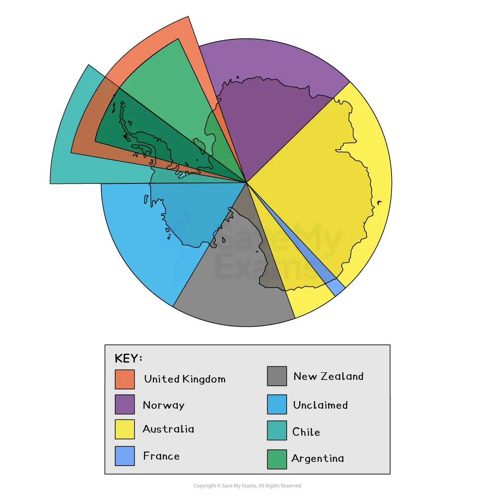

# Managing Threats to the Antarctic

## Specification link

This page covers section 3.2.3 of the [CIE IGCSE specification](https://www.cambridgeinternational.org/Images/718150-2027-2029-syllabus.pdf).

- **3.2.3 **- An evaluation of the strategies and techniques used to manage the Antarctic ecosystem, including sustainability. For example, international agreements and environmental impact surveys.
- For the Antarctic ecosystem, a detailed specific example is not listed; this is because the topic content is only based upon Antarctica.

## Managing threats to the Antarctic

> **Spec point** — `spcpt_w4VstZnnYgfffwnR` · An evaluation of the strategies and techniques used to manage the Antarctic ecosystem; including sustainable. For example, international agreements and environmental impact surveys

## Managing threats to the Antarctic

- Fishing and whaling in the **Southern Oceans** have been continuous since the 1700s
- As pressure on Antarctica grew, it was decided that *strategies* and *techniques* needed to be put in place to manage the area sustainably
- One of the most significant challenges is the sheer size of the area that needs to be managed and protected
- This makes it difficult to monitor any strategy or technique to guarantee that  international agreements are being kept

### Antarctic Treaty System (ATS)

- One strategy was the Antarctic Treaty
- The ATS is a set of international agreements that protect Antarctica for peace and science
- Signed in **1959** by 12 countries, it now has over 50 signatories
- The treaty:

  - Bans **military activity**, **nuclear testing**, and **mineral extraction**
  - Promotes **scientific research** and **international cooperation**
- The treaty designates Antarctica as a **global commons**—no one owns it

  - However, several nations have made territorial claims to particular parts of the continent – Australia, Chile, Argentina, Norway, France, New Zealand and the UK
  - Some of the claims overlap but none of them are universally recognised by the international community

*Map of territorial claims in Antarctica*

#### Evaluation of the ATS

- The treaty is highly successful at preventing conflict and resource exploitation but has **limited enforcement powers**

### Madrid Protocol (1991)

- Full name: **Protocol on Environmental Protection to the Antarctic Treaty**
- Its purpose is to protect **Antarctica’s environment** and regulate **human activities** (like science and tourism)
- **Key features:**

  - **Bans** mining and resource extraction
  - **Requires** Environmental Impact Assessments (EIAs)
  - **Promotes** waste reduction, biodiversity protection, and conservation of ecosystems
  - **Declares** Antarctica a 'natural reserve, devoted to peace and science'

#### Environmental Impact Assessments (EIAs)

- These are mandatory under the Madrid Protocol for any activity in the Antarctic ecosystem
- An Environmental Impact Assessment (EIA) is a process for evaluating the potential **environmental**, **social** and **economic** **impacts** and **sustainability** of a proposed **development project**
- The purpose of an EIA is to:

  - Identify and evaluate the potential impacts of the project on the environment
  - Develop **strategies** to ***mitigate*** or avoid those impacts

#### Evaluation of the Madrid Protocol

- The protocol sets out strict environmental rules, but will be **reviewed in 2048**, which may bring political challenges in the future

> **Exam Hint**
> Do not confuse the Madrid Protocol with the Montreal Protocol.
> 
> The **Madrid Protocol** refers to the environmental protection of Antarctica and is part of the Antarctic Treaty.
> 
> The **Montreal Protocol** refers to substances that deplete the ozone layer and **applies globally**, not just in Antarctica.
> 
> Remember:
> 
> **For managing human activity in Antarctica** → **Madrid Protocol**
> 
> **For reducing ozone damage globally** → **Montreal Protocol**

### CCAMLR – sustainable fishing

- **CCAMLR** is the Commission for the Conservation of Antarctic Marine Living Resources
- Its purpose is to manage **fishing quotas** to prevent **overfishing**, especially of **krill** and **toothfish**
- Uses **scientific data** to decide sustainable levels
- Protects **marine food webs** by limiting damage to non-target species
- **Evaluation**: Good science-based management, but **illegal fishing** is still a serious problem due to **remote monitoring difficulties**

### Marine Protected Areas (MPAs)

- These are ocean zones where human activity is restricted to protect ecosystems
- Some areas around Antarctica are **closed to fishing** or have strict rules Protect breeding grounds of species like **penguins, seals, and whales**
- **Evaluation**: Good for biodiversity, but only a small percentage of the Southern Ocean is protected—more MPAs are needed

### Ban on mineral and resource extraction

- It aims to stop mining, drilling or the extraction of minerals and oil
- **Prevents** large-scale environmental damage and pollution
- **Supports** the idea of sustainable use and preservation for future generations
- **Evaluation: **Effective now, but some countries (e.g. Russia, China) show interest in future exploitation if the rules change

### Scientific research regulations

- These are guidelines and permits for scientists working in Antarctica
- All research must include **environmental planning** and **waste management strategies**
- Scientific stations are encouraged to use **renewable energy** (e.g. solar panels) and **recycle** waste
- **Evaluation**: Research is well-managed, but **infrastructure development** still creates localised environmental impacts

### IAATO – tourism guidelines

- IAATO is the International Association of Antarctica Tour Operators
- It sets **voluntary rules** for tourist behaviour (e.g. keeping distance from wildlife, not leaving waste)

  - Such as limiting **ship sizes**, **landing sites**, and **group numbers**
- It aims to reduce the risk of **environmental damage** and **invasive species**. **Evaluation**: Largely successful due to cooperation, but not **legally binding**—compliance depends on the operator
