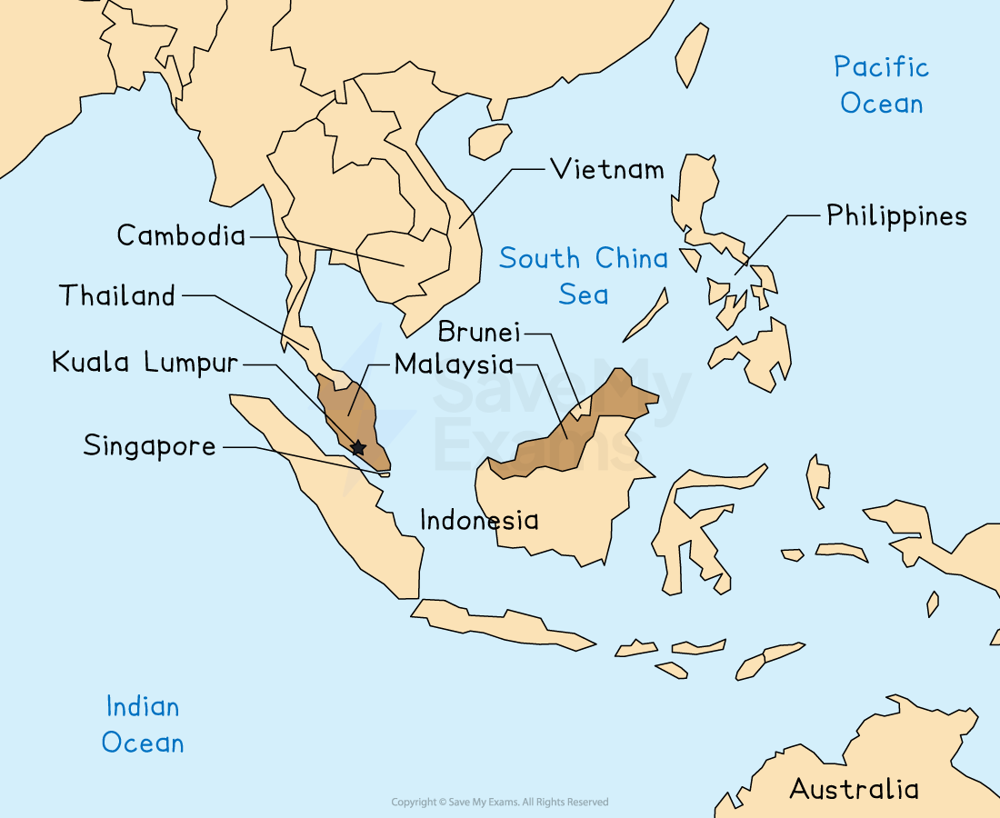

# Detailed Specific Example: Malaysian Rainforest

## Specification link

This page covers section 3.4.4  of the [CIE IGCSE specification](https://www.cambridgeinternational.org/Images/718150-2027-2029-syllabus.pdf) .

- **3.4.4 **- One detailed specific example of a named country or tropical rainforest area to include:

  - Threats to the tropical rainforest ecosystem.
  - Impacts of the destruction and deforestation of the tropical rainforest ecosystem.
  - The strategies and techniques used to manage the tropical rainforest ecosystem; including sustainable.

## Introduction - Malaysian rainforest

> **Spec point** — `spcpt_FXkzCzzM6D9DrHcb`

## Introduction - Malaysian rainforest

- Malaysia is located in Southeast Asia

*Location of Malaysia*

- Almost 70% of the land is covered by tropical rainforest

### Climate

- The climate of Malaysia is typical of tropical rainforest climates

  - **High rainfall **and **high temperatures **all year round

*Climate Graph of Kuala Lumbar, Malaysia*

- The Malaysian rainforest has** **a **high biodiversity** with over:

  - 15,000 plant species, including 5,500 flowering plants and 2,600 tree species
  - 750 bird species
  - 250 mammal species
  - 350 reptile species
  - 190 amphibian species
  - 350 fish species
  - 1000 butterfly species

## Threats to the tropical rainforest in Malaysia

> **Spec point** — `spcpt_mbR8dW83xD9BCnw6` · "One detailed specific example of a named country or tropical rainforest area to include:
• threats to the tropical rainforest ecosystem
• impacts of the destruction and deforestation of the tropical rainforest ecosystem
• the strategies and techniques used to manage the tropical rainforest ecosystem; including
sustainable"

## Threats to the tropical rainforest in Malaysia

- It is estimated that Malaysia has the fastest rate of deforestation in the world
- Since 2000, an average of over 140,000 hectares of forest has been felled and cleared each year
- The main threats to the rainforest in Malaysia include:

### Logging

- Malaysia is the largest exporter of **tropical *****hardwoods***
- Although Malaysia has environmental protection policies, there is still evidence of illegal logging in areas of Borneo
- **Selective logging** is the dominant type of logging but this requires road construction and settlements, which result in deforestation

### Energy

- The construction of dams to provide** hydroelectric power** results in the flooding of large areas of forest
- The **Bakun Dam** will result in 700 km 2  of land being underwater in Sarawak, Malaysia

### Mining

- Tin mines are widespread and require deforestation not only for the mine itself but also for road construction
- An iron ore mine planned for the **Som Forest Reserve** will result in the deforestation of over 60 hectares
- There is also drilling for oil and gas

### Commercial plantations

- Malaysia exports over 30% of the world's **palm oil **and is the second-largest producer
- Many palm oil processors are now adopting a **zero-deforestation policy** so that they do not buy palm oil from deforested areas. However, **clear felling permits **are sometimes used in Malaysia to clear land and then sometime later another company will plant palm oil

### Settlements

- Up to 1980, people were encouraged to move to rural areas from the cities to try and reduce the pressure on urban areas

  - This led to the deforestation of approximately 15,000 hectares of rainforest

### Subsistence farming

- This can sometimes involve **slash and burn,** where areas are cleared using fires; these can sometimes get out of control and destroy large areas of rainforest

## Impacts of the destruction of tropical rainforest in Malaysia

> **Spec point** — `spcpt_N7MPNXp6Xq3ZpDfv` · "One detailed specific example of a named country or tropical rainforest area to include:
• threats to the tropical rainforest ecosystem
• impacts of the destruction and deforestation of the tropical rainforest ecosystem
• the strategies and techniques used to manage the tropical rainforest ecosystem; including
sustainable"

## Impacts of destruction of the tropical rainforest in Malaysia

### Soil erosion

- Without the tree roots to bind the soil, the soil is more easily eroded by wind and rain
- Exposed soil is more vulnerable to the* leaching* of nutrients and the soil becomes **less fertile**

### Loss of biodiversity

- Habitats are destroyed and the ecosystem is affected by deforestation so the variety of plants and animals decreases
- Oil Palm plantations lead to a 35% reduction in species
- **Orangutans, pygmy elephants, Sumatran rhinos,** and **Malayan tigers** are all endangered

### Local climate change

- Reduced transpiration and evaporation leads to a decrease in precipitation and an increase in temperatures
- Rainfall patterns become less reliable and more extreme

### Global climate change

- The felling of the trees leads to a decrease in the absorption of carbon dioxide
- Increases carbon dioxide concentrations in the atmosphere and as this is a greenhouse gas, this increases human-induced climate change
- The use of fire for clearance also increases carbon dioxide emissions

### Indigenous communities

- Indigenous communities such as the **Orang Asli and Temiar** have been forced off land
- Pollination of fruits has reduced due to a decrease in pollinating insects and animals such as bats

  - This has reduced the available food sources
- In Kuala Koh village in 2019, at least 15 Indigenous **Batek** died after an outbreak of disease possibly transmitted by loggers working near the village

## Strategies to protect the tropical rainforest in Malaysia

> **Spec point** — `spcpt_zvRktFMgfQNDVpFt` · "One detailed specific example of a named country or tropical rainforest area to include:
• threats to the tropical rainforest ecosystem
• impacts of the destruction and deforestation of the tropical rainforest ecosystem
• the strategies and techniques used to manage the tropical rainforest ecosystem; including
sustainable"

## Strategies to protect the tropical rainforest in Malaysia

- The implementation of a range of strategies to protect the tropical rainforest is increasing sustainability in Malaysia
- Since 2001 the **Malaysian Timber Certification Council (MTCC) **has certified 349 timber companies

  - This means they are using sustainable management methods to fell timber

### Education

- Education provides people with information about the importance of conserving the rainforest
- It also informs people of the damage deforestation can do
- Several education strategies have been implemented:

  - Increased **education** programmes
  - The **Ministry of Education** has developed resources for integrating **environmental education** into the school curriculum.
  - They also have partnerships with **NGOs** such as the **World Wildlife Fund (WWF) **and** IGOs **such as** UNESCO**

### Community involvement

- Increased involvement of local communities in forest conservation
- Recognition of Indigenous community land rights
- Support of small-scale economic activities among Indigenous communities such as the **Rungus:**

  - **Gombizau village – **bees and honey
  - **Bavanggazo village – **ecotourism

### Selective logging and management system

- Selective logging has replaced clear felling in many areas
- The process involves:

  - Identification of the trees to be felled and the direction of felling. This avoids damaging other trees
  - Only trees of a certain size are selected for felling
  - Felling is carried out
  - A survey following felling leads to a treatment plan to restore any damage

### Ecotourism

- The introduction of ecotourism provides income for local communities and educates visitors
- The **Sungai Yu Forest Reserve** is one example where visitors can:

  - Camp with the **Batek** Indigenous community, who are semi-nomadic
  - Collect data about wildlife to help reduce poaching
- Ecotourism involves:

  - Members of the local community as guides, which provides them with an income
  - Use of local materials for building
  - Sustainable management of water, energy and waste
  - Small groups which reduce the damage to the environment

### Biosphere Reserves and National Parks

- Reserves and national parks are areas where no development or deforestation is allowed
- **Penang Hill Biosphere Reserve** attracts over 1.6 million visitors annually
- It consists of the:

  - Core area: 6,304 ha
  - Buffer zone: 2,213 ha
  - Transition zone: 3,964 ha
- It includes one of the last coastal rainforests in Malaysia
