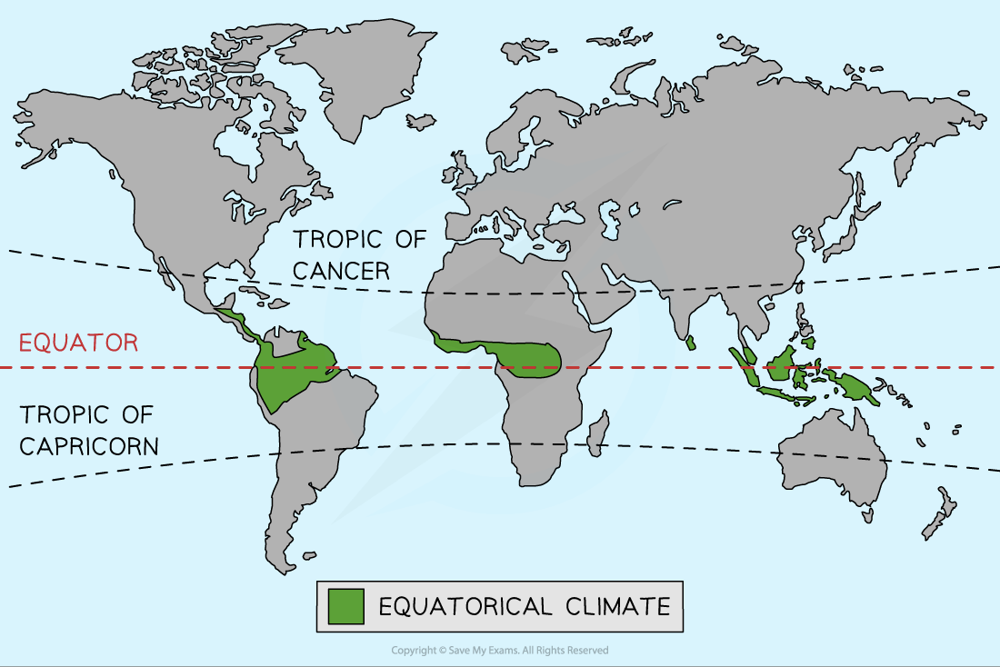
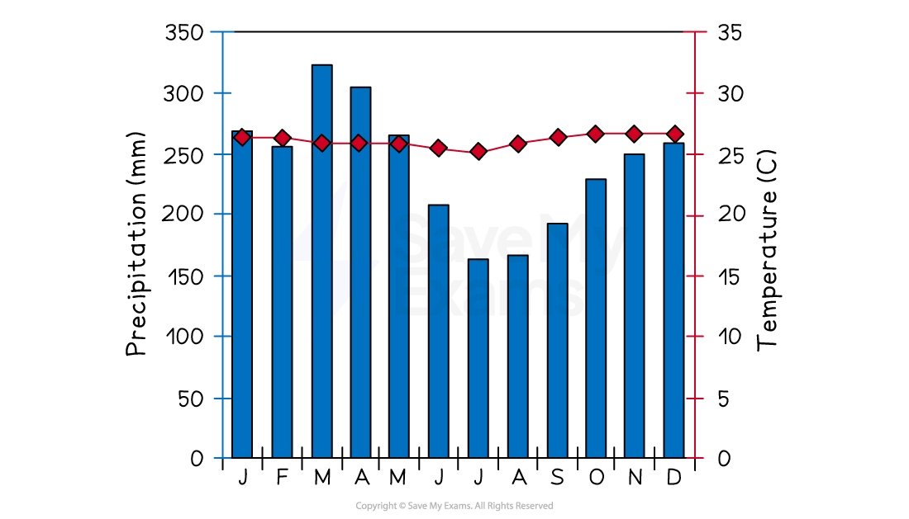
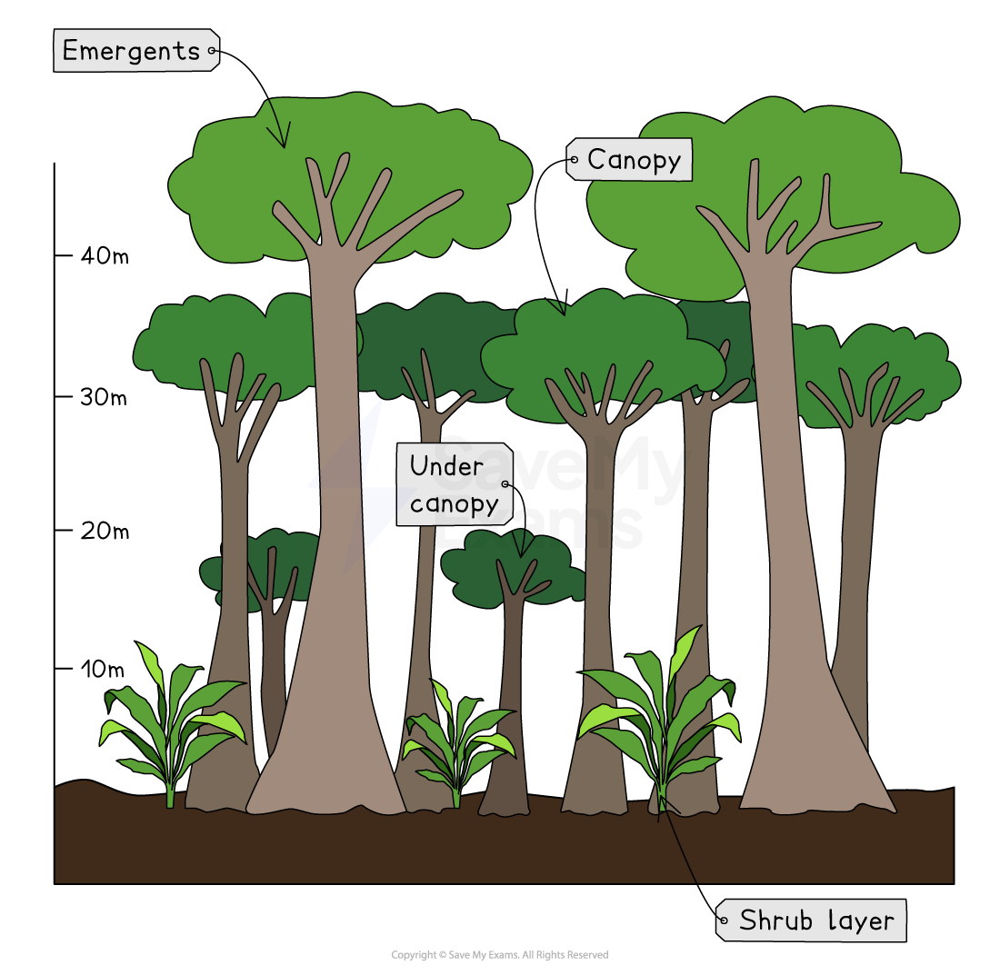
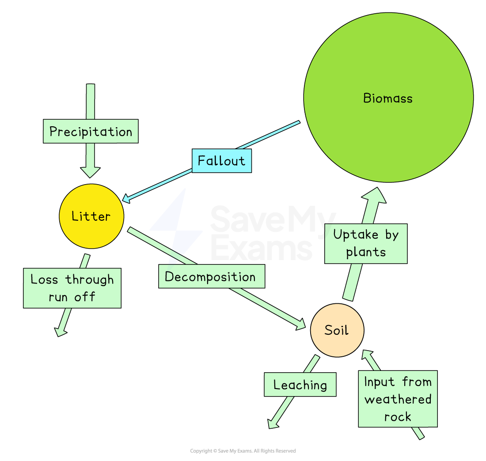
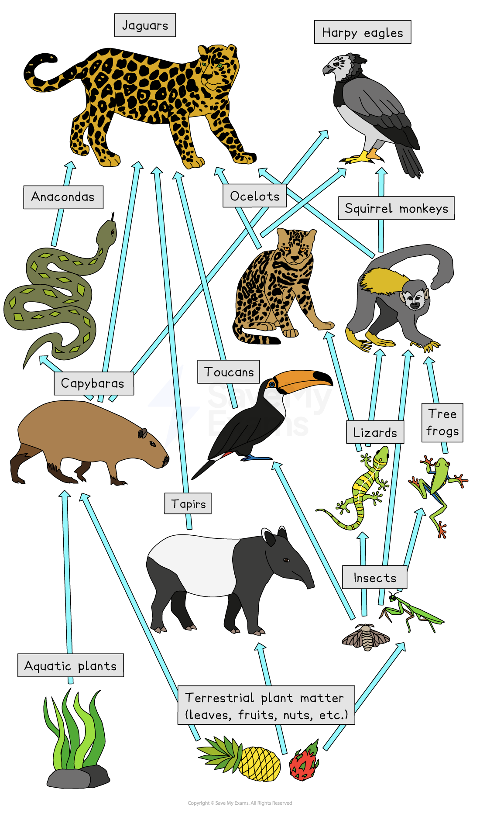

# Characteristics of the Tropical Rainforest

## Specification link

This page covers section 3.3.1 , 3.3.2, 3.3.3 and 3.3.4 and  of the [CIE IGCSE specification](https://www.cambridgeinternational.org/Images/718150-2027-2029-syllabus.pdf).

- **3.3.1**- The global distribution of tropical rainforests.
- **3.3.2** - The characteristics of the equatorial climate: overhead sun, low pressure, convectional rainfall, temperature, latitude.
- **3.3.3** - The characteristics and structure of the tropical rainforest ecosystem.
- **3.3.4 **- The interrelationships between abiotic and biotic factors in the tropical rainforest ecosystem and how flora and fauna adapt to survive.

## Global distribution of tropical rainforests

> **Spec point** — `spcpt_X5R8KpP6D5t4Mn2m` · The global distribution of tropical rainforests.

## Global distribution of tropical rainforests

The** tropical rainforest (TRF) **biome is mainly found in a band between 15° north and 15° south of the equator within the **equatorial climate zone**

- Covering only 6% of the Earth's surface, the main areas of tropical rainforest ecosystems are in the following countries:

  - **Amazon**
  
    - The largest remaining rainforest on Earth is usually associated with Brazil but covers parts of seven other countries
  - **Central America**
  
    - Including** **parts of Belize, Costa Rica, El Salvador, Guatemala, Honduras, Nicaragua, and Panama
  - **Central Africa**
  
    - Including Cameroon, the Central African Republic, the Republic of Congo, the Democratic Republic of Congo (DRC), Equatorial Guinea and Gabon
  - **Indo-Malaysia**
  
    - Including Malaysia, Indonesia and several other countries in South-East Asia

## Characteristics of equatorial climates

> **Spec point** — `spcpt_zCGJRMBVn2JKSdJR` · The characteristics of the equatorial climate: overhead sun, low pressure, convectional rainfall, temperature, latitude.

## Characteristics of equatorial climates

### Equatorial climate distribution

*Distribution of the equatorial climate*

### Equatorial climate characteristics

#### Location

- Low latitudes
- Within the Tropics, 23.5° north and south of the equator
- Amazon in South America, New Guinea, South-east Asia, and the Zaire Basin

#### Annual precipitation

- Over 2,000 mm

#### Temperature range

- Low range of mean monthly temperatures: 26-28 °C
- Constant high temperatures
- ***Diurnal*** range is about 7 ºC

*Climate graph for Iquitos, Peru*

#### Seasons

- No seasons—hot and wet all year round

#### Humidity

- High, usually over 75-80%

#### Prevailing winds

- Winds blow into the equatorial region from high-pressure areas to the north and south.
- The winds from the north blow from the northeast, and the winds from the south blow from the southeast
- The winds are known as the** trade winds**

#### Factors influencing the equatorial climate

- There are a range of factors that influence the climate, including:

  - The midday sun is almost directly overhead all year, meaning there is maximum ***insolation***
  - Low pressure all year leads to rising air, condensation, cloud formation, and high precipitation levels
  - Dense vegetation cover leads to high levels of evaporation and transpiration
  - The warm air stores large amounts of water vapour until the temperatures start to cool in the late afternoon, which then leads to heavy, daily convectional rainfall

> **Worked Example**
> Figure 1 shows the distribution of the equatorial climate.
> 
> 
> 
> *Distribution of the equatorial climate*
> 
> Describe the distribution of the regions with an equatorial climate.
> 
> [2]
> 
> > *When describing distribution answers should refer to specific features such as the location in relation to the equator, tropics or other lines of latitude as well as country/continent names*
> 
> **Answer**
> 
> - Places with an equatorial climate are located on the equator. **[1] **Including areas in South America, Africa and south-east Asia. **[1]**

## The tropical rainforest ecosystem

> **Spec point** — `spcpt_S4YgqSDdN7sFBmwD` · The characteristics and structure of the tropical rainforest ecosystem. 

## The tropical rainforest ecosystem

### Biodiversity

- TRFs contain the **highest biodiversity **of plants and animals on Earth

  - Estimates range from over 50% to 80% of the world's plant and animal species
  - One 10 km2 area can contain up to 1,500 flowering plants, 750 species of trees, 400 species of birds and 150 species of butterflies

### Structure of the tropical rainforest

- The TRF has five distinct layers:

  - ground layer (0 m)
  - shrub layer (3-4 m)
  - under canopy (15 m)
  - canopy (30 m)
  - emergents (45-55 m)

*Tropical rainforest structure*

> **Exam Hint**
> You may be asked to describe the rainforest vegetation characteristics. As well as adaptation features, remember to include information about the different layers and heights of each layer.

## Interrelationships in the tropical rainforest

> **Spec point** — `spcpt_QhDZnnHrH8jhw93v` · The interrelationships between abiotic and biotic factors in the tropical rainforest ecosystem and how flora and fauna adapt to survive.

## Interrelationships in the tropical rainforest

### Nutrient cycle

- The TRFs have a continual growing season with **high rainfall **and **high temperatures **all year round
- The nutrient cycle in the TRF is rapid

  - Trees and plants lose their leaves all year round
  - The high level of moisture and high temperatures lead to **rapid decomposition**
  - Plants grow quickly, which leads to the rapid uptake of nutrients from the soil

*Tropical rainforest nutrient cycle*

- The result of this rapid nutrient cycle is that the soil in the TRF is not very fertile
- This is because the nutrients are quickly used by the plants

### Food web

- As with all ecosystems, the TRF has a complex food web, which includes:

  - producers
  - primary consumers
  - secondary consumers
  - tertiary consumers

*Tropical rainforest food web*

### Adaptations

- The plants and animals within the TRF are very well adapted to the climate conditions

#### Plant adaptations

- **Waxy leaves with drip tips**

  - These ensure that rainwater runs off the leaf and does not remain, which would encourage mould growth or break the leaf
- **Buttress roots**

  - These large roots above the ground help to support the very tall trees because the roots below the surface are shallow
- **Lianas**

  - Vines which use the tall trees as support to reach the sunlight
- **Epiphytes**

  - Plants which grow on trunks and branches of trees and get nutrients from air, rain or debris accumulating around the plant
- **Straight, smooth trunks**

  - To reduce the number of epiphytes using the tree

#### Animal adaptations

- **Sloth**

  - Algae grow in the fur of the sloth, helping to camouflage it
- **Toucan**

  - Has a large bill to reach and cut fruit from the branches of trees
- **Primates**

  - Have prehensile tails to help them climb trees
- **Gecko**

  - Have large, flattened toe pads with sticky scales which allow them to grip the smooth tree trunks
- **Stick insects**

  - Their stick and leaf shapes help them to be camouflaged

###
