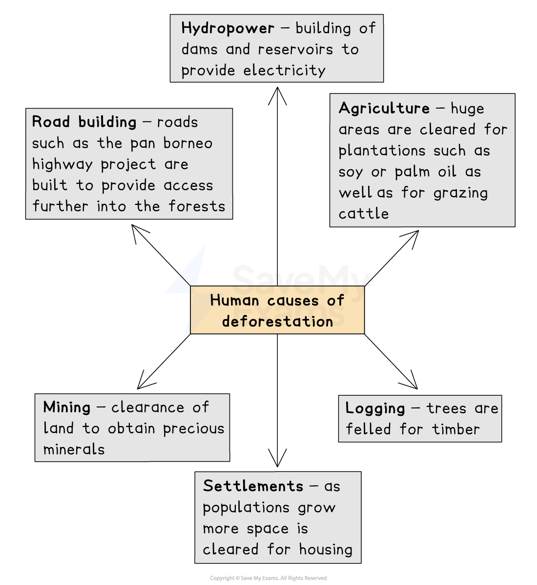
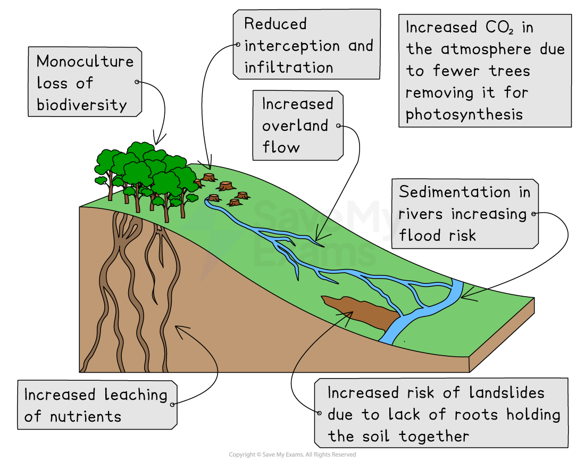
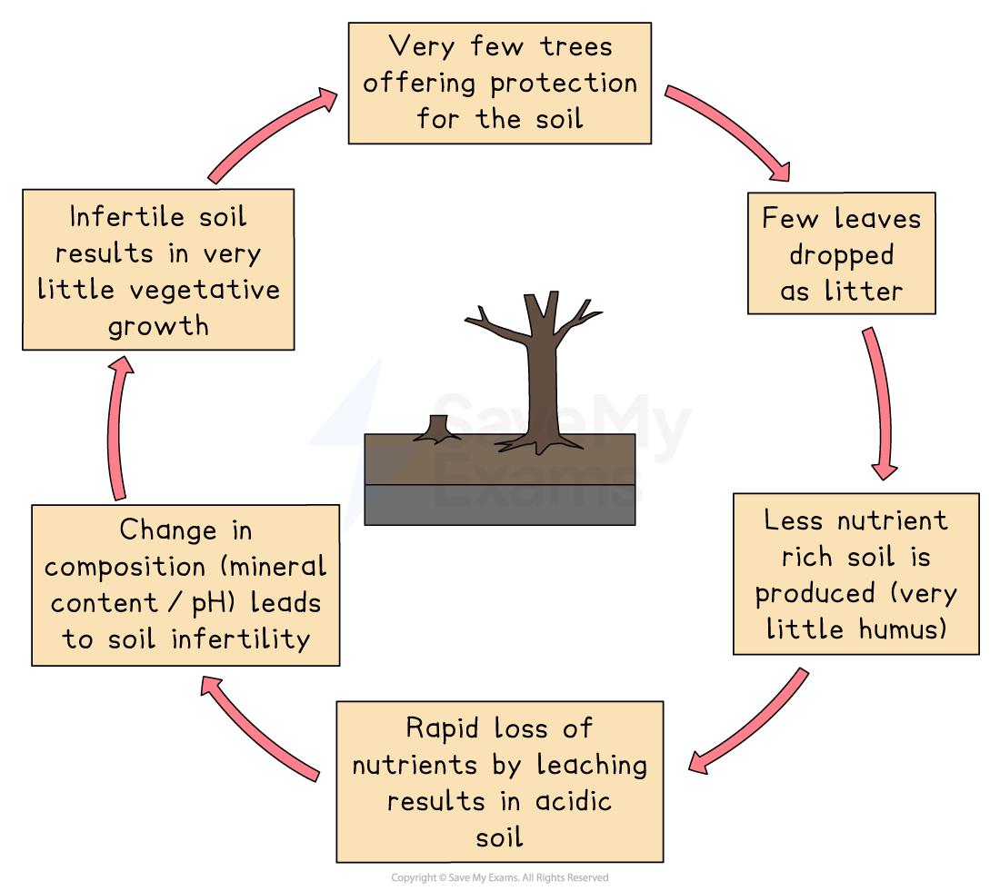

# Threats to the Tropical Rainforest

## Specification link

This page covers section 3.4.1 , 3.4.2 and 3.4.3  of the [CIE IGCSE specification](https://www.cambridgeinternational.org/Images/718150-2027-2029-syllabus.pdf) .

- **3.4.1 **- The threats to tropical rainforest ecosystems, for example, deforestation, resource exploitation, logging, road and railway building, cattle ranching, hydroelectric power, farming, settlements.
- **3.4.2** - The impacts of the destruction and deforestation of tropical rainforest ecosystems.
- **3.4.3 **- An evaluation of the strategies and techniques used to manage the tropical rainforest ecosystem; including sustainable

## The main threats to the tropical rainforest

> **Spec point** — `spcpt_6xnFfGypvWh5r8qr` · The threats to tropical rainforest ecosystems, for example, deforestation, resource exploitation, logging, road and railway building, cattle ranching, hydroelectric power, farming, settlements.

## The main threats to the tropical rainforest

- There are six main human causes of deforestation
- **Wildfires** are a natural cause of deforestation:

  - However, the frequency and severity of wildfires have increased this has been linked to human-induced climate change

*Causes of deforestation*

> **Exam Hint**
> It is important to remember that deforestation is often the result of a combination of factors that all affect one another rather than a single cause. For example, the growth of settlements also leads to more land being cleared for agriculture to support the people in the settlements.

> **Worked Example**
> Figure 1 shows the reasons for deforestation of the tropical rainforests in Africa and South America.
> 
> 
> 
> Use Figure 1 to compare the percentage of deforestation in Africa and South America for both types of agriculture. Refer to data in your answer.
> 
> [3]
> 
> > *In this question one mark is given for using data. If an answer does not include data the maximum mark awarded will be two.*
> 
> > *The answer should not include any explanation of the difference the question only asks for a comparison.*
> 
> **Answer**
> 
> In South America commercial agriculture is responsible for 66% of deforestation whereas in Africa it is responsible for  much less **[1]**  at 35% **[1]**. In Africa subsistence agriculture is responsible for more deforestation at 40% whereas in South America it is only 18%. **[1]**

## Destruction of the tropical rainforest

> **Spec point** — `spcpt_YrBXFKRmyrfh7hqv` · The impacts of the destruction and deforestation of tropical rainforest ecosystems.

## Destruction of the tropical rainforest

### Environmental impacts of deforestation

- Many of the impacts of deforestation are environmental, including:

  - Areas that have been deforested are planted with ***monoculture,*** which reduces **biodiversity**
  - **Interception** and **infiltration** decrease which reduces **evapotranspiration** and as a result **precipitation** decreases
  - This also increases overland flow which leads to soil erosion and ***sedimentation*** of the rivers
  - Sediment builds up on riverbeds reducing their capacity and increasing the flood risk
  - Lack of **interception** increases the leaching of nutrients
  - Fewer trees increase the amount of CO₂ in the atmosphere, adding to the **enhanced greenhouse effect**
  - Soils become less fertile and drier
  - They may turn reddish brown due to increased iron oxide

*Main impacts of deforestation*

### Impact on the nutrient cycle

- The majority of nutrients in the tropical rainforest are held in the biomass
- When trees and vegetation are cleared by deforestation, the main store of nutrients is removed

*Effects of deforestation on the nutrient cycle*

#### Social impacts of deforestation

- Indigenous communities have less land to sustain their traditional way of life. This means:

  - Land does not get the opportunity to recover
  - Less food is available
  - Improved quality of life for some people due to increased income and jobs
  - Indigenous communities may give up their way of life, leading to a loss of culture and traditions
  - Increased risk of landslides which can destroy homes and block roads
  - Loss of potential medicines
  - Increased risk of flooding settlements

#### Economic impacts of deforestation

- More jobs available in mining, forestry, agriculture and HEP
- Increased income for the country through the export of goods from the forest – minerals, timber, crops
- Almost a quarter of Brazil's GDP comes from activities in the deforested areas of the Amazon

## Managing the tropical rainforest

> **Spec point** — `spcpt_dw99GvwSnb2NdFs2` · An evaluation of the strategies and techniques used to manage the tropical rainforest ecosystem; including sustainable

## Managing the tropical rainforest

- Concerns about the rapid deforestation of tropical rainforests have led to a range of sustainable management strategies
- Strategies can be on an international, national or local level

### International strategies

- **UN Forum on Forests** was established in 2000 and is committed to the management, conservation and sustainable development of all types of forests
- The UN Sustainable Development Goals include the sustainable management of forests
- International treaties protect certain areas such as the **Central Amazon Conservation Complex (CACC), **which is a World Heritage Site. This means hunting, logging, fishing and access are limited
- Trade restrictions on endangered species and timber have been imposed

  - The **Convention on International Trade in Endangered Species of Wild Fauna and Flora (CITES) **aims to ensure that international trade in specimens of wild animals and plants does not threaten the survival of the species
  - The **International Tropical Timber Agreement (ITTA)** promotes sustainable forest management and restricts the trade in rainforest hardwood timber
  - The **Forest Stewardship Council (FSC)** approves wood from sustainable sources
- **Debt reduction – **countries are relieved of some of the debt in return for protecting rainforests** **

  - **Debt-for-nature swap**. In 2010 the USA converted US\$13.5 million of debt from Brazil into a fund to support the protection of the rainforest
- International organisations such as **Greenpeace** and** WWF** monitor deforestation

### National strategies

- **Brazil's Forestry code** requires landowners to maintain a proportion of their land as forests. However, the amount they need to maintain was reduced from 80% to 50% in 2012
- The** DETER **satellite was launched in 2004. It:

  - Started by sending reports every two weeks to rangers
  - In 2011 began sending daily reports, meaning that patrols could target areas of suspicious activity but it only detects areas over 250 m2 so people clearing simply reduce the size of the area they clear
  - It was estimated in some areas this led to a 60% decrease in large-scale deforestation
- There are **68 national parks** in Brazil. These are protected areas where the aim is to conserve the ecosystem
- The reforestation project is a part of the **Amazonia Sustainable Landscapes Project**. It aims to:

  - Restore 30,000 hectares of land to the forest by 2023, which will involve planting 73 million trees.
- The **Amazon Region Protected Areas (APRA) **resulted in a 68% increase in protected areas and Indigenous territories from 2004 to 2012
- **Selective logging **is where trees to be felled are selected, felled and removed, causing the least possible damage to surrounding trees

  - This reduces damage to the forest structure and helps to maintain biodiversity
- **Afforestation **to plant new trees replacing those which have been felled

### Local strategies

- **Agroforestry** combines agriculture with forestry, which means some trees remain, which:

  - Decreases deforestation
  - Provides shade as well as increases infiltration and interception, which reduces soil erosion
  - Provides organic matter from the trees and adds nutrients to the soil
  - Increases biodiversity due to the variety of plants grown
- **Education **of people involved in the exploitation and management of the rainforest
- There are small-scale projects like the **Marajo Project**, which preserves almost 90,000 hectares of Amazon forest. It includes:

  - A tree nursery to grow saplings to be planted in areas which have been cleared
  - The new trees help to bind the soil, reducing soil erosion and increasing infiltration
  - Agroforestry is encouraged, reducing the need to over-cultivate and clear areas. It includes:
  
    - A cooperative to support 49 local producers growing açai berries
    - Building of natural fish tanks to improve food security
  - School-based agricultural education and scholarships
- **Ecotourism **is becoming widespread. It includes:

  - A focus on the natural environment
  - Low impact on the environment – using materials from the local area and buildings to blend in with the environment
  - Supporting local communities – using locally grown food and employing local people
  - Education – to inform tourists about the local environment and wildlife
  - Gaining income which can be used for conservation
- Ecotourism rewards the local community for maintaining the rainforest rather than for cutting it down
