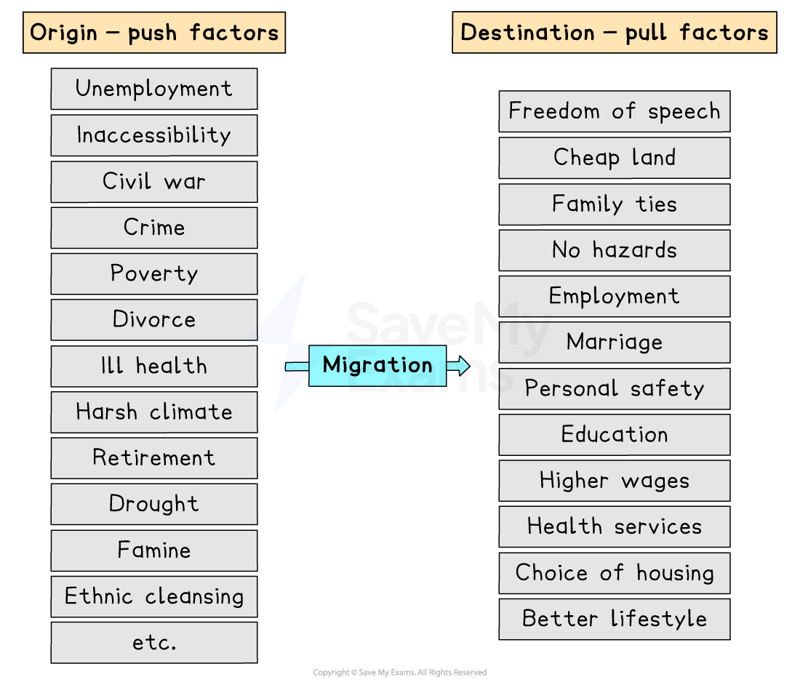

# Causes of Migration

## Specification link

This page covers section 6.3.2  of the [CIE IGCSE specification](https://www.cambridgeinternational.org/Images/718150-2027-2029-syllabus.pdf) .

- **6.3.2 **- Causes of migration, to include push and pull factors.

## Push and pull factors

> **Spec point** — `spcpt_XgCHvngKrq7km4KT` · Causes of migration, to include push and pull factors.

## Push and pull factors

- The main causes of migration are **push-pull factors**
- The push factors are things in a person's current situation that are 'pushing' them away

  - It is what makes the person consider moving from their **place of origin**
- The pull factors are the **perceived outcome**

  - It is what they imagine life will be in their **place of destination**
- Push-pull factors are **unique to each migrant,** depending on their reasons for moving
- These factors can be divided into:

  - **Social**
  - **Economic**
  - **Political**
  - **Environmental**

*Push and pull factors*

> **Exam Hint**
> - Remember do not just state the opposite when asked to give push-pull factors
> - Poverty is a push factor; however, everywhere has certain levels of poverty, so a pull factor could be better welfare and healthcare services
