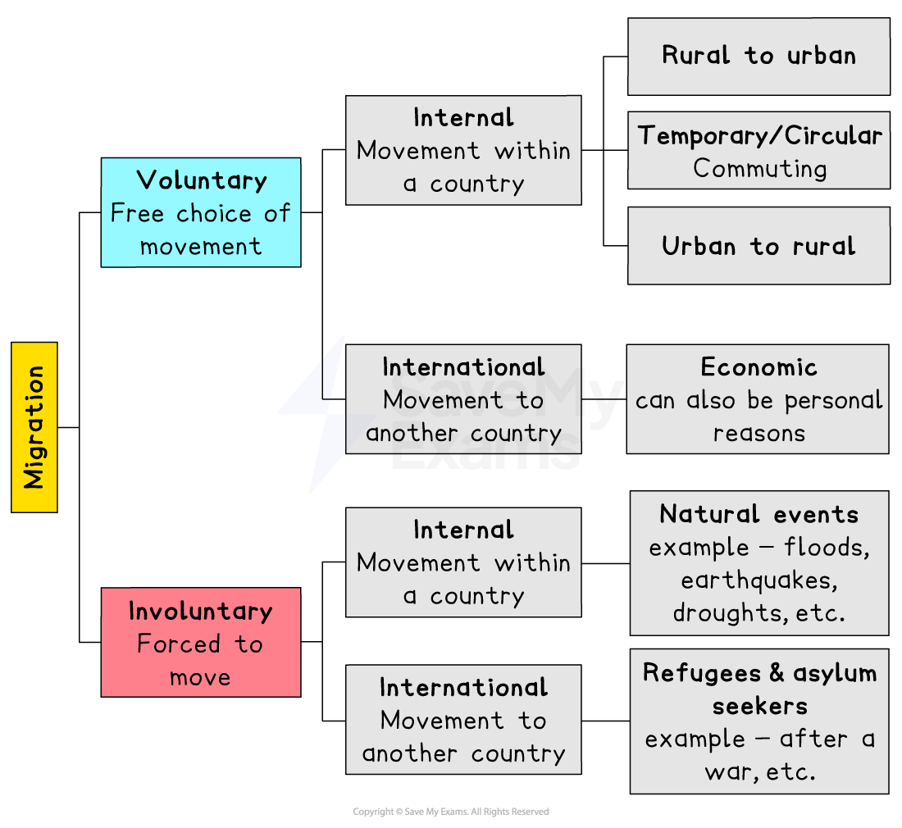

# Types of Migrant

## Specification link

This page covers section 6.3.1  of the [CIE IGCSE specification ](https://www.cambridgeinternational.org/Images/718150-2027-2029-syllabus.pdf).

- **6.3.1 **- Types of migrant: economic migrant, asylum seeker and refugee.

## Types of migration

> **Spec point** — `spcpt_sT3JFhMRNyC7XxQR`

## Types of migration

- People have always migrated from one place to another, either within their country (***internal migration***) or across borders (***international migration***)
- ***Globalisation*** has made this move easier and faster
- There are different types of migration, including:

  - **Forced (involuntary)**
  - **Voluntary**

*Different types of migration*

### Voluntary migration

- **Voluntary migration** is the** free choice** to migrate or not

  - This can be **internal **(within the same country) or **international **(to another country)
- Voluntary migration is usually for **economic **reasons such as work, promotion, higher wages, etc.

  - In **developing countries**, this is usually **internal**, from rural to urban areas
  - In **developed** countries, **counter-urbanisation** is more common, from urban to rural

### Forced migration

- This is where a migrant has **no choice** but to leave their place of origin
- This is usually international but can also be internal
- There are several reasons for internally forced migration, including:

  - natural hazards
  - war and persecution
  - ethnic cleansing

## Economic migrants

> **Spec point** — `spcpt_3FjXfz4vXq6bG89M` · Types of migrant: economic migrant, asylum seeker and refugee.

## Economic migrants

- Economic migrants are people who move to **earn more money**
- Often economic migrants plan to return to their country of origin after working in another country
- Many economic migrants send money back to their families

  - This money is called **remittances**

## Asylum seekers

> **Spec point** — `spcpt_vXD6Zysn3YNPQB7v` · Types of migrant: economic migrant, asylum seeker and refugee.

## Asylum seekers

- Asylum seekers are migrants who have left their country due to fear of persecution, punishment, torture or death in their home country and are claiming refuge in another country
- Asylum seekers are **seeking protection** in another country, but have not yet been legally recognised as a **refugee**
- The **UN High Commission for Refugees (UNHCR) **is responsible for those people forced to migrate—a **'person of concern'**
- Currently, 149 countries have signed the **1951 Refugee Convention**, recognise the rights of people seeking asylum and have agreed to protect them

  - Whilst waiting for a decision on whether they will be granted refugee status, asylum seekers are held in reception or detention centres

## Refugees

> **Spec point** — `spcpt_bfjXR4gqgYxQkrrD` · Types of migrant: economic migrant, asylum seeker and refugee.

## Refugees

- A refugee  is a person who lives **outside their country of nationality** because of well-founded fears of being **persecuted, punishment, torture **or **death**

  - This can be due to their:
  
    - Religion
    - Race
    - Political beliefs
    - Nationality
    - Sexuality
- A refugee has been **granted asylum** by another country
- This is based on international law which states that a person should not be sent back to a country where they face persecution, threats to their life or freedom

> **Exam Hint**
> Students often confuse asylum seekers and refugees. It is important to remember that asylum seekers are still 'seeking' asylum. This means that they have not received refugee status, which allows them to stay in the country under the protection of international law.
