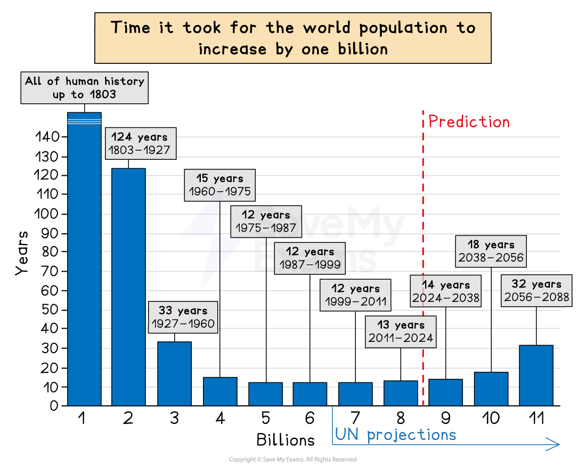
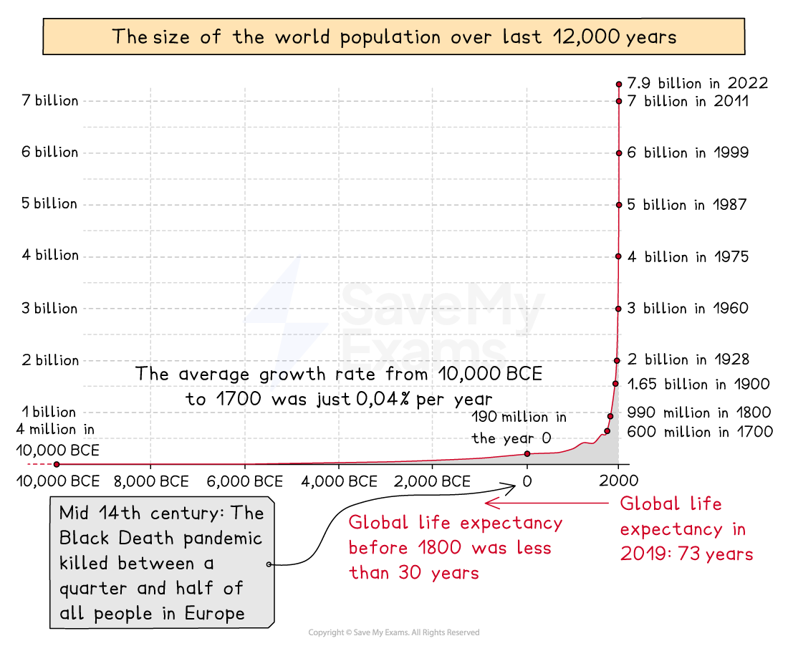
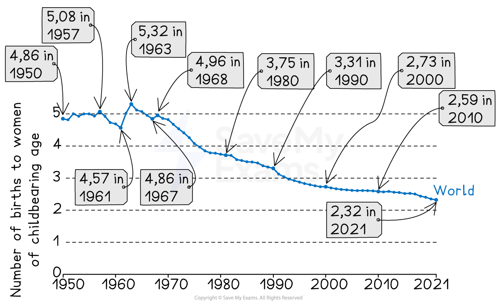

# Population Growth & Decline

## Specification link

This page covers section 6.1.1 and 6.1.2 of the [CIE IGCSE specification](https://www.cambridgeinternational.org/Images/718150-2027-2029-syllabus.pdf) .

- **6.1.1 **-Patterns and trends in global population growth.
- **6.1.2** - Reasons for the growth and decline of a country’s population: fertility rate, birth rate, death rate, natural increase, migration.

## Patterns and trends in population change

> **Spec point** — `spcpt_7dFgH7y4SRCd7PNK` · Patterns and trends in global population growth.

## Patterns and trends in population change

- Nearly 80 million people are added to the world's population each year
- Population growth was steady and low until 1804, when the world population reached 1 billion
- After 1804, it took just over 100 years for the population to double to 2 billion

*Graph showing the time taken for the world population to increase by one million*

> **Exam Hint**
> The exam may ask you to describe population change on a graph. Remember to consider the following points:
> 
> - What is the main trend? Is it
> 
>   - increasing
>   - decreasing
>   - staying about the same
> - Has the change been rapid or slow?
> - Have changes occurred during specific times?
> - Are there any ***anomalies***?
> - Don't forget to use figures from the graph

- The rate of increase after 1930 was more rapid and led to a ***population explosion***
- The fastest increase in population happened during the 1980s and 1990s
- **Population growth rate **is the average annual change of the population size during a set period of time, usually a year

  - The population is still increasing but at a slower rate
  
    - In 1970, the growth rate was 2%
    - In 2022, the growth rate is under 1%
- It is predicted by the UN that the population will stabilise at around 11 billion in 2100

*Graph of world population growth*

- This **rapid global population increase **has been caused by a combination of numerous factors, including improvements in

  - **agriculture**, particularly during the ***agricultural revolution,*** led to **higher yields** and more **varied diets**
  - **medicine** and medical care, which reduces the death rate
  - **technology** and transport led to a wealthier population, which increased ***life expectancy***
  - **clean water supply** and sewage disposal leading to a reduction in disease
- All these factors also led to a decrease in the ***death rate***
- The ***birth rate*** has remained high mainly in **low-income countries (LICs)** due to:

  - lack of access to family planning and contraception
  - an increase in women surviving childbirth
  - families continuing to have large numbers of children to look after their parents in old age and to help support the family
  - the culture of having larger families, which takes many years to change
  - religious reasons

> **Exam Hint**
> Population increase is not the same as the population growth rate. Population can increase at different rates. The **rate** at which it is increasing is known as the **population growth rate.**

## Reasons for the growth and decline of population

> **Spec point** — `spcpt_bRG82c6S8pZTqtKg` · Reasons for the growth and decline of a country’s population: fertility rate, birth rate, death rate, natural increase, migration.

## Reasons for the growth and decline of population

### Population Change

- There are two ways in which a population can change:

  - Migration
  - Natural population change

#### Migration

- ***Migration*** can cause the population to either increase or decrease
- This occurs as the result of ***emigration*** or ***immigration***
- **Net migration** is the difference between the number of people moving into a country **(immigrants)** and the number of people leaving the country** (emigrants)**
- Both LICs and **high income countries (HICs)** experience migration

  - Most emigration is **from** LICs
  - Most immigration is **to **HICs

> **Exam Hint**
> Remember, immigration and emigration are not the same. Immigration is the **inward** movement of people into a country. Emigration is the **outward** movement of people from a country.

### Natural population change

- Natural population change occurs due to changes in the birth rates and death rates

  - **Natural change** in population is calculated by subtracting the **death rate **from the **birth rate**
- The combination of a decreasing death rate and high birth rate led to rapid ***natural increase*** and population explosion
- A ***negative rate of natural increase*** happens when the birth rate is lower than the death rate

#### Birth rate

- The birth rate is the number of live babies born per 1000 people
- This figure is calculated by:

  - dividing the total number of births by the total population and multiplying by 1000
- In HICs, the birth rate tends to be low whereas in LICs the birth rate tends to be high

#### Fertility rate

- **Fertility rate** is the number of live births per 1000 women aged 15-49 years in a given year
- These rates apply to women within the main reproductive age range of 15-49 years (some sources use 15-44 years), rather than to the whole population
- This makes for a more accurate measure of fertility than just the birth rate
- **Total fertility rate (TFR) **is:

  - The average number of children that would be born alive to a woman during her lifetime – total family size
- The global fertility rate has fallen rapidly since 1950

*Declining global fertility rate*

#### Death rate

- The death rate is the number of deaths per 1000 people
- This figure is calculated by:

  - dividing the total number of deaths by the total population and multiplying by 1000
- In HICs, the death rate tends to be low whereas in LICs the death rate tends to be high

> **Worked Example**
> Study Figure 1.1 which shows information about the birth and death rates of three countries in 2013.
> 
> | Country | Birth rate (per 1000 of population) | Death rate (per 1000 of population) |
> |---|---|---|
> | Kuwait | 20.9 | 2.1 |
> | South Africa | 19.3 | 17.2 |
> | Vietnam | 16.8 | 5.9 |
> 
> (i) What is meant by South Africa has a death rate of 17.2?
> 
> [1]
> 
> > *This can be written as the number shown in the table or converted to a percentage. To do this divide the number by 1000 and then multiply by 100.*
> 
> **Answer**
> 
> - Either of the answers given below would be awarded a mark
> 
>   - 17.2 people of every 1000 people in the population die per year/in 2013 **[1]**
>   - 1.72% of the population died in 2013 **[1]**
