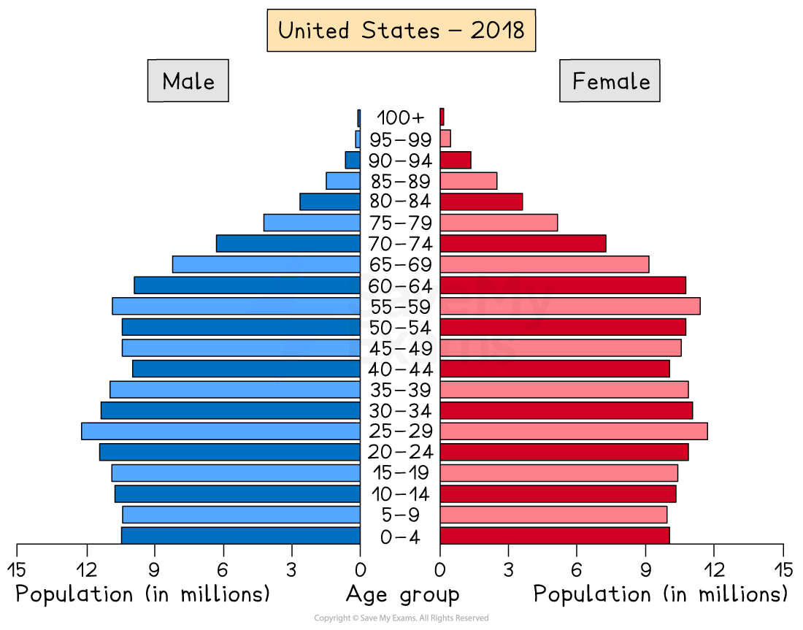
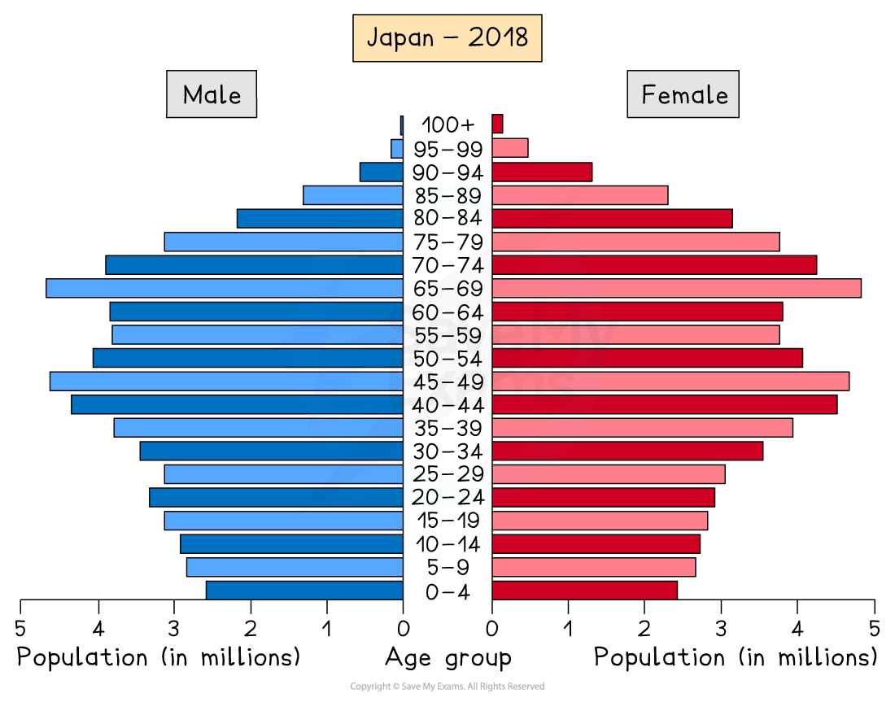
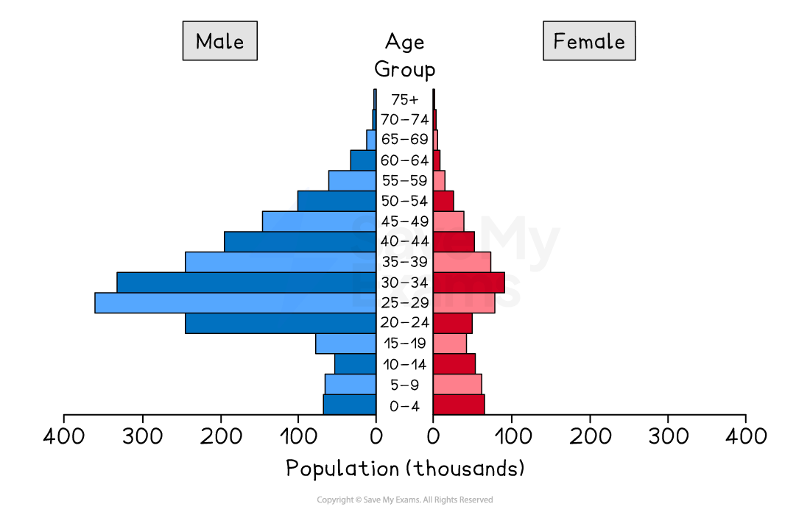

# Factors influencing population structures

## Specification link

This page covers section 6.2.1  of the [CIE IGCSE specification ](https://www.cambridgeinternational.org/Images/718150-2027-2029-syllabus.pdf).

- **6.2.1 **- Factors influencing population structures: natural increase and net migration.

## Population pyramids

> **Spec point** — `spcpt_8NHkrjF45MzZKKkR` · "Candidates should be able to:
• select, present, construct and communicate data through appropriate graphs, charts and diagrams using
relevant scales and annotations to present information
• extract, interpret, analyse and evaluate information presented on graphs, charts and diagrams
• identify and evaluate variations, trends and patterns from data provided."

## Population pyramids

- The characteristics of a population—the distribution of age, sex, ethnicity, religion, etc.—are known as the **population structure**
- Information about these characteristics is gathered in a *census*
- The population structure is the result of changes in:

  - fertility
  - mortality
  - migration
- The two main components of age and sex can be shown on a **population pyramid**

### What is a population pyramid?

- Population pyramids (also known as an **age structure graph**) are used to display the **gender and age structure** of a given population

  - They illustrate the distribution of the population across age groups and between male and female
- They enable governments nationally and regionally to assess the needs of the population for services such as healthcare and education

  - This means the governments can estimate and plan for spending
- As countries develop and pass through the stages of ***demographic transition,*** the **shape of the population pyramid **changes

  - Each bar of the population pyramid represents a 5-year age range
  - The two sides of the population pyramid represent males (usually on the left) and females (usually on the right)
- The population pyramid can be used to identify the following groups:

  - **Young dependants **
  - **Old dependants **
  - **Economically active **(working population)
  - **Dependency ratio **

*Interpreting a population pyramid*

### Demographic transition and population structure

- As countries move through the stages of demographic transition
- The shape of the population pyramids reflect the changes

*Population pyramid of Niger 2010*

- **LEDCs** like Niger have a **concave pyramid shape**
- Stages 1 and 2 of the model indicate:

  - high birth rate
  - low life expectancy
  - high death rate but starting to decrease
  - high infant mortality rate
  - **a young dependent population** dominates

*Population pyramid of Nepal*

- **LEDCs/NICs** that are a little further along the demographic transition, such as Nepal, have a convex pyramid shape
- Stage 3 of the demographic transition model
- This indicates:

  - decreasing birth rate
  - increasing life expectancy
  - decreasing death rate
  - decreasing infant mortality
  - larger working-age population

*Population pyramid of the USA*

- **MEDC** countries such as the USA have a **column-shape**
- Stage 4 of the demographic transition model
- This indicates:

  - decreasing birth rate
  - increasing life expectancy
  - decreasing death rate
  - low infant mortality
  - larger working-age population

*Population pyramid of Japan*

- **MEDC** countries such as Japan have a pentagon shape with a narrowing base
- Stage 5 of the demographic transition model
- This indicates:

  - Decreasing birth rate
  - Increasing life expectancy
  - The death rate is higher than the birth rate due to the **ageing population**
  - Low infant mortality
  - Ageing population: older dependent population

## Natural increase

> **Spec point** — `spcpt_246wdkk4cdD7MJZF` · Factors influencing population structures: natural increase and net migration.

## Natural increase

- Natural increase is calculated by subtracting the **death rate **from the **birth rate**
- The combination of a decreasing death rate and high birth rate led to rapid ***natural increase*** and population explosion
- The impacts on population structure often leads to

  - a larger overall population
  - a population with a larger proportion of younger people
  - a higher dependency ratio

*Population structure of Niger*

- A ***negative rate of natural increase*** happens when the birth rate is lower than the death rate
- When this occurs, it impacts the population structure, leading to:

  - a shrinking population
  - an ageing population

*Population structure of Italy*

## Net migration

> **Spec point** — `spcpt_Y6rWXf4c7zB54rG2` · Factors influencing population structures: natural increase and net migration.

## Net migration

- Net migration is calculated by subtracting the number of **emigrants** from the number of **immigrants**

  - The measurement is given per 1000 people
- **Positive net migration** occurs when there are more immigrants into a country than there are emigrants from the country
- **Negative net migration** occurs when there are more emigrants from a country than there are immigrants into the country

- In some countries, **migration** can lead to an imbalance in the population structure
- The UAE has significantly more males than females
- Approximately 29% of the population are males between the ages of 25 and 39, whereas only 10.5% of the population are women between 25 and 39

  - This is the result of the migration of males to the UAE to work in the oil, gas and construction industries

*Population structure showing the impact of male dominated migration*

- Rapid population growth in some areas as a result of migration can lead to:

  - increased pressure on services such as healthcare and schools
  - a shortage of housing
  - increased traffic congestion
  - increased water and air pollution
  - a shortage of food
  - a lack of clean water
