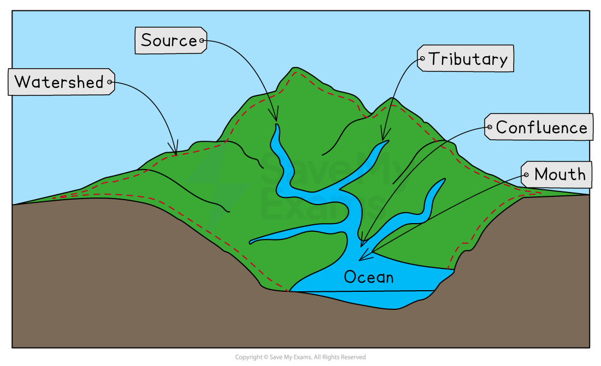
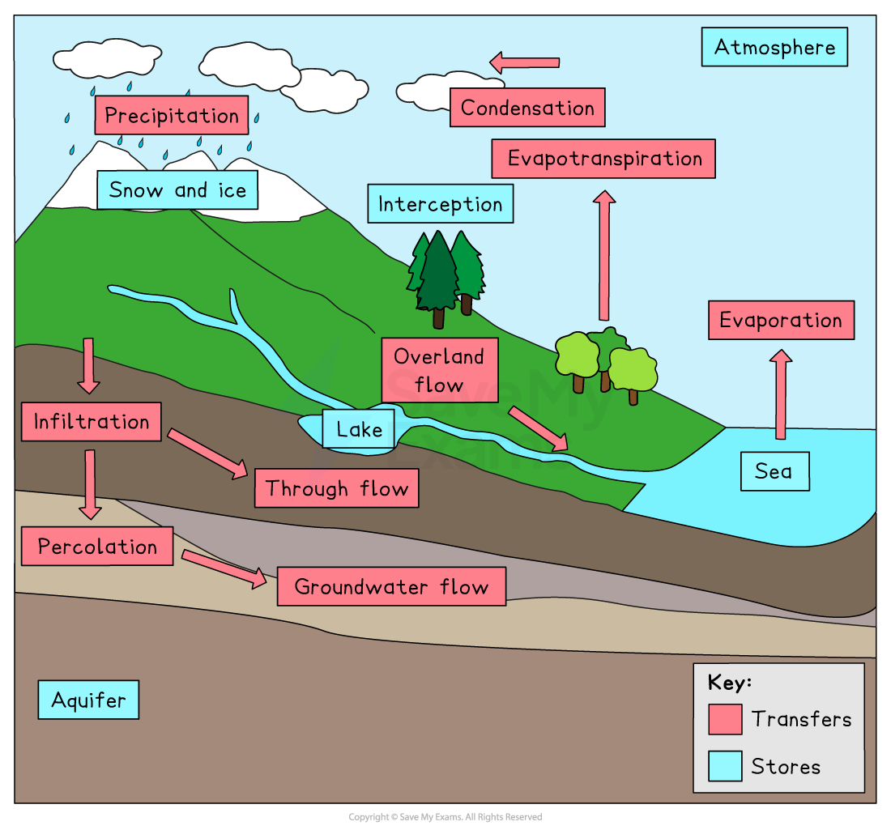

# Hydrological Characteristics

## Specification checklist

This content page covers the following sections of the specification:

- **1.1.1 **- Characteristics of drainage basins: the watershed, tributary, confluence, source and mouth.
- **1.1.3** - How the drainage basin operates within the water cycle.
- **1.1.4 **- Processes which operate in a drainage basin: precipitation, interception, infiltration, percolation, overland flow, channel flow, throughflow, groundwater flow, transpiration, evaporation, evapotranspiration.

## Features of drainage basins

> **Spec point** — `spcpt_xPdWVbMTXPmkd5Dr` · Characteristics of drainage basins:  channel, watershed, tributary, confluence, source, mouth.

## Features of drainage basins

- A **drainage basin** is the area of land drained by a river and its tributaries

  - This is also known as the **catchment area** of the river
- Drainage basins are ***open systems***
- This means that as well as **stores **and** transfers,** drainage basins have** inputs **and **outputs**

  - The** input** is any water **entering** the system (**precipitation**)
  - **Outputs** are where water is** lost **from the drainage basin (**evaporation, transpiration** and into the** sea/lake)**
- When precipitation falls into the drainage basin, it will take different paths
- The possible paths include:

  - **Direct channel precipitation,** which occurs when the water falls directly into a river
  - **Overland flow** (surface runoff) when the water cannot infiltrate the soil due to the ground being *impermeable*
  - **Throughflow **when the water flows through the soil
  - **Groundwater flow** when the water flows through the rocks
- Every drainage basin is unique
- They have different

  - shapes
  - sizes
  - rock types
  - ***relief***
  - land use

### Drainage basin features

- All drainage basins have some features in common:

  - The **watershed** is the boundary between drainage basins
  - A **source** is the point of the river which is **furthest from the mouth**; this is the point at which the river begins and is usually an upland lake, spring or glacier
  
    - Gravity then causes water to flow downhill, taking the fastest and easiest path
  - A **confluence** is the place where two or more streams/rivers meet
  - **Tributaries** are streams or rivers flowing into larger streams or rivers
  - The** mouth **of a river is where it enters the sea/ocean or sometimes a lake

*The main features of a drainage basin*

## The water cycle and drainage basins

> **Spec point** — `spcpt_ks8xFqfpfxbcds6y` · How the drainage basin operates within the water cycle

## The water cycle & drainage basins

- All drainage basins are part of Earth's** hydrological cycle**
- The **hydrological cycle **is a ***closed*** system
- Water is constantly recycled through the system
- The hydrological cycle includes **stores** and** transfers**

  - The stores and transfer processes of the hydrological cycle all take place within individual drainage basins

*The stores and transfers of the hydrological cycle*

## Drainage basin processes

> **Spec point** — `spcpt_SrYFvbG9SFncNDbN` · Processes which operate in a drainage basin: precipitation, interception, infiltration, percolation, overland flow, channel flow, throughflow, groundwater flow, transpiration, evaporation, evapotranspiration

## Drainage basin processes

### Stores

- **Stores **are those places where water is held for a period of time
- Stores of the hydrological cycle include:

  - The **atmosphere** where water is stored in the form of **water vapour** or as **water droplets** in clouds
  - **Surface stores** such as puddles, lakes, rivers and reservoirs
  - **Aquifers,** which are permeable rocks such as limestone and sandstone which can hold water
  - **Ice** and **snow**
  - **Seas **and** oceans **
- **Interception** is how precipitation is prevented from reaching the ground, usually by being caught on leaves or branches

  - Some of the water will be stored on the leaves and evaporate into the atmosphere
  - The remaining water will flow down the leaves, branches and trunk until it reaches the ground (**stemflow**)

### Transfers

- **Transfers **are how water is moved around the hydrological cycle and each drainage basin
- Transfers include:

  - **Evaporation** is the change of water from a liquid to a gas (**water vapour**) due to heat from the sun
  
    - This process transfers water from the surface up into the **atmosphere**
    - Higher temperatures and strong winds lead to increased evaporation
  - **Condensation,** which occurs when water cools and changes from water vapour into a liquid (water droplets)
  
    - Condensation leads to the formation of **clouds**
  - **Transpiration, **which occurs when plants release water vapour from their leaves
  
    - This process transfers water from the plants into the atmosphere
  - **Evapotranspiration** is the combined transfer of water vapour from the Earth's surface and plants
  - **Precipitation** is the transfer of water from the atmosphere to the Earth's surface in the form of hail, sleet, rain or snow
  - **Overland flow** is any water flowing across the Earth's surface
  - When water is transferred from the surface into the soil, this is known as **infiltration**
  - **Percolation** is the transfer of water from the soil into the rocks and **aquifers**
  - **Throughflow** occurs when water is transferred through the soil between the surface and the water table
  - **Groundwater flow** is the transfer of water through rocks
  - **Channel flow** is water flowing in a river or stream

> **Exam Hint**
> Remember there are no inputs and outputs in the hydrological system. There are only transfers and stores because it is a **closed** system. Each drainage basin is part of the hydrological cycle, so it is an **open** system with inputs and outputs.
