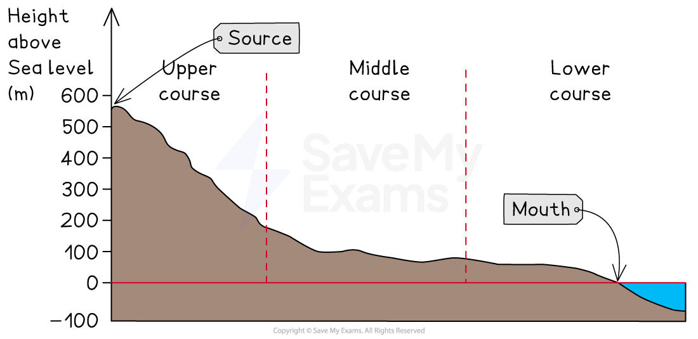
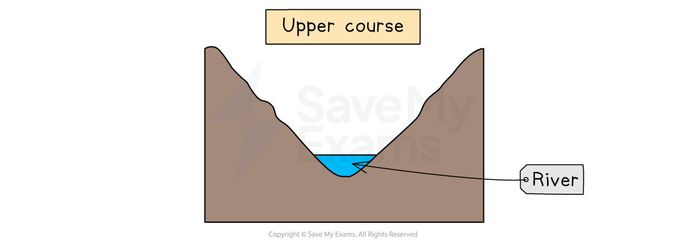
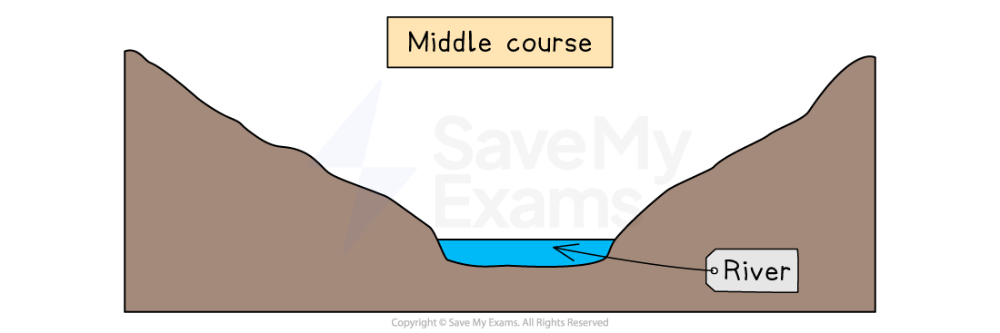
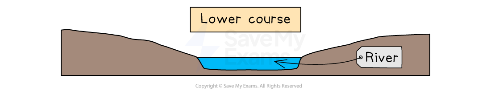
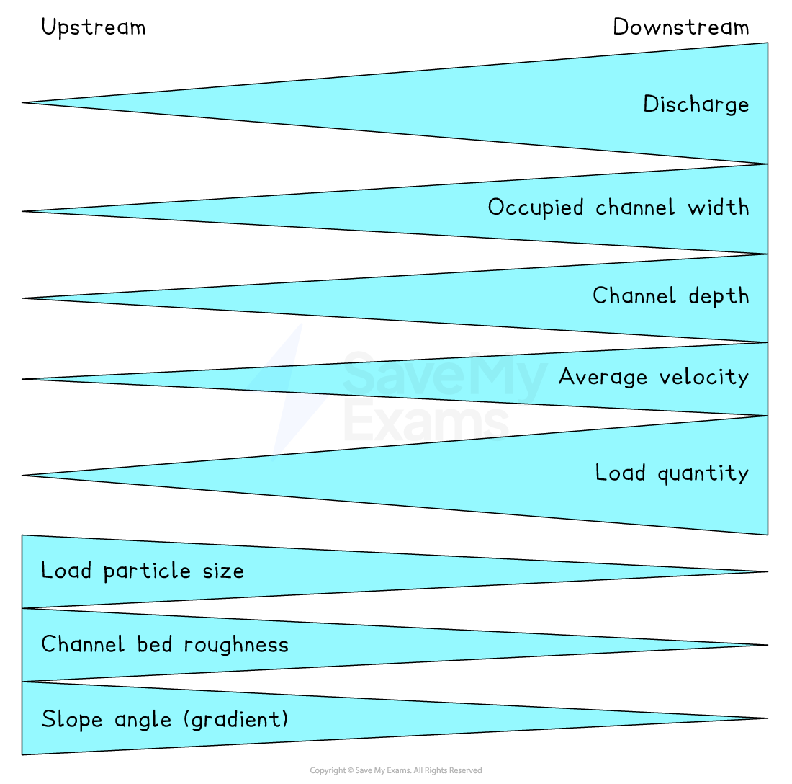
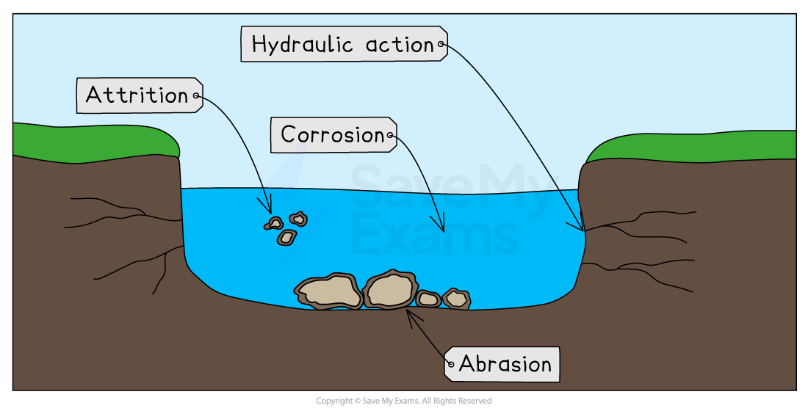
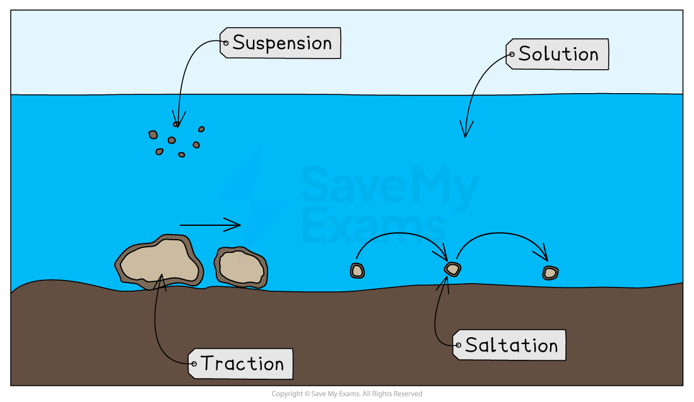

# River Characteristics

## Specification checklist

This content page covers the following sections of the specification:

- **1.1.1 **- Characteristics of rivers: the long profile, width, depth, speed of flow/velocity, discharge, wetted perimeter and channel
- **1.1.2 **- The Bradshaw model.
- **1.1.5** - Processes which operate within a river:

  - erosion; hydraulic action, abrasion, attrition
  - solution, transportation; traction, suspension, saltation, solution
  - deposition.

## Characteristics of river profiles

> **Spec point** — `spcpt_GsmmxJzQd8vn7hwX` · Characteristics of rivers: the long profile, width, depth, speed of flow/velocity, discharge, wetted perimeter,

## Characteristics of river profiles

#### River characteristics

- All rivers have **long **and **cross-profiles**
- Each river's long and cross profiles are unique, but they do have some characteristics in common
- These profiles show changes in river characteristics from the source to the mouth

#### Long profile

- The long profile of a river shows the changes in the river ***gradient*** from the **source** to the** mouth**
- Most long profiles have a **concave shape **with similar characteristics:

  - The **source** is usually in an **upland area**
  - The upper course of the river includes steep areas with uneven surfaces
  - In the middle course, the gradient decreases
  - In the lower section, the gradient decreases further until it becomes almost flat

*River long profile*

#### Cross profiles

- The cross profiles of a river are cross-sections from one bank to another
- Cross profiles of the upper, middle and lower courses show the changes in the river channel
- Upper course characteristics tend to include:

  - shallow
  - steep valley sides
  - narrow
  - low ***velocity***
  - large bedload
  - rough channel bed
  - high levels of friction
  - vertical erosion

*Cross-section of the upper river course*

- Middle course characteristics tend to be

  - deeper than upper course channel
  - gentle valley sides
  - wider than upper course channel
  - greater velocity than upper course channel
  - material in river decreases in size
  - smoother channel bed
  - lower levels of friction than upper course channel
  - lateral erosion

*Cross-section of the middle river course*

- Lower course characteristics tend to be

  - deeper than middle course channel
  - flat floodplains
  - wider than middle course channel
  - greater velocity than the middle course channel (apart from as the river enters the mouth)
  - material carried mainly sediment and alluvium
  - smooth channel bed
  - lowest friction
  - deposition is dominant

*Cross-section of the lower river course*

> **Exam Hint**
> Remember, valley shape and river shape are not the same thing. If you are asked to describe a valley shape, you should focus on the gradient and shape of the land on either side of the river channel.

## The Bradshaw Model

> **Spec point** — `spcpt_xkvJFvtQtWyRccBt` · The Bradshaw model

## The Bradshaw Model

- As a result of **erosion, transportation** and **deposition,** the character of a river changes as it moves downstream as shown in the cross-profiles
- These changes are summarised in the **Bradshaw model**

*The Bradshaw Model*

- Bradshaw's model shows that the following characteristics increase with distance downstream (away from the source):

  - *discharge*
  - width
  - depth
  - *velocity*
  - load quantity
- Other characteristics decrease:

  - load size
  - bed roughness
  - gradient (slope angle)

### Wetted perimeter and hydraulic radius

- The **wetted perimeter** is the length of the cross-sectional area where the water is in contact with the banks and bed
- The efficiency of the river is measured using **hydraulic radius** (cross-sectional area divided by wetted perimeter)
- The higher the ratio, the greater the efficiency and the less the friction

  - This increases the amount of erosion, which means the channel becomes wider and deeper

## River processes

> **Spec point** — `spcpt_b7Hpn3ds8rGNRNFT` · "Processes which operate within a river:
• erosion; hydraulic action, abrasion, attrition, solution
• transportation; traction, suspension, saltation, solution
• deposition"

## River processes

#### Erosion

- **Erosion **is the wearing down of surfaces
- There are four erosion processes that change the shape of the river channel:

  - **Hydraulic action**
  
    - The force of the water, which removes material from the bed and banks of the river
  - **Abrasion**
  
    - When the materials carried by the river scrape away the banks and bed
  - **Attrition**
  
    - When the material being carried by the river hits each other, the pieces become rounder and smaller
  - **Corrosion (solution)**
  
    - When rocks are dissolved in slightly acidic water

*Types of erosion*

- Erosion can be mainly vertical or lateral:

  - **Vertical erosion** is dominant in the upper course of rivers. It increases the depth of the river and valley as the river erodes downwards
  - **Lateral erosion** is dominant in the middle and lower courses of rivers. It increases the width of the river and valley as it erodes sideways

#### Transportation

- There are four processes of** transportation**:

  - **Traction**
  
    - Occurs when larger rocks and materials are rolled along the riverbed
  - **Saltation**
  
    - Smaller material, which can be lifted by the water, bounces along the riverbed
  - **Suspension**
  
    - Lighter material carried within the river flow
  - **Solution**
  
    - When materials are dissolved in the river water

*Types of transportation*

a

> **Exam Hint**
> It can sometimes help to remember a word and the process it refers to if you know what it means.
> 
> Traction: the action of pulling something over a surface.
> 
> Saltation: leaping or jumping.

#### Deposition

- When a river does not have enough energy to carry materials, it drops them

  - This is **deposition**
- The causes of reduced energy include

  - **Reduced discharge** due to a lack of precipitation or ***abstraction*** upstream
  - **Decreased** ***gradient***
  - Slower flow on the inside of a river bend or where the river is shallower
  - When the river enters a sea, ocean or lake
- The heaviest material is deposited first; this is known as the **bedload**
- The lighter materials, gravel, sand and silt, are known as** alluvium** and they are carried further downstream
- The dissolved materials are carried out to sea
