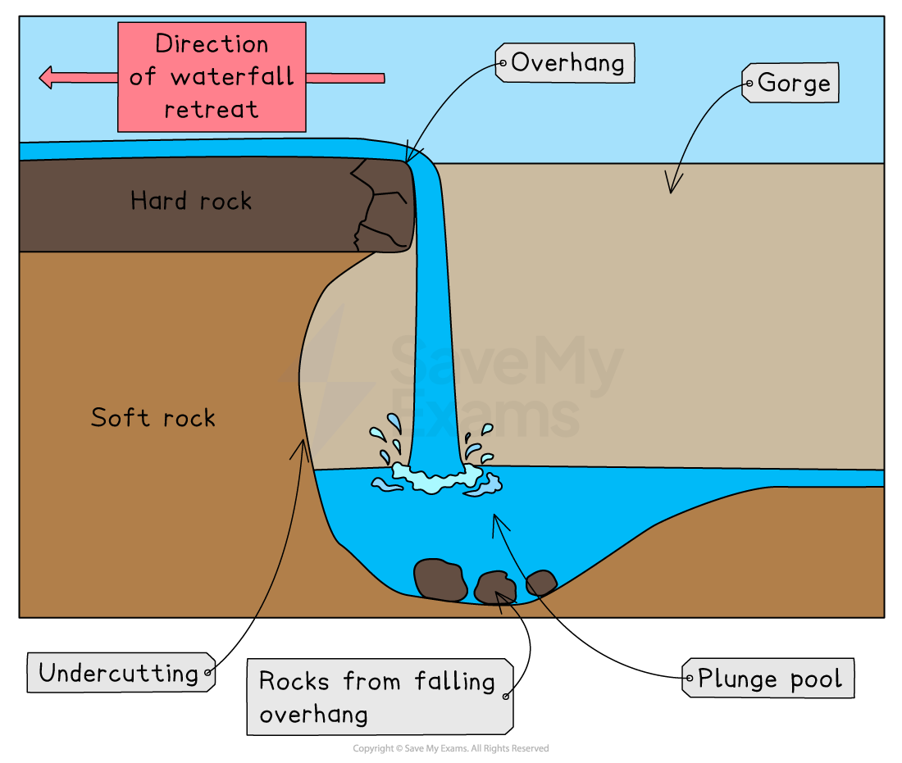
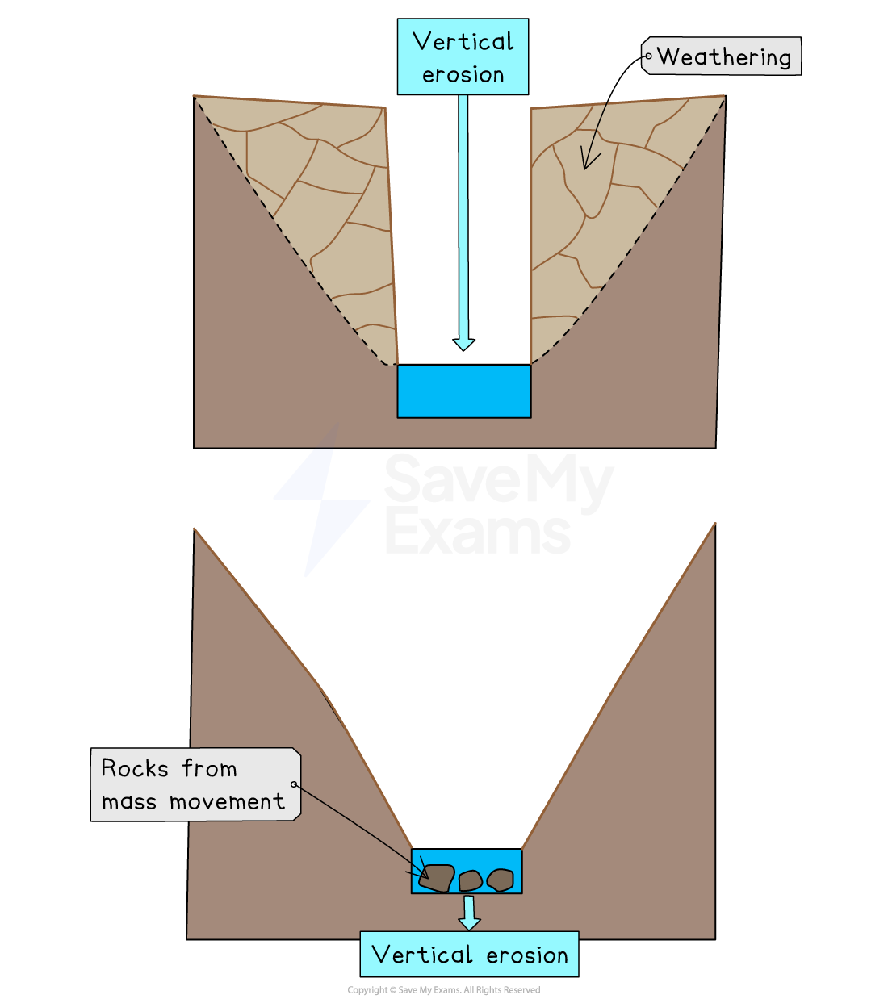
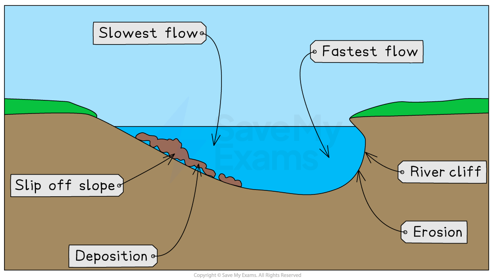
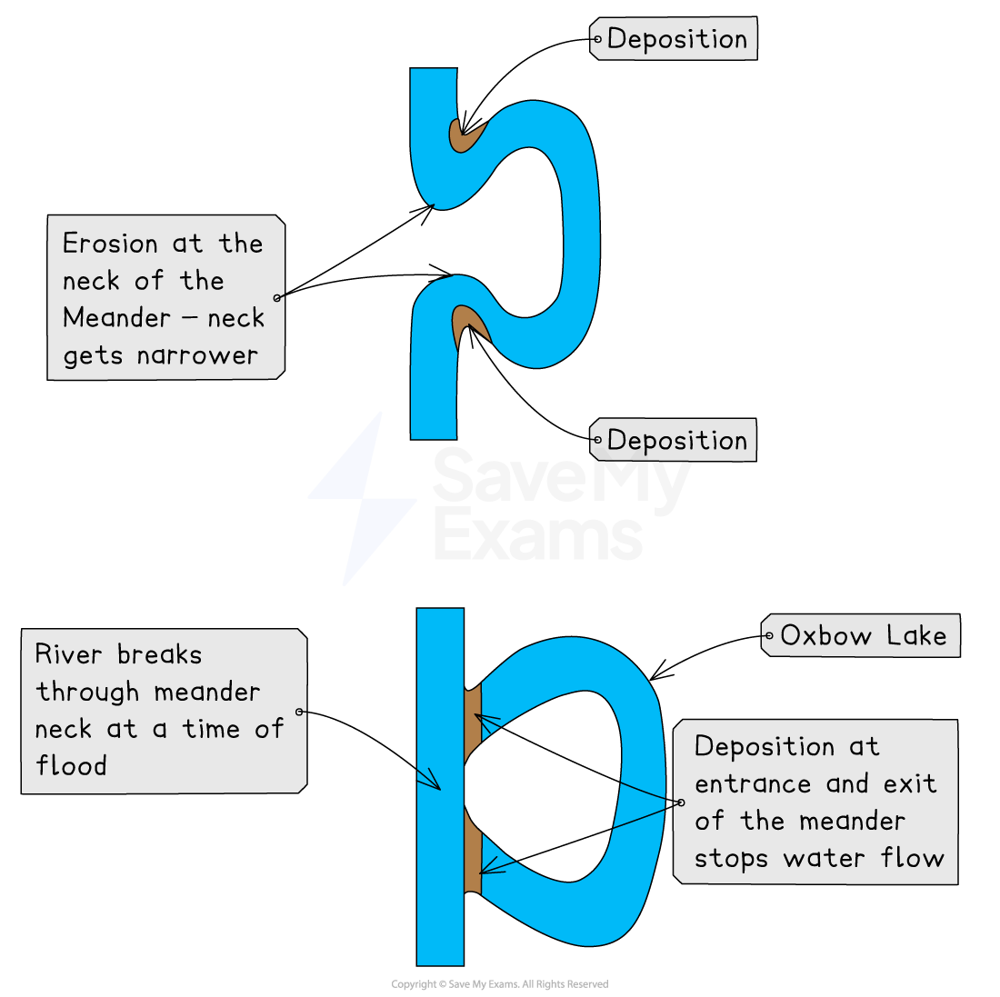
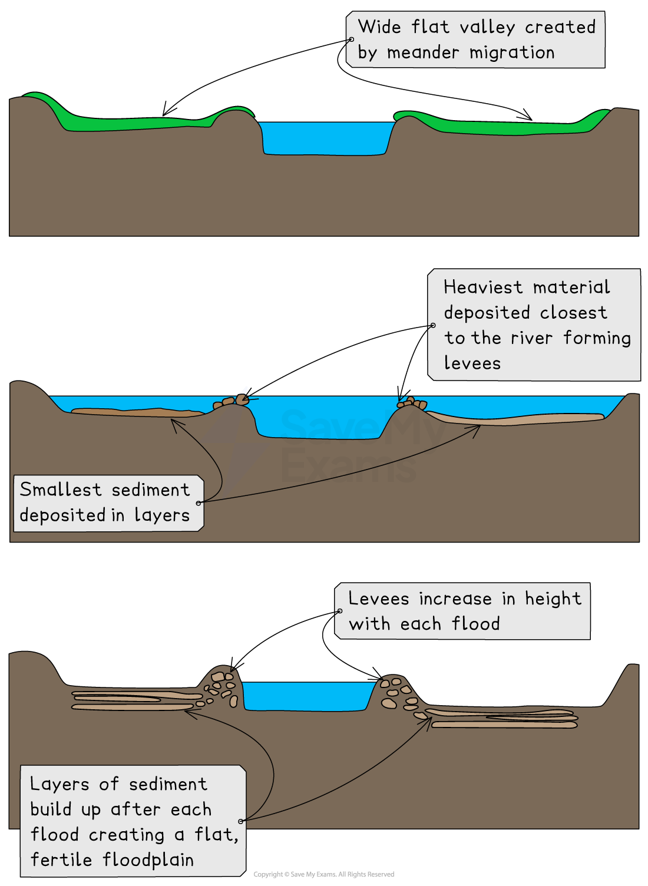
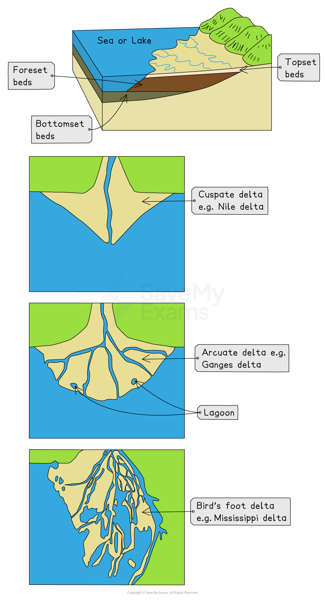

# River Landforms

## Specification checklist

This content page covers the following section of the specification:

- **1.2.1 -** The characteristics and formation of landforms: waterfalls, rapids, gorges, V-shaped valleys, meanders, oxbow lakes, levées, floodplains, deltas, interlocking spurs, potholes.

## Landforms in the river upper course

> **Spec point** — `spcpt_JfHhMD2GssBVwK8J` · The characteristics and formation of landforms: waterfalls, rapids, gorges, V-shaped valleys, meanders, oxbow lakes, levées, floodplains, deltas, interlocking spurs, potholes.

## Landforms in the river upper course

- The changes in river channel characteristics lead to changes in the river landscape
- The upland and lowland areas of rivers have distinctive landforms
- Upland:

  - waterfalls
  - gorges
  - v-shaped valleys
  - interlocking spurs

#### Waterfalls and gorges

- Waterfalls form when there is a drop in the riverbed from one level to another
- This drop is often due to changes in the hardness of the rock, where hard rock overlies soft rock
- [Hydraulic action and abrasion](https://www.savemyexams.com/igcse/geography/cie/25/revision-notes/changing-river-environments/rivers-and-drainage-basin/river-characteristics/) are the main erosional processes

  - The soft rock erodes quicker, **undercutting** the hard rock and creating a** plunge pool**
  - This leads to the development of an **overhang** of hard rock, which, eventually, over time, collapses
  - The overhang falls into the plunge pool, increasing **abrasion** and making the plunge pool deeper
  - The process then begins again and the waterfall retreats upstream leaving a **steep-sided gorge**

*Waterfall formation*

#### Rapids

- Rapids form where there are bands of **alternating hard** and** soft rock **
- The softer rock (less resistant) erodes more rapidly through **abrasion **and** hydraulic action**, leaving the harder rock jutting upwards from the river bed
- This creates an **uneven riverbed**

#### V-shaped valleys

- **Vertical erosion** is dominant in the upper course of the river

  - This cuts down into the riverbed and deepens the river channel
- **Weathering** and **mass movement** lead to material from the valley sides collapsing into the river, forming a steep v-shaped valley

*V-shaped valley formation*

#### Interlocking spurs

- In the upper course of the river, the channel starts to meander
- Erosion happens on the outside of the bend
- In the upland areas this forms interlocking spurs

*Interlocking spurs*

#### Potholes

- Potholes are round depressions in the riverbed
- They are formed by **abrasion**
- Where there are dips in the riverbed, the river flow can cause the sediment to spin

  - This erodes the dip, forming a circular hollow (**pothole**)
- As the size of the hollow increases, larger material becomes trapped in the pothole

  - This further increases the erosion of the pothole

## River landforms in the river middle course

> **Spec point** — `spcpt_ZcDdZR3CtysNDB24` · The characteristics and formation of landforms: waterfalls, rapids, gorges, V-shaped valleys, meanders, oxbow lakes, levées, floodplains, deltas, interlocking spurs, potholes.

## Landforms in the river's middle course

#### Meanders

- In the middle and lower course of a river, **lateral erosion** is dominant
- Meanders increase in size
- The fastest water flow **(thalweg)** is on the outside of the river bends, leading to erosion

  - The erosion undercuts the riverbank, forming a **river cliff**
  - The riverbank collapses and the edge of the meander moves further out
- The slowest flow is on the inside of the river bends, leading to deposition

  - The deposits form a **slip-off slope**
- [Deposition](https://www.savemyexams.com/igcse/geography/cie/25/revision-notes/changing-river-environments/rivers-and-drainage-basin/river-characteristics/) on one side and** erosion** on the other leads to the meander **migrating** across the valley

*Cross-section of a meander*

#### Oxbow lakes

- With distance downstream, the size of the meanders increases
- The erosion on outside bends can eventually lead to the formation of a meander neck
- At a time of the flood, the river may cut through the neck of the meander, forming a straighter course for the water
- The flow of water at entry and exit from the meander will be slower, leading to **deposition**
- The meander becomes cut off from the main river channel, forming an **oxbow lake**

*Oxbow lake formation*

> **Exam Hint**
> Remember when describing the formation of oxbow lakes, it is important to state that the river will break through the neck of the meander during a flood. At other times, the river does not have enough power to break through.

## Landforms in the river lower course

> **Spec point** — `spcpt_kS7DhcHmV3DcDpZ7` · The characteristics and formation of landforms: waterfalls, rapids, gorges, V-shaped valleys, meanders, oxbow lakes, levées, floodplains, deltas, interlocking spurs, potholes.

## Landforms in the river's lower course

### Floodplains and levees

- **Floodplains** are flat expanses of land on either side of the river
- The migration of meanders leads to the formation of the floodplain
- High discharge may cause the river to overflow the banks
- More of the water is in contact with the land surface as the water spreads across the floodplain
- Increased friction reduces velocity and material is deposited across the floodplain, gradually increasing the floodplain height
- The heaviest material is deposited first, nearest to the river channel, forming natural embankments called **levees**

*Levee and floodplain formation*

### River mouth

- A river enters a sea or lake at its mouth
- This may be in different forms, including

  - estuaries
  - deltas
  - narrow mouth
- This is dependent on:

  - the amount of sediment the river is carrying
  - the strength of the waves/tides

#### Estuary

- An estuary is a wide, deep mouth
- It forms the change between the river and the sea and is where freshwater and saltwater mix

#### Deltas

- Rivers must carry a large amount of sediment for deltas to form
- Delta formation requires a rapid drop in river velocity
- This leads to the deposition of sediment

  - As the sediment is dropped the fine particles clump together, this is known as **flocculation**
  - The layers of sediment then build up blocking water flow and forming **distributaries**
- There are a variety of delta formations, such as arcuate and bird’s foot

#### Types of delta

*Delta formation and types of delta*
