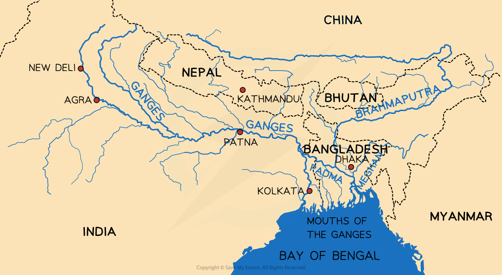

# Detailed Specific Example: Ganges/Brahmaputra

## Specification checklist

This content page covers the following section of the specification:

- **1.3.8 -** One detailed specific example to include:

  - the causes and impacts of a flood for a named river.
  - the strategies and techniques used to manage the flooding of the river; including sustainable.

> **Exam Hint**
> You may have studied other detailed specific examples, such as the [Mekong,](https://www.savemyexams.com/igcse/geography/cie/25/revision-notes/changing-river-environments/rivers-hazards-and-opportunities/river-case-study-pack/) Mississippi or the Indus, for this case study. The** case study** given **below** is just** one of many examples**.
> 
> In the final exam, you can use the detailed specific example you have studied in lessons or the one given below. The key information you need to ensure that you know for the case study is:
> 
> - The main causes of the flood
> 
>   - Human and natural
> - The effects of the flood, including social, economic and environmental impacts
> - The management strategies used to try and reduce flooding
> 
>   - This should include an analysis of whether they are sustainable

## Causes of flooding in Bangladesh

> **Spec point** — `spcpt_3btvhFbhvpTX6Tsn` · One detailed specific example to include: 
• the causes and impacts of a flood for a named river 
• the strategies and techniques used to manage the flooding of the river; including sustainable.

## The causes of flooding in Bangladesh

- The **Ganges** is 2,510 km long

  - It flows through India and Bangladesh, where it becomes the River Padma and joins with the Brahmaputra River
  - The drainage basin covers 1.2 million km²
  - The population living within the area drained by the Ganges is over 650 million people
- The **Brahmaputra** River is 3,969 km long

  1. It flows through Tibet, India and Bangladesh, where it joins with the River Padma
  2. The drainage basin covers 651,334 km2
- Both rivers;

  - Have their source in the Himalayan Mountains
  - Waters enter the sea in the Bay of Bengal

*The Ganges and Brahmaputra Basin*

### Human causes of flooding

- **Deforestation, **particularly in the upland areas

  - This leads to less interception and infiltration, increasing overland flow
- **Human-induced climate change** has led to increased melting of the Himalayan snow and ice, which increases discharge

  - It may also have affected climate patterns, leading to increased frequency and severity of tropical cyclones
- **Urbanisation,** as the population increases and there is more rural-urban migration, leads to increased overland flow due to impermeable surfaces
- **Agriculture** increases overland flow and soil erosion, which reduces the capacity of the rivers

### Natural causes of flooding

- **Low-lying land** in the Ganges delta in Bangladesh, which is at or just above sea level, meaning that it floods more easily
- **Monsoon climate, **which means that there are heavy and prolonged rains for some months
- **Tropical cyclones** bring heavy rainfall
- **Melting snow and ice **from the Himalayas in spring leads to a rapid increase in river discharge

## Impacts of flooding in Bangladesh

> **Spec point** — `spcpt_N3thNP73kQ2TQTv7` · One detailed specific example to include: 
• the causes and impacts of a flood for a named river 
• the strategies and techniques used to manage the flooding of the river; including sustainable.

## Impacts of flooding in Bangladesh

- The Ganges/Brahmaputra drainage basin regularly experiences floods, including most recently in May -July 2024, impacting approximately 40% of the population
- In July 2019, approximately one-third of the country was underwater

  - More than 360,000 homes were destroyed
  - Approximately 5 million people were directly affected
  - Landslides damaged roads and infrastructure
  - Waterborne diseases such as malaria increased
  - Cox's Bazaar was severely affected, displacing over 6,000 refugees
- 'Normal' floods are vital to provide fertile soil and irrigation, but increasingly, flooding is becoming more unpredictable and extensive

## Strategies to manage flooding in Bangladesh

> **Spec point** — `spcpt_bsPBTMPSG5Bzr6YR` · One detailed specific example to include: 
• the causes and impacts of a flood for a named river 
• the strategies and techniques used to manage the flooding of the river; including sustainable.

## Strategies to manage flooding in Bangladesh

- Bangladesh is a** Low-Income Country (LIC) **

  - The country lacks the money for large schemes to reduce the impact of flooding
- **The World Bank **and several** high-income countries (HICs) **funded the **Flood Action Plan (FAP).** The proposal included the following measures:

  - monitoring of flood levels
  - construction of** levées/embankments**
  - building 5000** flood shelters**
  - creating floodwater storage systems
  - a more effective** flood warning system**
  - building of **dams** to store water
  - reducing** deforestation**
- The FAP was not seen as a success because

  - Many parts of the project were never completed, including the dams and floodwater storage areas, due to** inadequate funding** and **corruption**
  - There was later a recognition that some flooding was necessary to maintain agriculture in many areas
  - Over 8 million people were forced to move to accommodate the FAP construction
  - Changing the channel upstream meant that areas downstream suffered more
  - The government cannot afford the maintenance costs
- New management suggestions include:

  - Better flood forecasting and warning systems
  - More well-stocked flood shelters
- These are less damaging to the environment and cheaper to maintain than hard engineering such as embankments, dams and floodwater storage areas

> **Exam Hint**
> When writing about the causes of flooding from a case study, be sure to separate natural and human causes clearly.
> 
> Use specific place-based facts to show detailed knowledge (e.g., “the Ganges and Brahmaputra both originate in the Himalayas”).
> 
> Use data (like population size or river lengths) to strengthen your answer.
> 
> To reach higher levels, explain how causes are linked, such as how deforestation in upland areas leads to increased overland flow, or how climate change increases the melting of Himalayan glaciers and tropical cyclone frequency.
