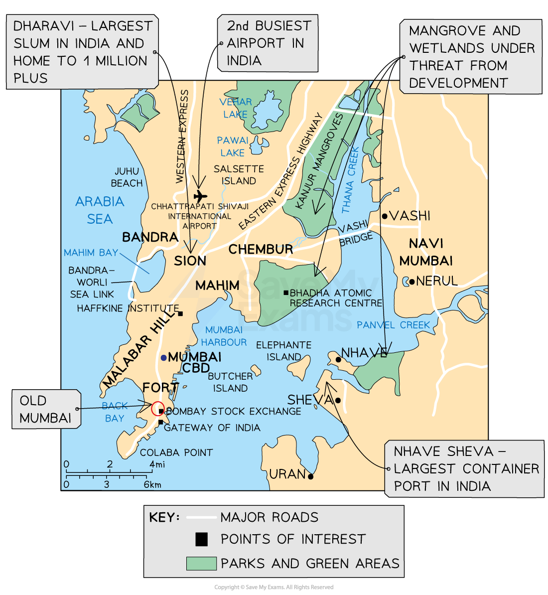
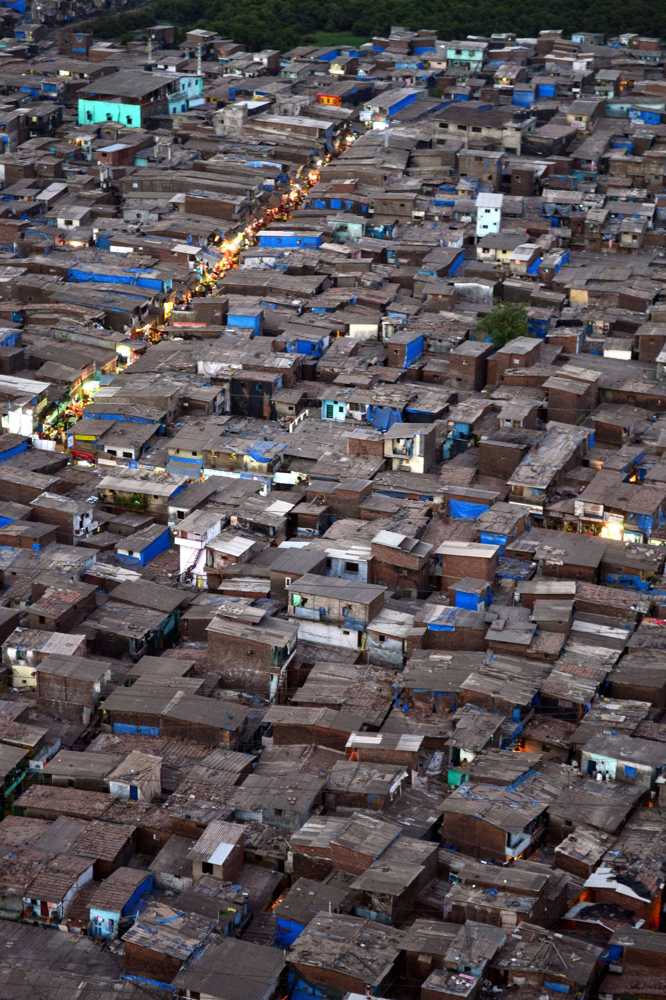
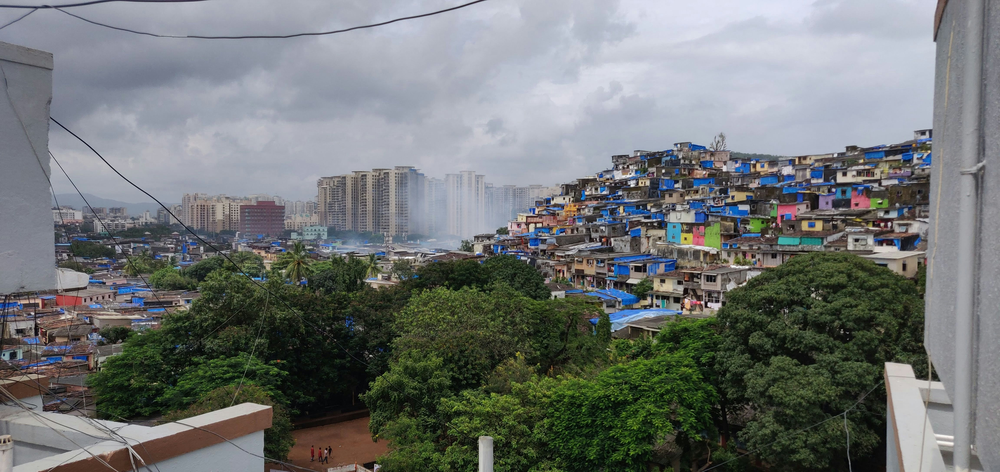
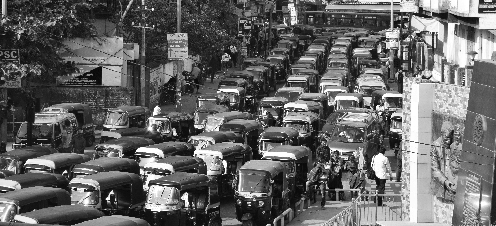
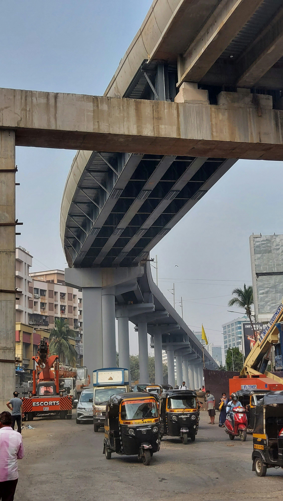
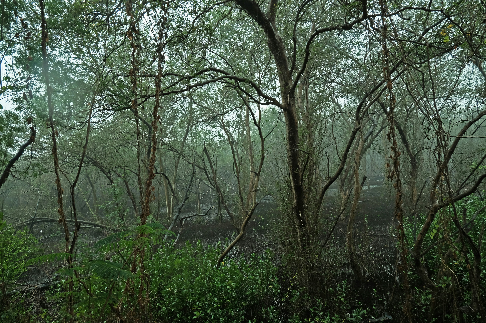

# Detailed Specific Example: Mumbai, India

## Specification link

This page covers part of section 7.3.2 of the [CIE IGCSE specification](https://www.cambridgeinternational.org/Images/718150-2027-2029-syllabus.pdf).

- **7.3.2 **- One detailed specific example of a named urban area to include:

  - Causes of urban growth
  - Challenges and opportunities brought about by urban growth
  - The strategies and techniques used to manage urban growth; including sustainable..

## Causes of urban growth in Mumbai, India

> **Spec point** — `spcpt_27qsjMNR8SCBRfGB` · One detailed specific example of a named urban area to include: 
• causes of urban growth 
• challenges and opportunities brought about by urban growth 
• the strategies and techniques used to manage urban growth; including sustainable.

## Causes of urban growth in Mumbai, India

### Background

- Mumbai is the capital city of the **Maharashtra state** on the **western coast of India**
- Originally, Mumbai was  a number of separate islands
- These were joined through large-scale ***land reclamation*** and *causeway* projects
- Mumbai has more millionaires and billionaires than any other Indian city, but also the highest rates of poverty

  - Mumbai contributes 31% of India's entire tax revenue
- Mumbai is the **commercial and financial capital of India**

  - Its growth is in hi-tech, call centres and online banking
  
    - The **Bombay Stock Exchange (BSE) **secured Mumbai's position as a financial hub, attracting banks and financial institutions
  - Approximately, 40% of Maharashtra state’s income come from Mumbai alone
- Mumbai has always been a significant **trading port** and remains the **wealthiest city on the north-west coast of India**

  - Over 60% of India’s trade is through** Nhava Sheva **container port
- Mumbai has air transport links to many world cities and is popular with international tourists

*Mumbai was once 7 separate islands, now merged into one region*

### Mumbai's growth

- Mumbai's urban growth is a combination of

  - **Natural increase **through** high birth rates**
  - **Rural-to-urban migration – **an estimated 60% of people moving to Mumbai are from villages within the state of Maharashtra
  - Most migrants are male, and aged 20-21 years
- **Mumbai **is India's **most populous city** and its growth has been large and steady
- In** 1950**, Mumbai had a **population of 1.6 million people** and increased 10-fold to **16 million by 2000 **
- In** 2024**, there were an estimated **25 million people** living in the **Mumbai Metropolitan Region (MMR)**, which **includes 12.6 million people **within the **city of Mumbai itself**
- Due to limited physical expansion, Mumbai has the **second highest population density** in the world, with **26,357 persons per km****2**
- Approximately** 3 million people commute daily** into the city

### Pull factors

- Mumbai offers better job prospects and higher wages

  - Large multi-national companies such as Coca-Cola and Tata Steel provide employment and generate income across the region
- Mumbai has better access to education, healthcare, and improved living conditions compared to rural areas
- Mumbai is home to **Bollywood**, which is the biggest film industry in the world

  - Mumbai is a significant global fashion centre, from affordable street markets to luxury designer boutiques and international fashion shows

### Push factors

- Maharashtra state is more rural than Mumbai and half of the population works in agriculture
- Farming has undergone massive changes in India in recent decades
- The increased use of machinery has forced people out of work
- Small-scale farmers are vulnerable to bad weather and poor harvests and some are forced to sell up and migrate
- Many young people see farming as hard work with long hours and low pay

## Housing in Mumbai, India

> **Spec point** — `spcpt_mnnwSN7X4nkGM2S4` · One detailed specific example of a named urban area to include: 
• causes of urban growth 
• challenges and opportunities brought about by urban growth 
• the strategies and techniques used to manage urban growth; including sustainable development.

## Housing in Mumbai, India

- Rapid urban growth has led to a significant increase in **rural-to-urban **migration, resulting in one of the **largest unplanned settlements globally**
- **Dharavi **is home to about 1 million residents and occupies an area equivalent to 500 football pitches

*Dharavi informal settlements, Mumbai. Photo by Kunal Kalra on Unsplash*

- Residents in Dharavi face severe challenges, including inadequate:

  - Water supplies
  - Sanitation
  - Waste services
- **Poor infrastructure** and transport contribute to increasing pollution, leading to waterborne diseases like **cholera **and** typhoid**
- The government plans to redevelop Dharavi into **high-end real estate** due to rising land prices and limited space
- There are over 12,000 companies, 58,000 families, and more than 100,000 people who work in the **informal economy**, mostly in leather, ceramics, and textiles in Dharavi
- Authorities are considering two approaches to improve housing through the Slum Rehabilitation Scheme

  - a **bottom-up approach **with NGO assistance
  - a **top-down approach **involving demolition and new construction

### Redevelopment of Dharavi

- The 2004 scheme for the **Dharavi Redevelopment Project **never happened, but in October 2022, new plans were made to deal with the problem of informal housing
- The government invited companies to submit proposals for redevelopment
- The **Adani Group **won the bid to replace informal housing with** high-rise apartments**
- The Adani Group plans to provide free housing with essential services for displaced residents, affecting around 68,000 people
- To qualify for new housing, residents must prove their informal homes were built before January 2000, raising concerns among long-term residents
- Many residents and business owners are worried that high-rise developments will erode the  community spirit and and have a negative influence on the informal economy
- Residents and business owners say they weren't consulted on the development plans
- There is uncertainty about details like room sizes in the new apartments
- This poses a problem for extended families if they only receive one apartment

*Dharavi slum next to high-rise apartments Photo by Prikesh Savla on Unsplash*

## Transport in Mumbai, India

> **Spec point** — `spcpt_8WBfdtK97WYG5yMD` · One detailed specific example of a named urban area to include: 
• causes of urban growth 
• challenges and opportunities brought about by urban growth 
• the strategies and techniques used to manage urban growth; including sustainable development.

## Transport in Mumbai, India

- The city faces challenges related to traffic congestion, air pollution, and the impact of suburbanisation on transport infrastructure
- The **World Health Organisation (WHO)** ranks Mumbai as the fourth most polluted megacity in the world

*Crowded and congested road in Mumbai. Photo by grayom on Unsplash*

- Car ownership is expensive which leads many people to rely on public transport

  - This reliance contributes to overcrowding and air pollution, particularly from older, inefficient vehicles
- Furthermore, Mumbai's suburban growth has increased transport demand and infrastructure upgrades
- Mumbai has a train and bus network but these are also often **overcrowded **and face** capacity issues**
- Due to narrow streets, public transport often struggles to reach informal settlements, forcing residents to walk and increasing the risk of accidents

### Mumbai's train network

- Mumbai's rail network is the busiest in the world
- The rail network spans 465 km and carries over 7.5 million commuters daily
- Trains are overcrowded during peak hours, with commuters often squeezed into carriages
- More than 2000 people die annually from train-related accidents

  - Most deaths are caused by passengers crossing tracks, sitting on train roofs and being electrocuted by overhead cables, or hanging from doors and windows
- Many strategies and projects have concentrated on improving the supply of transport facilities without sorting the problems of demand

  - This has wasted money, caused traffic jams and delayed travel times

#### Mumbai's monorail system

- India's first **monorail**, aims to provide a sustainable and efficient alternative to traditional road-based transportation
- The **Mumbai Metropolitan Region Development Authority (MMRDA)** claimed it suited congested areas and could carry 20,000 passengers per hour along a 20 km corridor from** Chembur **to **Wadala** to **Sant Gadge Maharaj Chowk**
- Long-term goal included land development and economic growth along its path
- The monorail system has been in commercial operation since 2014, but the number of people using it has been lower than initially projected
- The system has faced challenges including

  - Being **over budget**
  - Having a route that is** poorly connected** to other forms of transport
  - Closest suburban station is 4 km away, increasing travel time and costs
  - Issues with maintenance, accidents, and a fire in 2017 shut down services for 10 months
  - Overlooking **cheaper alternatives **like bus rapid transit
  - Ridership dropped from 15,000 to 10,000 per day post-closure
- Despite the challenges, the Mumbai Monorail is India's only working monorail system
- System improvements, including upgrades and more regular services, are ongoing

#### Mumbai's metro plan

- **Construction of the metro began in 2008** and aims to expand and improve the city's rail-based *mass transit system*
- The project **links businesses and residential areas **in South Mumbai
- Metro **connects **the Bandra Kurla apartment complex in Mumbai, the **International Airport**, and **northern residential areas**
- The system aims to **transport 17 million passengers daily** and hopes to reduce bus and taxi pressure

  - It aims to **cut private car journeys by half a million daily** and  promote healthier living with bus and pedestrian pathways
- The system **includes rainwater harvesting and solar panels to reduce its carbon footprint**
- The Mumbai Metro is being** built in three phases,** over 15 years, with **completion expected in October 2026**
- The total **cost **of the project is approximately **\$6.84 billion (US)**

*Mumbai metro under construction. Photo by Ansari Altamash on Unsplash*

### Mumbai's bus rapid transit system (BRTS)

- The system provides efficient public transport
- It features **dedicated bus lanes and priority at intersections**
- BRTS stations enhance boarding and alighting, with features such as raised platforms and off-board fare collection
- The high-capacity buses **carry more passengers** which improves reliability and speed  while **reducing congestion and pollution**
- It offers a better option for commuters
- **BRTS is cost-effective and uses existing infrastructure**
- It** promotes sustainable travel** by reducing private vehicle use

## Green spaces in Mumbai, India

> **Spec point** — `spcpt_h35ZtVx3nWSkYRtJ` · One detailed specific example of a named urban area to include: 
• causes of urban growth 
• challenges and opportunities brought about by urban growth 
• the strategies and techniques used to manage urban growth; including sustainable development.

## Green spaces in Mumbai, India

### Mangrove forests

- Mumbai's population has grown to over 20 million and existing green spaces are under threat
- The growth has led to the clearing of **mangrove forests** for housing and industry
- Mangroves are vital for air quality

  - They **moderate temperatures** and **reduce CO₂** levels
  - They** filter water **and keep rivers clean
  - They also provide relaxation spaces
- In 2017, authorities announced a \$1 billion investment to update treatment plants
- This plan involves cutting down 87 hectares of mangroves
- Campaigns are underway to protect Mumbai's mangroves with a proposal for a mangrove park in Dharavi

*Mangroves Park, Mumbai, Maharashtra, India. Photo by Vanburn Gonsalves on Unsplash*

### Sanjay Gandhi National Park

- In 1869, the area was designated a reserved forest, named Bombay Forest, to protect the natural landscape from the growing city of Mumbai
- Today this large park provides a significant area of green space, supporting  **biodiversity** and offering recreational opportunities

### Urban Forests

- There are efforts to find and protect the last urban forest areas, which are important in keeping the city's  *microclimate* and air quality
- An important urban forest, the **Aarey Milk Colony** stands between the city and the national park and is a major green area in Mumbai
- The area is a rich diversity of flora and fauna, and it has been a centre of *conservation* efforts, especially due to its role in protecting the city's green spaces

### Community gardens

- These gardens provide a space for residents to grow their food and connect with nature
- Mumbai's **Ambedkar Nagar slum** is a good example of a community turning a dump site and breeding ground for pests and disease into a recreational community garden

### Promenades and cycling tracks:

- Integrating green spaces with urban areas through promenades and cycling tracks promotes active transportation and recreational activities
- Mumbai has several promenades and cycling tracks along its coastline and in various parks
- Popular areas include **Marine Drive**, which is a famous promenade with a wide track for cyclists and pedestrians
- Other scenic locations for cycling include **Sanjay Gandhi National Park **and** Aarey Milk Colony**
- The **Mumbai Coastal Road project** also includes a dedicated cycle track and promenade along the shoreline
