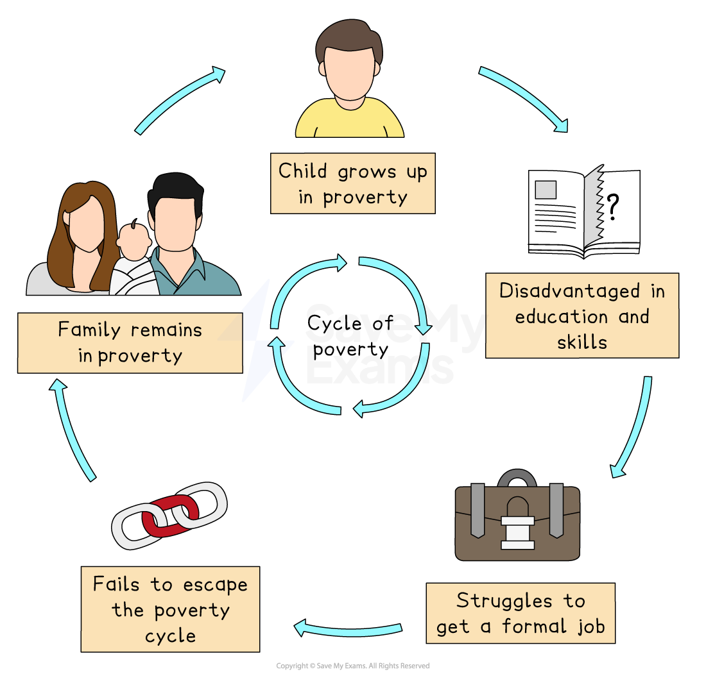

# Opportunities and challenges of rapid urban growth

## Specification link

This page covers part of section 7.2.2 of the [CIE IGCSE specification](https://www.cambridgeinternational.org/Images/718150-2027-2029-syllabus.pdf).

- **7.2.2 **- The opportunities and challenges of rapid urban growth: inequality, service provision, housing, employment, transport, waste management, unplanned settlements.

## Inequality in urban areas

> **Spec point** — `spcpt_jK2JgrjDcnGg7YGK` · The opportunities and challenges of rapid urban growth: inequality, service provision, employment, transport, waste management, 

## Inequality in urban areas

- **Rapid **and **unplanned **urbanisation creates a range of **problems**, including

  - **Inequality**
  - **Poor housing**
  - **Unemployment**
  - **Environmental issues such as pollution**
  - **Congestion**
  - **Crime, etc.**
- **Inequality **is the **unequal** access to **resources, services **and **opportunities** between **people **living in towns and cities
- It is more than just not having enough money and includes:

  - Levels of education
  - Access to technology
  - Housing quality and affordability
  - Infrastructure
  - Healthcare

- **All cities** have **levels of inequality**, but LICs are amongst the worst affected
- Many low-income families are 'pulled' to **informal settlements** around towns and cities looking for a sense of 'belonging' with others in the same situation
- For other people without a strong social network or in cities with many new migrants, it’s more common for them to become involved in crime, begging, and petty theft
- Overall, this creates urban poverty that causes a breakdown of both the physical and social environment

  - This makes it difficult for people to escape from poverty and they fall victim to the vicious '**cycle of poverty',** and urban poverty becomes ingrained within the city
- Combined with a lack of suitable work, housing, water supply, sewerage, solid waste disposal and pollution, the quality of life for some people in cities is low

*Cycle of poverty*

## Services in urban areas

> **Spec point** — `spcpt_HS6ZtRQC42T4xMZD` · The opportunities and challenges of rapid urban growth: inequality, service provision, employment, transport, waste management, 

## Services in urban areas

- **Electricity **supplies are often inadequate and unreliable in megacities

  - This results in frequent *blackouts* and *brownouts*
  - **Power outages** reduce foreign investment and quality of living for residents
- **Power theft** is also common in megacities
- Without electricity for cooking, biomass (such as wood or dung) is often used by the poorest households

  - This contributes to** low air quality** and greater household fire risk
- **Sanitation and water supplies** vary among cities and the UN estimates that in cities:

  - Over 1 billion people do not have access to adequate supplies of fresh, **clean drinking water **
  - Approximately 2 billion do not have adequate access to sanitation facilities, organised sewage disposal or waste collection
- **Water shortages** are common due to ***over-abstraction***
- **Water quality** is often poor

  - This forces people to buy water from sellers at a high price
- The** lack of safe water** means that people have to find alternative sources, which may lead some people to drinking from pools of water on the ground

  - This is a health risk, as it is a perfect breeding ground for diseases such as **cholera**, and accounts for 2 million deaths each year worldwide
  - Open water attracts mosquitoes which may lead to the spread of **malaria**

## Waste management in urban areas 

> **Spec point** — `spcpt_ZFNRZdk4zQs8PQb6` · The opportunities and challenges of rapid urban growth: inequality, service provision, employment, transport, waste management, 

## Waste management in urban areas

- Waste products and disposal of waste are major issues
- Every person and business produces waste, making the combined rubbish of a city, huge
- Much of this waste will end up going to landfill

  - This is both expensive and wasteful
- Space is running out and new laws restrict the dumping of certain wastes in landfill sites, adding to a city's problems in dealing with its waste
- Rubbish dumps are usually just outside city limits with** limited or no collection of waste, **leading to rats, etc.

  - Many of these rubbish dumps contain **toxic waste **
  - People pick over the waste to make a living
  - Many of these people have no formal training or protective clothing and are exposed to unsafe material
  
    - In Lagos, Nigeria, just 40% of the 10,000 tonnes of daily waste produced is collected and taken to large rubbish dumps
- Most LIC cities have **no adequate sanitation** or **sewage disposal**

  - Open defecation is common in local rivers, which increases the spread of diseases
- **Water pollution** is widespread as rivers are used to dump chemicals and other toxic wastes due to a lack of regulations

## Employment in urban areas

> **Spec point** — `spcpt_MtkW8TchWYyz6Yvg` · The opportunities and challenges of rapid urban growth: inequality, service provision, employment, transport, waste management, 

## Employment in urban areas

- Rapid urbanisation means that job creation cannot match the pace of growth
- As a result, ***unemployment*** and ***underemployment*** are not unusual
- People will often work on street corners and do ***informal*** work, including:

  - shining shoes
  - giving haircuts
  - ***para-transit***** – **including rickshaws and tuk tuks
  - selling water or food
- It is estimated that more than 60% of the world's employed population work in informal employment

  - As much as 93% of informal employment is in  MIC and LIC cities
- These jobs are often unskilled and labour-intensive and require little money to set up
- The **informal economy** leaves cities without revenue to provide adequate services, as workers pay no taxes
- It also makes wages and working conditions difficult to regulate
- Most informal employment is work in the **tertiary sector**

## Transport in urban areas

> **Spec point** — `spcpt_Rbkvwy4nG3pfZ4j3` · The opportunities and challenges of rapid urban growth: inequality, service provision, employment, transport, waste management, 

## Transport in urban areas

- Rapid development leads to these transport systems becoming easily **overloaded and overcrowded**
- Therefore, roads and public transport tends to be **poor in quality, size, and reliability, **which contributes to **congestion **
- Urban congestion varies over the week, time of day, the weather, and the season, which affects the levels of pollution

### Urban pollution

- Urban pollution kills thousands of people each year and  includes

  - **air**
  - **light**
  - **noise**
  - **visual**

#### Air pollution

- High numbers of vehicles **emit high levels of atmospheric pollution**

  - Smog
  - Carbon monoxide
  - Nitrous oxide
  - Sulphur dioxide
- This leads to breathing issues and cardiac and lung problems

#### Noise pollution

- Noise pollution is high in cities and comes from

  - traffic
  - construction
  - people talking
  - music in public places, etc.
- Noise pollution has been associated with

  - heart disease
  - sleep problems
  - mental health issues
  - physical stress

#### Light pollution

- Light pollution comes from

  - street lighting
  - homes
  - shops
  - factories
  - offices
- Light pollution has been associated with

  - eye problems
  - sleep disorders
  - increased stress and anxiety

#### Visual pollution

- Visual pollution from graffiti, slum housing, traffic congestion, advertising, etc.

### Effects in LICs

- These issues tend to be worse in LICs, as there is usually little regulation or enforcement
- Air pollution from using **old, un-serviced vehicles **that emit dirty and harmful fumes adds to serious health problems such as asthma and bronchitis
- **Unregulated factory emissions** pollute not only the air but water sources as well
- Roads in LIC cities were never designed to take large volumes of traffic
- A drop in the rate of extreme poverty around the world makes vehicle ownership possible

  - This worsens congestion and pollution
- It is not uncommon for 2-stroke engine taxis (such as auto-rickshaws or 'tuk tuks'), cycle rickshaws, bullocks, elephants, motorcycles, cars, buses and trucks to all share the same roads

  - These forms of transport move differently,  which often leads to them getting in each other's way
  - This causes traffic jams and pollution, both noise and air
- Many LICs have inconsistent driver training

  - A lack of consistent road rules leads to gridlock, stress and road rage
  - This adds to pollution through exhaust emissions (smog)
