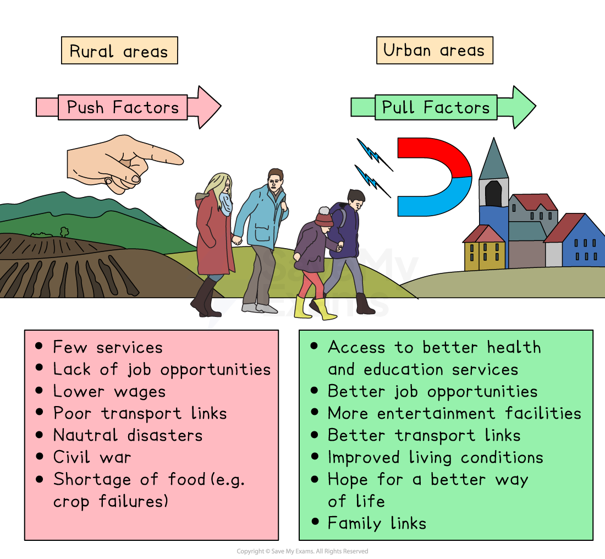

# Rapid urban growth rates in LICs

## Specification link

This page covers section 7.1.2 of the [CIE IGCSE specification](https://www.cambridgeinternational.org/Images/718150-2027-2029-syllabus.pdf).

- **7.1.2 **- Causes of rapid urban growth in LICs: rural to urban migration, social, economic, environmental, and political factors, natural increase.

## Causes of rapid urban growth rates in LICs

> **Spec point** — `spcpt_KPXT7DtzF4s3chWp` · Causes of rapid urban growth in LICs: rural to urban migration, social, economic, environmental, and political factors, natural increase.

## Causes of rapid urban growth rates in LICs

- The UN predicts that by 2030 over 60% of the world's population will live in an urban environment
- Urbanisation usually occurs because people move from **rural to urban** areas as a **country develops**
- **HICs **saw the majority of their urbanisation **before 1950 **due to** **industrialisation in many urban areas
- **From the 1950s**, **LICs **have seen rapid growth in urbanisation, particularly in South America, Asia and Africa
- By **2021**, the** urban population in LICs had doubled **
- There are** three main reasons** for rapid urbanisation in LICs

  1. **Rural-urban migration** due to push-pull factors
  2. **Speed of industrial **and** economic development **in major towns and cities
  3. **Rate of population growth **as development occurs

### 1. Rural-urban migration

- Rural-urban migration is a **major **factor that drives urbanisation

  - It is the movement of people from the countryside to cities
- This migration causes the urban population to grow, often at the expense of the rural population

  - For example, in **China**, rural-urban migration has led to massive city growth, with people moving from farming regions to cities like **Shenzhen** and **Beijing** in search of jobs in factories or offices
  - This has left many rural areas without people to work the land for food
- **Factors **that **cause** this **migration **are known as **push **and **pull**

  - **Push factors** are the reasons people **leave** rural areas
  - **Pull factors** are the **attractions** of urban areas that **draw **people to move there
- Push-pull factors are **unique to each **person depending on their end goal

  - What is a pull factor for one person may not be for another
- These factors can be further classified as:

  - ***Social*** such as population growth
  - ***Economic*** – higher wages in cities
  - ***Environmental ***– a lack of resources in rural areas
  - ***Political***, such as government policies that promote urban development
- Rural-urban migration is usually a combination of factors that cause people to migrate

  - For example: High levels of unemployment are a push factor, whereas higher wages and a better lifestyle are a pull factor

#### Social

- Push

  - Population growth leading to poverty
  - Poor housing and health care
  - Fewer and lower-quality schools and educational resources
  - Lack of social networks and family support
  - Lack of facilities such as shops,  can 'push' young people from rural areas
- Pull

  - Cities typically have better schools, universities, and medical facilities
  - More opportunities for cultural and personal development
  - Sense of community and belonging
  - Higher levels of retail and leisure facilities, such as  restaurants, theatres and gyms

#### Economic

- Push

  - A lack of industrial, service, and technology sectors
  - Skilled workers leaving rural areas
  - High levels of unemployment
  - Lower wage rates
- Pull

  - Better job options to earn more money
  - Brain gain in areas of economic development
  - Access to public transport and wider range of goods and services

#### Environmental

- **Push**

  - Disasters like earthquakes, floods, or droughts
  - Soil erosion causing a loss of productive land and crop failure
- **Pull**

  - Improved living conditions
  - Greater food security
  - Cleaner water
  - Better waste management

#### Political

- **Push**

  - Civil war
  - Lack of government support
  - Religious or cultural discrimination
- **Pull**

  - Higher personal safety with better infrastructure
  - Higher political freedom, democracy or human rights
  - Government policies on development

*Push and pull factors of rural–urban migration*

> **Exam Hint**
> Remember, when asked to provide push-pull factors, do not simply state the opposite of what was mentioned.
> 
> Poverty is a push factor; however, everywhere has certain levels of poverty, so a pull factor could be better welfare and healthcare services.

### 2. Speed of economic and industrial development

- Economic growth drives urbanisation

  - As a city prospers, it attracts people and businesses
  - This encourages inward investment
  - This leads to yet more development and growth
  - Generating further need for skills and labour and job growth
  - This cycle multiplies the positive effects and growth continues
- The faster the growth of ***secondary*** and ***tertiary*** employment sectors, the faster the growth of urbanisation

  - Most new **economic development **is concentrated in the big cities in LICs through investment in low-cost manufacturing of textiles, garments and shoes
  - Leading to high rates of **rural-to-urban migration**

### 3. Rate of population growth

- Economic growth needs a supply of labour
- There are two ways to meet this demand:

  - **Rural-urban migration** is an important source of labour, as it attracts a wider pool of people into the urban region
  - **Natural increase **in an urban population but this is a slow way of meeting demand

### Natural increase

- High levels of ***natural increase***** **in population accounts for roughly 60% of urban population growth
- It indicates how a population changes due to natural processes (births and deaths) without including migration

  - If ***birth rates ***are higher than death rates, then there will be a natural increase
  - If ***death rates ***are higher than birth rates, there will be a natural decrease
- Factors like birth rates, death rates, and life expectancy significantly impact natural increase

> **Exam Hint**
> Natural increase refers **only** to the **difference **between the number of** births** and the number of **deaths**, **excluding** any inward **migration **of people to a place.
> 
> E.g. On one street, there were five new migrants, 10 births, and two deaths. The natural increase is 8 people because the migrants chose to move there. If they went on to have children, the natural increase rate would also include theirs.
