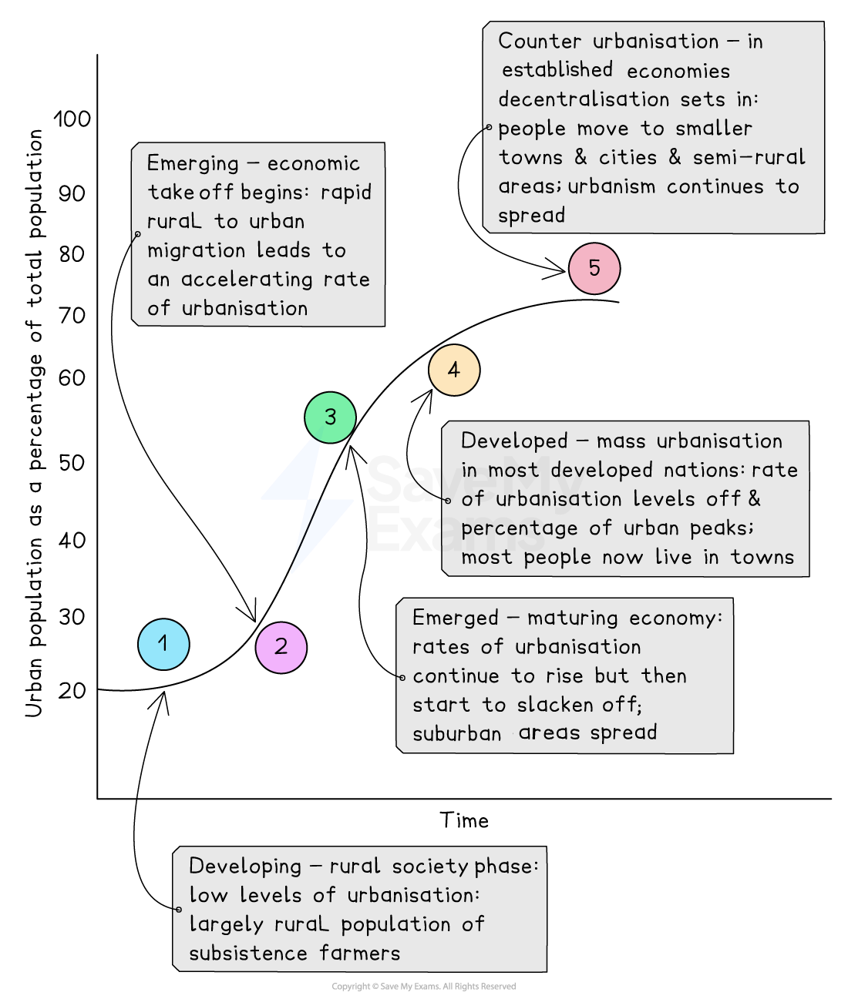

# Urban growth rates

## Specification link

This page covers section 7.1.1 of the [CIE IGCSE specification](https://www.cambridgeinternational.org/Images/718150-2027-2029-syllabus.pdf).

- **7.1.1 **- Reasons for variations in global urban growth rates.

## Reasons for variations in global urban growth rates

> **Spec point** — `spcpt_67JBJCZPRppWTVcv` · Reasons for variations in global urban growth rates. 

## Reasons for variations in global urban growth rates

- The term '**urban area**' refers to any highly developed built-up area, such as towns, cities, and suburbs

  - An urban area is **characterised **by a high density of man-made structures, including homes, businesses, schools, hospitals, bridges, roads, and other infrastructure
- **Urban growth** is the increase in the population size and/or physical area of a town or city
- Urban growth occurs because of:

  - **Natural population increase**
  
    - More people are born than die
    - Accounts for roughly 60% of urban population growth
  - **Rural-urban migration**
  
    - Accounts for 40% of urban growth
    - Due to rural push factors along with urban pull factors
  - **Economic development**
  
    - Countries become more urban as they develop economically
- **Urbanisation** is the process by which an increasing **percentage** of a country's population comes to **live in towns and cities**
- More people now live in towns and cities than in rural areas in search of a **better quality of life**
- Urbanisation **growth rate varies** **between and within countries **globally
- The **world population doubled** between 1950 and 2015, but the **urban population more than trebled**
- Modern transport and communication has created ***conurbations***, further adding to the growth of urban areas
- High-income countries** (HICs)** show the **highest levels of urbanisation**, with the **lowest levels being in Africa and SE Asia**
- **Government policies – **Some governments actively encourage urban growth by investing in cities and infrastructure

  - China, for example, has rapidly urbanised through deliberate government planning
  - Other countries might focus more on rural development

### HICs

- **Rate of urban growth: **Slow or declining

  - HICs have lower rates of urbanisation, as towns and ***cities*** already exist
- **Example: **UK, Germany, Japan, and America
- **Cause: **The industrial revolution 'pulled' the population into developing urban areas at that time

  - Nowadays, many people in HICs are being 'pushed' (counter-urbanisation) away from overcrowded cities to rural settlements
  - HICs tend to have good transport and communication networks; therefore, people can live in rural areas while commuting to cities or work from home

### MICs

- **Rate of urban growth: **Rapid
- **Example: **India, Russia, Brazil and China
- **Cause: **These areas are becoming key trade hub cities and are seeing greater growth than others due to investment from the government and TNCs

  - Cities such as Lagos in Nigeria, Shanghai in China, Mumbai in India, Sao Paulo in Brazil and St Petersburg in Russia – none of these are the country's capital
  - Trade such as finance, electronics and manufactured goods

### LICs

- **Rate of urban growth: **Fastest rates of urbanisation
- **Example: **Sub-Saharan countries, including Rwanda and Ethiopia. Asian countries like Vietnam, Bangladesh, and the Philippines are expected to contribute 60% to global growth by 2030
- **Cause:**

  - **Economic development **is concentrated in the big cities
  - **Investment **in **low-cost manufacturing** of textiles, garments and shoes
  - High** **rates of **rural-to-urban migration**
  - High levels of **natural increase **in population

*Urbanisation pathway*

## Megacities

- In 1900 there were just 2 ***'millionaire'*** cities (London and Paris); by 2018 this had grown to 512
- As the growth of cities continues, the term '**megacity'** is used to describe cities with more than 10 million people

  - In 1970 there were only 4
  - By 2000 there were 15
  - 2007 saw more people living in an urban environment than a rural one
  - In 2018 that rose to 33
- **Largest growth **of megacities is seen in **Asia – Tokyo** has close to 37.3 million people
- By **2050** it is thought that more than **two-thirds (7 billion)** of the world population will **live **in **urban areas**
- This scaling up of the urban environment is the **fastest **in human history

> **Worked Example**
> Which term is best defined by the phrase ‘the increasing percentage of the population living in towns and cities'?
> 
> **[1 mark]**
> 
> **A**: Urban regeneration
> 
> **B:** Urban sprawl
> 
> **C:** Migration
> 
> **D:** Urbanisation
> 
> **Final answer:** **Answer:**
> 
> - D: urbanisation **[1]**
