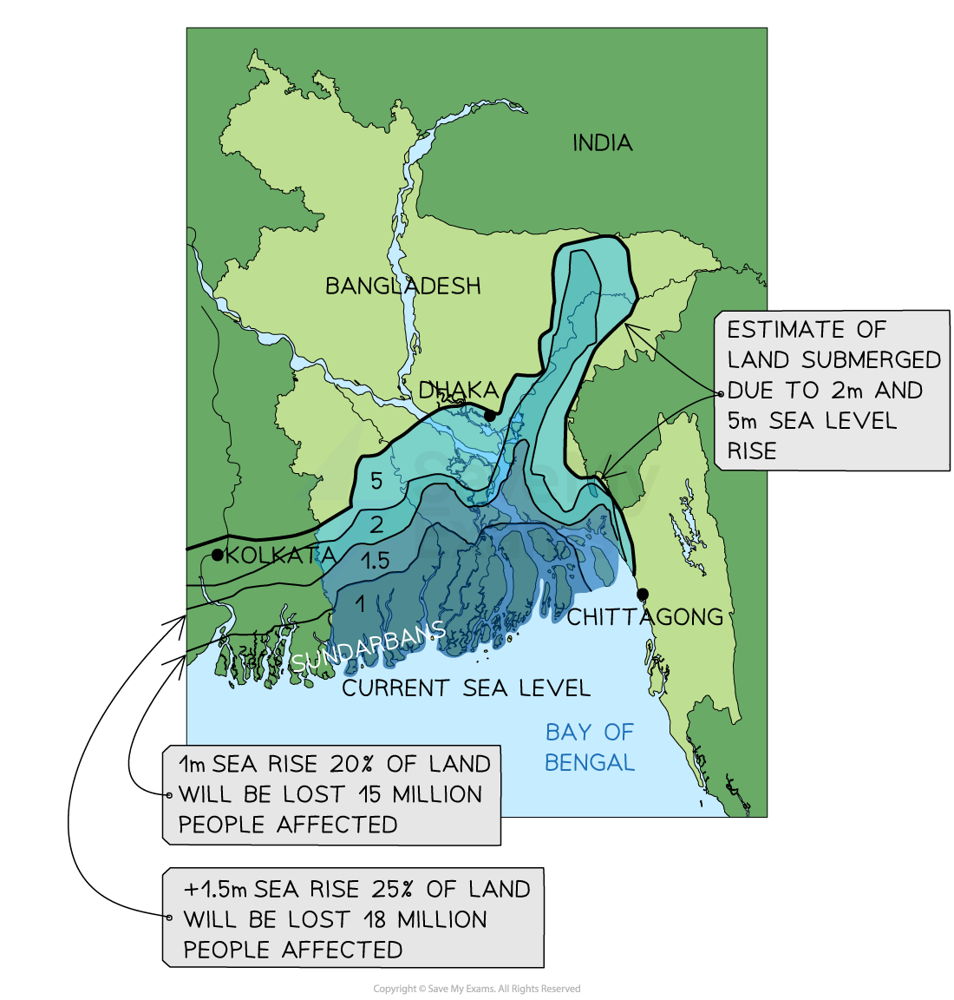

# Detailed Specific Example: Bangladesh

## Specification link

This page covers section 5.3.3 of the [CIE IGCSE specification](https://www.cambridgeinternational.org/Images/718150-2027-2029-syllabus.pdf) .

- **5.3.3 **- One detailed specific example of a named country or region to include:

  - The impacts of climate change
  - The responses to climate change
  - The strategies and techniques being used to manage climate change; including sustainable.

## Background

- Bangladesh is responsible for 0.5% of the global greenhouse gas emissions
- As a developing country, it did not have to sign up to the **Kyoto Protocol** but Bangladesh did sign the **Paris Agreement**
- Despite its very low contribution to emissions, Bangladesh is extremely vulnerable to climate change

## Impacts of climate change on Bangladesh

> **Spec point** — `spcpt_69hkF9mRCkVz2G23` · One detailed specific example of a named country or region to include: 
• the impacts of climate change 
• the responses to climate change 
• the strategies and techniques being used to manage climate change; including sustainable.

## Impacts of climate change on Bangladesh

### Rising sea levels and flooding

- Bangladesh is mostly a low-lying, flat delta
- It is **vulnerable to any changes in sea levels and flooding** because:

  - Over 75% of the country is less than 10 m above sea level
  - The Ganges, Brahmaputra and Meghna rivers converge in Bangladesh
  - Over 80% of the country sits on the low-lying floodplains of the delta
  - The country is already prone to flooding and tropical monsoon conditions
- Seasonal flooding is normal and necessary to provide fertile soil and irrigation
- The size, intensity, and frequency of these events have increased
- The monsoon rainfall is predicted to rise by 40% by 2030

  - In 1998, 75% of Bangladesh was flooded, making 30 million people homeless
  - Over 1,000 people died
  - At least 700,000 hectares of crops were destroyed
- Bangladesh is also vulnerable to sea level rise

  - A rise of 1 meter would lead to the loss of 20% of the land area and impact 15 million people

*Effect on Bangladesh of sea level rise*

### Water resources

- Changes in rainfall patterns have **increased droughts** in the west and northwest regions
- The droughts have led to:

  - crop failure
  - livestock deaths
  - food shortages

### Health impacts

- **Extreme heatwaves **increase the risk of **heatstroke**
- Flooding increases the spread of **waterborne diseases**, and diseases like malaria

### Economic impacts

- Flooding and droughts lead to :

  - loss of crops
  - disruption to industry
  - damaged **infrastructure**
- These all impact on the country's economy

### Biodiversity loss

- Climate change impacts ecosystems, such as the Sundarbans mangrove forest

  - This leads to **habitat loss** and **biodiversity decline**

## Response to climate change in Bangladesh

> **Spec point** — `spcpt_FQxhhBMshnCY52XW` · One detailed specific example of a named country or region to include: 
• the impacts of climate change 
• the responses to climate change 
• the strategies and techniques being used to manage climate change; including sustainable.

## Response to climate change in Bangladesh

- The government has taken steps to **adapt to climate change** and **mitigate future climate change**
- The **Bangladesh Climate Change Strategy and Action Plan **was adopted in 2009. The plan:

  - Identified the risks and challenges of climate change
  - Outlines adaptations which can be made
  - Identifies the need to reduce carbon emissions – Bangladesh has pledged to reduce emissions by 22% by 2030
- It is estimated that Bangladesh will need US\$5 billion a year to finance adaptation and mitigation projects

  - This is far more than the country can afford

## Strategies to manage climate change in Bangladesh

> **Spec point** — `spcpt_B6HZMgTB4xdM4Q7p` · One detailed specific example of a named country or region to include: 
• the impacts of climate change 
• the responses to climate change 
• the strategies and techniques being used to manage climate change; including sustainable.

## Strategies to manage climate change in Bangladesh

### Adaptations

- Bangladesh is already vulnerable to coastal and river flooding. Global warming has worsened this vulnerability

  - Increased melt from the Himalayas
  - Increased frequency and severity of tropical cyclones
  - Rising sea levels
- Bangladesh has adapted in several ways

  - **Submersible roads **which can withstand flooding or raised roads
  - Over **2,200 shelters** on stilts with a raised platform 'kills' nearby for livestock
  - Community-based **early warning system** for tropical cyclones
  - Flood protection and drainage schemes to protect urban areas
  - Coastal embankment projects involving **6,000km of embankments **
  - Irrigation schemes
  - Agricultural research programme to develop saline, **drought and flood resistant, high yield varieties of crops**
  - **Mangrove planting along 9,000 km** of coastline

### Mitigation

- Although Bangladesh's emissions are low, it is looking at ways to reduce them, including:

  - Improved agriculture practices to reduce the emissions of methane from rice fields
  - Encourage people to stop using biomass stoves for cooking and eating
  - Increase small-scale solar energy for homes
- The** Bangladesh Renewable Energy Policy (2008)** aims to increase the amount of renewable energy to over 10%
- The plans to build nine new coal plants have been abandoned
- Bangladesh aims to have 15% of registered vehicles powered by electricity by 2030
- The expansion of the public transport system – Mass** Rapid Transit** and **Bus Rapid Transit **in Dhaka as well as 798km of new rail lines by 2025
