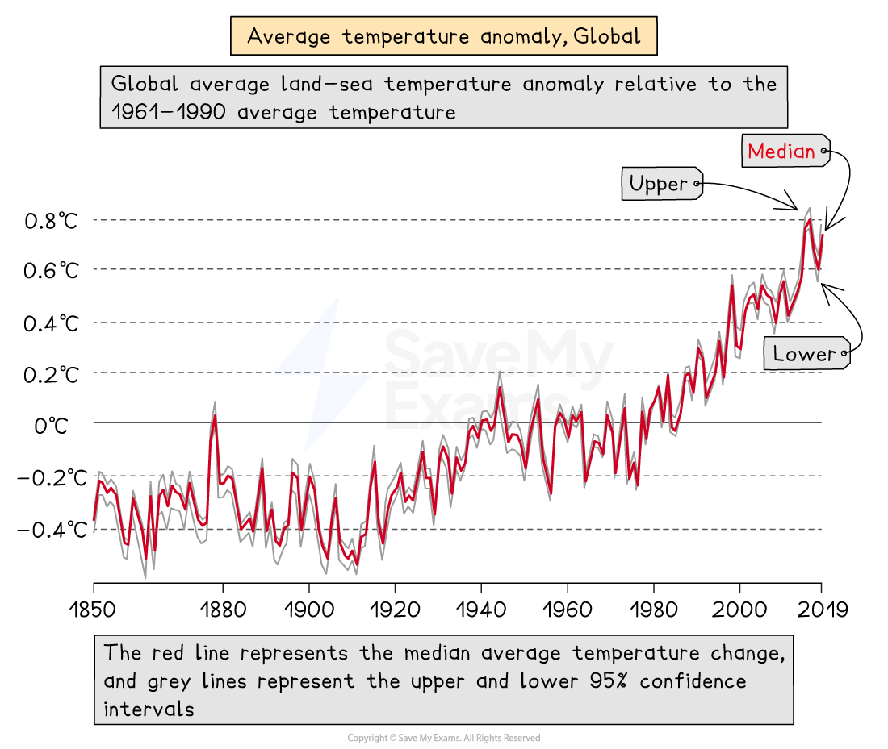
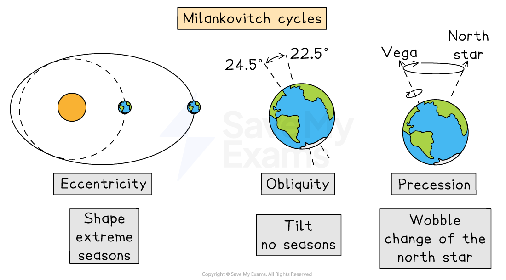
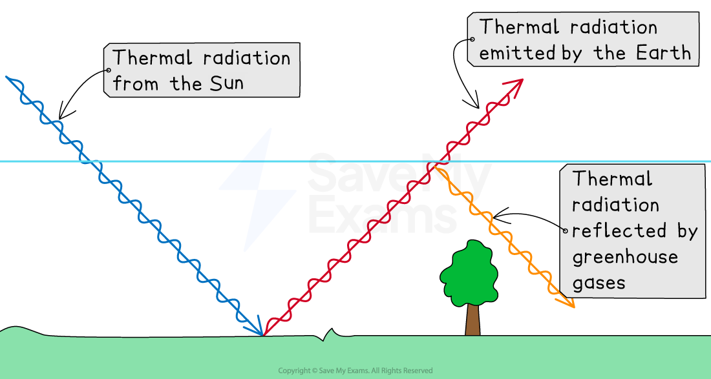
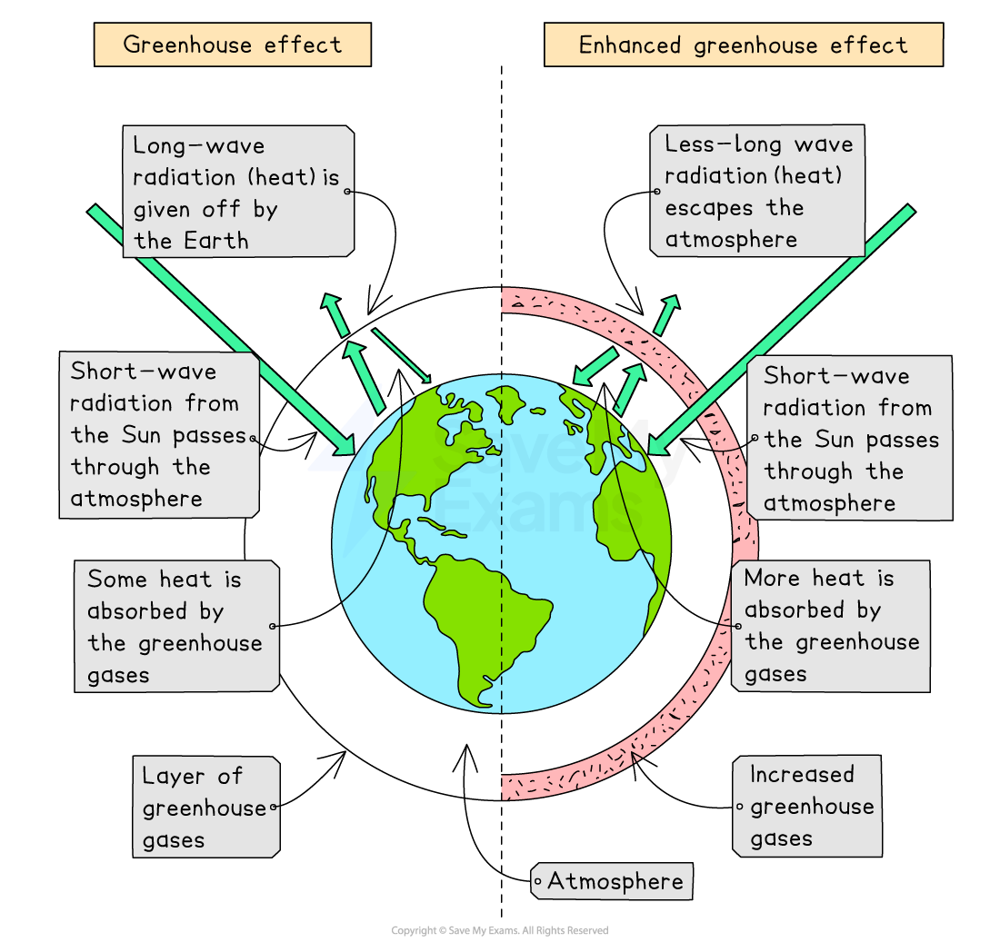

# Causes of Climate Change

## Specification link

This page covers section 5.1.1, 5.1.2 and 5.1.3 of the [CIE IGCSE specification](https://www.cambridgeinternational.org/Images/718150-2027-2029-syllabus.pdf) .

- **5.1.1 **- Evidence of climate change: global temperature data, ice cores, sea ice positions, historic writing and paintings.
- **5.1.2 **-  Factors influencing natural climate change: orbital changes (Milankovitch cycles), sunspots, volcanic activity.
- **5.1.3 **- The human influence on the atmosphere causing the enhanced greenhouse effect. For example, the use of fossil fuels, deforestation, agriculture.

## Evidence of climate change

> **Spec point** — `spcpt_v29yk6dPRnqNGrHd` · Evidence of climate change: global temperature data, ice cores, sea ice positions, historic writing and paintings.

## Evidence of climate change

- The global climate conditions of the Earth change over time, leading to colder and warmer periods
- The last 2.6 million years are the **Quaternary** period, when there have been 60 cold periods and warmer ***interglacial*** periods
- The last **ice age** ended approximately 25,000 years ago
- Evidence that change happened:

  - **Ice cores **have trapped ash, air bubbles and microbes
  - Preserved **pollen**
  - **Historical sources** such as diaries and art
  - **Tree rings**
  - **Sea ice position**
- Over the last 200 years, we have had  more accurate measurements of temperature

*Graph showing global average temperature change since 1850*

> **Worked Example**
> Study Figure 1, which shows changes in global carbon dioxide (CO2) emissions and average temperature change between 1960 and 2020.
> 
> 
> 
> Estimate the increase in global CO2 emissions between 1960 and 2020.
> 
> [1]
> 
> > *Ensure that the correct figures are used in the answer by checking the key. The dashed line shows CO2 emissions.*
> 
> > *The emissions in 1960 then need to be deducted from the emissions in 2020 to calculate the answer.*
> 
> **Answer**
> 
> - Emissions in 2020 = 4.9 metric tonnes per capita
> - Emissions in 1960 = 3.1 metric tonnes per capita
> - *4.9 - 3.1 = 1.8*
> - **1.8 metric tonnes per capita** **[1]**

## Factors affecting natural climate change

> **Spec point** — `spcpt_4hqFPz4MWp44Ckm4` · Factors influencing natural climate change: orbital changes (Milankovitch cycles), sunspots, volcanic activity

## Factors affecting natural climate change

### Milankovitch cycles

- These are **long-term** changes to the Earth's orbit and position
- This changes how much solar radiation the Earth receives
- The Earth's orbit changes every** 100,000 years. **A more circular orbit leads to cooler periods and an elliptical orbit leads to warmer periods
- The Earth's tilt varies every** 41,000 years **and the greater the tilt, the hotter the summers and the colder the winters are
- Every** 24,000 **years the Earth wobbles on its axis and this can affect the seasonal temperatures

*Milankovitch cycles showing shape, tilt and wobble*

### Volcanic eruptions

- Large-scale eruptions lead to vast quantities of ash being ejected into the atmosphere
- Ash in the atmosphere blocks solar radiation, leading to a decrease in temperatures

### Sunspot activity

- Increased sunspot activity is linked to higher average temperatures

### Atmospheric dust

- Asteroids and meteors entering the Earth's atmosphere may increase the amount of dust, which decreases temperatures

## The enhanced greenhouse effect

> **Spec point** — `spcpt_K2C4BXJkrygXg6zm` · The human influence on the atmosphere causing the enhanced greenhouse effect. For example, the use of fossil fuels, deforestation, agriculture

## The enhanced greenhouse effect

### The greenhouse effect

- The greenhouse effect is essential to the survival of life on Earth

  - Greenhouse gases in the atmosphere allow **short-wave radiation** from the sun through to the Earth's surface
  - This is then radiated back into the atmosphere as** long-wave radiation (heat)**
  - The greenhouse gases absorb some of the long-wave radiation (heat) and stop it from radiating out into space
  - This maintains the Earth's average temperature
  - Without the greenhouse effect, the average temperature would be -18°C

*Short wave radiation from the Sun is emitted by the Earth as long wave radiation into the atmosphere*

#### Greenhouse gases from natural sources

- **Water vapour—**evaporation from the oceans/seas and plants
- **Carbon dioxide—**volcanic eruptions, wildfires and respiration
- **Methane **is emitted from oceans and soils as part of decomposition; termites also emit methane
- **Nitrous oxide—**soils and oceans

- Human activity is increasing the number of greenhouse gases in the atmosphere

  - **Carbon dioxide** **(CO₂) **levels in the atmosphere have increased by more than 100 parts per million (ppm) to 420 ppm in 2020

*Diagram showing the natural and the enhanced greenhouse effects*

### The enhanced greenhouse effect

- **Population growth** has led to:

  - higher** energy** demand
  - greater** food production**
  - more** industrialisation**
  - increased** transport**
- All of these are increasing the proportions of greenhouse gases in the atmosphere
- This has led to the **enhanced greenhouse effect:**

  - Less **long-wave radiation (heat) **can escape the atmosphere
  - Average global temperatures have increased over 1°C since pre-industrial times

#### Greenhouse gases from human activity

- **Carbon Dioxide (CO****2****) **- the burning of fossil fuels, burning of wood and deforestation (less CO2 is removed from the atmosphere)
- **Methane (CH₄)—**decaying organic matter, including manure and waste in landfills, rice fields and livestock
- **Nitrous Oxide (N₂O)—**artificial fertilisers and burning of fossil fuels
- **Chlorofluorocarbons (CFCs)—**aerosols, refrigeration, air conditioning
