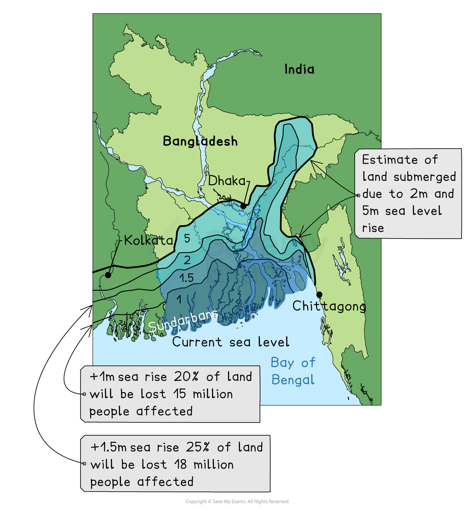

# Impacts of Climate Change

## Specification link

This page covers section 5.2.1, 5.3.1 and 5.3.2  of the [CIE IGCSE specification](https://www.cambridgeinternational.org/Images/718150-2027-2029-syllabus.pdf) .

- **5.2.1 **- The present day and predicted future impacts of climate change. For example, rising sea levels, and changes to global temperature, weather patterns, and food production.
- **5.3.1 - **The strategies (including national and international agreements) and techniques used to manage the impacts of climate change.
- **5.3.2 - **An evaluation of mitigation (including international agreements) and adaptation strategies and techniques used to manage the impacts of climate change.

## Impacts of climate change

> **Spec point** — `spcpt_zc3P6gJKGjrFqj4Q`

## Impacts of climate change

### Health

- Increased temperatures and lack of precipitation may lead to the spread of diseases:

  - Italy has experienced cases of **malaria** since 2017, when it was previously a malaria-free area
  - An additional **280 million** people may be affected by malaria
  - **Waterborne diseases** are more likely to spread
- **Heat waves** may become more frequent
- ***Heat stroke***, dehydration and sunburn increase during heat waves
- Stagnant air during heat waves increases air pollution levels:

  - ***Respiratory*** diseases increase and those suffering from respiratory illnesses such as asthma may be more affected
- Increased temperatures negatively affect people with ***cardiopulmonary*** diseases
- Diets may be restricted by **food shortages** leading to **malnutrition **and **famine**

### Homes and settlements

- **Increased flooding** due to **sea level rise** and increased frequency and severity of storms will lead to the*** displacement*** of large numbers of people
- Settlements in low-lying areas may have to be abandoned or need additional defences against sea level rise

  - Moving settlements or improving flood defences will be costly

### Agriculture

- Farmers may need to change the crop they grow if climate conditions become unsuitable
- Coastal flooding may lead to ***salt intrusion***
- Reduced availability of water will mean that irrigation is limited or impossible
- Food shortages will lead to malnutrition and famine
- Food prices may rise

### Employment

- Job opportunities may change or decrease for the following reasons:

  - Tourism may decline in some areas; for example, ski resorts may close due to the lack of reliable snow
  - Coastal resorts may be at risk of flooding leading to the closure
  - Farmers may have to change the crop they grow or livestock they raise or leave farming
  - In some areas, agriculture may decline due to rising temperatures or changing rainfall patterns

### Sea level rise

- Warmer temperatures cause the water in seas and oceans to expand, increasing the sea level
- Melting ice is adding to the increasing volume of water:

  - Average sea levels have risen **23 cm since 1880**
  - Sea levels are forecast to increase a further **30 cm by 2050**

*Bangladesh sea level rise predictions*

- Low-lying coastal areas such as **southern Bangladesh** and islands are at higher risk of flooding:

  - The Maldives may be uninhabitable by 2050
- **Beach erosion** will increase, leading to greater coastal erosion
- **Coastal ecosystems,** including coral reefs and mangrove swamps, will be affected
- Saltwater is contaminating freshwater supplies and affecting coastal agriculture

### Ecosystem change

- The location of** biomes** may shift to the north (Northern Hemisphere) and south (Southern Hemisphere) as they rely on specific climate conditions:

  - **Polar and tundra biomes** are at risk of becoming extinct as they cannot shift any further north/south
- Increasing sea temperatures and ***ocean acidification*** have resulted in ***coral bleaching***
- Migration and behavioural patterns of animals affected by changing temperatures:

  - Fish species are moving north and south of their usual habitats to seek cooler water
  - Reduced hibernation due to warmer winters
- Melting of ice caps/glaciers leading to changing ocean currents
- **Mangrove swamps and coral reefs** are threatened by rising sea levels
- Loss of habitats through flooding, drought and wildfires
- Food webs breaking as species numbers are reduced and food sources are decreased
- Loss of plants and vegetation

### Natural hazards

- Changes in climate patterns are likely to increase the **frequency and severity of storms:**

  - The 2020 Atlantic hurricane season was the first most active on record and 2021 was the third most active
- The **frequency and length of droughts** are increasing
- Dry conditions lead to the increased risk of **wildfires:**

  - In 2021, Australia, Greece, South Africa, Brazil and the USA were just some of the places to experience severe wildfires
  - In September 2021, the USA National Fire Centre reported 44,647 wildfires that had burnt 5.6 million acres
- Rising sea levels together with increased storms lead to **increased flooding **risk

> **Worked Example**
> State one reason for each of the following impacts of climate change.
> 
> - rising sea levels
> - prices of food may rise
> - shortage of water
> 
> [3]
> 
> > *The command word for this question is 'state' this means that no explanation is needed in the answer.*
> 
> **Answer**
> 
> - Rising sea levels - due to melting of the ice caps/increased sea temperatures **[1]**
> - Prices of food may rise - drought/lower crop yields** [1]**
> - Shortage of fresh water - drought/more evaporation of rivers/lakes** [1]**

## Responses to climate change

> **Spec point** — `spcpt_QWSsq7jc4bGwRYKs` · The present day and predicted future impacts of climate change. For example, rising sea levels, and changes to global temperature, weather patterns, and food production.

## Responses to climate change

- Global warming and climate change require an **international response** because they affect the entire globe
- Responses can involve either ***adaptation*** or ***mitigation***

  - Mitigation includes ways that people try to reduce or eliminate greenhouse emissions
  - The aim is to halt global warming and therefore climate change
  - Mitigations can include international agreements as well as national and individual actions

### International agreements

- In 1988 the **Intergovernmental Panel on Climate Change (IPCC)** was set up to assess the '**risks of human-induced climate change**'
- This was followed by several international agreements

#### Earth Summit, Rio 1992

- In May 1992 the **United Nations Framework Convention on Climate Change (UNFCCC)** was established
- It was then signed by **166 countries** at the Earth Summit in Rio or at the UN headquarters
- The Earth Summit also set out:

  - **Twenty seven principles** aimed at guiding countries towards more environmentally sustainable development
  - Aims to stabilise greenhouse gas levels
  - Principles for the management, conservation and sustainable development of all forests

#### Kyoto Protocol 1997

- Delegates from 150 countries agreed to **reduce greenhouse gas emissions**
- It stated that industrialised countries would **reduce emissions** to below the levels in 1990
- Developing countries, including China and India, were exempt from the agreement
- The USA did not sign up for the treaty
- Canada withdrew in 2011, stating that without China and the USA, the treaty would not work
- The Kyoto Protocol was the first legally binding international treaty to set emissions targets

#### Marrakech Agreement, 2007

- It was agreed that funding would be provided to less developed countries to support them in adapting to the effects of climate change

#### Paris Agreement 2015

- Global agreement to** limit global warming to 2°C** (preferably 1.5°C) above pre-industrial levels
- The agreement also includes** reducing CO₂ emissions by at least 60% **by 2050
- Signed by 196 countries, including the USA and China (the USA withdrew in 2020 and rejoined in 2021)
- Introduced** Nationally Determined Contributions (NDCs)**

  - These are climate action plans submitted by each country outlining their commitments
  - Currently these are not sufficient to meet the 2oC target (projections show 2.6-2.7oC warming by 2100)

#### Conference of the Parties (COP)

- The United Nations (UN) holds an annual (every year) meeting to discuss climate change.
- COP29 was held in Baku, Azerbaijan
- All nations agreed to:

  - Continue to take action to further reduce greenhouse gas emissions
  - Triple financial aid to developing countries

### Reducing emissions

- Emissions can be reduced in several ways, including:

  - Reducing deforestation
  - Increasing afforestation
  - Improving energy efficiency in industry and domestic appliances
  - Reducing emissions from industry
  - Improving public transport
  - Electric vehicles
  - Use of renewable energy and nuclear power
  - Carbon capture and storage
  - Reducing meat consumption
  - Alternative feed for cattle to reduce methane emissions

> **Exam Hint**
> Remember, reducing emissions of greenhouse gases is achieved by either:
> 
> - reducing the **sources** of emissions, for example by reducing the use of fossil fuels
> 
> **OR**
> 
> - Increasing the **stores **of greenhouse gases, for example, by planting more trees

### Adaptations

- Climate change is already impacting many countries
- Mitigation strategies will take time to have an impact
- Adaptations are needed to help populations cope with the impacts which are already being felt
- Examples of adaptations include:

  - Improved building design to withstand flooding and increased storm intensity
  - More efficient use of freshwater resources and **desalination**
  - Coastal and river defences to reduce the impact of flooding
  - Changing the types of crop grown
  - Relocation of vulnerable communities
  - Extreme weather plans

## Effectiveness of mitigation and adaptation strategies

> **Spec point** — `spcpt_RWv2TpR42gM49f43` · An evaluation of mitigation (including international agreements) and adaptation strategies and techniques used to manage the impacts of climate change.

## Effectiveness of mitigation and adaptation strategies

- Climate change is a global issue
- It requires international cooperation and collaboration
- The effectiveness of both strategies depends on various factors, including:

  - Political willingness to implement the strategies
  - Availability of finance and economic resources
  - Technological advancements

### Mitigation strategies

- Mitigation strategies are important in the long term to reduce the rate or even halt global warming
- Their effects can be gradual and may take time to have an impact

### Challenges of mitigation strategies

- Implementing mitigation strategies changes can be expensive
- They rely on international cooperation and may be politically  challenging to implement

  - Even if countries sign up to agreements, they may not be able to achieve the changes outlined
- There may be resistance from industries reliant on fossil fuels
- Not all mitigation strategies are equally effective

### Adaptation strategies

- Adaptation strategies can help reduce the short-term negative impacts of climate change

### Challenges of adaptation strategies

- Adaptation measures can be expensive and require significant infrastructure changes
- Some adaptation strategies may not be effective when there are extreme climate events
- Adaptation efforts may be more effective if combined with mitigation efforts
