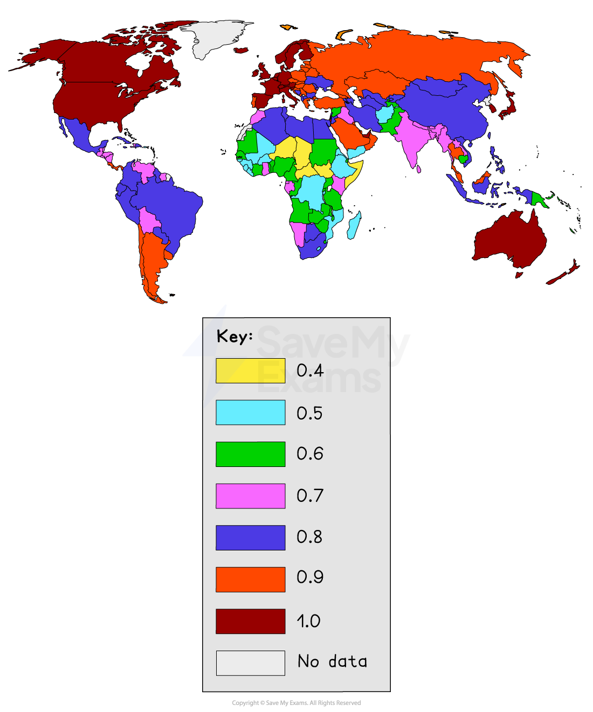

# Use of indicators to compare level of development

## Specification link

This page covers section 8.1.2 of the [CIE IGCSE specification](https://www.cambridgeinternational.org/Images/718150-2027-2029-syllabus.pdf).

- **8.1.2: **The use of development indicators to compare countries at different levels of development and an evaluation of their usefulness.
- **8.1.3:** Factors affecting quality of life and standard of living.

## Comparing countries using development indicators

> **Spec point** — `spcpt_9FBW6qBvynpc3wBm` · The use of indicators of development to compare countries at different levels of development and an evaluation of their usefulness.

## Comparing countries using development indicators

- Development is **hard **to measure **accurately,** as it covers so many features or **strands**
- It is **measured** using ***indicators***

### Social indicators

- Social indicators provide a more complete picture of a country's development
- It shows how the country's money helps its people

  - **Quality of life** and social well-being
  - **Equal opportunities**; access to services such as education and healthcare
  - **Life expectancy** and birth control
  - Level of **education**
  - **Diversity**, traditions and heritage

### Economic indicators

- These relate to income, job security and standards of living
- However, these are averages of a population and does not take into account disparities such as unequal wealth

  - **Employment**, income and general wealth
  - **Savings**, house building, house sales, consumer spending
  - International **trade**
  - **Resources**, pollution controls and conservation
- **Individual indicators are misleading** when used alone, as some features develop before others
- This can indicate that a country is more developed than it really is
- Using multiple indicators as a measure of development, provides a clearer picture of that country's development

## Effectiveness of development indicators

> **Spec point** — `spcpt_rvSgGXKxsW7nCFjr` · The use of indicators of development to compare countries at different levels of development and an evaluation of their usefulness.

## Effectiveness of development indicators

- Development indicators are averages, but these numbers may hide the extent of inequality in a given location

  - For example, the death rate is usually lower in a city than in rural areas because it is easier to get to hospitals and doctors

### Limitations of development indicators

#### Gross Domestic Product (GDP)

- GDP ignores the welfare component as the goods and services produced may or may not add to the welfare of society
- Pollution or even happiness leaves out some production in an economy, such as homegrown food

#### Gross National Income (GNI)

- The measure only takes into account one factor—income
- It is an average calculation so a few wealthy people can distort the figures
- Data about income is sensitive so people may not always be honest about their earnings
- People working in the informal sector and 'stay at home' parents are not taken into account

#### GNI per head

- It is an average and hides information about whether a person is either rich or poor or the quality of life within the country

#### Literacy Rate

- This can be hard to measure in LICs due to lack of monitoring
- Conflict zones and squatter settlements are difficult areas to measure literacy rates

#### Life Expectancy

- Data is not always reliable, especially in LICs
- It can be misleading in countries with a very high rate of infant mortality, as people who survive infancy may live longer than expected

#### People per Doctor

- More people are seeking medical help and advice via mobile phone/web chat—this is not included in the data

#### Birth Rate

- Some countries may have low birth rates but are quite poor (e.g., Cuba at 10 per 1000—this is due to political decisions to invest more money in healthcare over other sectors)
- Birth control policies can distort this as a measure of overall development (e.g. China, 12 per 1000)

#### Infant Mortality Rate

- Not all the deaths of children are reported, especially in LICs and remote regions of NEEs, meaning the true rates may be even higher

#### Death Rate

- By comparison, death rate is a less reliable measure of development than birth rate
- Death rates can be high in some LICs due to poverty but also high in HICs, where many people die of old age

#### Access to Safe Water

- Data collection in LICs is not likely to be accurate and so official figures can underestimate the issue
- People may technically have access, but high costs force people to use unsafe water
- Leaking pipes and natural disasters may deprive people of piped water

## Human Development Index

> **Spec point** — `spcpt_CvM8NCkjZ63ykyPT` · Social and economic indicators of development. For example, gross national product (GNP), gross domestic product (GDP), gross national income (GNI), literacy rate, life expectancy, Human Development Index (HDI), infant mortality rate, calorie intake, doctors per person.

## Human Development Index

- The UN created the** Human Development Index (HDI)** in 1990 as a better way of measuring differences between countries
- The index takes into account **four indicators** of development:

  - **Life expectancy at birth**, indicating overall health of a country
  - **Mean years of schooling **for adults aged 25 years
  
    - It is a measure of the educational level of a population's adults
  - **Expected years of schooling **that a child of school entrance age can expect to receive
  
    - It shows how well the younger generation will do in school
  - **Gross National Income** (GNI) per capita (PPP\$)
- Countries can be divided into four groups using HDI

  - **Very High Human Development (VHHD) **
  - **High Human Development (HHD)**
  - **Medium Human Development (MHD)**
  - **Low Human Development (LHD)**
- HDI is scored from 0 to 1
- The higher the HDI, the higher the level of development and quality of life

  - Norway has the highest HDI at 0.957  (2024)
  - Niger has the lowest HDI at 0.394 (2024)

*Human development index*

- The index only takes into account four indicators of development and the statistics provided by some countries may be unreliable and ***subjective***
- It is a general measure based on average calculations

  - It does not take into account disparities (differences) that might exist within a country
  - It does not take into account environmental or political measures
  - Some consider it still to be too simple and biased in favour of HICs, as income is weighted
