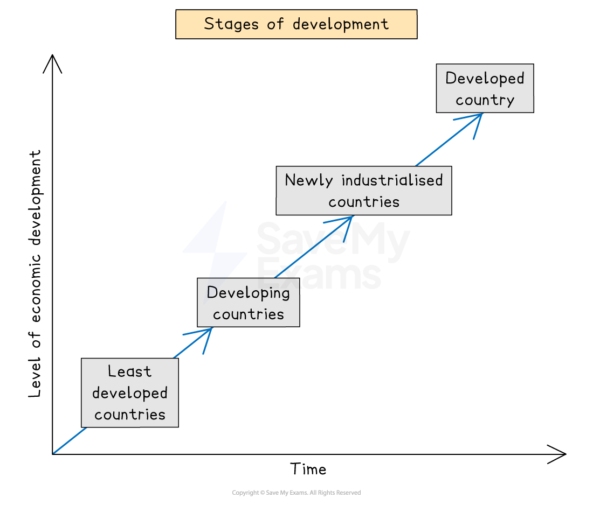
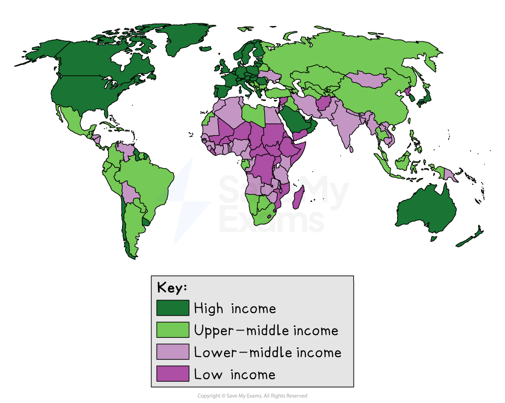

# Global pattern of development

## Specification link

This page covers section 8.2.2 of the [CIE IGCSE specification.](https://www.cambridgeinternational.org/Images/718150-2027-2029-syllabus.pdf)

**8.2.2 **- The current global pattern of low-income countries (LICs), middle-income countries (MICs) and high-income countries (HICs).

## Global pattern of development

> **Spec point** — `spcpt_BtBjtBQDbyqgJp5W` · The current global pattern of low-income countries (LICs), middle-income countries (MICs) and high-income countries (HICs).

## Global pattern of development

- All countries move through different stages of development; they are not in fixed categories
- The UN identifies **four main stages of development**

*Graph showing the stages of development*

- Economic development is a **constantly shifting process** – countries can move up or down
- The **World Bank** regularly revises income classifications based on updated **GNI data**

  - For example: China moved from LIC to MIC in under 40 years due to** rapid industrialisation** and **trade integration**

### Low-income countries (LICs) and developing countries

- The countries with the lowest level of development are the **low-income countries (LICs) **(e.g., Chad, Nepal)
- Most people have a poor quality of life with inadequate services and few opportunities
- The UN reviews the list of LICs every three years

  - There are currently **44 LICs **(Dec. 2024)
  
    - Africa – 31 countries
    - Asia – 8 countries
    - Caribbean – 1 country
    - Small Island Developing States (SIDS) – 4 countries
- The criteria for inclusion on the list of LICs are:

  - **Gross National Income (GNI)** below US\$1,018
  - **Poor health** and **education levels**
  - **Economic and environmental vulnerability**
- The LICs and developing countries are:

  - at a disadvantage in world trade
  - vulnerable to natural hazards
  - lacking infrastructure
  - dependent on primary resources
- **Colonialism** has also impacted all 44 of the LICs and many **developing countries**, leading to:

  - depletion of resources
  - environmental degradation

### Middle-income countries (MICs)

- **Middle-income countries (MICs) **are also known as** newly industrialised countries (NICs)**

  - These countries are experiencing rapid economic growth and development based on industrial development
  - Incomes are rising and most people enjoy a reasonable standard of living
  - Countries that have become MICs include:
  
    - Singapore
    - South Korea
    - Brazil
    - China
    - India

### High-income countries (HICs)

- These countries have **modern industries** and people enjoy a** good standard of living **with **relatively high levels of income**
- Good level of services
- Countries that have become HICs include:

  - Norway
  - Saudi Arabia
  - Japan
  - Uruguay
  - Canada
- The global pattern of distribution is complicated and changes constantly
- However, there are some key features

  - Asia and Africa have more MICs than LICs
  - Most HICs and MICs are found in the northern hemisphere
  - LICs are mostly in the southern hemisphere
  - Eastern European countries have been classified as MICs
  - Most South American countries are MICs

*Distribution of global development*

### Why classifications are contested or dynamic

- **GNI per capita doesn’t tell the full story** – it hides regional inequalities (e.g. urban vs. rural divide)
- A country may be **wealthy overall but still have large impoverished populations**
- **Data reliability** can vary – weak governance or poor census systems affect accuracy
- **Political sensitivity** – calling a country an LIC can change how people see it and affect its chances for aid
- **Development is multi-dimensional –** just because a place is rich doesn’t mean people are happy or the environment is strong

> **Exam Hint**
> Classifications can change, but issues like inequality, corruption, and environmental risks might remain.
