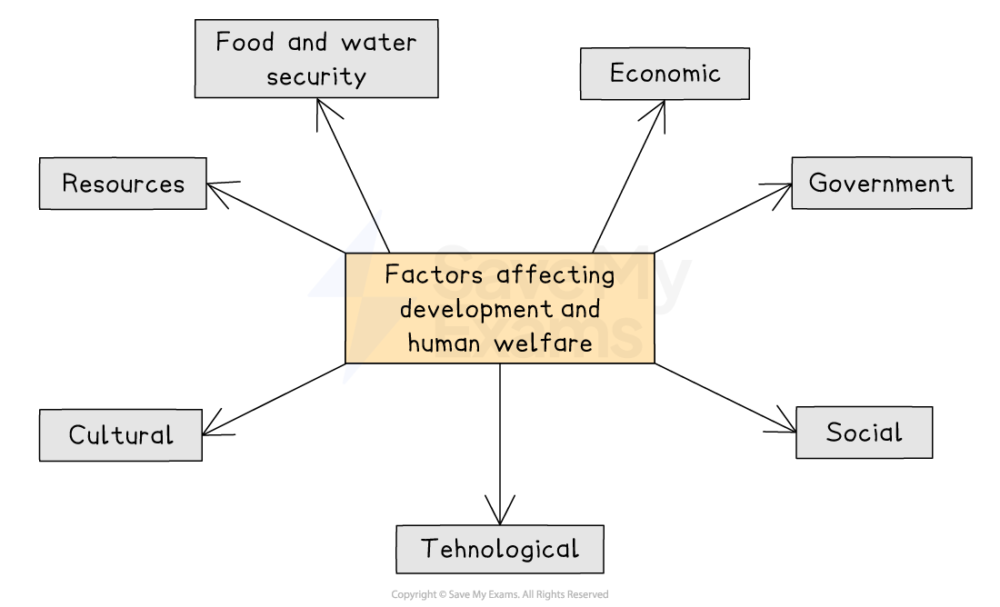

# Levels of development

## Specification link

This page covers section 8.2.1 of the [CIE IGCSE specification](https://www.cambridgeinternational.org/Images/718150-2027-2029-syllabus.pdf) .

- **8.2.1 **- Reasons for differences in levels of development and the development gap, to include social, economic, and environmental factors.

## What is the development gap?

> **Spec point** — `spcpt_3TwjsNMYhkM24Cvp` · Reasons for differences in levels of development and the development gap, to include social, economic, and environmental factors. 

## What is the development gap?

- The **development gap **is the difference in levels of development between the least developed and most developed countries in the world
- The development gap shows how different these countries are in terms of their wealth, health, and general quality of life
- The development gap affects how well millions of people live, with high-income countries usually having better living standards and more resources
- The development gap can cause problems like

  - poverty
  - inequality
  - harm to the environment
  - social unrest
- The development gap affects global stability and security because problems in poorer countries can impact the wider world

## Reasons for the differences in development

> **Spec point** — `spcpt_V7r24HWNzs6Bj7JZ` · Reasons for differences in levels of development and the development gap, to include social, economic, and environmental factors. 

## Reasons for the differences in development

- The development gap is a complex problem with many **social, economic and environmental reasons**
- These reasons can become less or more important over time

*Factors affecting development and human welfare*

## Environmental factors

- ***Landlocked*** countries have no direct access to ports, making **trade **more difficult and they often **develop more slowly **as a result

  - Nine of the twelve most undeveloped countries in the world are landlocked and struggle to trade with other countries
- Countries with **extreme climates** develop more slowly, as climate impacts agricultural productivity and infrastructure
- **Natural disasters** such as earthquakes and floods occur more frequently in some countries, which diverts money from development to recovery
- **Climate-related diseases and pests,** such as **malaria**, affect the ability of the population to stay healthy enough to work

  - **Locust swarms** can decimate crops

- Some countries can meet all their needs from the **natural resources** they have
- Many countries have to ***import*** some natural resources that are not available within their borders
- **Water, food** and **energy security** are vital to support a country's development

## Social factors

- *Demography*

  - The **birth** and **death rates**, as well as **immigration,** affect the available workforce
  - Some countries have a large, youthful population but lack education and employment opportunities
- **Technology**

  - Can help to increase water, food and energy security
  - **Mechanisation** of farming increases yields and improved land surveying may reveal more energy sources
- **Conflict and instability** can disrupt economic development, hinder investment, and displace populations
- **Levels of education** affect the skills people have. The more educated a population is, the more a country will develop
- **Healthcare** affects how well people are, which affects their ability to work
- **Lack of equality** can mean that the overall productivity of a country is affected
- **Colonialism – **Some countries' **colonial past** has caused uneven growth, environmental degradation, loss of cultural systems and inequality

  - Colonial powers, such as the UK, France, and Spain, extracted resources from colonies, such as minerals and crops, leaving little wealth behind
  - They also set up systems that benefited themselves, not local people
  - This caused inequality and left many countries dependent on low-value exports after independence
  - Many African and American countries were impacted due to the transatlantic slave trade

## Economic factors

- **Corruption **can take money away from important projects and make it hard to put good policies into action
- LICs usually **trade **primary products for less money to HICs

  - The HIC then produces a final, **high-profit **product
- HICs have good road, railway, and electricity **infrastructure**

  - This helps attract foreign investment because companies can quickly produce and transport goods
  - This boosts a country's development by bringing in money

> **Exam Hint**
> **Think systemically** about the causes of the development gap. How do social, economic, and environmental factors interlink to either widen or close the development gap?
> 
> For example: low investment in education → low literacy → limited skilled workforce → low-income economy → poor healthcare → high infant mortality
> 
> Identify **feedback loops **or **spirals—**both **positive **and **negative**—to understand how development shifts or combines over time.   For example, economic inequality leads to social unrest, which in turn damages the environment.
