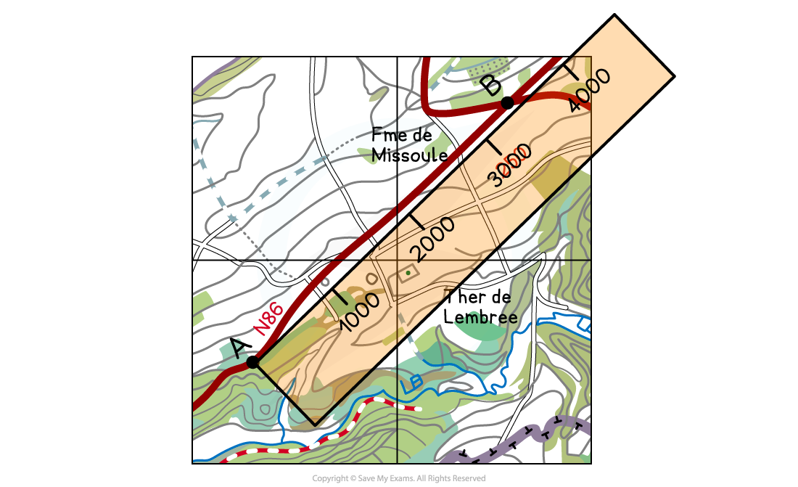
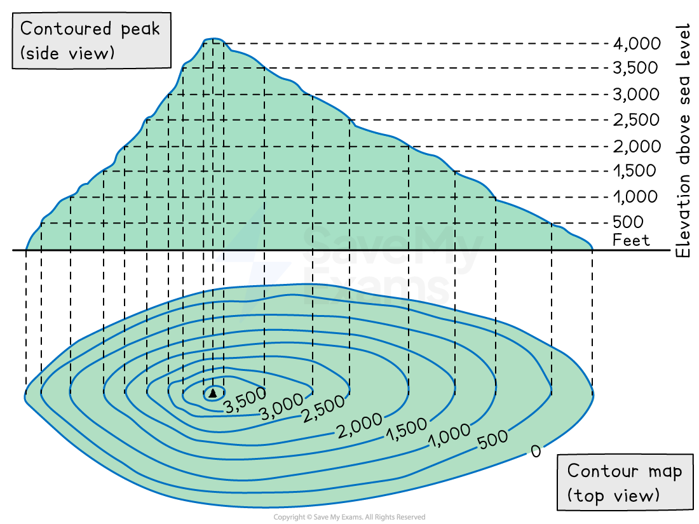
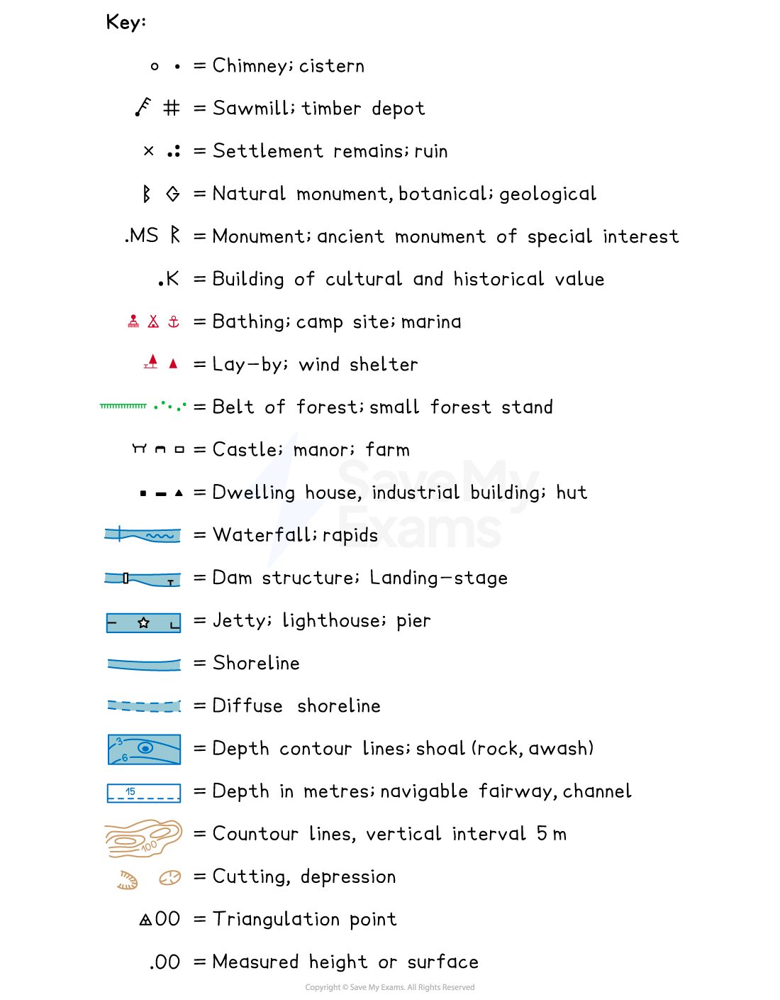

# Cartographic skills

## Maps

- Questions in the exam will be based on topographical maps

  - The maps can be from anywhere in the world
  - Maps will have a key, scale, northings and eastings
  - These all need to be used to answer the questions

## Grid references

> **Spec point** — `spcpt_m3CTDmjBhDWjWSKq` · Candidates should be able to: 
• select, construct and interpret maps using direction, scale, symbols, a key, and other information 
• extract, interpret, analyse and evaluate information presented on maps 
• use co-ordinates, latitude and longitude, 4 and 6 figure grid references 
• give directions using the 16-point compass and bearings from grid north 
• measure and estimate distances and area 
• use and interpret gradient, contour lines and spot heights; calculate differences in height 
• interpret cross-sections and transects.

## Grid references

### Grid references

- 4-figure are used to locate specific grid squares within the map

  - The first two figures are the **eastings**, which indicate how far east or west a grid is across the map
  - The second two figures are the **northings**, which indicate how far north or south a grid is on the map
- 6-figure grid references are used to locate exact points within grid squares

  - The first three figures are the eastings
  - The second three figures are the northings
- To find a 4- and 6 figure grid reference

  - To find the four-figure grid reference, give the number from the bottom of the map first, then the number from the side

*4 - figure grid reference*

- In image above, the 4-figure grid reference would be 17, 51
- To give the 6-figure grid reference, you need to imagine that the grid square is divided into 100 smaller squares

*Six figure grid reference*

> **Worked Example**
> Figure 1.1 shows some of the features around the main settlement at Misterbianco in the north-east of the map extract
> 
> 
> 
> What is the six-figure grid reference for the junction to the north of B in Fig. 1?
> 
> **[1 mark]**
> 
> **Final answer:** **Answer**
> 
> - **017 517**

## Scale

> **Spec point** — `spcpt_VwcHz89r5f6Rpbn9` · Candidates should be able to: 
• select, construct and interpret maps using direction, scale, symbols, a key, and other information 
• extract, interpret, analyse and evaluate information presented on maps 
• use co-ordinates, latitude and longitude, 4 and 6 figure grid references 
• give directions using the 16-point compass and bearings from grid north 
• measure and estimate distances and area 
• use and interpret gradient, contour lines and spot heights; calculate differences in height 
• interpret cross-sections and transects.

## Scale

- Maps in exams will be scaled at either:

  - 1:25,000 (1 cm = 250 m in real life)
  - 1:50,000 (1 cm = 500 m in real life)
- Distance measurement methods:

  - For straight or nearly straight distances:
  
    - Use a ruler
    - Use the edge of a straight piece of paper
  - Using map scale:
  
    - Mark distances on a piece of paper using the scale at the map's bottom
    - Lay the marked paper from first to second point to calculate distance

*Using scale to measure a straight line*

- Measuring curved route distances:

  - Divide the route into segments
  - Rotate and mark the paper in stages to calculate the full distance
- Measuring road routes on the map:

  - Divide the route into straight sections using crosses
  - Use the paper to measure from A to the first cross
  - Rotate the paper, pivoting at the cross to mark the second cross

*Using scale to measure curved route distances*

## Area

> **Spec point** — `spcpt_6WyvDpmCSVgf9G6W` · Candidates should be able to: 
• select, construct and interpret maps using direction, scale, symbols, a key, and other information 
• extract, interpret, analyse and evaluate information presented on maps 
• use co-ordinates, latitude and longitude, 4 and 6 figure grid references 
• give directions using the 16-point compass and bearings from grid north 
• measure and estimate distances and area 
• use and interpret gradient, contour lines and spot heights; calculate differences in height 
• interpret cross-sections and transects.

## Area

- The scale of a map is important when accurately calculating area
- Areas can be divided into squares and triangles to make the calculation easier

  - The area of a rectangle = length x width
  - The area of a triangle = 1/2 base x height
- For a map with the scale 1:25,000
- To calculate an area where the length on the map is 4 cm and the width is 2 cm, the calculation is as follows:

  - Length 4 x 25,000 = 100,000 = 1,000 metres
  - Width 2 x 25,000 = 50,000 = 500 meters
- Area in m2 = 1000 x 500 = 500,000 meters2 or 0.5km2

## Bearings

> **Spec point** — `spcpt_ZKm5rbNWQVnT46Db` · Candidates should be able to: 
• select, construct and interpret maps using direction, scale, symbols, a key, and other information 
• extract, interpret, analyse and evaluate information presented on maps 
• use co-ordinates, latitude and longitude, 4 and 6 figure grid references 
• give directions using the 16-point compass and bearings from grid north 
• measure and estimate distances and area 
• use and interpret gradient, contour lines and spot heights; calculate differences in height 
• interpret cross-sections and transects.

## Bearings

- Directions on a map should always be given using compass points
- There are 16 compass points

*Sixteen Compass Points*

- A grid bearing is measured from the grid north at 0°, east at 90°, south at 180°, and west at 270°
- Grid bearings are given using a protractor

  - The 0º should be pointing north and the centre of the protractor should be on the place the bearing is been given from
  - The compass direction and grid bearing from the crossroads at A to the location at B

*Illustration showing how to take a map bearing*

- On the map below, B is south-west of A
- The bearing is 280º

## Height

> **Spec point** — `spcpt_s38rP4RvNt9GCYwh` · Candidates should be able to: 
• select, construct and interpret maps using direction, scale, symbols, a key, and other information 
• extract, interpret, analyse and evaluate information presented on maps 
• use co-ordinates, latitude and longitude, 4 and 6 figure grid references 
• give directions using the 16-point compass and bearings from grid north 
• measure and estimate distances and area 
• use and interpret gradient, contour lines and spot heights; calculate differences in height 
• interpret cross-sections and transects.

## Height

- There are three ways to display height:

  - **spot height**
  - **contour lines**
  - **trigonometrical (trig) stations**
- Spot heights show the height at a specific point with the height measurement written next to it
- Contour lines are** isolines**

  - They join points of **equal height **and are usually at 5 or 10-metre intervals (distance between the contour line)
  - This means that the height of the land increases by 5 or 10 metres between the lines
- A trigonometrical (trig) station is marked by a small black triangle with a height measurement written next to it

## Topography

> **Spec point** — `spcpt_vJXFyXCmq2fsf7Ff` · Candidates should be able to: 
• select, construct and interpret maps using direction, scale, symbols, a key, and other information 
• extract, interpret, analyse and evaluate information presented on maps 
• use co-ordinates, latitude and longitude, 4 and 6 figure grid references 
• give directions using the 16-point compass and bearings from grid north 
• measure and estimate distances and area 
• use and interpret gradient, contour lines and spot heights; calculate differences in height 
• interpret cross-sections and transects.

## Topography

- The contour lines can also indicate the shape and slope of the land or topography
- Contour lines close together indicate steep land
- Contour lines very far apart indicate gently sloping or flat land, dependent on the distance apart
- V-shaped valleys have a v-shaped set of contours
- A hill is shown by a set of circular contour lines

*Contour lines *

## Cross-sections

> **Spec point** — `spcpt_f3ZggcghrcwNfzXM` · Candidates should be able to: 
• select, construct and interpret maps using direction, scale, symbols, a key, and other information 
• extract, interpret, analyse and evaluate information presented on maps 
• use co-ordinates, latitude and longitude, 4 and 6 figure grid references 
• give directions using the 16-point compass and bearings from grid north 
• measure and estimate distances and area 
• use and interpret gradient, contour lines and spot heights; calculate differences in height 
• interpret cross-sections and transects.

## Cross-sections

- A cross-section is a slice through the landscape
- They are represented on a map by a line, which is often labelled A at one end and B at the other
- They use the contour lines to determine the height of the land

*Cross-section on a map*

- A piece of paper is then laid along the line and points A and B are marked on
- The contour lines are then marked on each time they cross the paper

*Marking on the contour lines*

- These figures can then be used to create the cross-section

*Cross-section*

## Key

> **Spec point** — `spcpt_Dnw8dYjV7V7mtkgk` · Candidates should be able to: 
• select, construct and interpret maps using direction, scale, symbols, a key, and other information 
• extract, interpret, analyse and evaluate information presented on maps 
• use co-ordinates, latitude and longitude, 4 and 6 figure grid references 
• give directions using the 16-point compass and bearings from grid north 
• measure and estimate distances and area 
• use and interpret gradient, contour lines and spot heights; calculate differences in height 
• interpret cross-sections and transects.

## Key

- Maps can be used to identify a range of landscape features
- These may be physical and human features
- Each map has a key to show what the symbols mean

*Map key example*
