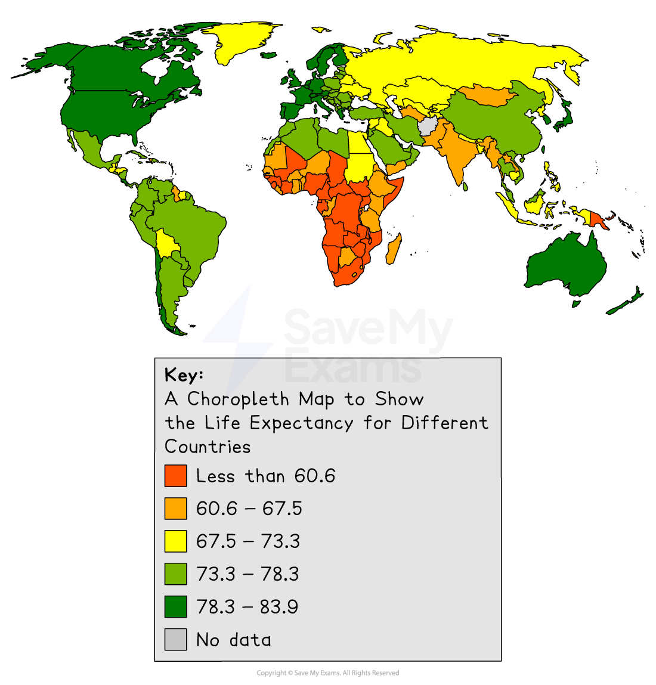
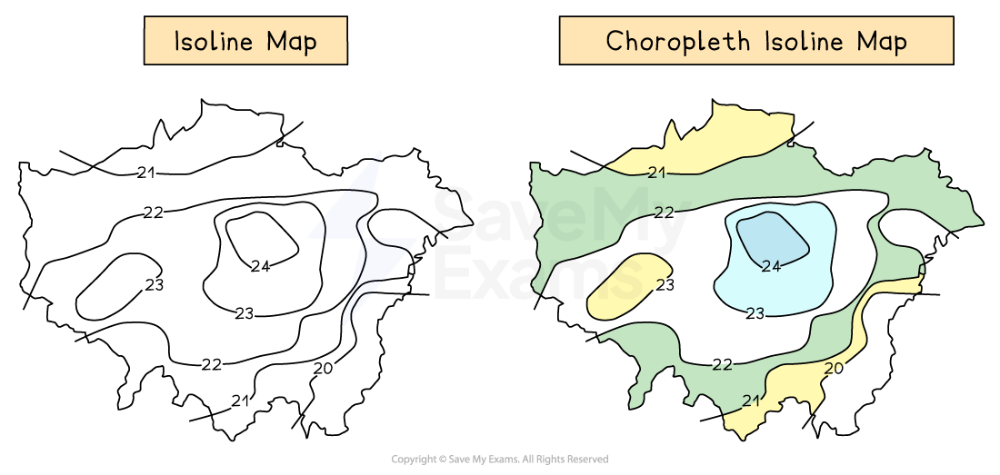

# Types of map

## Topographical & thematic maps

- The cartographic skills on the previous revision note are used on topographical maps
- The exam will also include the interpretation of a range of thematic maps

## Thematic maps

> **Spec point** — `spcpt_jn26TQFvhdPPxCGm`

## Thematic maps

### Choropleth maps

- Choropleth** **maps are shaded according to a pre-arranged key
- Each shade represents a range of values
- It is common for one colour in different shades to be used
- Can be used for a range of data, such as annual precipitation, population density, income levels, etc.

*Illustration of a choropleth map showing life expectancy*

### Isoline maps

- **Isolines** are lines on a map which join places of equal value, such as **isobars, **which join places of equal pressure or **contour** lines, which join places of equal height
- Isoline maps become **choropleth isoline **maps when shaded between the isolines

  - Shading is progressive from light to dark
  - The heaviest (darkest) shading is for the largest value

*Comparison of an isoline map and a choropleth isoline map*

## Describing and analysing maps

> **Spec point** — `spcpt_ycJrJwPhmCfbKKyP`

## Describing and analysing maps

- The geography exam papers will include a range of maps which need to be described and/or analysed as part of the questions
- The questions may also require comparison of maps for example, two maps showing data from different years

### Describing maps

- When describing maps, the following can be included:

  - **Direction**: Use compass points (N, NE, SW etc.) to describe where things are
  - **Scale**: Look at the scale to understand distances (e.g. 1cm = 1km)
  - **Symbols**: Use the map key to interpret what different symbols mean (e.g. roads, rivers, urban areas)
  - **Relief**: Describe the height and shape of the land using:
  
    - Contour lines (close = steep; far = gentle)
    - Colour shading (e.g. brown = high land, green = low)
  - **Patterns**: Point out patterns or distributions (e.g. clustered, linear, scattered).
  - **Human features**: Describe towns, roads, and land use (e.g. residential, industrial).
  - **Physical features**: Mention rivers, hills, coasts, forests, etc.
- First tasks when looking at an unfamiliar map:

  - **Title & purpose**: Always check what the map shows (e.g. population, land use, rainfall)
  - **Location**: Identify where the place is – name of country, region, or city
- Descriptions of maps should:

  - **Start with general statements **about the key features, for example, 'active volcanoes are mostly found on plate boundaries'
  - **Add more detail** by mentioning specific regions or places; it is good to name countries or features. For example, the majority of active volcanoes are located around the Pacific 'Ring of Fire' in areas such as the west coast of South America and Japan
  - For a more detailed description, you may also want to **mention anomalies **(examples which do not fit the pattern/trend). For example, 'However, some volcanoes are located away from the plate boundaries on hot spots including those which are in Hawaii

> **Exam Hint**
> When asked to **describe** a map, take care that you do not explain any of the patterns or analyse them. When the command word is 'describe', you only need to write what you see. You will not be awarded marks for anything else.

### Analysing maps

- Analysis of maps involves examining the maps and interpreting the data shown to extract information and reach conclusions
- Successful analysis of maps may include:

  - **Comparison:** Identifying similarities and differences between places on the map or between different maps
  - **Explanation of patterns**: Suggest reasons for patterns seen (e.g. why towns are near rivers)
  - **Links to geographical themes**: Use knowledge of physical or human geography to interpret features (e.g. how relief affects farming)
  - **Use of specific examples**: Refer to named places or grid references where possible
  - **Direction and distance**: Analyse how far and in what direction things are from each other
  - **Changes over time** (if applicable): Comment on how a place has changed using historical vs current maps
  - **Use of OS Map Skills** (for topographic maps):
  
    - **4-figure grid references**: to locate larger areas
    - **6-figure grid references**: for precise points
    - **Compass directions and bearings**: for accurate description of direction
    - **Scale and measurement**: to calculate distances

> **Exam Hint**
> When analysing maps, ensure that you:
> 
> - **Use geographical language** – e.g. “north-east”, “steep relief”, “linear settlement”
> - **Are precise** – back up descriptions with evidence (e.g. “River flows from NW to SE, approx. 5km”)
