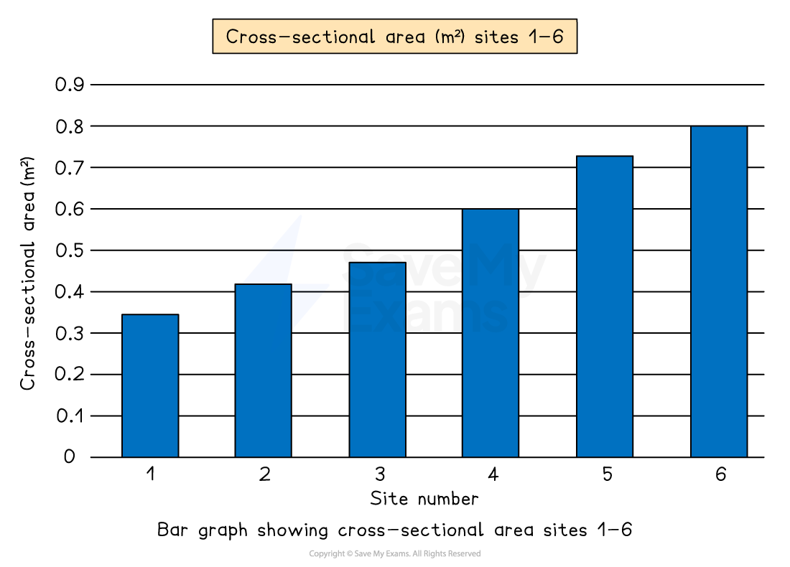
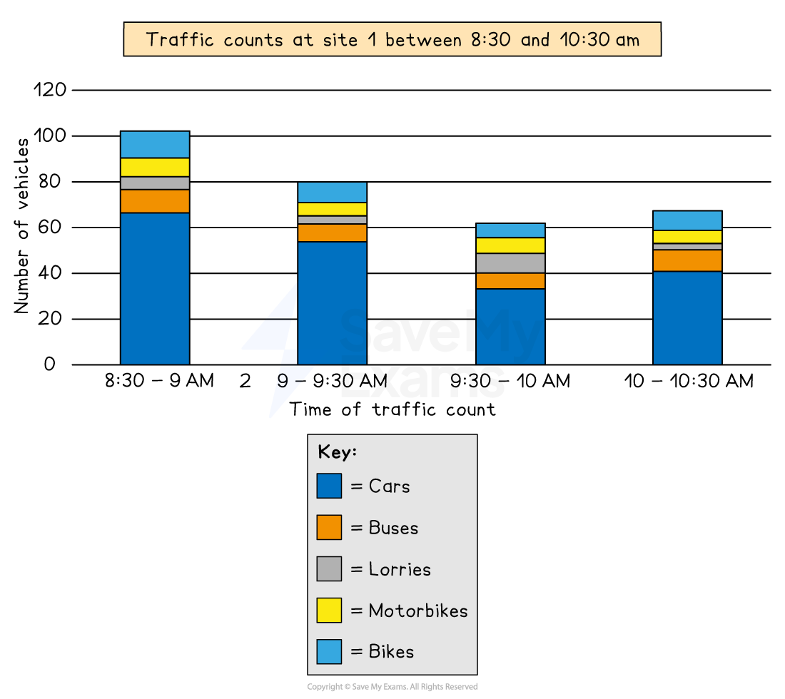
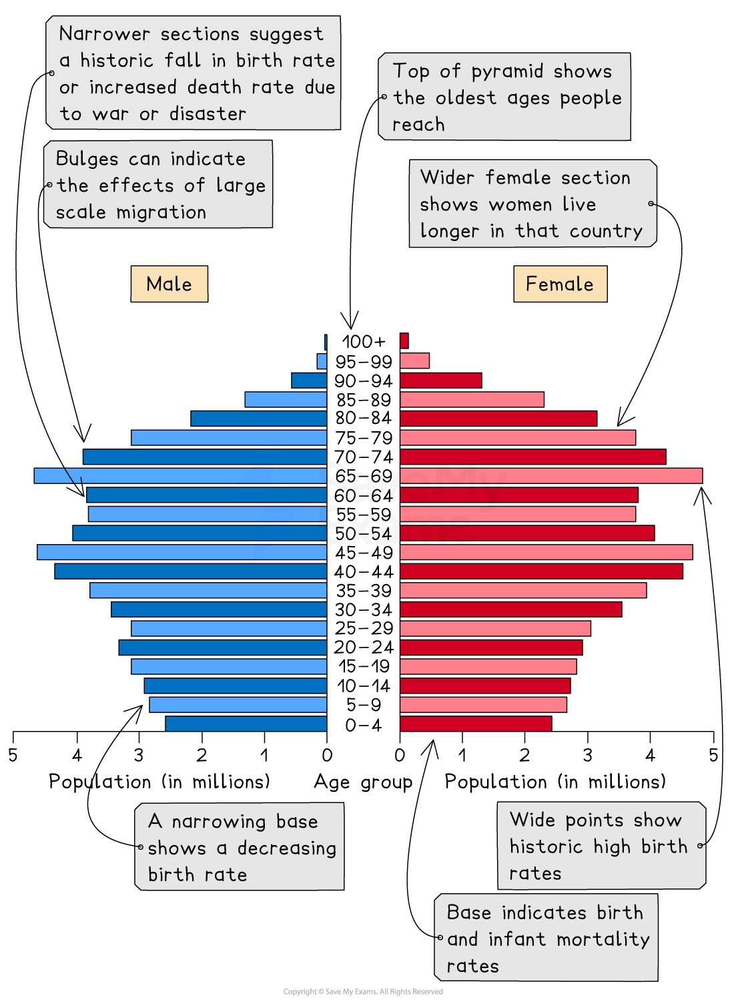
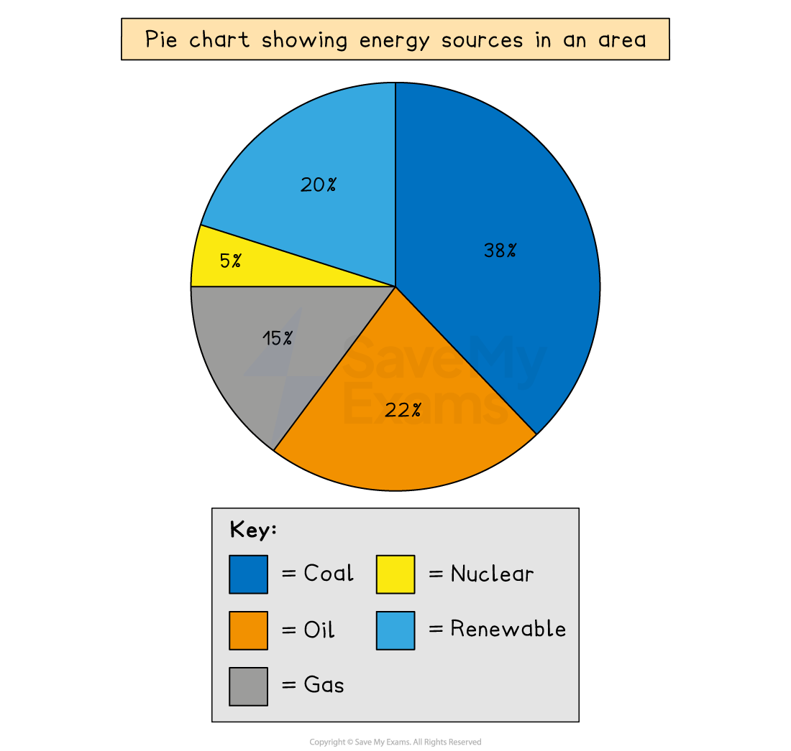
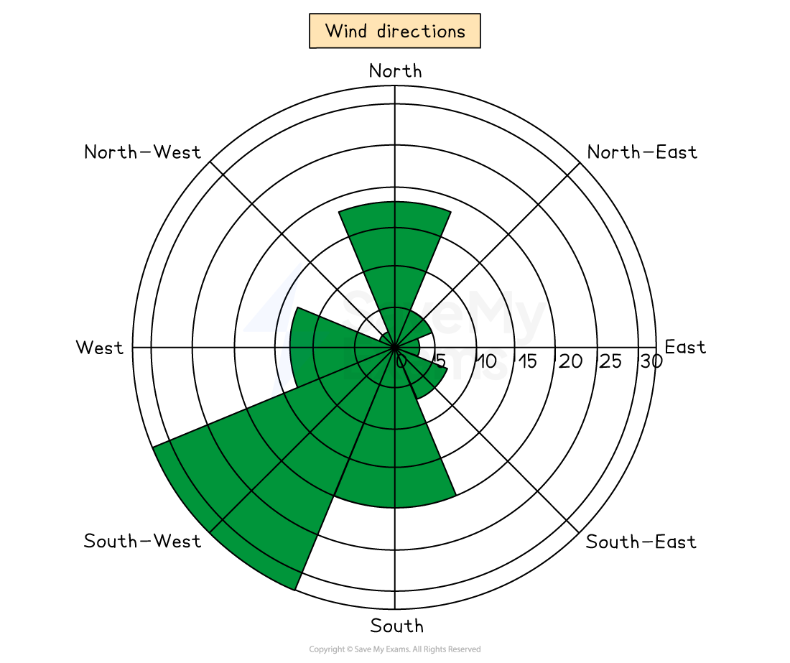
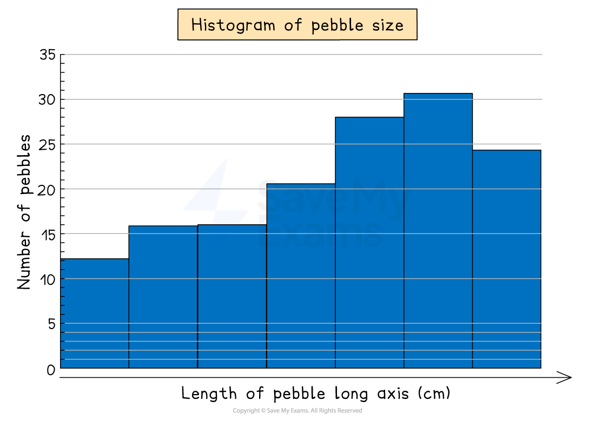

# Charts

## Bar chart

> **Spec point** — `spcpt_ShRVbzTpgXbVzQ6J` · "Candidates should be able to:
• select, present, construct and communicate data through appropriate graphs, charts and diagrams using
relevant scales and annotations to present information
• extract, interpret, analyse and evaluate information presented on graphs, charts and diagrams
• identify and evaluate variations, trends and patterns from data provided."

## Bar Chart

- A bar chart is the simplest form of displaying data
- Each bar is the same width but can have varying lengths
- Each bar is drawn an equal distance apart (equidistant)
- The data is ***discrete*** data
- Bar graphs are useful for:

  - Comparing classes or groups of data
  - Changes over time

| Strengths | - Summarises a large set of data - Easy to interpret and construct - Shows trends clearly |
|---|---|
| Limitations | - Requires additional information - Does not show causes, effects or patterns; can be too simplistic - Can only be used with discrete data |

*Example of a bar graph*

## Compound or divided bar chart

> **Spec point** — `spcpt_YTn2k6nVvDD6NQWT` · "Candidates should be able to:
• select, present, construct and communicate data through appropriate graphs, charts and diagrams using
relevant scales and annotations to present information
• extract, interpret, analyse and evaluate information presented on graphs, charts and diagrams
• identify and evaluate variations, trends and patterns from data provided."

## Compound or Divided Bar Chart

- The bars are subdivided to show the information, with all bars totalling 100%
- Divided bar charts show a variety of categories
- They can show percentages and frequencies

| Strengths | - A large amount of data can be shown on one graph. - Percentages and frequencies can be displayed on divided bar charts |
|---|---|
| Limitations | - A divided bar chart can be difficult to read if there are multiple segments - It can be difficult to compare data sometimes |

*A compound or divided bar chart*

## Population pyramid

> **Spec point** — `spcpt_v8JWX45c7FhrvRJR` · Factors influencing population structures: natural increase and net migration.

## Population Pyramid

- The characteristics of a population—the distribution of age, sex, ethnicity, religion, etc.—are known as the **population structure**
- The two main components of age and sex can be shown on a **population pyramid**
- This is a graphical illustration of the distribution of a given population, grouped by age and gender
- It can be used to represent a population of any region, city, country or even the world
- As the population grows the shape of the pyramid changes
- The population pyramid can be used to identify the following groups:

  - **Young dependants **
  - **Old dependents **
  - **Economically active **(working population)
  - **Dependency ratio **

| Strengths | - Easy to compare age and sex data - Easy to read and annotate |
|---|---|
| Limitations | - Can take a long time to construct - Detail can be lost in the data (figures just show age groups there can be variation within the groups); additional annotations may be necessary |

*Population pyramid*

## Pie Chart

> **Spec point** — `spcpt_wMc5tmVxkqXJx4BB` · "Candidates should be able to:
• select, present, construct and communicate data through appropriate graphs, charts and diagrams using
relevant scales and annotations to present information
• extract, interpret, analyse and evaluate information presented on graphs, charts and diagrams
• identify and evaluate variations, trends and patterns from data provided."

## Pie Chart

- Used to show proportions, the area of the circle segment represents the proportion
- A pie chart can also be drawn as a proportional circle
- Pie charts can be located on maps to show variations at different sample sites
- The percentage of the pie chart must add up to 100%
- To calculate degrees of the pie chart (which totals 360°), divide the percentage by 100 and then multiply by 360
- Each segment should be a different colour

| Strengths | - Clearly shows the proportion of the whole - Easy to compare different components - Easy to label - Information can be highlighted by separating segments |
|---|---|
| Limitations | - Does not show changes over time; hard to compare two sets of data - Difficult to understand without clear labelling - Calculating the size of each section can be difficult - Can only be used for a small number of categories; otherwise, lots of segments become confusing |

*Example of a pie chart*

## Rose diagram

> **Spec point** — `spcpt_sRn9tbwhKdKcrNNm` · "Candidates should be able to:
• select, present, construct and communicate data through appropriate graphs, charts and diagrams using
relevant scales and annotations to present information
• extract, interpret, analyse and evaluate information presented on graphs, charts and diagrams
• identify and evaluate variations, trends and patterns from data provided."

## Rose diagram

A rose diagram is a type of radial graph

- It uses compass points for the axis directions
- Can be used for data such as wind direction, noise or light levels

| **Strengths** | - Clearly show patterns - Multiple sets of data can be compared |
|---|---|
| **Limitations** | - Can be difficult to plot - Can only be used for certain types of data - Hard to identify anomalies |

*Rose diagram showing wind direction*

## Histograms

> **Spec point** — `spcpt_VzSWk6QrhGrpMp7D` · "Candidates should be able to:
• select, present, construct and communicate data through appropriate graphs, charts and diagrams using
relevant scales and annotations to present information
• extract, interpret, analyse and evaluate information presented on graphs, charts and diagrams
• identify and evaluate variations, trends and patterns from data provided."

## Histograms

- Histograms show **continuous data**
- **Always** use a ruler to draw the bars
- All bars should be the **same width **
- The top of the bar should reach the number on the side of the graph that is being represented
- There should be no gaps; all bars should be touching
- Ensure all axes are labelled and that the graph has a title

| **Strengths** | - Large data sets can be graphed easily - Data can be compared |
|---|---|
| **Limitations** | - Can be difficult to pinpoint exact data values - They can only be used for numerical data |

*Example of a histogram*
