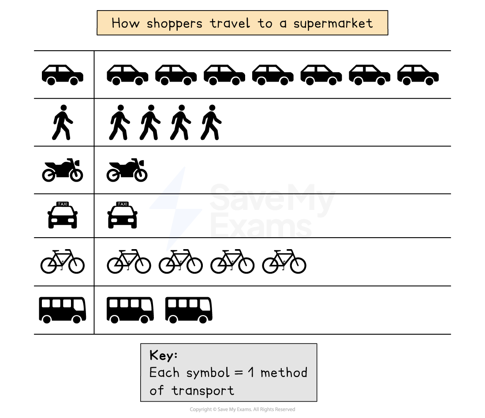
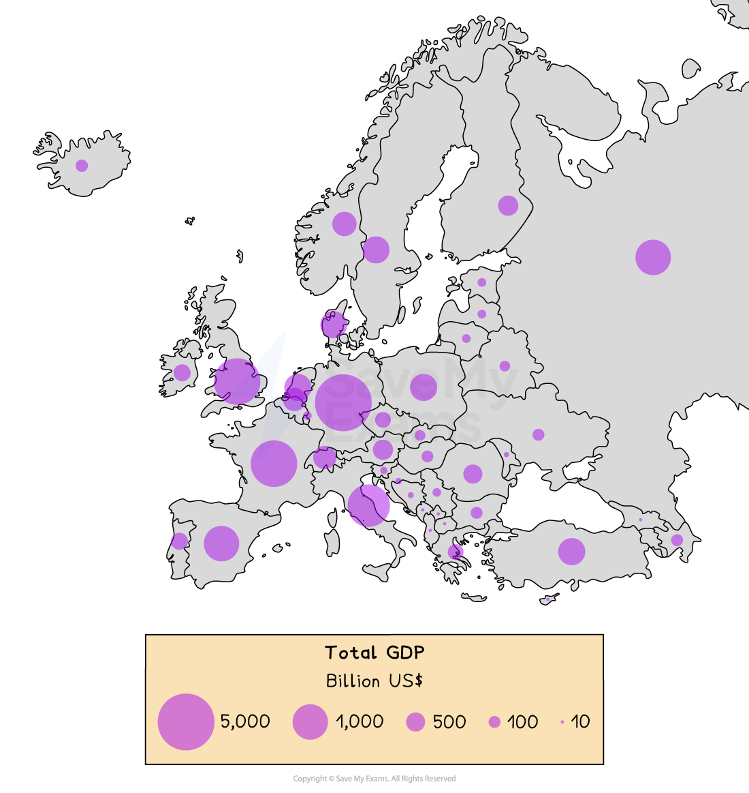

# Diagrams

## Flow diagrams

> **Spec point** — `spcpt_WYCBdQKhssQv44zw` · "Candidates should be able to:
• select, present, construct and communicate data through appropriate graphs, charts and diagrams using
relevant scales and annotations to present information
• extract, interpret, analyse and evaluate information presented on graphs, charts and diagrams
• identify and evaluate variations, trends and patterns from data provided."

## Flow Diagrams

- Flow diagrams are used to show the movements or flows of people, goods, or materials
- **Desire lines **are used to show the general direction of movement on a base map using lines
- More detailed information is shown in flow line diagrams

  - The lines can be used to show **quantity** (by the thickness of the line)

## Pictograms

> **Spec point** — `spcpt_yZJh3KjDr2q5qwyJ` · "Candidates should be able to:
• select, present, construct and communicate data through appropriate graphs, charts and diagrams using
relevant scales and annotations to present information
• extract, interpret, analyse and evaluate information presented on graphs, charts and diagrams
• identify and evaluate variations, trends and patterns from data provided."

## Pictograms

- Pictograms are a way of displaying data using symbols or diagrams drawn to scale
- Useful way of showing data if accuracy is not too important and data is discrete
- Years do not need to be continuous
- Symbols do not need to be whole but can represent a proportion
- A key is needed to show if the total number of objects or events that image represents exceeds one

#### How to read a pictogram

- **Step 1**: Read the problem carefully and identify the specific information requested from the pictogram
- **Step 2**: Count the symbols corresponding to the desired information and report the count

*Example of a pictogram*

## Venn Diagrams

> **Spec point** — `spcpt_wPrNPPYS5548mP9k` · "Candidates should be able to:
• select, present, construct and communicate data through appropriate graphs, charts and diagrams using
relevant scales and annotations to present information
• extract, interpret, analyse and evaluate information presented on graphs, charts and diagrams
• identify and evaluate variations, trends and patterns from data provided."

## Venn Diagrams

- Venn diagrams can be used to **visualise **and **compare information**
- A Venn diagram is an illustration which uses overlapping circles
- They can be used to:

  - Illustrate similarities and differences for example between urban and rural areas
  - Show relationships between sets of data

| Strengths | - A clear visual representation of relationships between sets of information - Allow easy comparison between sets of data |
|---|---|
| Limitations | - Can be confusing if more than two or three sets of data is shown - Can oversimplify geographic processes or information |

## Proportional Symbols

> **Spec point** — `spcpt_j8qC43GCbgV4M34q` · "Candidates should be able to:
• select, present, construct and communicate data through appropriate graphs, charts and diagrams using
relevant scales and annotations to present information
• extract, interpret, analyse and evaluate information presented on graphs, charts and diagrams
• identify and evaluate variations, trends and patterns from data provided."

## Proportional Symbols

- The symbols on the map are drawn in proportion to the variable represented
- Usually, a circle or square is used but it could be an image
- Can be used to show a range of data, for example, population, wind farms and electricity they generate, traffic or pedestrian flows

| Strengths | - Illustrates the differences between many places - Easy to read - Data is specific to particular locations |
|---|---|
| Limitations | - Not easy to calculate the actual value - Time-consuming to construct - Positioning on a map may be difficult, particularly with larger symbols |

*Example of a proportional symbol map*
