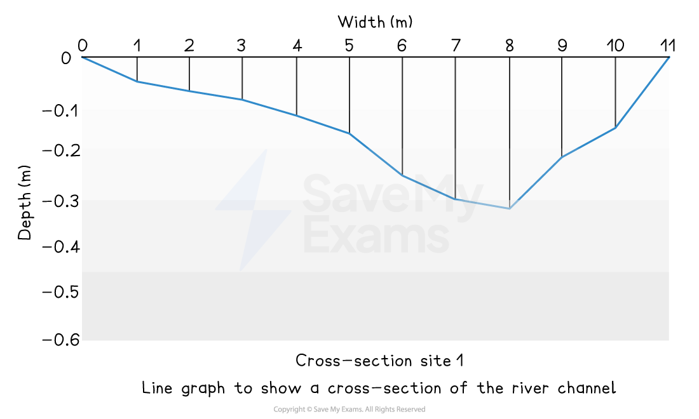
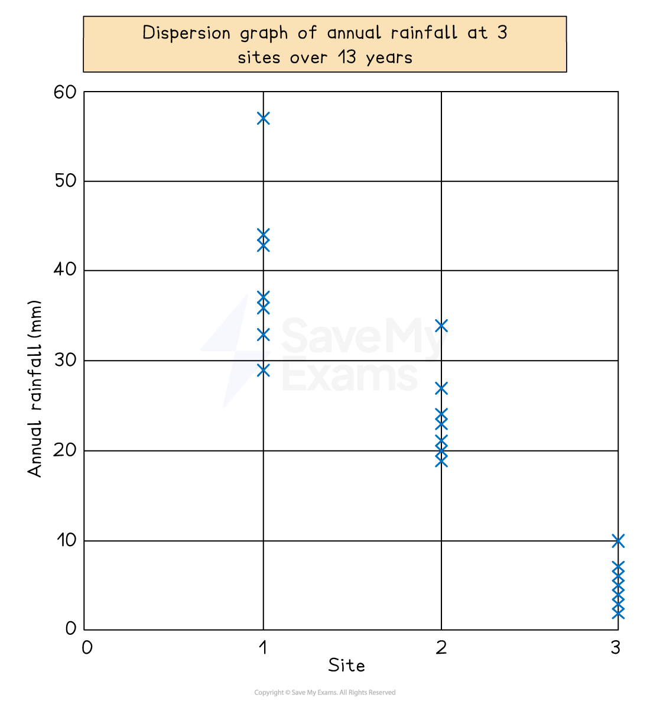
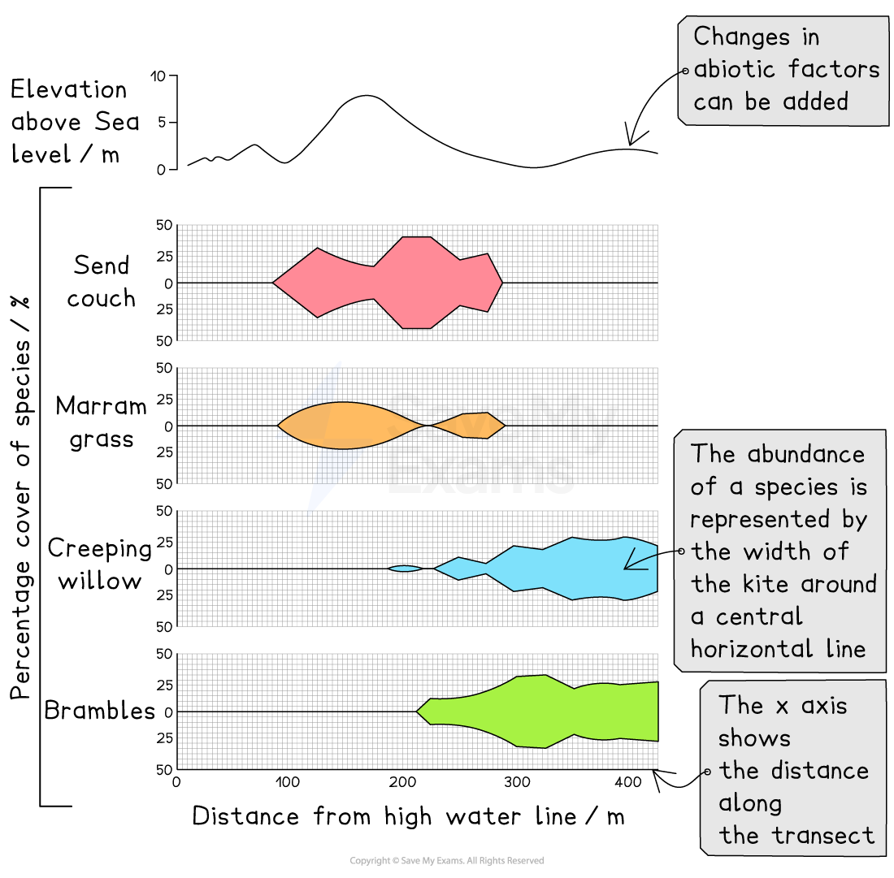
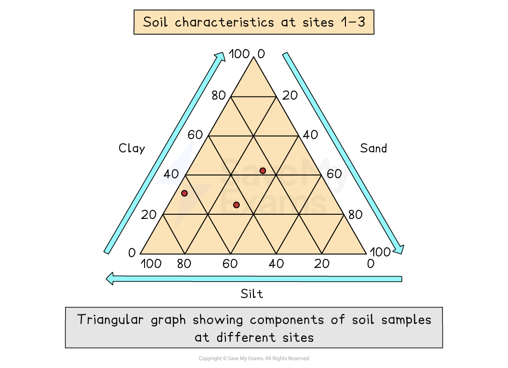
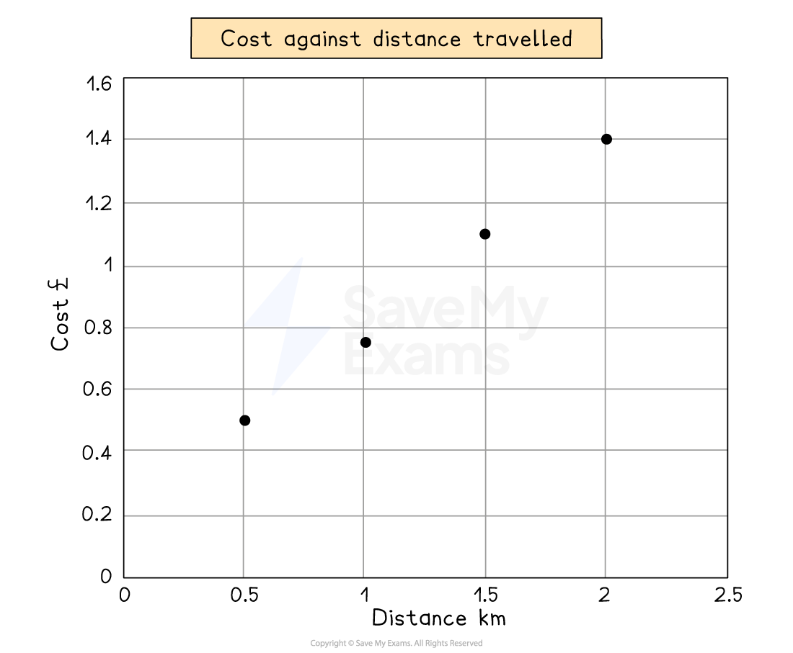
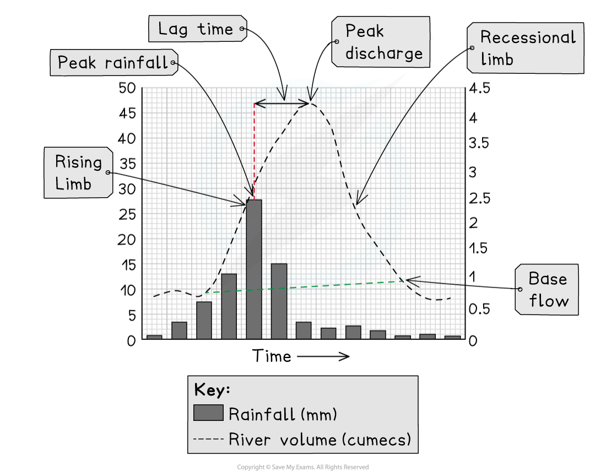

# Graphs

## Key terminology

> **Spec point** — `spcpt_C2J2c4g8THGXG6mg` · "Candidates should be able to:
• select, present, construct and communicate data through appropriate graphs, charts and diagrams using
relevant scales and annotations to present information
• extract, interpret, analyse and evaluate information presented on graphs, charts and diagrams
• identify and evaluate variations, trends and patterns from data provided."

## Key terminology

### Types of data

- **Continuous data **is numerical data that can take any value within a given range, e.g. heights and weights
- **Discrete data **is numerical data that can only take certain values, e.g. shoe size
- **Quantitative data** is where the results can be expressed using numerical values
- **Qualitative data** is where the results can’t be expressed as numbers, e.g. opinions

## Line graphs

> **Spec point** — `spcpt_Wx7TfkSxMVW23h4d` · "Candidates should be able to:
• select, present, construct and communicate data through appropriate graphs, charts and diagrams using
relevant scales and annotations to present information
• extract, interpret, analyse and evaluate information presented on graphs, charts and diagrams
• identify and evaluate variations, trends and patterns from data provided."

## Line graphs

- One of the simplest ways to display continuous data
- Both axes are numerical and continuous
- Used to show changes over time or space

| **Strengths** | - Shows trends and patterns clearly - Quicker and easier to construct than a bar graph - Easy to interpret - Requires little written explanation |
|---|---|
| **Limitations** | - Does not show causes or effects - Can be misleading if the scales on the axis are altered - If there are multiple lines on a graph it can be confusing |

#### Example

- A river cross-section is a particular form of line graph because it is not continuous data, but the plots can be joined to show the shape of the river channel

*Line graph showing a river cross-section*

## Radial graphs

> **Spec point** — `spcpt_ymg73MfXG5Dmyhjj` · "Candidates should be able to:
• select, present, construct and communicate data through appropriate graphs, charts and diagrams using
relevant scales and annotations to present information
• extract, interpret, analyse and evaluate information presented on graphs, charts and diagrams
• identify and evaluate variations, trends and patterns from data provided."

## Radial graphs

- Use multidirectional axes to plot data with bars or lines

| **Strengths** | - Clearly show patterns - Multiple sets of data can be compared |
|---|---|
| **Limitations** | - Can be difficult to plot - Can only be used for certain types of data - Hard to identify anomalies |

## Climate graphs

> **Spec point** — `spcpt_yYtK582pvdzJh5z6` · "Candidates should be able to:
• select, present, construct and communicate data through appropriate graphs, charts and diagrams using
relevant scales and annotations to present information
• extract, interpret, analyse and evaluate information presented on graphs, charts and diagrams
• identify and evaluate variations, trends and patterns from data provided."

## Climate graphs

- A climate graph shows mean monthly temperatures and precipitation rates over 30 years
- They can be local, national, or global
- Precipitation is always shown as a bar graph and temperature as a line graph

| **Strengths** | - Clearly show trends and patterns - Allow for easy comparison of climates between places - Easy to understand and interpret |
|---|---|
| **Limitations** | - Don't show variations of precipitation and temperature within the month - Does not show extreme weather events within the month - Use of averages means that identifying anomalies |

*Climate graph*

## Dispersion graphs

> **Spec point** — `spcpt_YmmKTf8n3cRCd9y6` · "Candidates should be able to:
• select, present, construct and communicate data through appropriate graphs, charts and diagrams using
relevant scales and annotations to present information
• extract, interpret, analyse and evaluate information presented on graphs, charts and diagrams
• identify and evaluate variations, trends and patterns from data provided."

## Dispersion graphs

- Dispersion graphs are used to compare sets of data
- They also illustrate whether the data forms groups or is dispersed (spread)
- Values are shown on the vertical axis
- Can also be used to present the upper and lower values along with the mean, median, mode and extreme values

| **Strengths** | - Clearly show the range of values and potential anomalies - Useful for comparison of the spread and central tendencies of multiple sets of data - The spread gives an indication of reliability |
|---|---|
| **Limitations** | - Don't show variations of precipitation and temperature within the month - Does not show extreme weather events within the month - Use of averages means that identifying anomalies |

*Illustration of a dispersion graph*

## Doughnut graphs

> **Spec point** — `spcpt_d3DzkXZydn9RK2QC` · "Candidates should be able to:
• select, present, construct and communicate data through appropriate graphs, charts and diagrams using
relevant scales and annotations to present information
• extract, interpret, analyse and evaluate information presented on graphs, charts and diagrams
• identify and evaluate variations, trends and patterns from data provided."

## Doughnut graphs

- Doughnut graphs visually represent proportions as part of a whole
- They are similar to a pie chart but with no centre

| **Strengths** | - Clear and easy to interpret - Allows comparison between the proportions for different categories - Well suited to presenting percentages |
|---|---|
| **Limitations** | - Not suitable to display many categories - Cannot show changes over time - Small sections can be hard to interpret |

## Kite graphs

> **Spec point** — `spcpt_vtGMxqDBm99vqZsX` · "Candidates should be able to:
• select, present, construct and communicate data through appropriate graphs, charts and diagrams using
relevant scales and annotations to present information
• extract, interpret, analyse and evaluate information presented on graphs, charts and diagrams
• identify and evaluate variations, trends and patterns from data provided."

## Kite graphs

- Kite diagrams can show both **distribution **and **amounts**

  - The distribution along a* transect* is shown by its **position along a line** in each section of a kite diagram
  
    - Each section represents a different species
    - The **distance along the transect is given on the x-axis**
  - The numbers are shown by the **width of the 'kite'** around the central horizontal line
  
    - The shape is referred to as a kite because it extends an **equal distance** on each side of the central horizontal line

*Kite diagram*

| **Strengths** | - Useful for displaying changes over distance - Clear and easy to interpret - Easy to use to compare one set of data to another |
|---|---|
| **Limitations** | - Time consuming to draw - Can only be used with specific types of data |

## Triangular graphs

> **Spec point** — `spcpt_qWC4CTT7gHxPVkry` · "Candidates should be able to:
• select, present, construct and communicate data through appropriate graphs, charts and diagrams using
relevant scales and annotations to present information
• extract, interpret, analyse and evaluate information presented on graphs, charts and diagrams
• identify and evaluate variations, trends and patterns from data provided."

## Triangular graphs

- Triangular graphs have axes on three sides, all of which go from 0 to 100
- Used to display data which can be divided into three
- The data must be in percentages
- Can be used to plot data such as soil content, employment in economic activities

| **Strengths** | - Clearly shows relationships between data - Makes it easy to identify anomalies |
|---|---|
| **Limitations** | - Too many data points can make it difficult to read - Can only display three sets of data |

*Example of a triangular graph showing soil samples*

## Scatter graphs

> **Spec point** — `spcpt_7NMNdKszQNn7Znft` · "Candidates should be able to:
• select, present, construct and communicate data through appropriate graphs, charts and diagrams using
relevant scales and annotations to present information
• extract, interpret, analyse and evaluate information presented on graphs, charts and diagrams
• identify and evaluate variations, trends and patterns from data provided."

## Scatter graphs

- Used to show the relationship between two variables

  - In a river study, they are used to show the relationship between different river characteristics such as the relationship between the width and depth of the river channel
- The points on a scatter graph should not be connected
- The best-fit line can be added to show the relationship

| **Strengths** | - Clearly shows data correlation - Shows the spread of data - Makes it easy to identify anomalies and outliers |
|---|---|
| **Limitations** | - Data points cannot be labelled - Too many data points can make it difficult to read - Can only show the relationship between two sets of data |

*Example of a scatter graph showing the relationship between cost and distance*

> **Exam Hint**
> Many graphs and diagrams are available for data presentation. It is important for the exam that you are able to:
> 
> - Extract information from graphs
> - Analyse and evaluate the information on a graph
> - Identify and evaluate variations, trends and patterns from the data
> 
> Make sure you are familiar with the different types of graphs and that you are confident with using them.

## Flood hydrographs

> **Spec point** — `spcpt_9WNjSfc5nG59FmNv`

## Flood hydrographs

- Used to show the impact of a storm event on river discharge

  - The **bar chart **shows the precipitation total (mm)
  - The **line graph** shows the river discharge (cumecs)

*Flood hydrograph*

- The graph shows a short period, usually 24 hours
- The storm hydrograph has several features:

  - **Base flow, **which is the 'normal' level of river discharge
  
    - The water mainly comes from **groundwater flow**
  - **Peak rainfall** is the highest rainfall level during the storm
  
    - The time of the peak rainfall is taken from the centre of the bar
  - The** rising limb** shows the increase in the river discharge
  
    - The steeper the limb, the faster the river discharge has increased
  - **Peak discharge** is the highest level of discharge in the river
  - **Lag time** is the time difference between the peak rainfall and the peak discharge
  
    - The shorter the lag time, the higher the risk of flooding because the river may not have the capacity to contain the increase in discharge
    - Where there is more **overland flow** (surface runoff), the lag time will be shorter
  - The **recessional limb** shows the river discharge returning to normal flow
  
    - The steeper the recessional limb is, the faster the river returns to normal flow
- The shape of the flood hydrograph indicates some of the factors that may affect the discharge

  - A hydrograph with a steep rising limb and short lag time is likely to be in an area with one or more of the following:
  
    - Impermeable surfaces (urban areas)
    - Heavy precipitation
    - Snow melt
    - Steep slopes
    - Impermeable soil (saturated or frozen)
  - A hydrograph with a gentle rising limb and long lag time is likely to be in an area with one or more of the following:
  
    - Rural area with trees
    - Permeable surfaces
    - Gentle slopes
