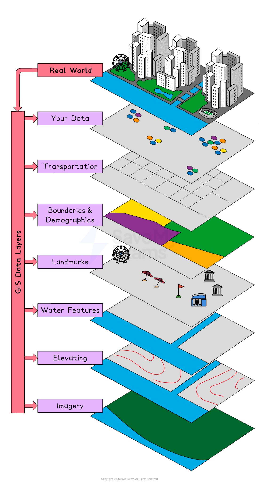

# Geographic Information Systems (GIS)

## Using GIS

> **Spec point** — `spcpt_sgwhfGmVVSp7rHpG`

## Using GIS

- **Geographic Information Systems (GIS)** is digital software which analyses and displays data on maps
- Each GIS map is made of layers, each of which shows different information
- The maps can then be used to:

  - Identify correlations and patterns
  - Assist in:
  
    - Urban planning
    - Disaster management
    - Environmental conservation

*Geographic Information Systems*

- Using GIS software, users can:

  - Zoom in and out to different scales
  - Turn layers of information on and off
  - Add data
- The complexity of GIS maps depends on the purpose of the map
- Google Maps is an example of a GIS application
- Within fieldwork enquiries, GIS can be used either:

  - To display primary data
  - As a source of secondary data

## Benefits & Limitations of GIS

> **Spec point** — `spcpt_3yHJHgBshQXtmpxn`

## Benefits & Limitations of GIS

### Benefits of GIS

- GIS applications are used by businesses and governments
- The use of GIS has several benefits, including:

  - **Improved decision-making** because they clearly show patterns and relationships between different sets of information
  - **Effective planning** for example when making decisions about where to place new housing or an industrial estate
  - **Market analysis **to make decisions such as where to put a new supermarket
  - **Disaster preparedness **and **response **by examining the areas most at risk

### Limitations of GIS

- GIS can be** expensive**
- Inputting the data required can be **time consuming**
- Quality GIS output depends on quality data being inputted, which includes:

  - The accuracy of data
  - Whether the data is up to date
  - Consistency between types of data
- Bias when using GIS is also an issue because:

  - Many maps still use the Mercator projection, which distorts the size of countries and regions
  - The information shown depends on what is selected by the user
