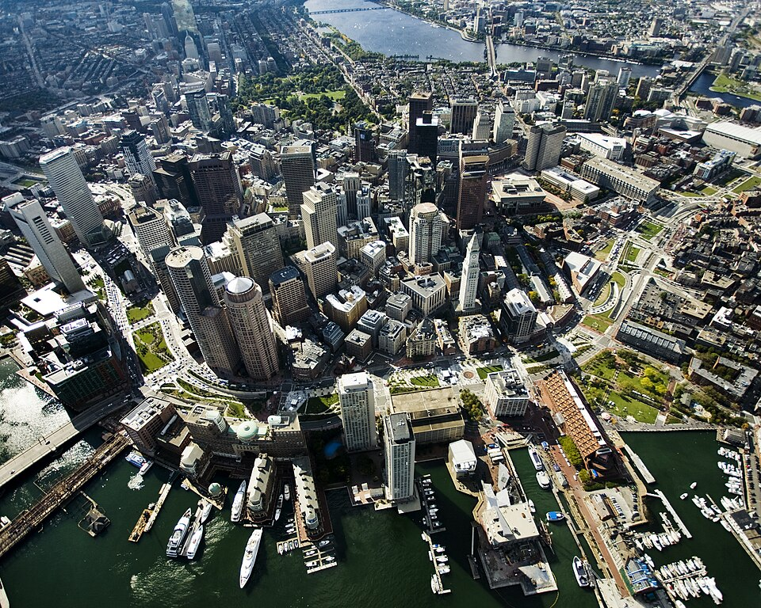

# Image skills

## Photographs

> **Spec point** — `spcpt_X6zdFYFh7WtmqXrB` · Candidates should be able to: deconstruct, interpret, analyse and evaluate visual images including photographs (aerial: vertical and oblique and ground level), cartoons, pictures, diagrams, satellite images 
• analyse written text from a variety of sources for understanding, interpretation and to recognise bias 
• suggest improvements to, issues with, or reasons for using maps, graphs, statistical techniques and visual sources including photographs (aerial: vertical and oblique and ground level) and diagrams 
• use GIS to identify trends, patterns, issues and solve problems 
• recognise the benefits and limitations of using GIS.

## Photographs

- The command word for photographs is usually '**describe'**
- This is about observational skills and understanding about what is being viewed
- When describing, look for:

  - **Physical features: **vegetation, climate, relief, drainage, distinct features (cliff, river, desert, landslide, etc.), rocky outcrops, etc.
  - **Human features: **groupings of buildings: offices, homes, factories, etc. Urban, rural or fringe settlements. Industry and transport; developed or developing areas and general condition of features: busy, quiet, modern, old, etc.
  - **Relief: **height and shape of ground surface, named features, overall appearance
  - **Agriculture: **animal type and spread; vegetation type—grass, barren, sparse, etc. Land type: arable or pasture, ploughed or fallow, crops or harvested, etc. Types of farm buildings and machinery, along with their condition
  - **Settlements: **rural or urban; features of buildings; types of buildings; use of settlements and buildings; spacing between or among buildings—linear, dispersed, nucleated, etc.
  - **Housing: **size and storey: bungalow, large, multistorey, skyscraper, etc. number of windows, are there building plots or vacant sites on the urban fringe or new builds, etc.

> **Exam Hint**
> When asked to **describe**, say what you see, not what you think you see.
> 
> The details of 'what and why' typically appear in a subsequent question.
> 
> You will not gain extra marks for explaining, but you will lose out on precious time.
> 
> **For example, **there is a photograph of a black cat and I describe it as follows:
> 
> - The cat has black fur with a little bit of white on her tummy. Her fur is soft, and she has long whiskers and a stubby tail. She has sharp claws and purrs a lot; she can still bite when annoyed, despite having lost a tooth.
> 
> **How do I know all this?** The photo doesn't reveal if the cat is female, has long claws, lost a tooth, bites, purrs, or has soft fur.
> 
> Always remember to say what you can **only **see in the photograph.

## Aerial images

> **Spec point** — `spcpt_Ykkx2FCWppYsztMT`

## Aerial images

- An **aerial image** is a photograph taken from above the ground, usually from an aircraft, drone, or satellite
- They shows a **bird’s-eye view** of the Earth’s surface

  - **Vertical aerial photos**: Taken from directly above, these views are map-like and good for measuring distances
  - **Oblique aerial photos**: Taken at an angle – shows a more natural perspective but harder to measure

*Oblique aerial image of Boston, USA*

Rose Kennedy Greenway CC-BY-SA-3.0

- Aerial images are often used in geography to study natural and human features
- Interpretation of aerial images requires both a description and explanation

### Identify physical features

- Identify **natural landscapes**:

  - Rivers (winding shapes, valleys)
  - Hills or mountains (shadows, contours of land)
  - Coastlines, beaches, cliffs
  - Forests, fields, lakes

### Recognise human features

- Identify **human-made structures**:

  - Buildings (rectangular blocks)
  - Roads and motorways (long, straight or curved lines)
  - Railways, bridges
  - Settlements (look at layout – grid, scattered, linear)
  - Farmland (fields with boundaries)

#### Describe layout and patterns

- Descriptions should include information on:

  - **Distribution** (e.g. “Houses are clustered along the road”)
  - **Shape and pattern** (e.g. “Fields are regular and rectangular, showing planned farming”)
  - **Land use** (e.g. commercial, residential, industrial)

### Use direction and location

- Refer to compass directions (N, S, E, W).
- Use the **foreground, middle ground, and background** if describing an oblique image

### Analyse

- Suggest reasons for what you see:

  - “The settlement is near the river, possibly for water supply or transport.”
  - “The fields are large and open, suggesting arable farming.”

> **Exam Hint**
> When interpreting aerial images:
> 
> - **Be specific: **Don’t just say, 'There are buildings' – say *what type*, *how many*, and *where.*
> - **Use geographical terms like** 'urban area', “'coniferous woodland”, and “meandering river”.
> - **Compare and describe:**Look for contrasts (e.g. rural vs. urban areas).
> - **Link to context**: If the question is about tourism, industry, or development, relate what you see to the topic.

## Field sketches

> **Spec point** — `spcpt_Fv5HVVKJBh8qVvx4`

## Field sketches

- Field sketches should include:

  - title
  - location/site number
  - compass direction
  - **key **features found at a site

| **Strengths** | **Limitations** |
|---|---|
| - Things can be left out of the sketch if they are not relevant to the enquiry - Smaller, important areas can be more detailed - Gives a broad overview of the features - Helps recall of key features | - The scale in the sketch may be inaccurate - Important key details may be missed - The sketch may contain inaccuracies which affect the analysis, for example, more litter than there actually was at the site |

#### 

> **Exam Hint**
> The exam may ask you to sketch and label key features from a photograph. We do not assess total accuracy or artistic prowess; however, you must identify important features such as rivers, coastlines, hills, etc.
> 
> Follow the geographical rules for sketching:
> 
> - Draw a box to frame the sketch
> - Always draw in pencil
> - Use colour to highlight a feature
> - Use a ruler for straight lines and arrows
> - The arrows always go to the feature, not the label
> - Never cross arrow lines
> - Write horizontally to the arrow in pen

> **Worked Example**
> **The photograph below shows a feature of a river in its upper course.**
> 
> 
> 
> 1. Identify the landform in the photograph **[1 mark]**
> 2. Sketch and label the key features of this landform **[4 marks]**
> 
> **Final answer:** **Answer:**
> 
> 1. Waterfall and gorge **[1]**
> 
> 
> 
> *Example of a sketch from the photograph of High Force waterfall with labels*
> 
> **[4]**
