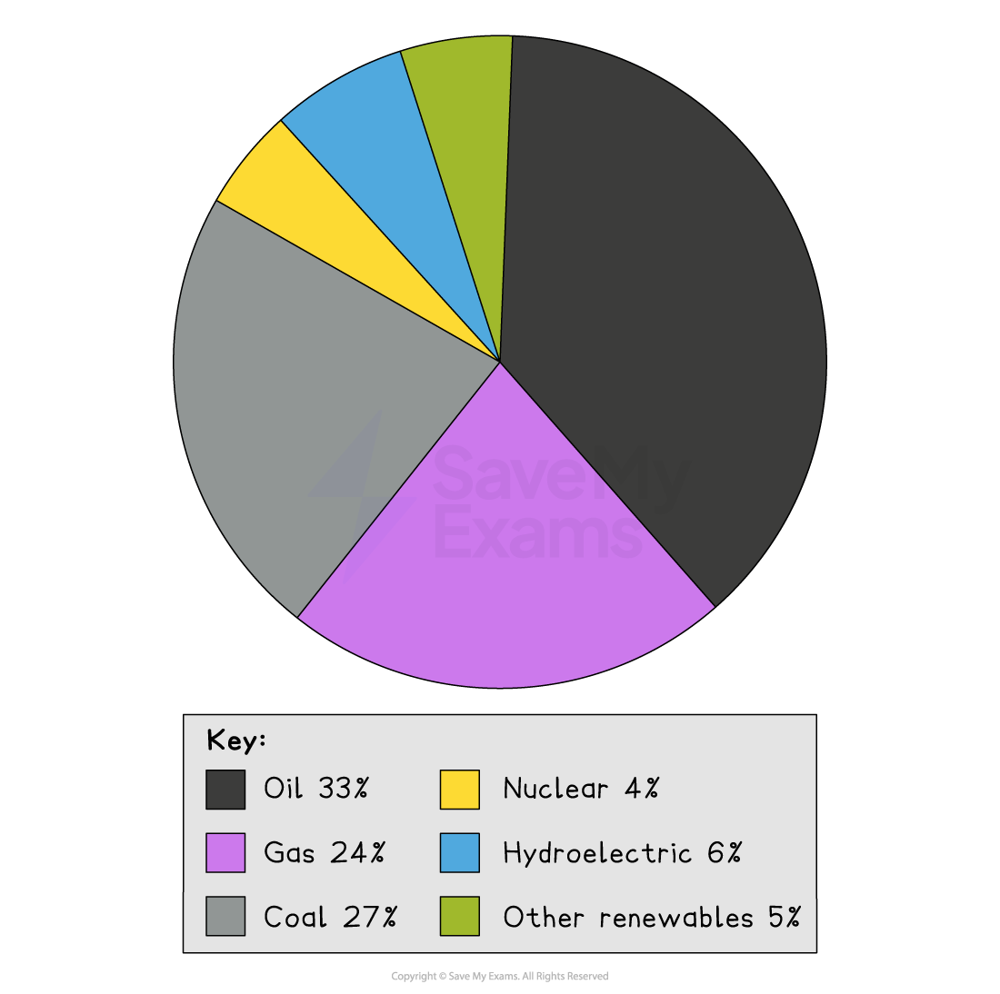
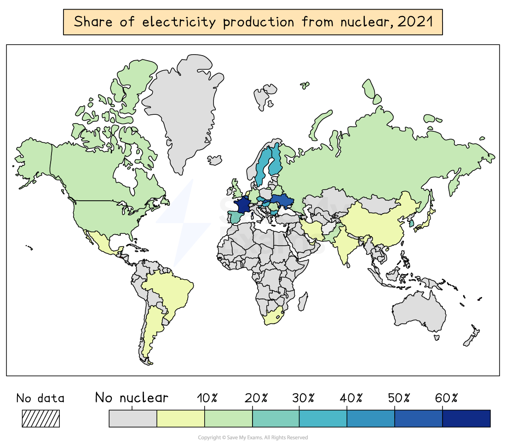

# Energy types

## Specification link

This page covers section 10.4.1 of the [CIE IGCSE specification](https://www.cambridgeinternational.org/Images/718150-2027-2029-syllabus.pdf) .

- **10.4.1 **- Types of energy:

  - Renewable: biomass, geothermal, hydroelectric power (HEP), solar, tidal, wave, wind
  - Non-renewable: fossil fuels (coal, gas, oil), nuclear
  - Fuelwood, which can be either renewable or non-renewable.

## Energy production

> **Spec point** — `spcpt_dcmrqNmBJHpVZD9v` · Types of energy: 
• renewable: biomass, geothermal, hydroelectric power (HEP), solar, tidal, wave, wind • non-renewable: fossil fuels (coal, gas, oil), nuclear 
• fuelwood, which can be either renewable or non-renewable.

## Energy production

- Energy sources are needed to power technology, transport, factories, homes
- The amount of energy used globally varies from place to place
- Each country has it's own *energy mix*
- This will depend on several factors including the availability of:

  - fossil fuels
  - sunlight
  - rivers suitable for dams
  - steady wind speeds
  - coastal access
- Energy production also relies upon a country's investment in infrastructure and government *subsidies *

## Renewable energy sources

> **Spec point** — `spcpt_t9Jbp6tyHkhrFN6p` · Types of energy: 
• renewable: biomass, geothermal, hydroelectric power (HEP), solar, tidal, wave, wind • non-renewable: fossil fuels (coal, gas, oil), nuclear 
• fuelwood, which can be either renewable or non-renewable.

## Renewable energy sources

- **Renewable energy sources **are ***infinite*** and will not run out. They include:

  - hydroelectric
  - wave/tidal
  - wind
  - solar
  - geothermal
  - biomass/waste
- Once in place, except for **biomass/waste**, they do not produce any greenhouse gas emissions
- **Greenhouse gases** may be emitted in the production, construction and transport of the equipment

### Increase in renewable energy

- Renewable energy is increasingly important in the global **energy mix**
- This is due to:

  - **Non-renewable fossil fuels** will at some point** run out **and so they need to be replaced with another energy source
  - The use of non-renewable fuels is damaging to the environment.
  
    - Fossil fuels, when burnt, **release greenhouse gases** and the sulphur dioxide released causes** acid rain**
    - Mining and drilling for fossil fuels can** destroy habitats** and damage the surrounding environment
  - Increasing awareness of the** impact of using fossil fuels** has resulted in international pressure to reduce their use
  - Countries wanting to** reduce their reliance on imports **of energy sources and improve their energy security

## Non-renewable energy sources

> **Spec point** — `spcpt_TvSMHc9VFHhKtgkp` · Types of energy: 
• renewable: biomass, geothermal, hydroelectric power (HEP), solar, tidal, wave, wind • non-renewable: fossil fuels (coal, gas, oil), nuclear 
• fuelwood, which can be either renewable or non-renewable.

## Non-renewable energy sources

- Over 80% of the world's energy is provided by **fossil fuels** (coal, oil and gas)

  - 33% oil
  - 27% coal
  - 24% gas
- Fossil fuels are fuels formed from the remains of living organisms (plants/animals)

  - These are **non-renewable **as they cannot be replaced at a speed that keeps up with consumption
- It is estimated that based on current use and availability, gas and oil will run out by 2080

*World energy mix*

- The use of nuclear and renewable energy is growing but non-renewable fossil fuels still **dominate energy production**
- It is predicted that the use of gas and oil will continue to increase over the next 30 years

  - Fossil fuels are expected to still provide over 75% of the world's energy by 2040

## Nuclear

> **Spec point** — `spcpt_YWsvkJYYNqdcVjBK`

## Nuclear

- Nuclear fuel has the potential to provide large amounts of energy
- It is often used countries who do not have their own supplies of fossil fuels such as France
- Nuclear fuel can be reused and is used in small amounts
- This means that although non-renewable it is not likely to run out in the near future

*Share of electricity production from nuclear.*

- In 2019, approximately 4% of the global primary energy supply was from nuclear power
- There are 439 active nuclear reactors across the world
- Most of these are in just five countries:

  - USA (92)
  - France (56)
  - China (54)
  - Russia (37)
  - Japan (33)

## Fuelwood

> **Spec point** — `spcpt_38DzCKXWsnfPGB4W`

## Fuelwood

- It is estimated that between 2 and 3 billion people across the world rely on fuelwood for **heating** and** cooking**

  - This is usually because they do not have access to other forms of energy
- Approximately 13% of the world's population does not have access to electricity

  - This is mostly an issue in** LICs within Sub-Saharan Africa and Asia**
- Fuelwood is often included as a** biofuel **but the wood is not usually grown specifically for use in heating and cooking
- The reasons for this include

  - It is free
  - It does not require technology
  - That it can be renewable if the trees are replaced
  - No high-technology equipment is needed to use the fuel
- If new trees are planted this is a renewable energy source
- If the trees are not replaced it is a non-renewable energy source
