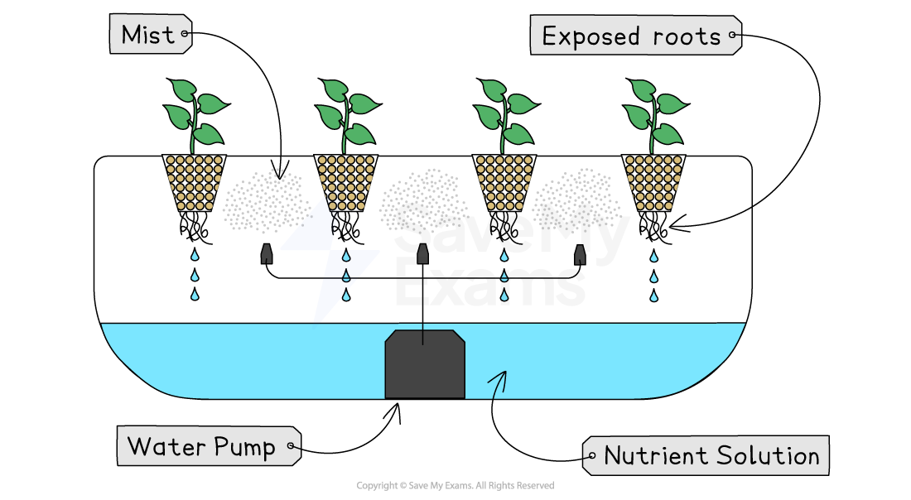

# Types of farming

## Specification link

This page covers section 10.1.1 of the [CIE IGCSE specification](https://www.cambridgeinternational.org/Images/718150-2027-2029-syllabus.pdf) .

- **10.1.1** - Farming types: subsistence, commercial, arable, pastoral, mixed, aeroponics, aquaponics, hydroponics.

## What are the different types of farming?

> **Spec point** — `spcpt_FgJ5rz7Bqzdg6tjK` · Farming types: subsistence, commercial, arable, pastoral, mixed, aeroponics, aquaponics, hydroponics.

## What are the different types of farming?

- To obtain food, humans use and modify the ecosystems through farming
- There are four groupings commonly used to categorise farming:

  - By inputs:
  
    - **Intensive** farming use large amounts of labour, machines, technology or money often resulting in high yields per acre/hectare
    - **Extensive **farming uses low levels of labour, machines, technology or money often resulting in low yields per acre/hectare
  - By what is grown/raised (processes):
  
    - **Arable** is the cultivation of crops
    - **Pastoral** is the rearing of livestock
    - **Mixed **is a combination of arable and pastoral
  - By the outputs:
  
    - **Commercial **farming is growing crops or rearing livestock for profit
    - **Subsistence** farming is when crops are grown and livestock is raised to feed the farmer and their family
- Classification of farms is not easy because:

  - each type of farm belongs in more than one category
  
    - a sheep farm is commercial, extensive and pastoral
  - activities within the farm are subject to change
  
    - If a subsistence farmer has a particularly good harvest then they will sell some of the crops for profit
- As well as the main categories farming can also be categorised by location

  - **Nomadic** farming occurs where farmers move from one place to another
  
    - This usually happens in areas where farmers need to search for grassland for grazing their livestock
  - **Sedentary **farms are located in one place and do not move

> **Exam Hint**
> Remember, farms do fit into more than one category. For example, a sheep farm in Cumbria. The UK would be categorised as arable, commercial, extensive and sedentary

## Other types of farming

> **Spec point** — `spcpt_kH6ZBkMHwbs5pghH` · Farming types: subsistence, commercial, arable, pastoral, mixed, aeroponics, aquaponics, hydroponics.

## Other types of farming

### Vertical farming

- **Vertical farming **is the growth of crops vertically (upwards), in layers
- This type of farming usually occurs in large buildings, greenhouses or shipping containers to reduce land use
- The systems produce **more food** for the land available
- Examples include:

  - **Aeroponics** - crops hang in the air, with their roots exposed. A nutrient-rich condensed mist waters the plants
  - **Hydroponics** - growing plants without soil, using mineral nutrient-rich water instead
  - **Aquaponics** - using ***aquaculture*** with hydroponics. Waste from marine animals nourishes the water used for crop growth
- Vertical farming is seen in countries across the world, from Germany and the Netherlands to Japan and Singapore
- Examples of vertically farmed foods include:

  - Lettuce, kale, broccoli, garlic
  - Strawberries
  - Tree seedlings
  - Plants used for medicine
  - Fish

### Aeroponics

- This method involves growing plants inside using a mist system
- The plants are not grow in soil but are suspended in the air and the roots take in the nutrients and water they need from the mist

*Aeroponic system*

- Costs of aeroponic systems are high
- The system is only suitable for some crops such as:

  - lettuce
  - kale
  - strawberries
  - tomatoes
- Aeroponics uses less water than traditional systems
- It may also produce higher yields

### Hydroponics

- In a hydroponic system plants are grown in a nutrient rich liquid
- Unlike aeroponics where the roots are suspended in the air, in hydroponics the roots sit in the liquid

### Aquaponics

- An aquaponic system combines aquaculture and hydroponics
- As in hydroponics the plant roots sit in a nutrient rich water
- The difference is that in aquaponics the water is an environment for fish

  - The fish waste provides nutrients for the plant growth
  - The plants remove nitrates from the water which filters it, keeping it clean for the fish
