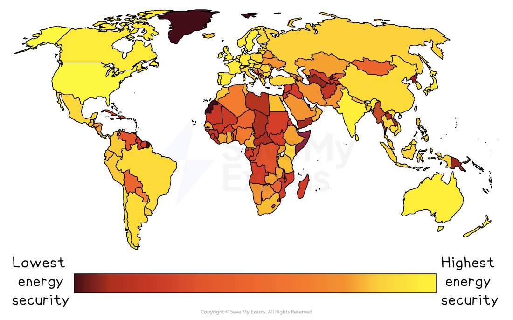

# Global patterns of energy

## Specification link

This page covers section 10.5.2 of the [CIE IGCSE specification](https://www.cambridgeinternational.org/Images/718150-2027-2029-syllabus.pdf) .

- **10.5.2 **- The global patterns of energy surplus and deficit and the importance of energy security.

## Patterns of energy surplus & deficit

> **Spec point** — `spcpt_xCkhCg38VFBPrSPV` · The global patterns of energy surplus and deficit and the importance of energy security.

## Patterns of energy surplus & deficit

- The global **supply **of energy sources is **not evenly distributed**
- Production of energy sources **depends **on various **factors**

  - **Physical **factors such as **geology**
  - **The technology **opening up new **opportunities **for resource **exploitation**
  - **Economic **factors such as the **price **of the resource and the **cost **of extraction
  - **Political **factors such as **environmental agendas **and wars
- Some places have a **surplus **of energy sources
- Others have a **deficit **and rely on **trade **and** imports **to make up the shortfall

### Energy surplus

- Energy surplus tends to occur in countries that have:

  - **Large reserves of fossil fuels**, such as the Middle East and Russia
  - Good **access to renewable energy **sources – often hydroelectric or geothermal, such as Norway
  - A **small population** compared to the energy sources available, for example, Australia

### Energy deficit

- Energy deficit tends to occur in countries that:

  - Have** limited fossil fuel or renewable energy, **such as Nepal
  - Have** large populations**, leading to high energy demands
  - **Lack the money** to exploit energy resources such as countries in Sub-Saharan Africa

## Importance of energy security

> **Spec point** — `spcpt_dz2PxkqJbDQBHSYN` · The global patterns of energy surplus and deficit and the importance of energy security.

## Importance of energy security

- An **energy gap** is when a country cannot meet the demand for energy using its own resources
- When countries have an energy gap, they have to import energy to meet the demand
- Having an energy gap means that a country is not **energy secure**
- To be energy secure, a country needs an:

  - **uninterrupted **supply of energy
  - **affordable** supply
  - **accessible **supply

*Global energy security*

- The UK has a widening **energy gap** and is **not energy secure** because:

  - Renewable energy is not as efficient and so cannot replace energy from fossil fuels
  - It is cheaper to import fossil fuels than it is to exploit the resources in the UK
- The commitment of many countries to tackling climate change and reducing the use of fossil fuels has increased energy insecurity for many countries
- There are other factors that can affect energy security:

  - energy sources running out
  - war/conflict
  - natural hazards
  - political disputes
  - cost
  - environmental concerns

> **Exam Hint**
> When writing about global patterns of energy in your answers, it is important to make sure that you include the correct terminology, including:
> 
> - Energy surplus
> - Energy deficit
> - Energy security
> - Energy gap
> 
> Also ensure that you can give named examples and explain why countries have an energy surplus or energy deficit.
