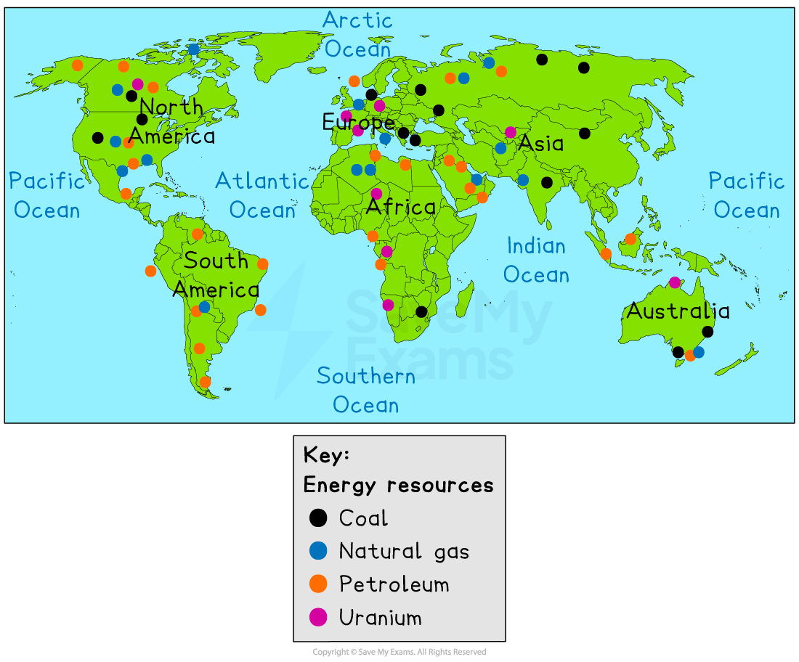
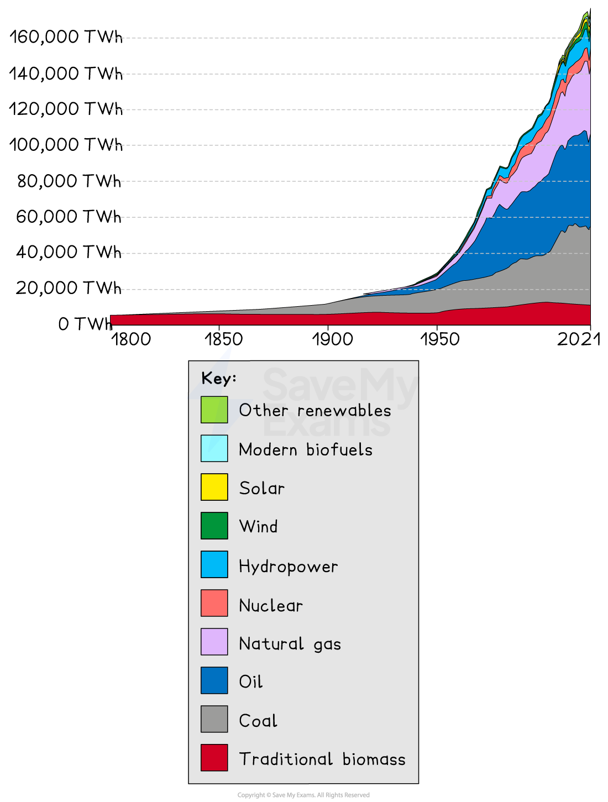

# Increasing global production & consumption of energy

## Specification link

This page covers section 10.5.1 of the [CIE IGCSE specification](https://www.cambridgeinternational.org/Images/718150-2027-2029-syllabus.pdf) .

- **10.5.1 **- Reasons for the increasing global production and consumption of energy.

## Reasons for increasing global energy production

> **Spec point** — `spcpt_cr5tWyD6FDhSXZzH` · Reasons for the increasing global production and consumption of energy. 

## Reasons for increasing global energy production

- Energy sources are **not evenly distributed **across the world
- Some areas produce very little energy due to a lack of natural resources or because they do not have the money to ***exploit*** the resources
- The main producers of fossil fuels for primary energy are:

  - USA
  - Canada
  - Norway
  - Russia
  - Australia
  - Middle East

*Global distribution of fossil fuels and nuclear fuel*

- The world's largest producers are often the largest consumers of energy
- Countries are investing more to try and **achieve energy security**
- Energy production is growing due to the increased demand for energy

## Reasons for increasing global energy consumption

> **Spec point** — `spcpt_gsS8JqMywvbrc8YT`

## Reasons for increasing global energy consumption

### Increasing energy demand

- Global energy demand is rising rapidly

*Graph showing world energy demand by source.*

### Reasons for increasing energy consumption

- Population growth and development are the key drivers of increased energy consumption because of:

  - **Food production**:
  
    - The **higher demand for food** leads to more **intensive farming,** which needs more energy for machines, light and heat
  - **Industrial growth**:
  
    - Factories need energy for operations, heating, and lighting
  - **Transportation:**
  
    - Increased movement relies on petrol, diesel, and electricity
  - **Urbanisation**:
  
    - Increasing urban population use domestic appliances, heating, and lighting
  - **Economic development**:
  
    - **Rising wealth** leads to people buying more appliances and technology that need energy
