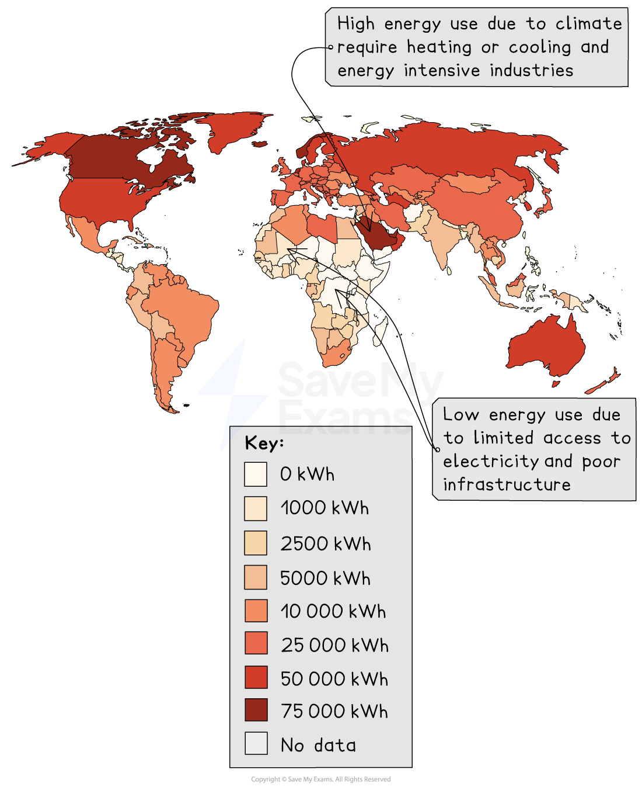

# Variations in energy use

## Specification link

This page covers section 10.5.3 of the [CIE IGCSE specification](https://www.cambridgeinternational.org/Images/718150-2027-2029-syllabus.pdf) .

- **10.5.3 **-The reasons for variations in types of energy used within a country and between countries at different levels of development.

## Reasons for high energy consumption

> **Spec point** — `spcpt_pMbJkVk3yy2r9qvs`

## Reasons for high energy consumption

- The global demand for energy is not evenly distributed
- Some countries and some regions within countries use more energy than others

  - Countries with the **highest energy consumption** per person tend to be HICs, including Canada, Norway and Saudi Arabia
  - Countries with the **lowest energy consumption** per person are LICs, which are mainly in Africa and include Niger, Chad and Tanzania

*Energy use per person*

- The reasons for high energy consumption vary among countries and regions, but some of the main ones include:

  - Level of development
  - Industrialisation
  - Climate
  - Population size and growth
  - Availability of energy

### Level of development

- Wealthier High Income Countries (HICs) have higher average living standards this means people have more appliances and technology that require energy
- There is higher car ownership and people travel more frequently

### Industry

- Countries with heavy industries such as steel production and where there are lots of factories have high energy demands

  - **Rapid *****industrialisation*** in emerging economies such as China and India has led to a significant increase in energy demand in these areas

### Climate

- In countries with** colder climates **such as Canada and Iceland more energy is required for** heating**
- In** hotter climates **such as Saudi Arabia and Qatar more energy is used for cooling

### Population

- As the population rises so there are more homes, businesses and transport, which increases the demand for energy

### Availability of energy

- Access to cheap, plentiful supplies of energy tends to lead people to consume more
- In countries like Saudi Arabia where there is access to large *energy reserves* energy is *subsidised,* which means that people tend to use more

## Reason for low energy consumption

> **Spec point** — `spcpt_S8r9ksd66sKzkmG2`

## Reasons for low energy consumption

- The reasons for low energy consumption also vary between countries and regions, but some of the main ones include:

  - Level of development
  - Poor *infrastructure*
  - High energy costs
  - Climate

### Level of development

- In Low Income Countries (LICs), people cannot afford to pay for energy
- A greater proportion of the population live a subsistence lifestyle which is based on farming this does not have high energy use
- People have limited access to technology and appliances, particularly in rural areas

### Poor infrastructure

- Access to energy is dependent on infrastructure such as pipes and cables

  - In many LICs, *electricity grids* are small, unreliable and don't cover many rural areas
  - Gas pipelines and petrol/fuel stations may also be limited

### High energy costs

- In countries with few energy sources, the cost of importing energy supply can be expensive, which increases prices

  - High prices lead to reduced consumption

### Climate

- In temperate climates people do not need to use as much energy for heating or cooling

  - This reduces the consumption of energy in homes and businesses

## Variations in energy consumption within countries

> **Spec point** — `spcpt_g87dpN7h8W7FsPXp` · The reasons for variations in types of energy used within a country and between countries at different levels of development.

## Variations in energy consumption within countries

- Urban areas usually consume more energy than rural areas
- The reasons for this include:

  - Higher *population density*
  - Better access to energy infrastructure
  - More transport
  - Higher use of energy for heating/cooling, entertainment and industries
- Rural areas tend to consume less energy due to:

  - Fewer industries
  - Smaller populations
  - Less infrastructure and greater reliance on biomass for heating/cooking, particularly in LICs
- **Industrial **and **commercial areas **consume more energy than residential areas
- Colder or hotter parts of countries have different heating and cooling requirements which cause variations in energy demand

  - Florida in the USA will use more energy for cooling, whereas Minnesota in the USA will use more energy for heating
