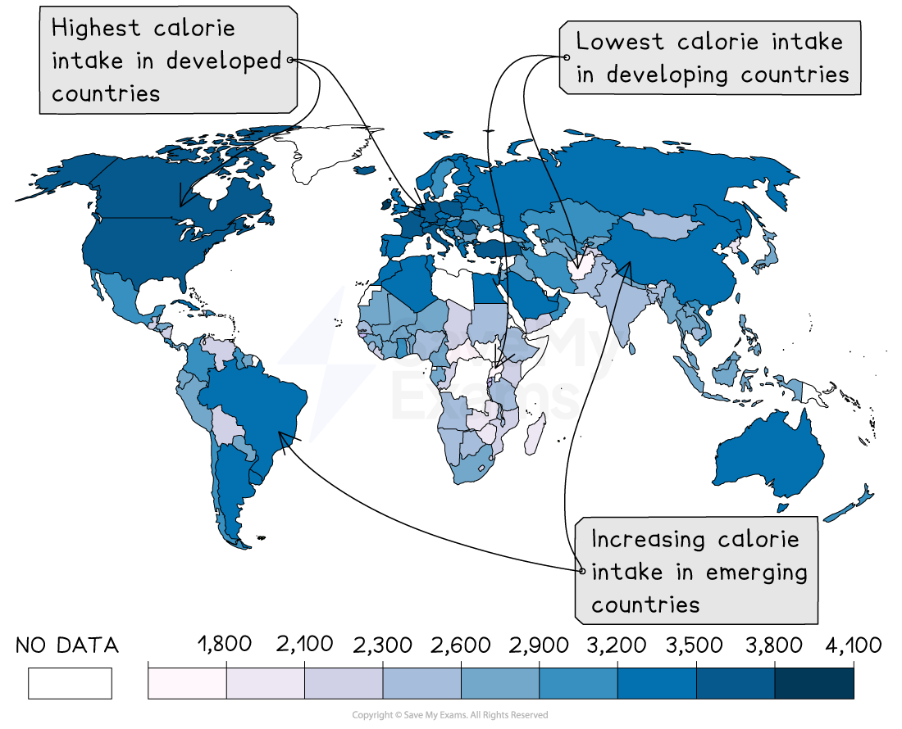

# Global patterns of calorie intake

## Specification link

This page covers section 10.2.1 of the [CIE IGCSE specification](https://www.cambridgeinternational.org/Images/718150-2027-2029-syllabus.pdf) .

- **10.2.1** - Global patterns of calorie intake and reasons for variations.

## Global patterns of calorie intake

> **Spec point** — `spcpt_3Rgqbg5v8ng76GT9` · Global patterns of calorie intake and reasons for variations.

## Global patterns of calorie intake

- Food consumption around the world is increasing due to:

  - **Population increase**: the world population has now reached 8 billion
  
    - Much of this growth has been in LICs and MICs where people are more likely to suffer ***food insecurity***
  - As countries develop people have money to buy more food
  - Transport of food is easier and cheaper than in the past
- Sufficient food is produced to feed the world's population

  - The distribution of the food available is not equal

- To live a healthy and active life people require about 2,500 calories

  - In areas like the USA and Europe people consume more calories than needed
  - In areas such as Pakistan, Venezuela and sub-Saharan Africa people consume fewer calories than needed

*World map showing calorie Intake*

## Reasons for variation in calorie intake

> **Spec point** — `spcpt_fYgBMQMVTmK6VjNk` · Global patterns of calorie intake and reasons for variations.

## Reasons for variations in calorie intake

- There are many factors which affect calorie intake these may be due to:

  - food supply
  - food production
  - diet
- Diet can impact the levels of **calorie consumption **

  - People in HICs tend to have a **higher calorie consumption**, as diets are richer in fats and sugars
  - In LICs people tend to consume** fewer calories**, as diets focus on lower fat and higher fibre diets
- Food production is dependent on several factors

### Climate

- Crops and animals require suitable conditions the climate impacts on whether there is enough, too little or too much precipitation and sunshine

### Soil

- Soil depth, structure, fertility and pH all influence the types of crops which can be grown

### Water

- Crops and livestock need water
- The amount needed is dependent on the type of crop/livestock
- Farmers need enough water to irrigate during drier times

### Technology

- The availability of technology will impact on the yield produced

### Government

- Investment in agriculture tends to be higher in HICs
- Government subsidies are often available to help support farmers so that they keep producing food

### Crop choice

- Some crops are able to feed more people
- Choosing suitable crops affects the number of people who can be fed
