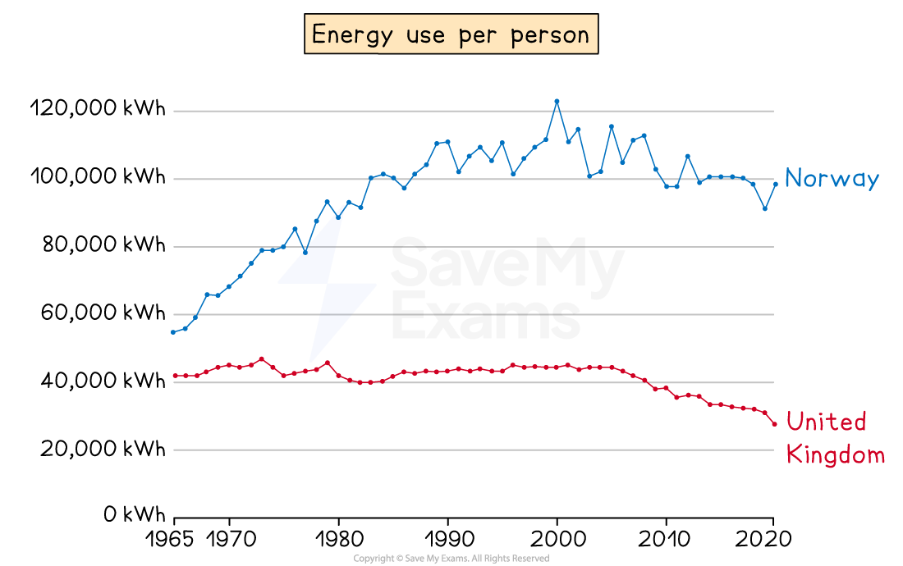
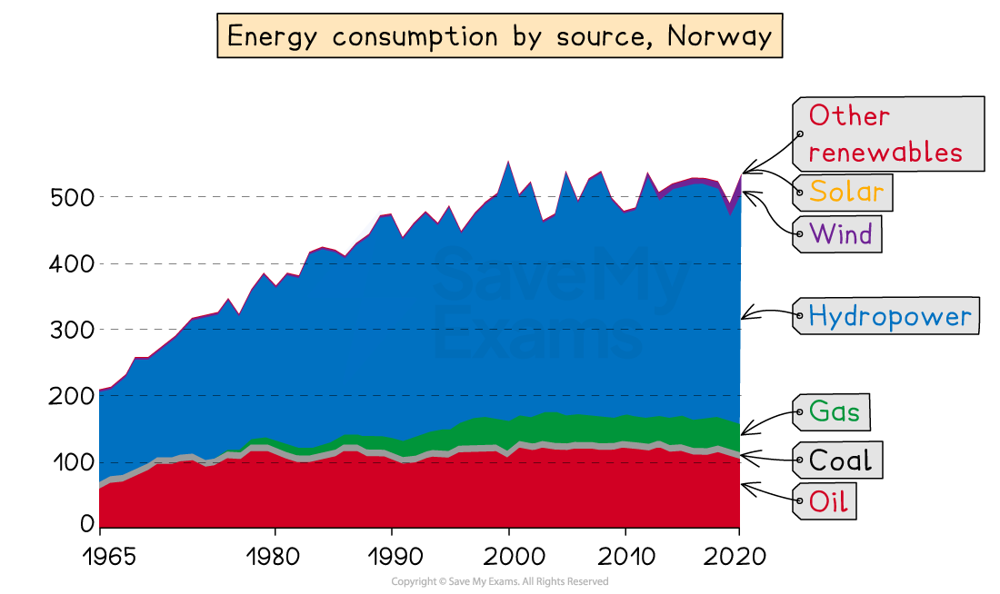

# Detailed Specific Example: Norway

## Specification link

This page covers section 10.6.4 of the [CIE IGCSE specification](https://www.cambridgeinternational.org/Images/718150-2027-2029-syllabus.pdf) .

- **10.6.4 **- One detailed specific example of a named country to include:

  - The energy mix.
  - The impacts of the different types of energy being used.
  - The strategies and techniques used to manage energy supplies; including sustainable.

## Energy mix in Norway

> **Spec point** — `spcpt_GGMn8R8NmsZG9QVh` · One detailed specific example of a named country to include: 
• the energy mix 
• the impacts of the different types of energy being used 
• the strategies and techniques used to manage energy supplies; including sustainable.

## Energy mix in Norway

- Norway is a **High Income Country (HIC)** in **northern Europe**
- The demand for energy is one of the highest in the world
- The population is **mainly urban** with 83% of people living in towns and cities

*Graph showing the energy use in Norway and the UK*

### Energy resources

- Norway has significant energy resources, including:

  - 1% of the world's gas reserves (17th in the world)
  - 0.3% of the world's oil reserves (22nd in the world)
  - There are also some coal reserves
- Norway is one of the **world's largest energy exporters**
- **Hydropower** generates 90% of Norway's electricity and accounts for 65% of energy use

*Graph showing the energy use in Norway and the UK*

### 

## Impacts of energy types in Norway

> **Spec point** — `spcpt_GBkJWfH8pcr3sRsK` · One detailed specific example of a named country to include: 
• the energy mix 
• the impacts of the different types of energy being used 
• the strategies and techniques used to manage energy supplies; including sustainable.

## Impacts of energy types in Norway

- The reliance on hydropower in Norway has several impacts, including:

  - **Flooding **of large areas of land
  - Dams create physical barriers to** fish migration** and impact on breeding areas
  - **River flow rates **are impacted, which can negatively affect wildlife
  - Water temperature and sediment levels are altered
  - **Habitat destruction**
- The production of hydropower can be impacted by climate conditions

  - In 2022, Norway experienced drought conditions leading to a decrease in energy supply and an increase in energy prices
- Although much of the oil and gas extracted by Norway is exported, the extraction impacts the environment by:

  - Increasing the risk of **oil spills** and leaks
  - **Underwater noise pollution** affects marine life
  - The burning of the fossil fuels increases **greenhouse gas emissions** and contributes to global warming

## Strategies used to manage energy supplies in Norway

> **Spec point** — `spcpt_SzrsNBSgPjPhYmJr` · One detailed specific example of a named country to include: 
• the energy mix 
• the impacts of the different types of energy being used 
• the strategies and techniques used to manage energy supplies; including sustainable.

## Strategies used to manage energy supplies in Norway

- There are over **1500 hydropower plants** in Norway
- Due to the issue of reliance on hydropower during the dry season and the environmental impact of large hydropower plants Norway is expanding other renewable energy sources
- Demand continues to increase
- Norway is expanding the number of wind farms:

  - There are currently **53 wind farms**
  - Plans for 36 additional onshore and offshore are due to be started or completed by 2030
  
    - Includes the world's first** floating wind farm**
- Norway is also investing in** solar energy**:

  - Homeowners in Oslo get a 30% subsidy for installing solar panels
- To reduce the consumption of oil, Norway is encouraging the population to move to **electric cars**:

  - In 2021, 66% of all new car sales in Norway were electric
