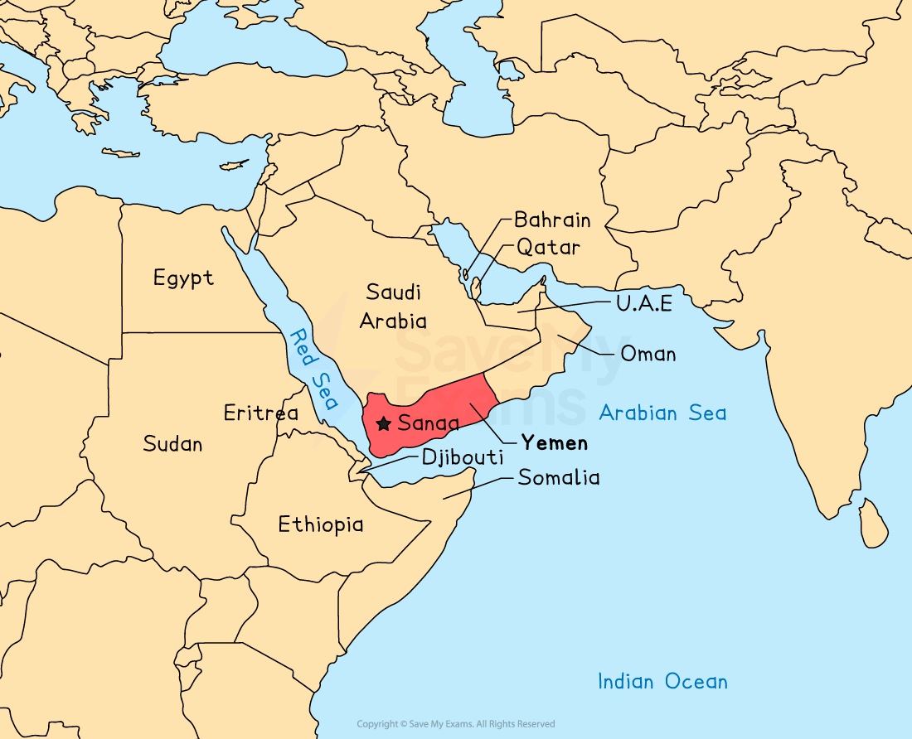
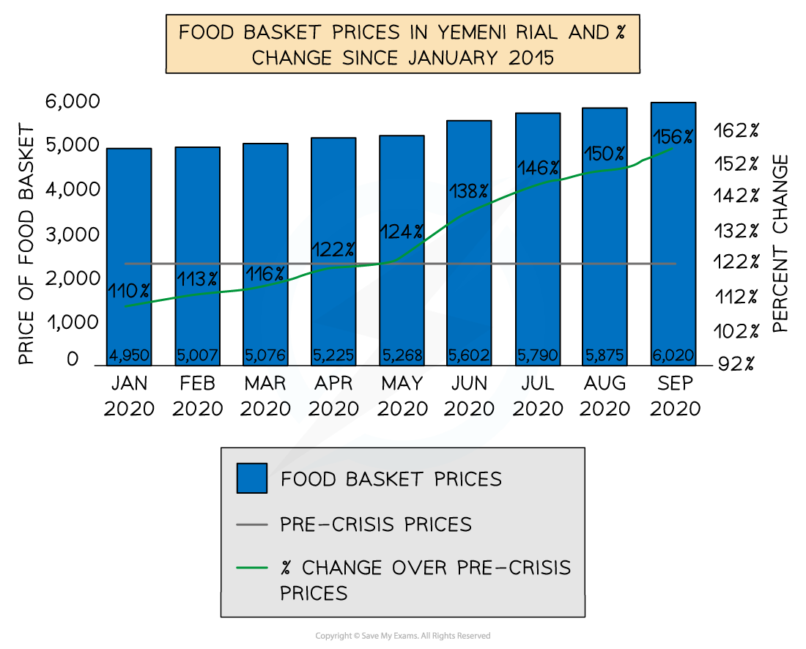

# Detailed Specific Example: Yemen

## Specification link

This page covers section 10.3.6 of the [CIE IGCSE specification](https://www.cambridgeinternational.org/Images/718150-2027-2029-syllabus.pdf) .

- **10.3.6 **- One detailed specific example of a named country or area to include:

  - Factors affecting food supply
  - Causes of food insecurity
  - Problems caused by food insecurity
  - Strategies and techniques used to increase food supply.

The example below might be different from the one you have studied at school or in the textbook. It does not matter which example you use, providing it meets the requirement of the specification and you use it effectively.

## Food supply in Yemen

> **Spec point** — `spcpt_6c3yk2cqZ29wfc3Q` · One detailed specific example of a named country or area to include: 
• factors affecting food supply 
• causes of food insecurity 
• problems caused by food insecurity 
• strategies and techniques used to increase food supply

## Food supply in Yemen

- Yemen is located in the south-east of the Arabian Peninsula

*Location of Yemen*

- Yemen has a mainly** hot desert climate** with a **temperate climate** in the western mountains
- In summer months, temperatures reach 40 ºC and there is little rainfall
- Winter months are cooler between 25 and 35 ºC, but with little rainfall

### Agriculture

- There is increasing agricultural activity in Yemen, with crops including

  - millet
  - corn
  - wheat
  - barley
  - sorghum
- Other crops include coffee, cotton and fruit, which were grown for export
- Over 73% of the population relies on agriculture as their main source of income

## Causes of food insecurity in Yemen

> **Spec point** — `spcpt_SSW88vHFM3c4HRZr` · One detailed specific example of a named country or area to include: 
• factors affecting food supply 
• causes of food insecurity 
• problems caused by food insecurity 
• strategies and techniques used to increase food supply

## Causes of food insecurity in Yemen

- **Conflict**

  - In 2015, after years of internal conflict, a** civil war** broke out
  - Continued conflicts have led over 4 million Yemenis to be displaced
  - Food aid supplies have been affected by **blockades** at the ports intended to stop weapons from entering the country
  - Internal infrastructure (roads, airports and communication) has also been affected by the conflict, which stops the movement of food around the country

- **Drought**

  - In recent years, drought has further affected supplies
  - The main crop-growing areas have received only one-third to half of the usual precipitation
- **Pests**

  - In 2019, swarms of locusts hit Yemen, destroying many of the crops
  - The conflict affected the control and monitoring program
  - The lack of pesticides meant that the Yemenis struggled to control the insects
- **Corruption**

  - Food aid is taken by those involved in the fighting and those in power
  - It often does not reach those who need it most
- **Population increase**

  - The population has increased to almost 30 million from 26.5 million in 2015
  - This increases the demand for food

## Problems caused by food insecurity in Yemen

> **Spec point** — `spcpt_YzRsnDPG79T95Sv9` · One detailed specific example of a named country or area to include: 
• factors affecting food supply 
• causes of food insecurity 
• problems caused by food insecurity 
• strategies and techniques used to increase food supply

## Problems caused by food insecurity in Yemen

- The Yemeni economy has declined
- These issues have mostly happened in the crop-growing areas in the south-west
- In 2016, it is estimated that farm produce losses totalled \$964.5 million
- Yemen became dependent on** imports** for 90% of its grain supplies

  - Much of this was from Ukraine, the supply of which has been affected by the Russian invasion
- More than 80% of the population live below the poverty line
- Over 50% of the population working in agriculture have lost their jobs
- Food prices have increased between 30 and 70%, meaning people cannot afford a healthy diet
- The increase in 2020 was over 150%

*Food basket price in Yemen *

- The UN estimates more than 226,000 Yemenis have died due to **food shortages** and **lack of health services**
- **Acute malnutrition** now threatens over 50% of children under 5
- The total number of food-insecure people is expected to reach 19 million by the end of 2022

## Strategies to increase food supply in Yemen

> **Spec point** — `spcpt_HbcJY69vK7MVvBW2` · One detailed specific example of a named country or area to include: 
• factors affecting food supply 
• causes of food insecurity 
• problems caused by food insecurity 
• strategies and techniques used to increase food supply

## Strategies to increase food supply in Yemen

- Since the start of the conflict, billions in aid have been sent to Yemen through organisations such as:

  - UNICEF
  - Red Cross
  - World Food Program
  - Oxfam
- Getting aid to the people who need it is challenging for the reasons outlined in '**causes**' above
- The World Food Programme provides 13 million people with food assistance through:

  - Rations
  - Vouchers
  - Cash transfers
- The **International Fund for Agricultural Development (IFAD) **has provided US\$38 million in funding to restore agricultural land and infrastructure
- Until the end of the conflict, the food shortages are likely to continue and may even get worse
