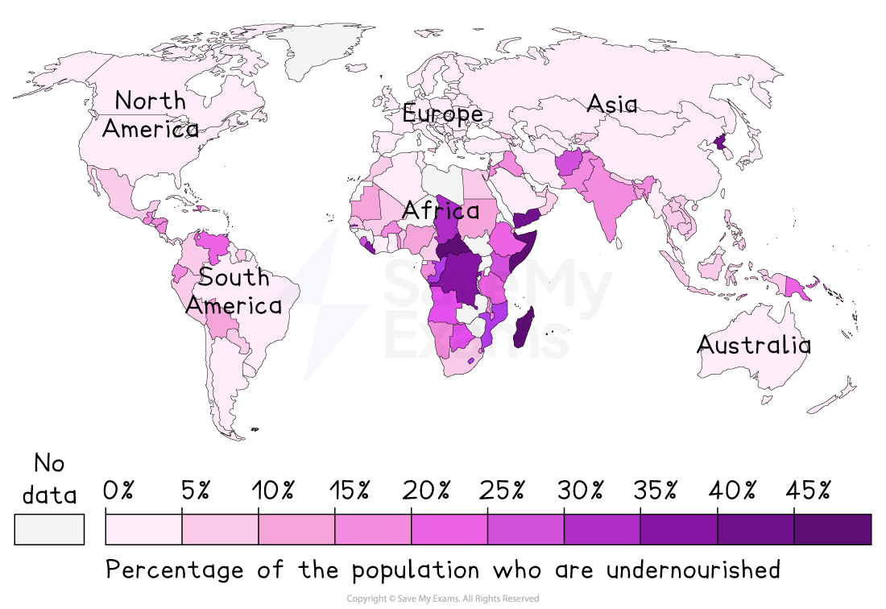
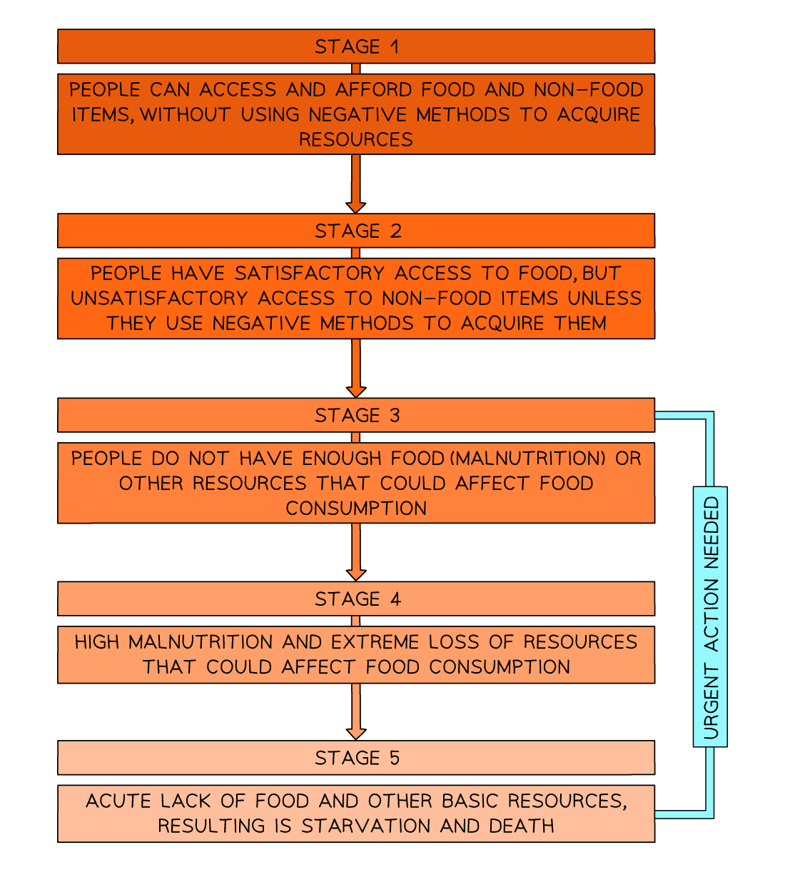

# Problems caused by food insecurity

## Specification link

This page covers section 10.3.2 of the [CIE IGCSE specification](https://www.cambridgeinternational.org/Images/718150-2027-2029-syllabus.pdf) .

- **10.3.2 **- The problems caused by food insecurity in countries at different levels of development.

## What is food insecurity?

> **Spec point** — `spcpt_jd9SQbXHdQSqqmj2` · The problems caused by food insecurity in countries at different levels of development.

## What is food insecurity?

- The distribution of food is uneven and this affects **food security**
- Food security is defined as having reliable access to a sufficient quantity of affordable, nutritious food

*Percentage of the population undernourished*

- Countries where a high percentage of the population are food insecure often have a ***food deficit***

  - These tend to be LICs as they cannot produce or afford to import enough food to meet the population's needs
- Some countries have a ***food surplus***, these tend to be HICs

  - HICs and some MICs can also afford to import food when they do not produce sufficient for the demand
  
    - The UK imports approximately 46% of the food supply required by the population

*Food security classification*

### Factors affecting food security

- There are many factors which affect food security either in terms of yields or transport into an area

#### Climate

- **Extreme temperatures** make growing crops challenging
- **Tropical storms** lead to flooding which destroys crops
- **Changing patterns of rainfall** impact on yield and can lead to drought or floods
- **Drought** can lead to desertification and salinisation which affect crop growth

#### Technology

- LICs lack money to invest in:

  - Machinery
  - Irrigation systems
  - Transport and storage infrastructure
- This means their yields are lower than in HICs which are able to invest money in this technology

#### Pests and diseases

- Crops and livestock are vulnerable to pests and diseases
- HICs are able to afford pesticides and treatments to reduce the impact of these on yields
- LICs are often in tropical areas where pests such as locusts and diseases such as African Swine Flu are more prevalent

#### Water stress

- Water stress affects the ability to irrigate crops due to lack of water
- LICs are more likely to suffer water stress than HICs due to lack of precipitation and poor infrastructure
- Lack of irrigation in drier areas leads to low yields

#### Conflict

- During conflicts people abandon or are driven off their land leading to large areas of uncultivated farmland
- Conflict can destroy or block transport routes meaning that food supplies including imports cannot get to where they are needed
- Conflicts also lead to the destruction of crops and livestock

#### Poverty

- Poverty can mean that people are unable to afford:

  - Technology such as machines
  - Irrigation
  - Quality seeds and livestock
- Poor diets then mean that people are unable to work due to ill health

## Problems caused by food insecurity in LICs

> **Spec point** — `spcpt_fjP56MtVhcY6RsNG` · The problems caused by food insecurity in countries at different levels of development.

## Problems caused by food insecurity in LICs and MICs

- The impact of food shortages ranges from undernutrition to wasting

  - **Undernutrition:** people do not consume enough calories, this is linked to 45% of all child deaths
  - **Malnutrition:** people's diet lacks the correct nutrients to keep them healthy
  - **Wasting:** when people have low weight in relation to their height: affects 45 million children under the age of 5
- There are different forms of malnutrition

  -
- **Famine **can occur** **when a significant proportion of the population are suffering severe and prolonged hunger

  - This leads to acute malnutrition and deaths as a result of starvation.
- **Rising food prices**

  - When there is increased demand and reduced supply the prices increase
  - Those living in poverty often cannot afford a balanced diet this means people in LICs and NEEs are the most affected
- **Underdevelopment - loss of productivity**

  - If a country's workforce is suffering from food shortages, they will be less productive, and development will slow or even reverse
- **Soil erosion and desertification**

  - Farmers may over cultivate and overgraze the land in an attempt to increase the amount of food available
- **Social unrest**

  - Food shortage may lead people to riot and loot
- **Migration**

  - People migrate to other countries or to urban areas where the food supply is better. This can impact those areas with the development of illegal settlements

## Problems caused by food insecurity in HICs

> **Spec point** — `spcpt_zV5HdfVP853QfdkJ` · The problems caused by food insecurity in countries at different levels of development.

## Problems caused by food insecurity in HICs

- People in HICs are less likely to suffer food insecurity
- There are still between 8% and 20% of the populations in HICs who suffer food insecurity
- Particular groups are vulnerable to food insecurity including:

  - the elderly
  - the unemployed
  - those living in poverty
  - people with disabilities
- In the UK between 2021-22 an estimated 11.3 million people in the UK experienced food insecurity
- As in LICs and MICs this can lead to **malnutrition **and **undernutrition**

  - In extreme cases it can lead to **wasting**
- Other problems caused by food insecurity in HICs include:

  - Underachievement at school due to children being hungry
  - Mental health issues
  - Increase in crime
- There has also been an increase in reliance on food aid in developed countries

  - There are almost 3,000 food banks in the UK
