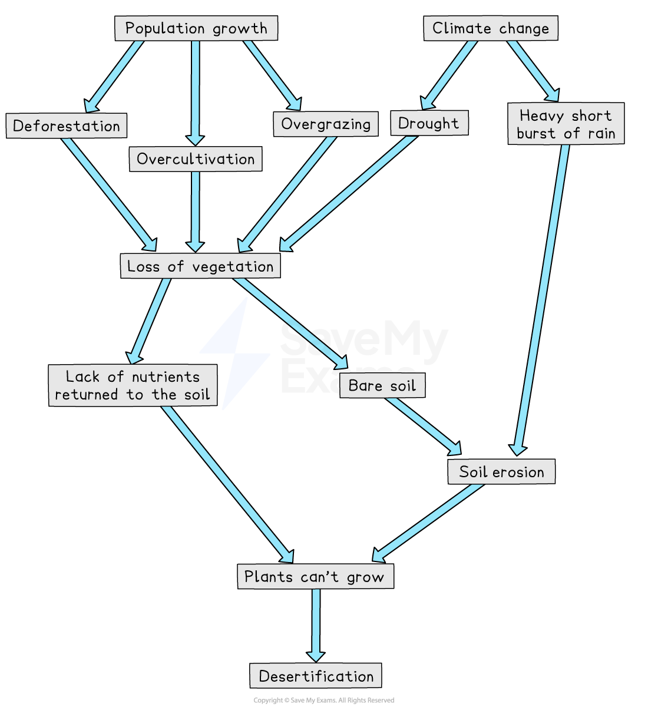
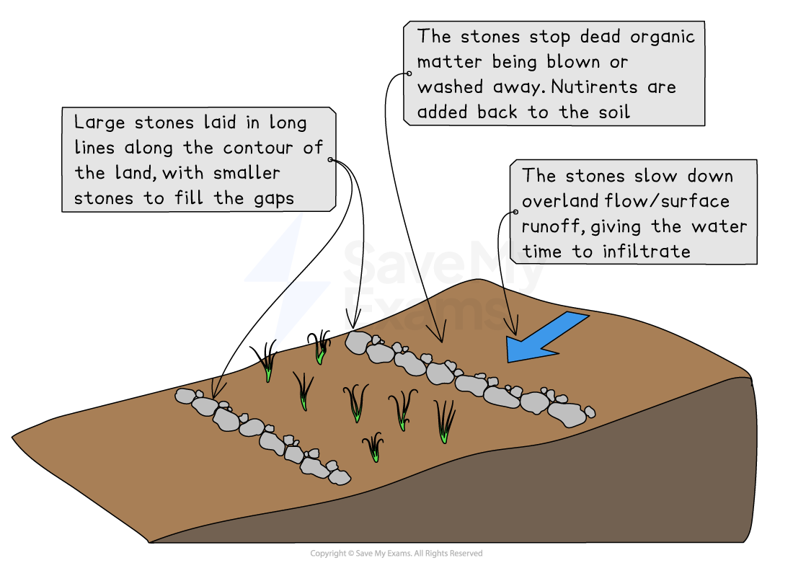

# Strategies used to manage soil erosion & desertification

## Specification link

This page covers section 10.3.5 of the [CIE IGCSE specification](https://www.cambridgeinternational.org/Images/718150-2027-2029-syllabus.pdf) .

- **10.3.5** - An evaluation of the strategies and techniques used to manage desertification and soil erosion; including sustainable.

## What are soil erosion & desertification

> **Spec point** — `spcpt_XSBYzr69MbH6pwrT` · An evaluation of the strategies and techniques used to manage desertification and soil erosion; including sustainable.

## What are soil erosion & desertification

- Soil erosion is the wearing away of the **topsoil** by the action of wind or water
- It is a **natural process** which is made worse by human activities which leave the soil exposed to wind and water

### Causes of soil erosion

#### Deforestation

- Removes the trees **reducing interception** so the soil is more exposed to the rainfall
- Reduces the amount of roots which reduces **infiltration** and **increases surface runoff**
- The bare soil is more exposed to the wind which would have been reduced by tree cover

#### Overgrazing

- Removes vegetation cover which acts to protect the soil from both wind and water
- More animals trampling the land leads to **compaction** and **increased surface runoff**
- This happens more in LEDCs where farmers have less and less land to graze

#### Over-cultivation

- Land is not left to rest (fallow) between crops and so the fertility of the soil is reduced

#### Population increase

- More people increase the settlement sizes reducing the areas which can be farmed - increasing **over-cultivation **and **overgrazing**
- Increases the demand for food which leads to over-cultivation and overgrazing

#### Over-abstraction of groundwater

- This leads to the **soil moisture** content decreasing
- Drier soil is more easily eroded by wind or water

#### Human-induced climate change

- Changes in climate patterns, **increasing floods** and **increasing droughts** all lead to an increase in soil erosion

### Salinisation

- **Salinisation** is also an increasing issue in many semi-arid areas

  - Occurs when high rates of **evaporation** lead to groundwater being drawn to the surface
  - When the groundwater evaporates salts are left in or on the topsoil
  - These salts make the land toxic to many crops and so the land can no longer be used
  -

### Desertification

- Soil erosion may over time lead to **desertification**
- Desertification is the spread of desert like conditions into semi-arid areas
- It is caused by both natural factors and human activities
- Many of the natural causes may be made worse by human-induced **climate change **

#### Natural causes

- **Soil erosion** leads to the loss of nutrients

  - As a result, plants cannot establish and grow
- **Less predictable rainfall** leads to drought and vegetation dying
- Intense rainfall leads to increased surface runoff
- Reduced vegetation means that fewer nutrients are added to the soil

#### Human causes

- **Overgrazing** reduces the amount of vegetation so the soil is bare and no nutrients are added to the soil
- **Over-cultivation **means that the crops take up all the remaining nutrients
- **Deforestation** decreases:

  - the nutrients added to the soil
  - **infiltration**
  - **interception**
  - the number of roots which bind the soil
- **Population growth** increases the pressure on the land increasing the number of animals and crops

*Causes of desertification*

> **Exam Hint**
> Remember, desertification is not the expansion of the deserts that already exist. It is when semi-arid ecosystems become desert-like as a result of human activity and unsustainable land use.

## Strategies used to manage soil erosion & desertification

> **Spec point** — `spcpt_SPRXFG7z7qx6FKYx` · An evaluation of the strategies and techniques used to manage desertification and soil erosion; including sustainable.

## Strategies used to manage soil erosion & desertification

- Halting and reversing soil erosion and desertification means tackling the causes
- There are a variety of political and social responses

#### Education

- Education, including:

  - **Sustainable farming methods,** including ***agroforestry*** and ***crop rotation***, help to keep the soil healthy
  - **Family planning** to reduce population growth

#### Agroforestry

- This combines agriculture with forestry, which means some trees remain
- Increases the variety of plants grown which increases biodiversity

#### Afforestation

- Tree planting, such as the **Great Green Wall **across the** Sahel**

#### Contour Stones and Terraces

- Stones are laid along the contour lines of the land
- These reduce soil erosion and increase nutrients added to the soil

*Use of contour stones to reduce soil erosion*

## Effectiveness of strategies used to manage soil erosion & desertification

> **Spec point** — `spcpt_V55ZFP3q9NzhkZfY` · An evaluation of the strategies and techniques used to manage desertification and soil erosion; including sustainable.

## Effectiveness of strategies used to manage soil erosion & desertification

- The strategies outlined have all proved effective in halting and even reversing soil erosion and desertification

### Crop rotation

- Improves soil health and structure
- Breaks the cycle of pests and diseases

### Agroforestry

- **Decreases deforestation **because crops are grown alongside the trees
- It provides shade as well as **increasing infiltration** and** interception**, which reduces soil erosion
- Provides** organic matter** from the trees and adds nutrients to the soil

### Afforestation

- Afforestation is effective because:

  - The roots of trees help to **bind the soil together**, reducing soil erosion
  - The canopy offers **shade**, helping to prevent the soil from drying out and also reducing soil erosion from rainfall landing directly on the soil
  - Nutrients in the soil are replaced by falling leaves and branches
  - The trees increase animal and insect activity, which helps improve soil quality
- **Great Green Wall**

  - The Great Green Wall project was launched in 2007
  - The project aims to plant an 8 000-kilometre band of trees across 11 Sahel countries
  - By 2024, the Great Green Wall had:
  
    - Restored 30 million hectares of degraded land
    - Created three million new jobs
  - However, it is only 30% complete and there are only six years left on the project

### Contour stones

- These help to **reduce soil erosion** by:

  - Preventing the soil from being blown or washed away
  - **Increasing infiltration** of water and reducing overland flow
  - Ensuring that dead organic matter stays in one place and can decompose, adding nutrients to the soil

- In **Burkina Faso**, Oxfam worked with farmers to improve the traditional stone wall, aiming to increase food production by using bund lines of stones across a slope to stop water and soil from running away

  - This method preserves the topsoil and has improved farming and food production in the village
  - They managed to increase millet, the staple crop in Burkina Faso, production by 50% on average
