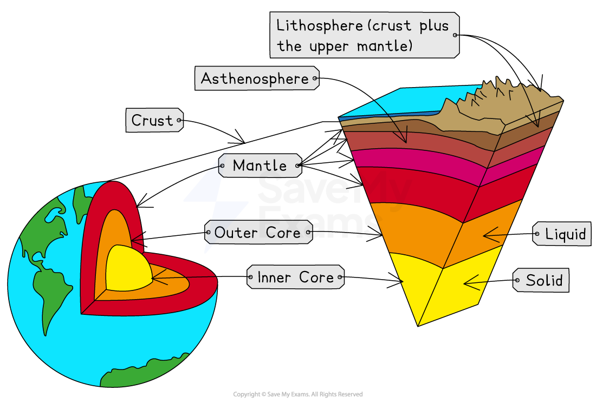
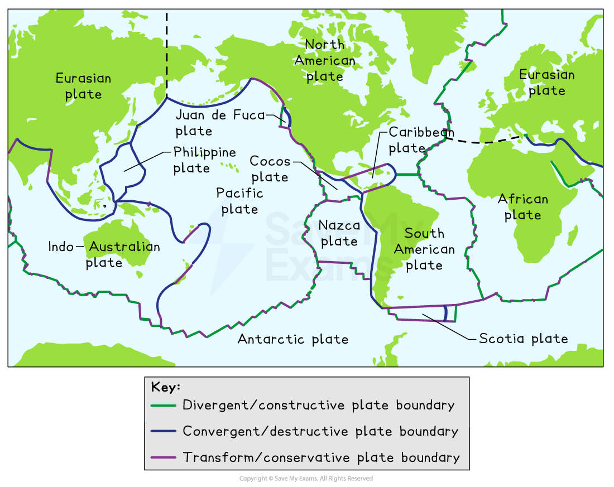
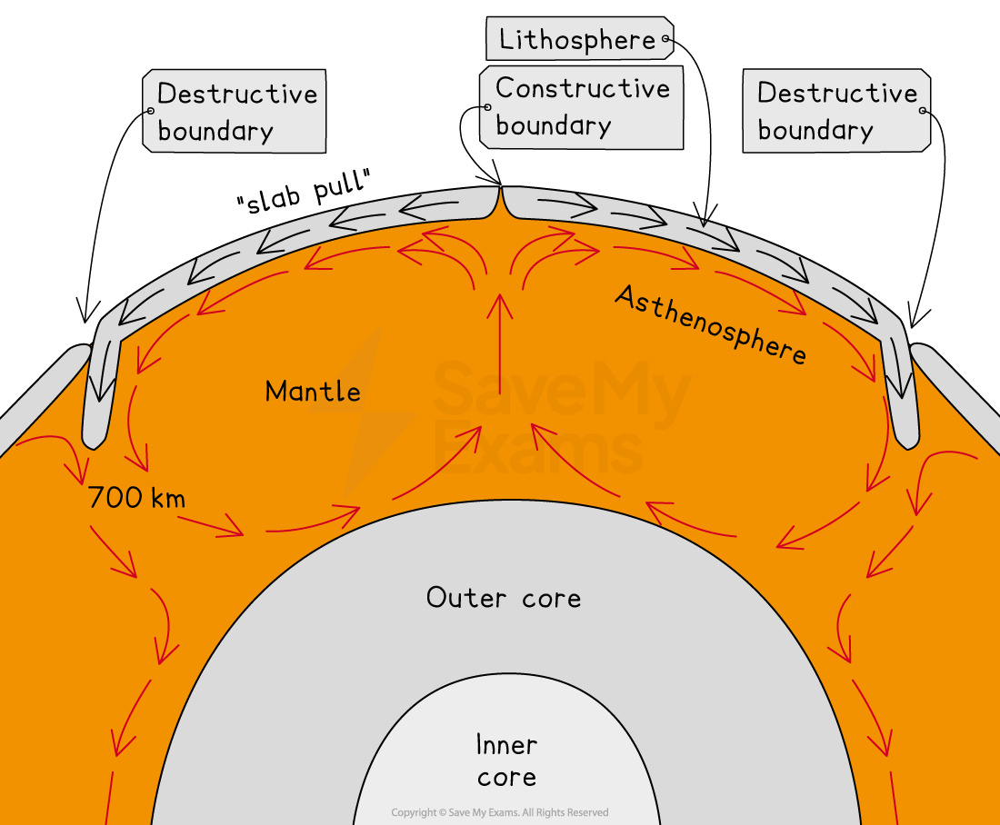
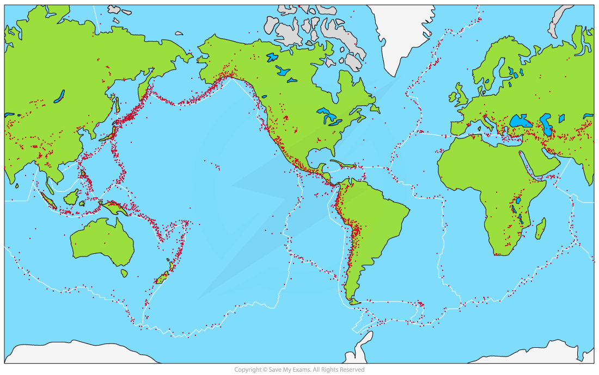

# Characteristics of the Earth's Structure

## Specification link

This page covers section 4.1.1, 4.1.2 and 4.1.3 of the [CIE IGCSE specification](https://www.cambridgeinternational.org/Images/718150-2027-2029-syllabus.pdf) .

- **4.1.1 **- The characteristics of the layers of the Earth: inner core, outer core, mantle, crust, lithosphere.
- **4.1.2 **- The names and location of the main tectonic plates and how tectonic plates move.
- **4.1.3 **- Types of plate boundary: divergent/constructive, convergent/destructive, convergent/collision, conservative/transform and the location of earthquakes and volcanoes.

## Structure of the Earth

> **Spec point** — `spcpt_9RFf95b4k5mfSYHD` · The characteristics of the layers of the Earth: inner core, outer core, mantle, crust, lithosphere

## Structure of the Earth

- The Earth is composed of various layers

  - **Inner core:** About 1400km in diameter, a solid and dense layer composed of iron and nickel with temperatures of about 5000 - 6000°C
  - **Outer core:** About 2100km thick, a semi-molten metal layer with temperatures between about 4000 and 6000 °C
  - **Mantle:** About 2900km thick, a semi-molten layer which is less dense than the outer core this is split into two parts
  
    - **Asthenosphere**
    - **Lower mantle**
- The **lithosphere** is made up of two types of crust together with the rigid upper part of the mantle. The thickness varies.
- The two types of crust are:

  - **Oceanic**
  - **Continental**

*Structure of the Earth*

#### Crust

- There are two types of crust and they are part of the lithosphere

  - **The oceanic crust** is thinner (5-10km) but heavier, and denser and is composed mainly of basalt
  - **The Continental crust** is thicker (25-100km) but is older and less dense and is composed mainly of granite
- Oceanic crust is continually being created and destroyed as a result of plate movement where it is denser and so subducts under the continental crust

#### Mantle

- The mantle is composed of the:

  - The **upper mantle** has two layers
  
    - The rigid upper layer which is part of the lithosphere
    - The **Asthenosphere **is a partially molten plastic-type layer which moves under high pressure and is between 35 and 250 km
  - The **lower mantle** is solid and the largest of the Earth's layers (2900 km)

## Tectonic plates

> **Spec point** — `spcpt_FVDBNVXV8w3G3f3V` · The names and location of the main tectonic plates and how tectonic plates move

## Tectonic plates

- The Earth's crust is broken into 15 large **tectonic plates **and several smaller ones
- The places where the plates meet are called plate boundaries

*Map showing the main tectonic plates and boundaries*

### Tectonic plate movement

- The heat within the Earth **(geothermal),** which is estimated to reach between 5 and 6000is generated by **radioactive decay**
- Heat rises from the Earth's core and creates **convection currents** in the mantle

  - The tectonic plates which make up the crust **(lithosphere)** move on top of the semi-molten mantle below
- The current theory is called **slab pull theory**

  - This suggests that in addition to the convection currents, plate movement is a result of the weight of the denser oceanic plates subducting and dragging the rest of the plate along

*Convection currents and slab pull*

### Mantle plumes

- Within the mantle, there are also mantle plumes, which are upwellings of superheated rock
- These can lead to either:

  - Divergent plate boundaries
  - Hot spots located at random points on a tectonic plate

> **Worked Example**
> Study Figure 1, a map showing the location and magnitude of earthquakes in Alaska, USA.
> 
> 
> 
> (i) In which direction is the Pacific plate moving?
> 
> |   | Tick |
> |---|---|
> | north (N) |   |
> | north-north-west (NNW) |   |
> | north-west (NW) |   |
> | south-east (SE) |   |
> | south-south-east (SSE) |   |
> 
> **Answer **
> 
> - **north-north-west (NNW)** is the correct answer **[1]**

## Types of plate boundary

> **Spec point** — `spcpt_C2FD3bB8ncXZh7zz` · Types of plate boundary: divergent/constructive, convergent/destructive, convergent/collision, conservative/transform and the location of earthquakes and volcanoes

## Types of plate boundary

- Volcanic eruptions and earthquakes most commonly occur at or near plate boundaries

### Earthquake distribution

- Earthquakes occur at all types of ***plate boundaries***

  - Most (approximately 90%) occur around the rim of the Pacific Ocean
  - This zone is called the **'Ring of Fire'**

*Map showing global distribution of volcanic eruptions*

#### Volcano distribution

- Most volcanoes occur at ***divergent (constructive)*** and ***convergent (destructive)*** plate boundaries
- Like earthquakes, the majority of active volcanoes (approximately 75%) are located around the **Pacific 'Ring of Fire'**
- Volcanoes also occur at** hotspots **away from plate boundaries and are plumes/columns of magma which escape through the Earth's crust

*Map showing global distribution of earthquakes*

- There are four main types of plate boundaries:

  - **divergent (constructive)**
  - **convergent (destructive)**
  - **collision**
  - **transform (conservative)**

> **Exam Hint**
> For the exam, you will need to know the processes that take place at each plate boundary and how they lead to volcanic eruptions and earthquakes. Please take a moment to review this revision note on plate boundary processes to refresh your knowledge.
