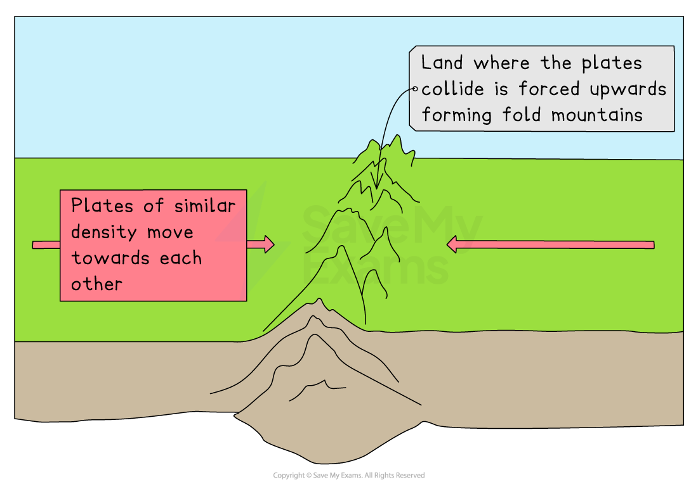
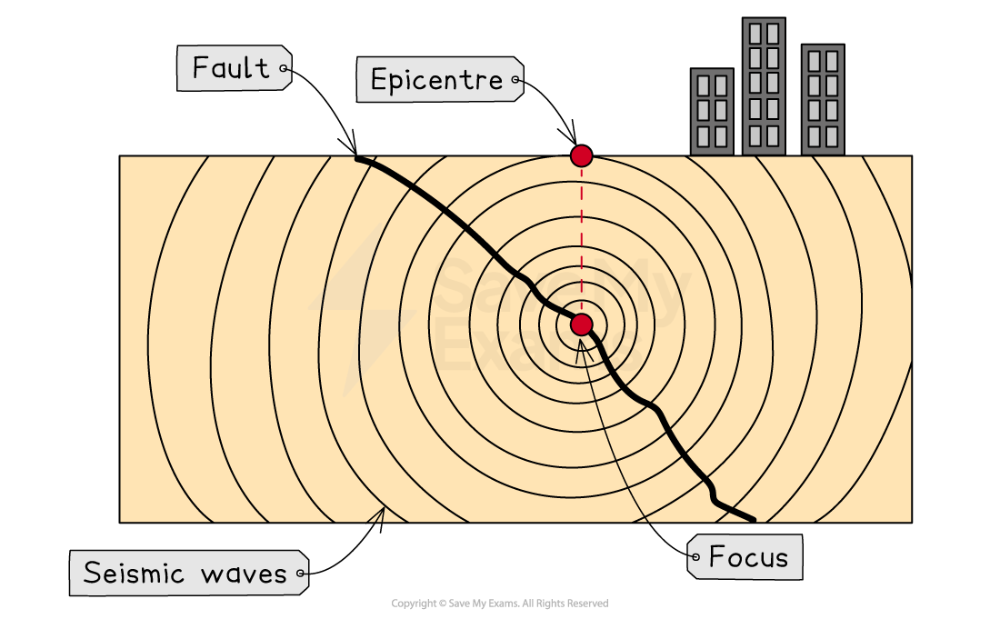
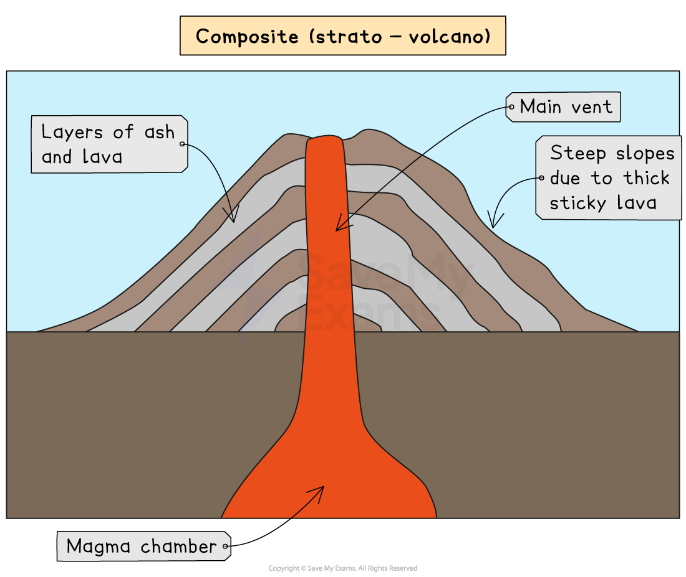
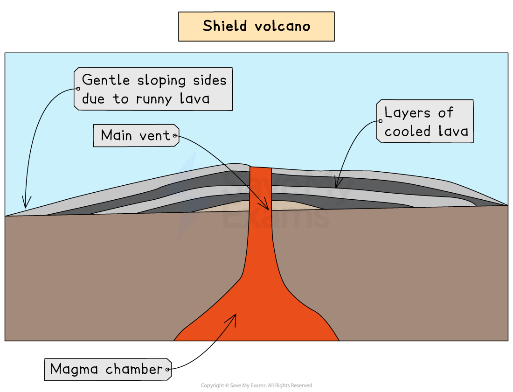
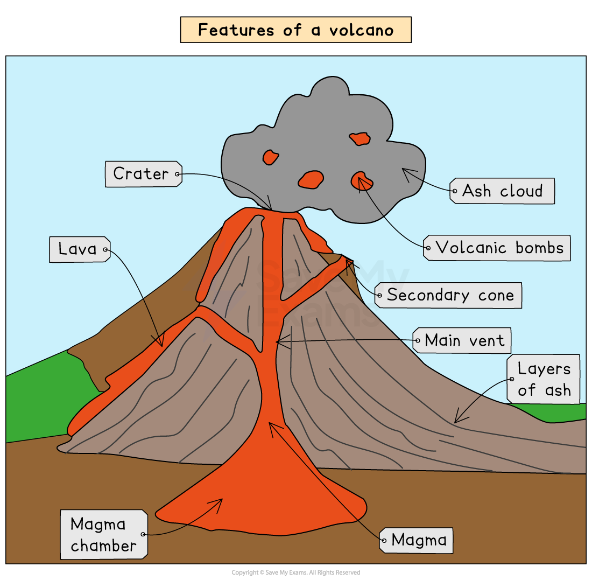

# Processes and Features of Earthquakes and Volcanoes

## Specification link

This page covers section 4.2.1, 4.2.2 ,4.2.3 , 4.2.4, 4.2.5 and 4.2.6 of the [CIE IGCSE specification](https://www.cambridgeinternational.org/Images/718150-2027-2029-syllabus.pdf) .

- **4.2.1 **- The processes experienced at each type of plate boundary which cause earthquakes and volcanic eruptions.
- **4.2.2 ** - The main characteristics of earthquakes: focus, epicentre, seismic waves.
- **4.2.3 -** Types of volcano: strato-volcano (composite cone), shield, cinder cone.
- **4.2.4 **- The classification of volcanoes as active, dormant, or extinct.
- **4.2.5 **- The main features of volcanoes: crater, vent, magma, magma chamber, secondary cone.
- **4.2.6 **- Volcanic hazards: lava flows, ash falls, lahars, pyroclastic flows, tephra, volcanic rocks, toxic gases; the significance of speed, size, frequency, and spread.

## Plate boundary processes

> **Spec point** — `spcpt_pdDBsjgNmh4VgwRs` · The processes experienced at each type of plate boundary which cause earthquakes and volcanic eruptions.

## Plate boundary processes

- Different processes happen at each type of plate boundary
- These processes can lead to earthquakes and the formation of volcanoes

  - As the plates move, **earthquakes **can occur at **any** of the boundaries
  - Volcanoes **only form** at constructive (divergent) and destructive (convergent) boundaries

#### Constructive (divergent) plate boundary

- At the constructive (divergent) boundary, the plates are moving apart

  - As they move apart, magma rises to fill the gap
  - This leads to the formation of volcanoes and eruptions
- The **Mid-Atlantic Ridge** is an example of a constructive plate boundary
- Both volcanic eruptions and earthquakes can occur at this type of plate boundary

*Constructive (Divergent) plate boundary*

### Destructive (convergent) plate boundary

- At a destructive (convergent) plate boundary, the plates are moving together

  - The denser, heavier **oceanic plate** ***subducts*** under the lighter, **less dense continental plate**
  - This leads to friction and heat, which melts the crust and forms magma
  - Magma rises to the surface through cracks in the crust
  - It erupts on the surface as lava and forms a volcano
- The boundary between the **Nazca plate **and the **South American **plate is an example
- Both volcanic eruptions and earthquakes occur at this type of plate boundary

*Destructive (Convergent) Plate Boundary*

### Collision boundary

- At a collision boundary, two continental plates of **similar density** move towards each other

  - Neither is dense enough to subduct, so the land is pushed upwards
  - This process forms **fold mountains** such as the** Himalayas**
- Earthquakes are the main hazard at this type of plate boundary

*Collision Boundary*

### Conservative (transform) boundary

- At a conservative (transform) boundary, the plates move past each other in opposite directions or in the same direction at different speeds
- Earthquakes are the only hazard at this type of boundary

*Conservative (Transform) Boundary*

> **Exam Hint**
> Draw each of the plate boundaries and add annotations to outline the processes. This will help you to remember what happens at each one.

> **Worked Example**
> Figure 1 shows information about a volcanic eruption
> 
> 
> 
> *Formation of Whakaari volcano*
> 
> Use Figure 1 to explain why a volcanic eruption occurred on Whakaari.
> 
> [5]
> 
> > *To answer this question the process of volcano formation needs to be broken down into steps. Each step should outline a stage in the process. The wording used does not have to be the same as below, but it is essential that the answer covers each stage of the process.*
> 
> **Answer**
> 
> **Step 1 **- The Indo-Australian plate and Pacific plate are moving towards each other.** [1] **
> 
> **Step 2 - **The Pacific plate is denser and so subducts under the Indo-Australian plate. **[1]**
> 
> **Step 3** - This leads to the Pacific plate melting due to the friction and heat.** [1]**
> 
> **Step 4** - The molten crust is magma which builds up causing an increase in pressure.** [1] **
> 
> **Step 5** - The magma rises and erupts at the surface forming the volcano. **[1]**

## Earthquake characteristics

> **Spec point** — `spcpt_bqB63Zcps8sG85Bc` · The main characteristics of earthquakes: focus, epicentre, seismic waves.

## Earthquake characteristics

- An earthquake is the **sudden, violent shaking** of the ground
- Earthquakes are the result of pressure building when **tectonic plates** move
- The **epicentre** is the point on the Earth's surface directly above the focus
- The **focus** is the point at which the earthquake starts below the Earth's surface
- The **magnitude** (amount of energy released) by earthquakes is measured on the **Moment Magnitude Scale, **which replaced the **Richter scale**
- The damage caused by earthquakes is measured on the **Mercalli Scale**

### Earthquake sequence

- The sequence of an earthquake is the same regardless of the boundary at which it happens:

  - As the tectonic plates move, they can get stuck
  - Pressure builds as the plates continue to try to move
  - Eventually, the plates jolt free and the pressure is released as energy
  - The point at which the earthquake starts is the **focus**
  - The **epicentre **is the point directly above the focus on the earth's surface
  - The energy passes through the Earth's crust as waves, which is the earthquake

*Features of an earthquake*

- Earthquakes can also happen as a result of human activity, such as drilling into the crust or mining
- At a** divergent (constructive)** plate boundary, earthquakes tend to be** weaker **as the plates are moving apart
- Earthquakes tend to be **stronger** at **convergent (destructive), collision** and **conservative (transform) **plate boundaries

## Types and classification of volcano

> **Spec point** — `spcpt_kcxGp7MGkrD9qGRm` · Types of volcano: strato-volcano (composite cone), shield, cinder cone
The classification of volcanoes as active, dormant, or extinct.

## Types and classification of volcano

### Types of volcano

- There are three main types of volcanoes:

  - **Composite (strato-volcano)**
  - **Shield volcano**
  - **Cinder volcano**

- The type of volcano which forms depends on the type of lava which erupts

#### Composite (strato-volcano)

- Composite volcanoes, also known as strato-volcano, have:

  - steep-sides
  - sticky **(viscous)** lava
  - more explosive eruptions
  - alternating layers of ash and lava
- They tend to form on **convergent (destructive)** plate boundaries

*Composite (strato) volcano*

#### Shield volcanoes

- **Shield **volcanoes have:

  - gently sloping sides
  - runny/thin lava
  - less explosive—gentle eruptions
  - frequent eruptions
- They tend to form on **divergent (constructive)** plate boundaries or *hot spots*

*Shield volcano*

#### Cinder volcano

- Cinder volcanoes are:

  - circular and cone-shaped
  - usually less than 1000 feet high
  - composed of hardened ash, tephra and lava, which is forcefully ejected from the volcano and cools whilst in the air, falling as cinder fragments

### Classification of volcanoes

- Volcanoes may be active, dormant or extinct

  - **Active**
  
    - The volcano has recently erupted and is likely to erupt again
  - **Dormant**
  
    - Has not erupted for many years but there is evidence of a magma reservoir
  - **Extinct**
  
    - Shows no evidence of eruption in historic times and there is no evidence of a magma reservoir

## Main features of volcanoes

> **Spec point** — `spcpt_MFBBGpNsYt724hk9` · The main features of volcanoes: crater, vent, magma, magma chamber, secondary cone

## Main features of volcanoes

- A volcano forms when **magma** erupts onto the Earth's surface as** lava **through a vent in the Earth's crust

  - When magma erupts onto the surface, it is called lava
- The magnitude of a volcanic eruption is measured on the **Volcanic Explosivity Index (VEI)**

  - The scale is open-ended but the highest in recorded human history was an 7 (*Tambora 1815*)

*Main features of a volcano*

## Volcanic hazards

> **Spec point** — `spcpt_nwHBqd2zTqBSjsmn` · Volcanic hazards: lava flows, ash falls, lahars, pyroclastic flows, tephra, volcanic rocks, toxic gases; the significance of speed, size, frequency, and spread.

## Volcanic hazards

- Volcanic eruptions may include a range of features
- Some of these hazards are localised  or can have a global impact

### Tephra

- Tephra refers to all the material that is ejected during an eruption, including ash and volcanic rocks
- **Ash ** is *pulverised* solid lava which measures less than 2 mm in diameter

  - Ash is ejected into the atmosphere and can travel thousands of kilometres
  - The ash fall can cover large areas, disrupting transportation, damaging infrastructure and affecting animal/human health
- **Volcanic rocks** are fragments of molten rock which are ejected from the volcano

  - These are between 60 mm and 5 m in diameter

### Pyroclastic flow

- Pyroclastic flow is fast-moving, very hot clouds of poisonous gases mixed with ash

  - Average speeds of about 100 km/h but can move at up to 700 km/h
  - Can cover large areas and lead to total destruction

### Lahars

- Lahars occur when volcanoes erupt and snow and ice on the peak melt

  - The meltwater combines with the ash
  - This creates fast-moving mudflows or lahars
  - The lahars can  cover large areas, destroying infrastructure, buildings and crops

### Lava flows

- When magma erupts to the surface, it is known as lava

  - The lava can be thin and runny or thick and slow-moving
  - This depends on the composition of the magma
  - Lava can cover extensive areas leading to the destruction of buildings and infrastructure

### Earthquakes

- These are caused by magma rising to the surface through the vents in the volcano

  - This increases pressure on the Earth's crust, leading to earth tremors

### Toxic gases

- Gases released during an eruption include carbon dioxide, sulphur dioxide and hydrogen sulphide
- The gases can travel long distances depending on the wind patterns
- They pose a health hazard to humans and animals

> **Exam Hint**
> Remember, the damage and destruction caused by each of the hazards are dependent on their speed, size and spread. This means that pyroclastic flow is regarded as more dangerous than lava flow.
