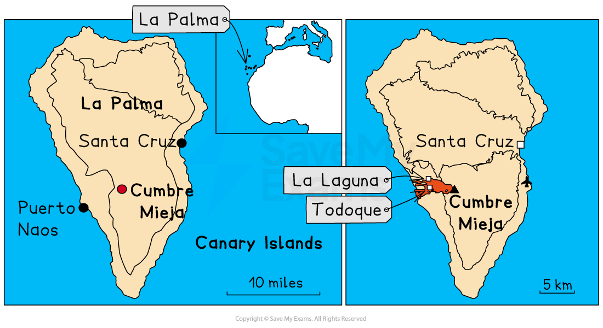

# Detailed Specific Example: Cumbre Vieja

## Specification link

This page covers section 4.4.4 of the [CIE IGCSE specification](https://www.cambridgeinternational.org/Images/718150-2027-2029-syllabus.pdf) .

- **4.4.4 **- One detailed specific example to include:

  - The causes and impacts of an eruption of a named volcano
  - The responses to the volcanic eruption
  - The strategies and techniques used to manage the impacts of volcanic eruptions

## Causes of the Cumbre Vieja eruption

> **Spec point** — `spcpt_38bsVRpt69CrGgPj` · "One detailed specific example to include:
• the causes and impacts of an eruption of a named volcano
• the responses to the volcanic eruption
• the strategies and techniques used to manage the impacts of volcanic eruptions"

## Causes of the Cumbre Vieja eruption

- Part of the Canary Islands, La Palma is located in the Atlantic Ocean off the coast of North Africa
- The Canary Islands are an ***autonomous region*** of Spain
- There are **33 volcanoes** across the Canary Islands, 10 of which are on the island of La Palma
- La Palma has a **population of 85,000**

#### Eruption, September 2021

- The eruption of the Tajogaite volcano on the **Cumbre Vieja** ridge on La Palma began on September 19, 2021 and the eruption lasted for almost three months
- The eruption was **VEI 2 to VEI 3**

*Location of the Cumbre Vieja eruption*

#### Cause

- La Palma and the other Canary Islands are located on the African plate
- The islands are an ***archipelago*** which has formed as the result of a [hot spot](https://www.savemyexams.com/igcse/geography/cie/20/revision-notes/2-the-natural-environment/2-1-earthquakes-and-volcanoes/2-1-3-causes-of-earthquakes-and-volcanoes/)
- This means that they are not located on a plate boundary but over a magma plume

## Impacts of the Cumbre Vieja eruption

> **Spec point** — `spcpt_XsBPS4wks6bmXD3M` · "One detailed specific example to include:
• the causes and impacts of an eruption of a named volcano
• the responses to the volcanic eruption
• the strategies and techniques used to manage the impacts of volcanic eruptions"

## Impacts of the Cumbre Vieja eruption

- Over **7,000 **people had to be evacuated from their homes
- Almost **1,500 houses **were destroyed by the lava flow
- Over **1,500 other buildings,** such as churches, shops, and schools, were destroyed
- The lava flow cut across the coastal highway
- The water supply was cut off for almost 3,000 people
- Over** 400 hectares of banana farms** were destroyed
- Almost 1,300 hectares of land were affected
- 1 death
- About 20,000 people were exposed to the eruption and its effects
- Air traffic disruption
- **€1 billion damages**

## Responses to the Cumbre Vieja eruption

> **Spec point** — `spcpt_8v5384tRCcDqxbt6` · "One detailed specific example to include:
• the causes and impacts of an eruption of a named volcano
• the responses to the volcanic eruption
• the strategies and techniques used to manage the impacts of volcanic eruptions"

## Responses to the Cumbre Vieja eruption

### Immediate response

- A warning was issued of an eruption on 13th September and 40 people and livestock were evacuated
- A further 1000 people were **evacuated** after the eruption began on the 19th September
- 5600 more people were evacuated over the next few weeks
- The **alert level** was raised to red
- Air traffic was briefly suspended
- Constant monitoring of lava flow and gas emissions to ensure the safety of the population
- Food and shelter were provided for those made homeless
- A** €5.4 million** advanced payment donated by the** EU**

### Long-term response

- Spain promised €400 million to La Palma for rebuilding
- Prefabricated housing was built for those made homeless but six months on, many people were still living in hotels and with family and friends
- Constant monitoring of the volcano and others on La Palma
- Improved crisis management processes are now in place for future eruptions

## Strategies to reduce the impact of eruptions in La Palma

> **Spec point** — `spcpt_PWB6YxFKQKTKn7hq` · "One detailed specific example to include:
• the causes and impacts of an eruption of a named volcano
• the responses to the volcanic eruption
• the strategies and techniques used to manage the impacts of volcanic eruptions"

## Strategies to reduce the impact of eruptions in La Palma

- The local government in La Palma is focusing on several strategies to reduce the impacts of any future eruptions, including:

  - more accurate risk mapping to understand which areas are most vulnerable
- Strategies to reduce disruptions to the water and power supply include exploring the possibility of geothermal energy production
- Installation of over  1,300 air quality and gas monitoring sensors; these aim to:

  - reduce people's exposure to low air quality during future eruptions
  - ensure that people know when the level of gases is safe and when they need to evacuate
- Public announcement and phone alert systems improved
- Improved monitoring and prediction of eruptions
