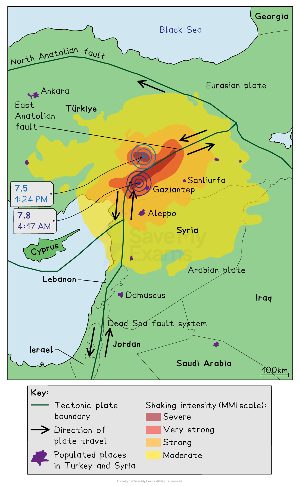

# Detailed Specific Example: Türkiye-Syria

## Specification link

This page covers section 4.4.3 of the [CIE IGCSE specification](https://www.cambridgeinternational.org/Images/718150-2027-2029-syllabus.pdf) .

- **4.4.3 **- One detailed specific example to include:

  - The causes and impacts of an earthquake on a named country/area
  - The responses to the earthquake
  - The strategies and techniques used to manage the impacts of earthquakes

## Background

- Türkiye and Syria, though sharing a border, are at different levels of development.
- **Türkiye:**

  - is a middle-income country (MIC)
  - has a reasonably well-developed infrastructure
  - has trained and equipped emergency services
- **Syria:**

  - is a low-income country (LIC)
  - is in the midst of  a continuing *civil war*
  - has a severely damaged infrastructure and economy
  - has limited ability to respond to a disaster

## Causes of the Türkiye-Syria earthquake

> **Spec point** — `spcpt_BvKzGsWMY3qWSGvF` · "One detailed specific example to include:
• the causes and impacts of an earthquake on a named country/area
• the responses to the earthquake
• the strategies and techniques used to manage the impacts of earthquakes"

## Causes of the Türkiye-Syria earthquake

- The 2023 Türkiye-Syria earthquake happened due to movement along the **East Anatolian Fault**
- This is an example of a *transform boundary*

  - Arabian Plate moves north, pushing the small **Anatolian Plate westward**

*Turkiye -Syria earthquake*

- Built-up pressure was released in a **magnitude 7.8 earthquake**
- The earthquake occurred in the early hours of the morning on February 6, 2023
- The **shallow depth** meant more intense shaking and destruction
- A **magnitude 7.5 aftershock** followed nine hours later

  - This increased the damage
  - Many additional buildings damaged in the first earthquake collapsed
- The region hadn’t experienced a major earthquake since **1822**, meaning accumulated pressure that had built up was high

## Impacts of the Türkiye-Syria earthquake

> **Spec point** — `spcpt_hMStXXSJj9n8wBCF` · "One detailed specific example to include:
• the causes and impacts of an earthquake on a named country/area
• the responses to the earthquake
• the strategies and techniques used to manage the impacts of earthquakes"

## Impacts of the Türkiye-Syria earthquake

### Primary Impacts

- **Widespread destruction** in Türkiye and Syria
- Over **35,000 deaths** were reported in the first week, later rising to **over 56,000**
- In Türkiye, over 100,000 people were injured
- Millions of people were left **homeless** due to collapsed buildings

  - In Türkiye, the cities of** Antakya**, **Gaziantep** and **Kahramanmaraş** suffered severe damage
  
    - Over 300,000 buildings were damaged or destroyed across  Türkiye
    - An estimated 1.5 million people were made homeless
  - In Syria, the towns of **Aleppo **and **Idlib** were most affected
  
    - An estimated 10,600 buildings were destroyed in Syria (there is no exact figure due to the ongoing conflict)
    - Approximately 2 million people end up living in camps and shelters due as a result of the earthquake and conflict
- Damage to **infrastructure**, including roads, hospitals, and electricity networks
- The estimated economic loss was between **\$50** and **\$85 billion**

### Secondary Impacts

- **Fires** caused by broken gas pipes and electrical faults
- **Landslides** triggered by the quake
- **Food and water shortages** due to damaged supply chains

  - **Food prices** increased in some cases by over 20%
- Increased spread of **disease** in makeshift camps

  - By June 2023, over 40,000 cases of cholera had been recorded in Syria
- **Respiratory infections** increased due to the conditions people were living in
- Many hospital buildings and health centres had collapsed, meaning treating survivors was difficult
- Harsh** winter conditions** worsened survival chances for trapped victims
- Rescue efforts in **Syria** were slowed by ongoing **civil war** and damaged infrastructure
- Approximately 18 million people needed assistance

## Responses to the Türkiye-Syria earthquake

> **Spec point** — `spcpt_wbBbfZWDSjsKM8rt` · "One detailed specific example to include:
• the causes and impacts of an earthquake on a named country/area
• the responses to the earthquake
• the strategies and techniques used to manage the impacts of earthquakes"

## Responses to the Türkiye-Syria earthquake

#### Immediate Responses

- **Local people** searched for survivors
- Approximately** 250,000 volunteers** from Türkiye joined rescue efforts

  - Specialised equipment and sniffer dogs were used in  Türkiye to locate survivors buried in the rubble
- **International rescue teams** and aid arrived after a few days

  - The UN appeal aimed to help over 10 million people in Türkiye and  Syria
- Shelter, food, and medical supplies were provided
- Access to affected areas in **Syria was difficult** due to the ongoing conflict
- In  Türkiye,** Hatay's airport **was badly damaged, which affected aid getting to the area
- The last survivors were pulled from the rubble **nine days **after the earthquake

#### Long-Term Responses

- **Reconstruction efforts** were planned but delayed by the scale of damage
- **Improving building standards** to reduce future risks in  Türkiye
- Financial aid and international support were pledged for rebuilding
- Psychological and medical support for survivors

## Strategies to reduce the impacts of earthquakes in Türkiye-Syria 

> **Spec point** — `spcpt_JWjqC5wDtd8fmRPX` · "One detailed specific example to include:
• the causes and impacts of an earthquake on a named country/area
• the responses to the earthquake
• the strategies and techniques used to manage the impacts of earthquakes"

## Strategies to reduce the impacts of earthquakes in Türkiye-Syria

- **Stricter building regulations** were implemented to prevent future collapses

  - The government in  Türkiye were criticised due to the failure to enforce stricter building codes after the 1999 Izmit earthquake
- **Education on earthquake preparedness** to increase survival chances
- Financing of \$1 billion from the World Bank to support  Türkiye's recovery
- Development of **early warning systems** to give people time to react
- Strengthening **infrastructure** (e.g. roads, hospitals) to withstand tremors
- More **efficient disaster response plans** for faster aid delivery
- **International cooperation** for disaster relief in conflict-affected areas like Syria
