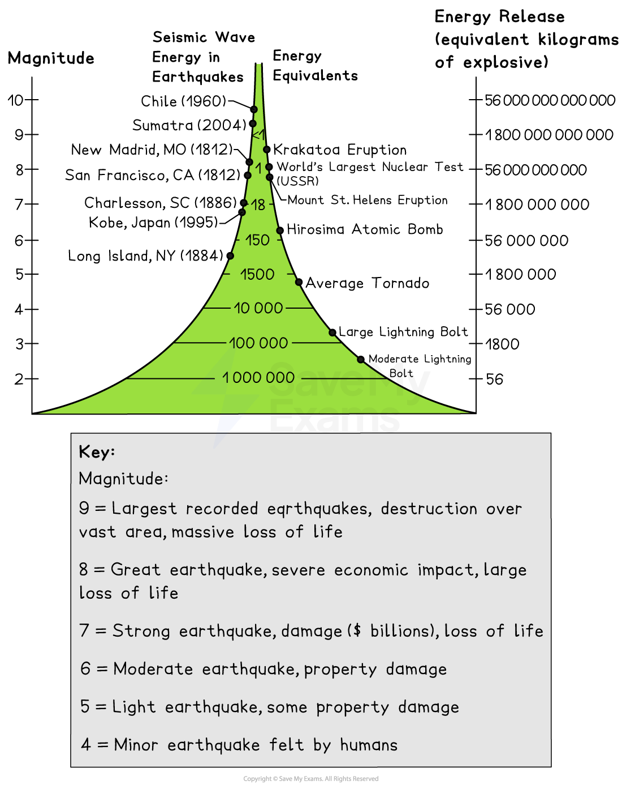
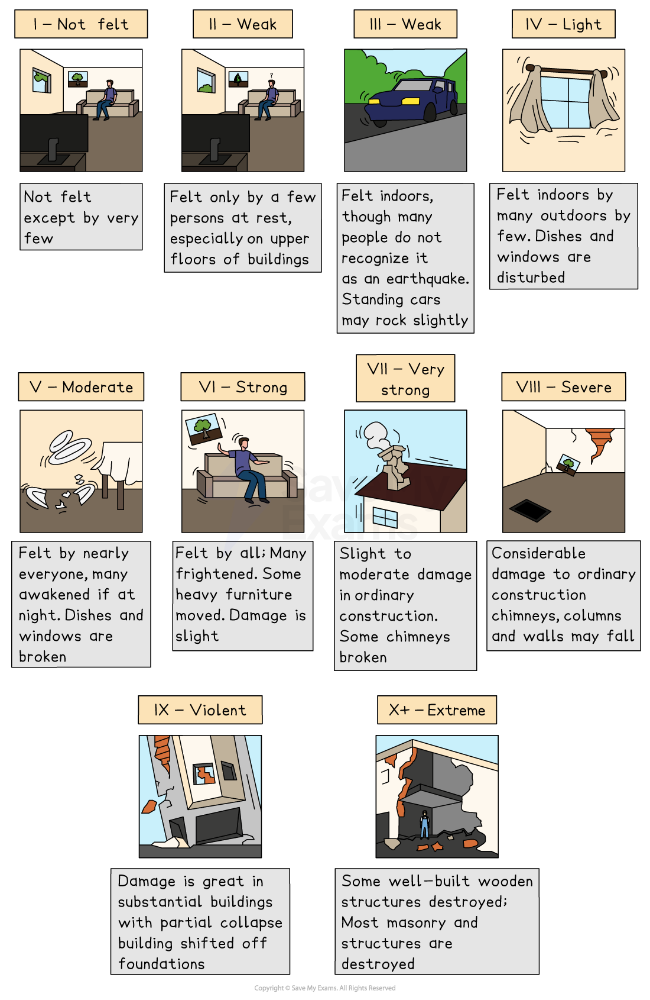

# Impacts of Tectonic Hazards

## Specification link

This page covers section 4.3.1, 4.3.2, 4.3.3 and 4.3.4 of the [CIE IGCSE specification](https://www.cambridgeinternational.org/Images/718150-2027-2029-syllabus.pdf) .

- **4.3.1 **- Reasons why people live in areas at risk from earthquakes and volcanic eruptions.
- **4.3.2 **- The impacts of earthquakes.
- **4.3.3 ** - The impacts of volcanic eruptions.
- **4.3.4** - How the magnitude of a tectonic event is measured: moment magnitude scale, Richter scale, Mercalli scale, the volcanic explosivity index (VEI).

## Why do people live in tectonic hazard areas?

> **Spec point** — `spcpt_VqJmwrkjzDqMZkfT` · Reasons why people live in areas at risk from earthquakes and volcanic eruptions.

## Why do people live in tectonic hazard areas?

- Billions of people live in areas which are vulnerable to tectonic hazards
- It is the interaction between the natural event, humans and the human environment that makes the event a hazard
- There are several reasons why people continue to live in these areas:

  - A lack of education and information means that people are not aware of the risks
  - People believe that the advantages of living in the area outweigh the disadvantages
  - Advantages include:
  
    - **fertile soil in **volcanic areas
    - **geothermal energy**
    - **access to water**
    - **trade**
    - **jobs**
    - **tourism**
  - People are too poor to move away; they have little choice about where they live
  - People were born in an area and have friends/family there so do not want to move
  - If disasters do not happen frequently, people may believe that they are unlikely to be affected
  - Historically settlements have developed in areas on the coast and near rivers which are vulnerable to hazards

## Impacts of earthquakes

> **Spec point** — `spcpt_cMqpJSRCc3ynVGPp` · The impacts of earthquakes.

## Impacts of earthquakes and volcanic eruptions

- The impacts of earthquakes and volcanic eruptions can be categorised into:

  - **Primary hazards: **these are a direct result of the earthquake or eruption
  - **Secondary hazards: **these occur as a result of the primary effects
- Although the characteristics of earthquakes and volcanic eruptions are very different, many of the impacts are similar

### Earthquakes and volcanic eruption impacts

#### Loss of life and injury

- This may be immediate through falling buildings in the case of earthquakes or **pyroclastic flow **or **ashfall** during a volcanic eruption
- Alternatively, it may be in the days and weeks after the event due to unclean water or disease

  - After the 2010 Haiti earthquake over 10,000 people died due to **cholera **which spread through contaminated water

#### Transport network

- Roads, bridges and railways may be damaged or destroyed
- This can impact the speed at which aid can get to affected areas

#### Loss of jobs and businesses

- This impacts the economy when factories and offices are destroyed or damaged

#### Power and water supply damaged

- This affects the supply of clean water, which can lead to disease
- Energy supplies can also be affected with gas pipes and electricity cables being damaged

#### Damage to the environment

- Loss of vegetation and habitats
- The effects on the climate of ash in the atmosphere

  - The ash reduces the amount of solar radiation
  - This can reduce overall global average temperatures

### Earthquake impacts

#### Collapse or destruction of buildings

- This leads to people being homeless for months and even years after the event
- The more buildings that are destroyed or damaged, the higher the costs of rebuilding

### Volcanic eruption impacts

#### Closure of airports

- It is dangerous for jet planes to fly through ash clouds due to possible engine failure, so flights are cancelled

#### Loss of crops

- Ashfall from the eruption causes the death of crops
- This leads to food shortages and affects farmers' income

> **Exam Hint**
> It is easy to confuse the primary and secondary effects/impacts of earthquakes and volcanic eruptions. Remember:
> 
> - **Primary effects **are those that occur directly from an earthquake or volcanic eruption. For example, buildings collapsing is a direct result of the earthquake ground shaking.
> - **Secondary effects **are those things that result from the primary hazards. For example, fires caused by gas mains that have fractured.

## Measuring earthquake and eruption magnitude

> **Spec point** — `spcpt_GMcZChqvVXn2Nw3h`

## Measuring earthquake and eruption magnitude

### Richter scale and moment magnitude scale (MMS)

- **Magnitude** measures the energy released at the source **(focus)**

  - The magnitude can be measured on different scales, including the **Richter Scale** but the one which is reported on the news when an earthquake occurs is the **Moment Magnitude Scale (MMS)**
  - It is measured using **seismographs**
- The Richter scale and the MMS go from 1, which is not felt by humans to over 10
- Both are **logarithmic scales,** which means that a 6 on the scale is ten times an increase in amplitude from a 5

  - The energy release is 32 times greater

*Magnitude of earthquakes*

### Mercalli scale

- The intensity of an earthquake is its impact on people, as well as on the built and natural environments
- The **Modified Mercalli Intensity Scale **is used to measure the intensity
- The scale goes from I to XII

*Modified Mercalli Intensity Scale*

### Volcanic Explosivity Index (VEI)

- Some volcanic eruptions are gentle and **effusive,** while others are hugely explosive

  - This is dependent on the magma composition
- The **Volcanic Explosivity Index (VEI)** is used to measure the magnitude of an eruption
- This is a **logarithmic scale** from 0 to 8
- It cannot be measured on a scientific instrument so is calculated based on a series of measurements and observations

  - These include the:
  
    - height of material ejected into the atmosphere
    - volume of material
    - duration of the eruption

*Volcanic Explosivity Index*

> **Worked Example**
> Name** two** scales which can be used to measure earthquakes.
> 
> [2]
> 
> **Answer**
> 
> - Any two of the three below would be awarded marks
> 
>   - Richter scale** [1]**
>   - Moment magnitude scale** [1]**
>   - Mercalli scale** [1]**

> **Exam Hint**
> It is important to remember that the Richter scale and moment magnitude scales are measures of energy released by the earthquake whereas the Mercalli scale measures intensity in terms of the damage caused.
