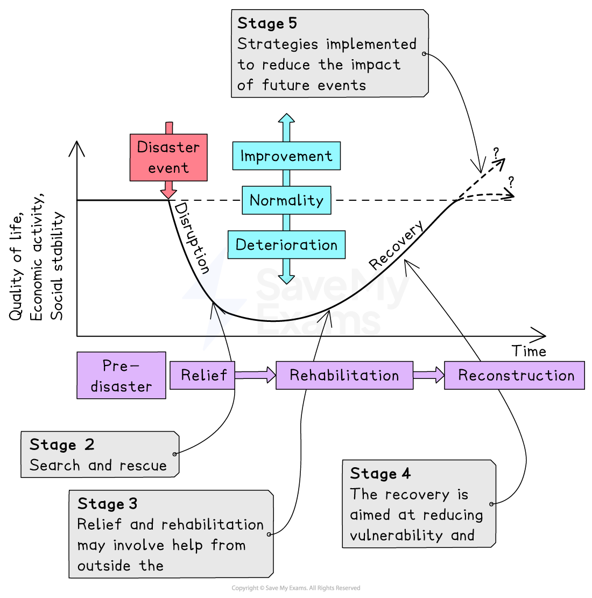

# Managing the Impacts of Tectonic Hazards

## Specification link

This page covers section 4.4.1 and 4.4.2 of the [CIE IGCSE specification](https://www.cambridgeinternational.org/Images/718150-2027-2029-syllabus.pdf) .

- **4.4.1 **- Primary and secondary responses.
- **4.4.2 - ** An evaluation of the strategies and techniques used to manage the impacts of earthquakes and volcanic eruptions: monitoring, prediction, protection, planning and technology.

## Primary and secondary responses

> **Spec point** — `spcpt_HWdmFRymbNfXtqkC` · Primary and secondary responses.

## Primary and secondary responses

- Types of response to tectonic hazard

  - The responses to any tectonic hazard can be divided into two groups
  
    - **Immediate** or **emergency**
    - **Long term**

### Immediate or emergency responses

- The immediate or emergency response is the action taken immediately after a hazard event, such as an earthquake

  - Rescue teams search for survivors
  - Medical assistance for injured people
  - Shelter provided for those people made homeless
  - Food and water provided
  - Recovery and burial of bodies
  - Evacuation if needed
  - Clearing ash and debris
  - Reconnect gas, water and electricity supplies
- This response has to be coordinated, as many ***NGOs*** and government organisations, including the armed forces, may be involved

### Long term responses

- The long-term responses happen over the months and years after the hazard

  - Rebuilding homes and other buildings
  - Improve building regulations
  - Improve drills, evacuation plans and warning systems
  - Money given to farmers for seed and new livestock
  - Data used to inform future hazard planning
  - Government planning improved
  - Transport routes rebuilt

### Park's hazard response curve

- The stages of hazard response can be seen in **Park's** **hazard response curve**

*Park's hazard response curve*

> **Exam Hint**
> Remember that although there is an immediate or emergency response in all countries where there is a natural hazard event, the response will be slower and often less well-organised in low-income countries (LICs). This delay often increases deaths and recovery time.

## Strategies to manage the impacts of tectonic hazards

> **Spec point** — `spcpt_f9TxvynqHMrg9C96` · An evaluation of the strategies and techniques used to manage the impacts of earthquakes and volcanic eruptions: monitoring, prediction, protection, planning and technology.

## Strategies to manage the impacts of tectonic hazards

- To reduce the risks from tectonic hazards, the five key management strategies and techniques are:

  - monitoring
  - prediction
  - protection
  - planning
  - technology

### Monitoring

- Active **volcanoes **are monitored using a range of equipment

  - **Seismometers** record earth movements and can detect the slightest tremor
  - **Lasers** and** tiltmeters** are used to detect ground deformation; changes in land shape can be a sign of rising magma
  - **Remote sensing** is where satellites are used to detect heat increases within the volcano, another sign of rising magma
  - **Gas sensors **detect increases in gases such as sulphur and radon which increase before an eruption

*Monitoring volcanic activity*

- **Earthquakes**

  - **Seismometers** record earth movements and can be used to detect foreshocks
  - **Gas sensors **detect increases in radon gas, which some scientists believe is released before an earthquake
  - **Groundwater level **changes have been recorded before earthquakes

### Prediction

- **Volcanoes**:

  - Monitoring of volcanoes now allows more accurate predictions to be made of when eruptions will happen
  - This allows for **evacuation **and **exclusion areas **to be put in place
  - Accurate timings for eruptions are not possible
- **Earthquakes**:

  - **Impossible **to predict the date, time or location because it is a very sudden release of stress that has built up over long periods

### Protection

- **Volcanoes**:

  - Evacuation and exclusion zones move people out of areas at risk
  - Buildings cannot be protected against lava or pyroclastic flow
  - Strengthening of roofs to support the weight of falling ash
  - Airports can be closed to ensure that planes are not flying through ash clouds
  
    - In June 2025, Bali's international airport was closed due to the eruption of Mount Lewotobi Laki-Laki
- **Earthquakes**:

  - **Building regulations **and codes require new buildings to include earthquake-resistant features, including:
  
    - shutters on windows prevent falling glass
    - **cross-bracing** or diagonal bracing of steel frames
    - flexible building materials
    - foundations sank deep into the bedrock
    - frames which sway with the earthquake tremors
    - rubber **shock absorbers** to reduce tremors moving through the building
    - reinforce walls/pillars with concrete
    - shatterproof/reinforced glass
    - fire-resistant materials
    - automatic cut-off for gas/electricity
  - In many countries, earthquake drills are regularly carried out
  
    - The drills help people prepare for what to do in an earthquake to protect themselves
  - **Educating** people about how to prepare homes means they are less likely to be injured by falling objects and furniture
  - Sea walls to protect against tsunami

### Planning

- **Volcanoes and earthquakes**:

  - **Hazard mapping **and **risk assessment** are used to identify areas which are at greater risk – this means people can be moved or buildings restricted in those areas, particularly essential buildings (hospitals) and transport
  - Evacuation plans
  - Education about what actions to take, including drills
  - Stockpile of emergency supplies
  - Training of emergency services

> **Exam Hint**
> High-income countries (HICs) often have less to change in their long-term planning because their preparation for the hazard is better. However, the costs of any disaster are often greater than in a developing country. This is due to the higher cost of the damaged buildings, roads, and infrastructure.

### Technology

- **Hazard mapping **and **geographical information systems (GIS) **can be used to:

  - Map the areas where earthquakes are most likely to occur
  - Enable planning of where important services and infrastructure should be located – ***land use zoning***
  - Identify the ***correlation*** between risk and vulnerability
- **Remote sensing** of the Earth's surface by satellites such as Sentinel 1 provides data about changes in ground movement

> **Exam Hint**
> Remember that the level of planning, prediction and monitoring will vary between countries of contrasting wealth. High-income countries (HICs) are better able to prepare for and monitor tectonic hazards.
