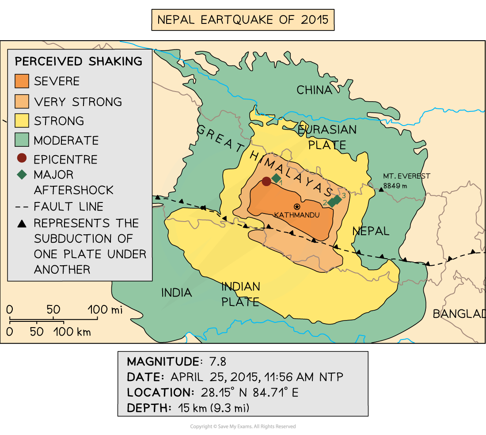
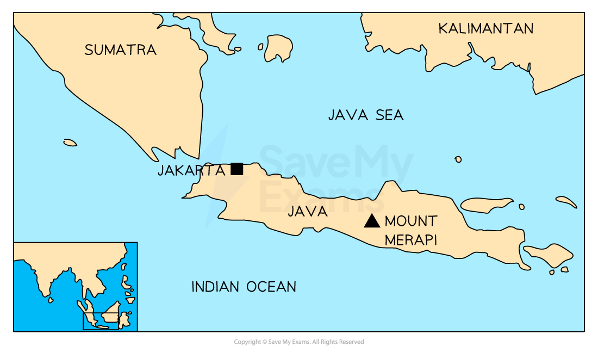

# Tectonic Hazards: Additional Detailed Specific Examples

> **Exam Hint**
> In the main revision notes there are detailed specific examples on an earthquake in the **Türkiye-Syria **example and a volcanic eruption in the **Cumbre Vieja **example**.**
> 
> Not all schools and centres will use these detailed specific examples. Provided below are alternative detailed specific examples that may also be used.

## Detailed specific example - Nepal earthquake

> **Spec point** — `spcpt_qHgKy6VXs2RJvMmw`

## Detailed specific example - Nepal earthquake

- Nepal is an **Low Income Country (LIC)** with a ***GDP*** of under \$1000
- Located between China and India, Nepal is a ***landlocked*** country
- In 2015, 80% of the population lived in rural, often remote, communities
- In April 2015 at 11.26 am Nepal was struck by an earthquake, magnitude 7.8
- The epicentre was 80 km northwest of **Kathmandu** in the **Gorka district**
- The focus was shallow at only 15 km beneath the surface
- Over 300 aftershocks followed the main earthquake

#### Nepal Earthquake Map

*Location of the Nepal Earthquake*

### Cause

- Nepal is located on a collision boundary between the Indian and Eurasian plates
- As the plates move towards each other they get stuck
- Pressure builds as the plates continue to move
- Eventually the plates jolt free
- The energy which has built up is released as seismic waves which move through the Earth's crust

### Effects

- Approximately **9000 deaths**
- Over **20,000 people injured**
- Electricity and water supplies cut
- **7000 schools** and **1000 health facilities** were damaged or destroyed
- Almost **3.5 million** people were made homeless
- Offices, shops and factories were destroyed meaning people were unable to make a living
- UNESCO world heritage sites destroyed as well as many temples
- Loss of tourist income which Nepal is reliant on
- Avalanches on Mount Everest and in the Langtang Valley
- Landslides which blocked roads and rivers
- Damages estimated at between \$7 and \$10 billion about **35% of the GDP**

### Immediate responses

- Donations of money and aid from around the world totally \$3 billion including \$3.3 million from China and \$51 million from the UK
- Many countries sent aid in the form of:

  - Temporary shelters
  - Medicines
  - Food
  - Water
  - Clothing
  - Search and rescue teams
  - Medical staff
- 90% of the Nepalese army were mobilised
- Tent cities were set up in Kathmandu for those made homeless
- **GIS crisis mapping tool** was used to co-ordinate the response
- **\$3 million grant **was provided by the **Asian Development Bank** for emergency relief

### Long term response

- Landslides were cleared and roads repaired to restore access to remote rural communities
- Schools were rebuilt
- Earthquake drills were introduced to provide people with education about what to do in the event of an earthquake
- Stricter building codes with more enforcement
- \$200 million was provided by the Asian Development Bank for rebuilding
- A new government task force was set up to plan for future earthquake events

## Detailed specific example - Mount Merapi

> **Spec point** — `spcpt_nNW7KW9Wg9K62vXH`

## Detailed specific example - Mount Merapi

- Indonesia is a **Middle Income Country (MIC)**
- It is estimated there are 130 active volcanoes in Indonesia
- **Mount Merapi** is located on **Java**

  - Java is the most densely populated island in **Indonesia**
  - It has a population of over** 157 million people**

*Location of Mount Merapi*

### Eruption, 25th October 2010

- The eruption of Mount Merapi occurred on the **25th October 2010** and lasted over **a month**, ending **30th November 2010**
- The eruption was classified as **VEI 4** on the **Volcanic Explosivity Index**

### Cause

- The volcano is situated on a **destructive plate boundary**

  - The **Indo-Australian Plate** **subducts** beneath the **Eurasian Plate**
- This tectonic activity leads to the formation of **stratovolcanoes** (composite cones) like Mount Merapi

### Impacts of the Mount Merapi eruption

- An estimated** 353 deaths** **caused** by **pyroclastic flows**, falling ash, and lava
- **Over 350,000 people were evacuated** from the area surrounding the volcano
- More than **19,000 homes** were damaged or destroyed.
- Key transport links were affected when **30 bridges** were damaged
- **Agricultural land and livestock** were destroyed – leading to **food shortages** and increased prices
- **Ash and gas emissions** caused **respiratory illnesses** and damaged air quality
- **Over 200 hectares of forest** and ecosystem areas were affected
- **Tourism fell** by 30% domestically and 70% internationally after the eruption
- **Mental health impacts** affected nearly 50% of the population in the affected zone
- Economic losses were estimated to reach **£450 million**
- Ash in the atmosphere led to the **closure of airports** and the **cancellation of 2500 flights**

### Responses to the Mount Merapi eruption

#### Immediate responses

- **Evacuation** of more than **350,000 residents** to **over 200 temporary shelters**.
- **Emergency services and the military** provided **food, water, and medical assistance**.
- **Indonesian Red Cross** distributed emergency relief like **blankets, face masks**, and food.
- **Flights were cancelled** and air traffic was suspended briefly due to ash clouds.
- The **alert level was raised to red** and areas were cordoned off

#### Long-term responses

- The government built **16,000 new houses** to replace those destroyed
- Major **repairs to damaged roads, schools, and infrastructure**
- A **new volcano monitoring centre** was established to enhance future prediction
- Development of an **early warning system** and improved **evacuation planning**
- **Tourism campaigns** launched to support economic recovery

### Strategies to reduce the impact of future eruptions

- **Hazard mapping** and **risk zoning** to restrict building in danger zones
- Strengthening of **building codes** for resilience against ash and tremors
- Installation of **tiltmeters, GPS, seismometers, and gas sensors** to improve **eruption prediction**
- Public **education campaigns** and **volcano evacuation drills**
- Government funding for **rebuilding livelihoods**, especially for affected farmers and tour operators
- **International aid and collaboration** with scientific bodies to improve disaster preparedness
